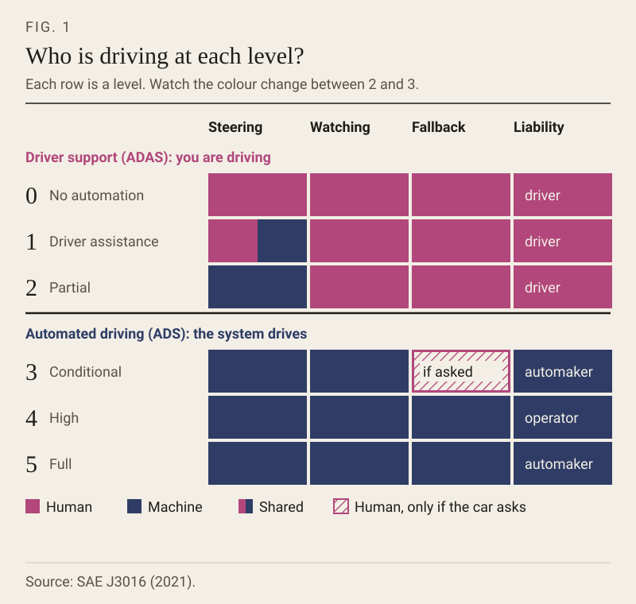

# Diagram Generation Instructions

When asked to create a diagram, chart or figure for a post, follow these rules.

## 1. Pick a tool you can check
Any tool is fine **as long as you can render its output, look at it, and fix your own mistakes**:

* **Hand-written or generated SVG** (preferred for custom figures: timelines, maps, scales, grids). Write a small generator script in `scripts/diagrams/` so the figure can be edited and regenerated later. Example: `scripts/diagrams/six_levels_figures.py`.
* **draw.io**: keep the `.drawio` source next to the exported `.svg` in `assets/images/diagrams/`.
* **Mermaid / Graphviz / PlantUML via Kroki**: fine for flowcharts and sequence diagrams. Generate the URL with `scripts/generate_kroki_url.py` (zlib + URL-safe Base64, pattern `https://kroki.io/{type}/svg/{encoded}`), then **download the SVG into `assets/images/diagrams/`** instead of hotlinking, so it can be checked and does not break if Kroki is down.
* **Mermaid code blocks** in a post also render live (the loader is in `_includes/head.html`). Set `fontSize` to at least `18px` in the Mermaid config for anything new.

Do not use a tool whose output you cannot render and inspect.

## 2. Check every figure before you finish (required)
Run the checker on each SVG:

```
node scripts/diagrams/render.js assets/images/diagrams/my-figure.svg
```

It renders the SVG at the real post width (800px), saves a PNG to `scripts/diagrams/out/`, and fails on:
* text rendered smaller than 18px
* text running outside the image
* text overlapping other text
* text crossed by a line or path

Fix and re-run until every file prints `ok`. Then **open the PNG and look at it**: the checker cannot see awkward spacing, empty areas, unclear meaning or ugly composition.

## 3. Size and readability
* **Width**: use `viewBox="0 0 800 H"` and `width="100%"`. The post column is about 800px wide on desktop, so 1 unit = 1 screen pixel and the font sizes you write are the sizes readers see.
* **Minimum text size: 18px** (Gmail's "Large" setting). This applies to every label, key, footnote and source line. Titles about 30px, emphasised numbers 24 to 26px.
* If text does not fit, **cut words or change the layout** (stack vertically, transpose a table, move detail into the post's caption). Never shrink the text.
* Phones scale the whole image down, so keep figures simple and avoid long paragraphs inside them.

## 4. Avoid the "AI-generated" look
See https://dev.to/alanwest/how-to-fix-the-ai-generated-look-in-your-frontend-1ahh. The look comes from defaults, so do not use them:
* **No Tailwind default palette** (slate/indigo/emerald/rose/violet hex values such as `#0f172a`, `#1e293b`, `#34d399`, `#f43f5e`, `#a78bfa`), no dark-navy card backgrounds, no purple-to-blue gradients, no glows or drop shadows.
* **No rounded cards, pill badges or emoji icons.** Use square corners, thin rules and plain labels.
* **Use the curated site palettes** (cream paper `#f4f1e6`, solid ink `#141414` / `#1f1d1a`, rules `#cfc6b6`). Every diagram, chart, or figure MUST select exactly ONE of the 6 approved palette groups (max 3 accent/categorical colors per figure):
  1. **Muted Primaries:** Terracotta `#b84d43`, Slate Ink `#2d4763`, Ochre Gold `#cfa14a`
  2. **Muted Botanical:** Deep Pine `#1b3b2b`, Sage Moss `#3d634e`, Sand Champagne `#cbb87b`
  3. **Muted Risograph:** Aubergine Plum `#38233f`, Dusty Lavender `#6d597a`, Curry Mustard `#d99b26`
  4. **Stripe Modernist:** Stripe Navy `#0a2540`, Blurple `#635bff`, Soft Coral `#ff705a`
  5. **IBM Carbon:** Carbon Gray 100 `#121619`, Carbon Blue 60 `#0f62fe`, Teal 50 `#009d9a`
  6. **Google M3 Tonal:** Royal Blue `#1a73e8`, Brick Red `#b3261e`, Warm Amber `#f59e0b`
* **Universal Black & White Rule**: Black (`#141414` / `#1f1d1a`) and White (`#ffffff` / paper `#f4f1e6`) are universal foundation colors. An all black-and-white figure or diagram is completely acceptable. Adding black or white to any selected color palette for borders, line strokes, or fills is always permitted and does not count against the 3-color palette limit.
* **Color Addition Guardrail (STRICT)**: If an agent runs out of colors or needs additional categorical series while making a chart or SVG, **NEVER invent or add new colors**. You MUST alert Richard directly to request guidance or palette expansion.
* **Typography**: serif title (`Georgia, 'Times New Roman', serif`), system sans for labels.
* **Layout**: a "FIG. n" label, a left-aligned title with a rule under it, and a source line at the bottom. Avoid centred grids of identical boxes.
* **Let shape carry meaning, not only colour**: hatching, marker shapes (square, circle, triangle), dashed lines and transit-map conventions. This also helps colour-blind readers.

## 5. Content rules
* Follow `.agent/workflows/writing-style.md` inside figures too: **no em dashes or en dashes** (write "4.5 to 6 s", not "4.5–6 s") and no questions aimed at the reader.
* **Mandatory Watermark**: Every SVG diagram MUST include the `rdjarbeng.com` watermark at the bottom right (`text-anchor="end"`, `x="768"` on an 800px wide canvas, `fill="#57514a"`, font-size `18px`, font-weight bold).
* Every SVG needs `role="img"`, a `<title>` and a `<desc>` that states what the figure shows, so screen readers get the same information.
* Every fact in a figure must also be supported by the post text or its sources.

## 6. Embedding
Use standard Markdown image syntax with meaningful alt text, followed by an italic caption that tells the reader what to notice:

```markdown

*Most of the change happens between Level 2 and Level 3.*
```
