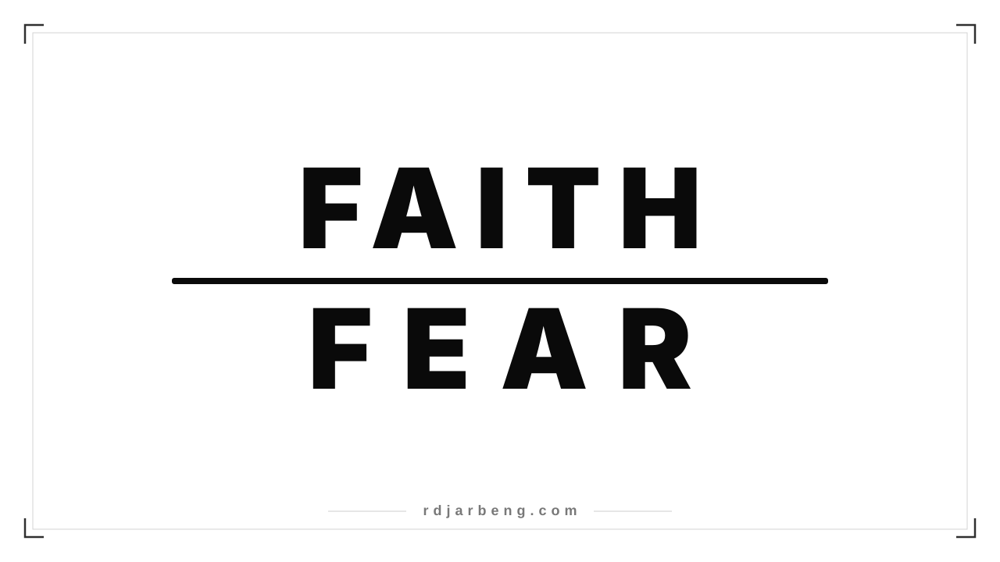
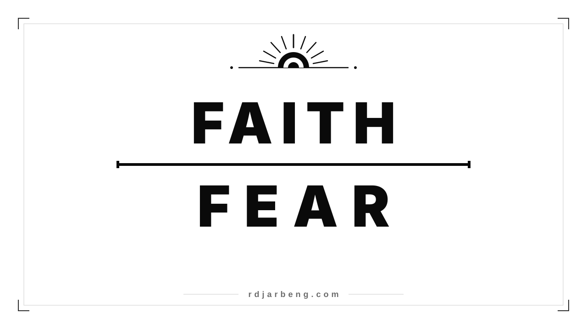
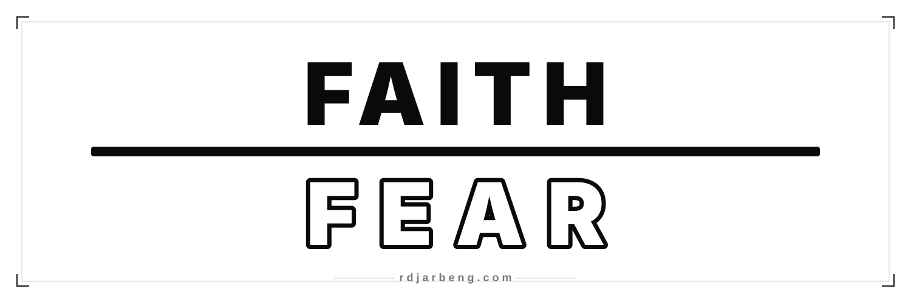
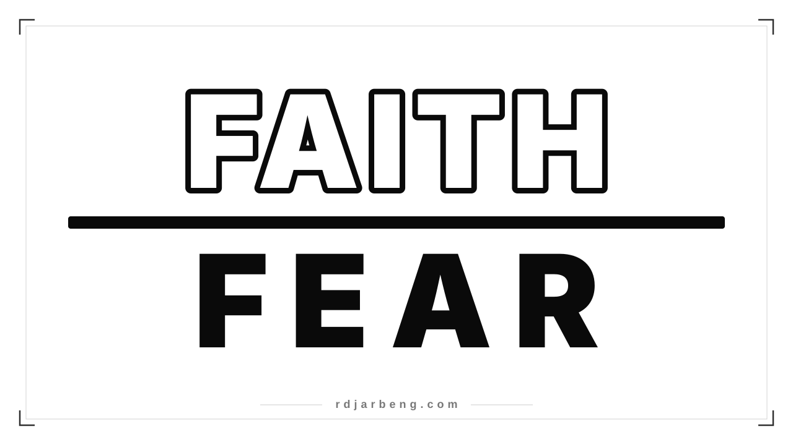
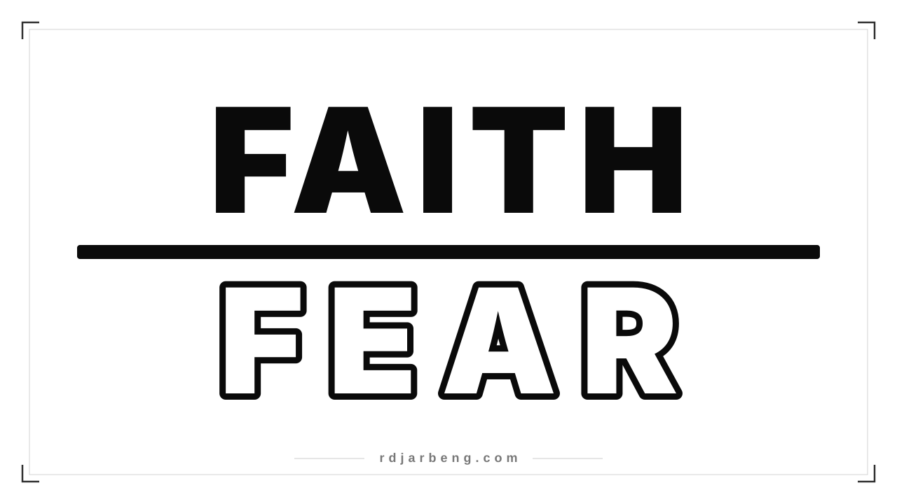

A minimalist editorial vector banner study on the concept of **Faith over Fear**, exploring architectural typography, line weight, and contrast to symbolize substance, conviction, and triumph over uncertainty.

This piece was designed and authored by **Richard Djarbeng (rdjarbeng)** specifically for **[rdjarbeng.com](https://rdjarbeng.com)**.

All variations are rendered below directly as native, resolution-independent **SVG vector graphics** that scale losslessly on retina and 4K screens.

---

### Design Evolution & Version History

This series progressed through several deliberate design stages to reach its final balance:

1. **Phase 1: Initial Typographic Alignment**
   * Exploration of the fractional motif: placing **FAITH** above and **FEAR** below, with a horizontal rule replacing the word "over".
   * Optical kerning was matched across both words so the 5 letters of FAITH and the 4 letters of FEAR shared a harmonious horizontal footprint.
   
   

2. **Phase 2: Symbolic Editorial Motifs**
   * Introduction of geometric line art emblems to reinforce the message.
   * Created the **Radiant Dawn** edition featuring an upward sunrise burst, and the **Swiss Classic** edition featuring an apex compass star and diamond center rule.
   
   
   
   

3. **Phase 3: Panoramic Format Adaptations**
   * Expanded the composition into an ultra-wide 3:1 aspect ratio (1500×500).
   * Tuned specifically for website header banners, GitHub profile covers, and social hero headers.
   
   

4. **Phase 4: Bold Weight & Scale Escalation**
   * Scaled the typography significantly up to 208px font size to command the canvas.
   * Replaced the fine hairline divider with a substantial, confident 20px architectural threshold bar.
   * Explored body contrast with an inverted study (illuminated white-body FAITH with solid black FEAR).
   
   

5. **Phase 5: Final Contrast Refinement**
   * Exchanged the body styles to reflect the underlying philosophy.
   * **FAITH** is anchored in solid, resolute black ink to convey weight and presence.
   * **FEAR** is rendered with a pure white body and a bold black perimeter outline, visually expressing that fear is hollowed out and subordinated beneath faith.
   
   

---

### 1. Bold Master Banner (16:9)

The primary layout: solid filled black **FAITH** on top, an authoritative 20px dividing threshold bar replacing the word "over", and a white-body black-outlined **FEAR** below.

* **Dimensions**: 1280×720 (16:9 ratio)
* **Formats**: [Vector SVG](/assets/images/faith-over-fear-banner.svg) · [Rendered JPG](/assets/images/faith-over-fear-banner.jpg)

---

### 2. Panoramic Header (3:1 Ultra-Wide)

Proportioned specifically for website hero headers, GitHub profile banners, and Twitter/X headers. Features an elongated 16px dividing bar and wide optical tracking.

* **Dimensions**: 1500×500 (3:1 ratio)
* **Formats**: [Vector SVG](/assets/images/faith-over-fear-panorama.svg) · [Rendered JPG](/assets/images/faith-over-fear-panorama.jpg)

---

### 3. Radiant Dawn Edition (16:9)

Features an editorial geometric rising sun and upward dawn rays positioned above **FAITH**, visually reinforcing faith as a rising dawn that dispels uncertainty.

* **Dimensions**: 1280×720 (16:9 ratio)
* **Formats**: [Vector SVG](/assets/images/faith-over-fear-radiant.svg) · [Rendered JPG](/assets/images/faith-over-fear-radiant.jpg)

---

### 4. Swiss Minimalist Classic (16:9)

A clean, monolithic Swiss typographic study with an apex compass star motif, balanced horizontal rules, and subtle geometric diamond anchoring.

* **Dimensions**: 1280×720 (16:9 ratio)
* **Formats**: [Vector SVG](/assets/images/faith-over-fear-classic.svg) · [Rendered JPG](/assets/images/faith-over-fear-classic.jpg)

---

### 5. Inverted Contrast Edition (16:9)

Inverts the typographic body contrast: illuminated white-body **FAITH** on top with a crisp black contour, set above a solid black **FEAR** beneath the dividing threshold.

* **Dimensions**: 1280×720 (16:9 ratio)
* **Formats**: [Vector SVG](/assets/images/faith-over-fear-inverted.svg) · [Rendered JPG](/assets/images/faith-over-fear-inverted.jpg)
