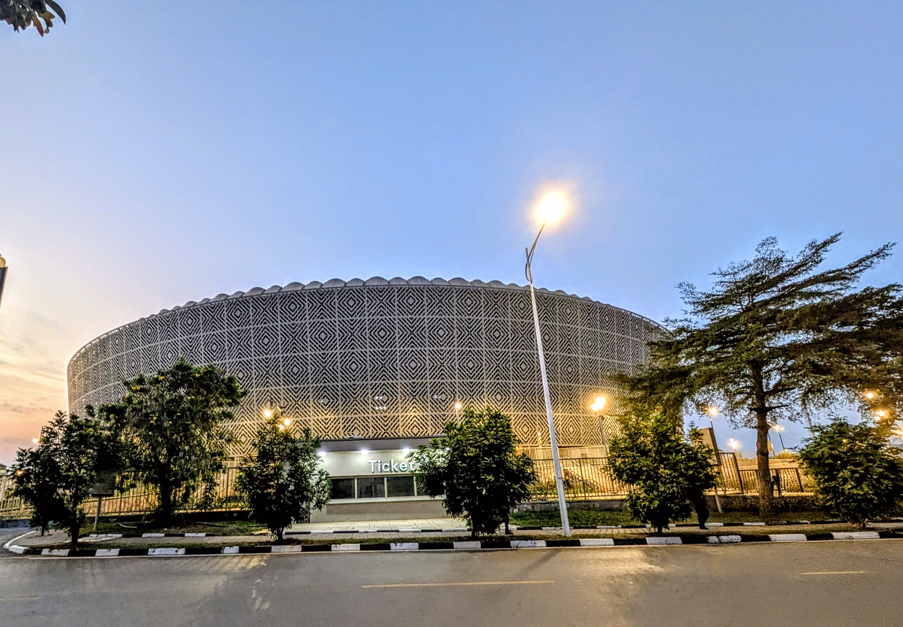
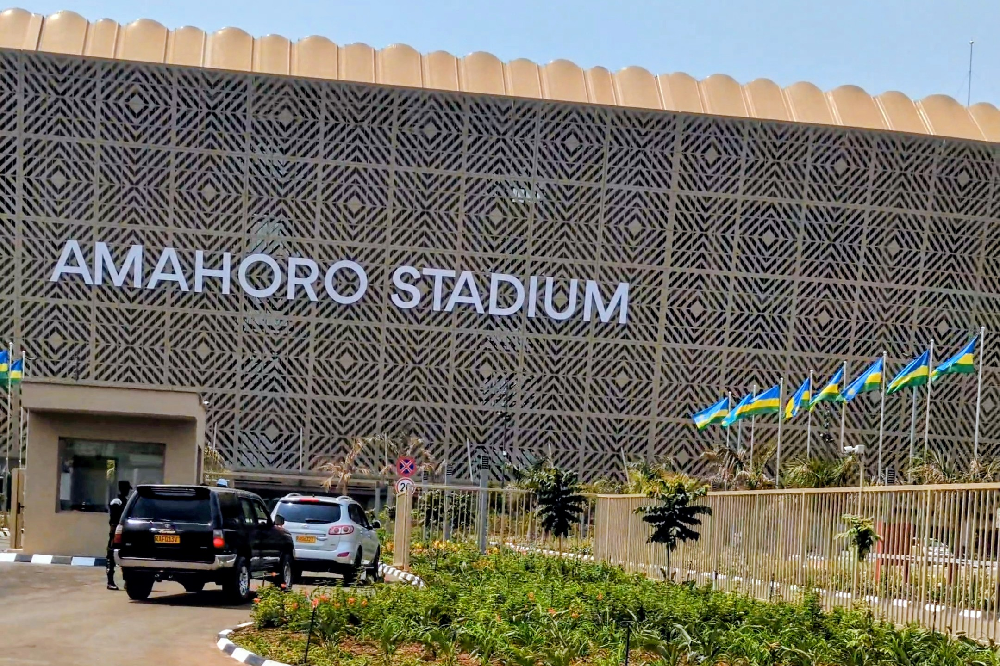

The renovations on Amahoro Stadium are finally done, so I put together a quick video showing what the building looks like from the outside. If you have spent any time in Kigali, you have probably noticed the massive, basket-shaped roofline in the distance.

_(It looks even larger in person when you are standing right outside the gates.)_

## A quick rundown

The 45,000-seat stadium is located in Remera. It hosts matches for local football clubs like APR FC and Rayon Sports, as well as major national events like the presidential inauguration.

The woven basket exterior draws directly from Rwandan basket-weaving traditions. If you want to know more about the background behind the design, I wrote earlier about the [baskets in Gasabo District](https://rdjarbeng.com/personal/gasabo_basket/) and how common that motif is across the country.

Right next door is BK Arena, which hosts indoor basketball games and concerts.

## Watch the video

Here is the video of the stadium from the outside:

  <iframe
    src="https://www.youtube.com/embed/jiec7XXD6EY"
    title="Why is there a giant basket on this building? Amahoro Stadium Tour"
    frameborder="0"
    allow="accelerometer; autoplay; clipboard-write; encrypted-media; gyroscope; picture-in-picture; web-share"
    referrerpolicy="strict-origin-when-cross-origin"
    allowfullscreen
    style="position: absolute; top: 0; left: 0; width: 100%; height: 100%;">
  </iframe>

I do not have footage of the interior yet, but I hope to put together a post on the inside later.

Music in the video: [3Kota: Si Yab Tumpa (Official Audio)](https://www.youtube.com/watch?v=7qL4BmTQkrc).
