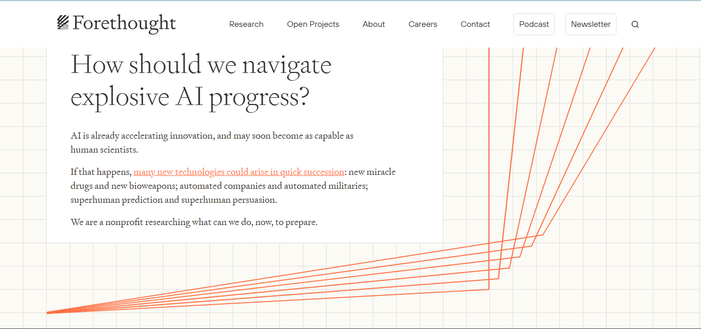

I find it interesting how there seems to be two camps when it comes to what AI can do or will do. There is the "AI could never camp" where they claim that there is so much potential or innovation of the human mind that there is no chance for AI to supersede it. Then there is the "AI will or has" camp that says that AI has already surpassed humans in a lot of endeavors, and it's only a matter of time before it surpasses our best minds. And they are already convinced that the future is already going to be determined by AI, and that humans will probably have to find something else to do. And I find this interesting because the two camps don't seem to talk or don't seem convinced that the others' thoughts or concerns are actually true. And mostly you find this groupings in the two camps, the first camp that says AI would never is mostly workers and people who work with their hands or the general public. And the second one that says AI can or will, and it's only a matter of time, are mostly academics and people working in AI research who seem to all be about doomerism, saying that it's only a matter of time before AGI arrives and makes renders all of us useless.

For instance on this site:

https://www.forethought.org/

Their opening statement on the homepage on 28th Nov, 2026 is:

How should we navigate explosive AI progress?
AI is already accelerating innovation, and may soon become as capable as human scientists

Interesting website where they believe:

AI systems might soon be much more capable than humans, [quickly leading](https://www.forethought.org/preparing-for-the-intelligence-explosion) to rapid technological progress. Even if AI systems were aligned, we might face AI-enabled autocracies, races to grab offworld resources, and conundrums about how to treat digital minds, as well as opportunities to dramatically improve quality of life and collective decision-making.

In other news: Future of Humanity Institute (FHI) at the University of Oxford closed on 16 April 2024. Not looking good when the people concerned with our future as a species is already shut down. Is this a sign?

While researching for this post I found out there's actually something called Futurology, devoted to the field of Future(s) Studies and evidence-based speculation about the development of humanity, technology, and civilization.

They even have a subreddit: [https://www.reddit.com/r/Futurology/](https://www.reddit.com/r/Futurology/)
