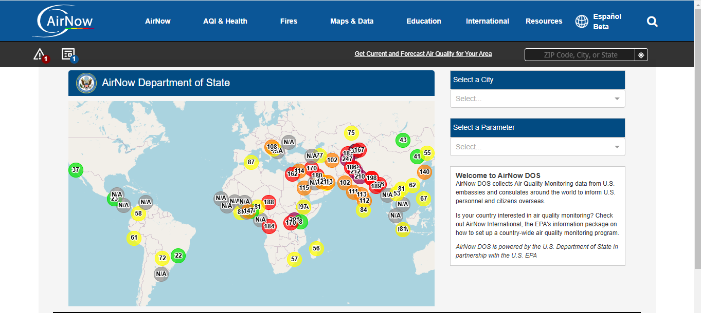

None of the West African ambient air standards I could verify sets a limit for fine particles (PM2.5), and the coarser particle (PM10) limits that do exist are 3 to 5 times the World Health Organization (WHO) guideline. This post collects the limits I could check against a primary source or a peer-reviewed compilation, so you can compare countries side by side and follow each number back to where it came from.

**Update (November 2026):** I revised this post to make it usable as a reference. It now has a table of national limits with a source for every value, the WHO 2021 guidelines as a comparison row, and a corrected entry for Côte d'Ivoire, which the source review lists as having no national standard. I removed general claims I could not source, fixed reference links that pointed to the wrong papers, and replaced the AirNow link, which now returns an error.

## Global air quality standards

The United Nations Environment Programme (UNEP) assessed air pollution laws worldwide in its report [Regulating Air Quality: the First Global Assessment of Air Pollution Legislation](https://www.unep.org/resources/report/regulating-air-quality-first-global-assessment-air-pollution-legislation). It states:

> "While ambient air quality is monitored in many countries, this is not a legal requirement in at least 37 per cent of countries. In countries where monitoring is framed in legislation, important questions arise about the rigour of monitoring, as well as issues of capacity"

The same report describes the role of the WHO guidelines, which is why they serve as the comparison row in the table below:

> "The primary global guidance on air quality is scientific, as provided by the World Health Organization (WHO) air quality guideline values for ambient air quality. These guideline values are not intended to be binding upon States, but they reflect a high degree of scientific consensus, giving them global authority."

## National ambient limits compared with WHO 2021

All values are in µg/m³. A dash means the instrument or compilation gives no value for that pollutant and averaging period.

| Country | Pollutant | Limit (µg/m³) | Averaging period | Instrument and year | Source |
|---|---|---|---|---|---|
| WHO (guideline, not binding) | PM2.5 | 5 | Annual | WHO global air quality guidelines, 2021 | [WHO](https://www.who.int/publications/i/item/9789240034228) |
| WHO (guideline, not binding) | PM2.5 | 15 | 24 hours | WHO global air quality guidelines, 2021 | [WHO](https://www.who.int/publications/i/item/9789240034228) |
| WHO (guideline, not binding) | PM10 | 15 | Annual | WHO global air quality guidelines, 2021 | [WHO](https://www.who.int/publications/i/item/9789240034228) |
| WHO (guideline, not binding) | PM10 | 45 | 24 hours | WHO global air quality guidelines, 2021 | [WHO](https://www.who.int/publications/i/item/9789240034228) |
| WHO (guideline, not binding) | NO2 | 10 | Annual | WHO global air quality guidelines, 2021 | [WHO](https://www.who.int/publications/i/item/9789240034228) |
| WHO (guideline, not binding) | NO2 | 25 | 24 hours | WHO global air quality guidelines, 2021 | [WHO](https://www.who.int/publications/i/item/9789240034228) |
| WHO (guideline, not binding) | SO2 | 40 | 24 hours | WHO global air quality guidelines, 2021 | [WHO](https://www.who.int/publications/i/item/9789240034228) |
| Nigeria | PM2.5 | - | - | National Environmental (Air Quality Control) Regulations, 2020, Schedule XIII | [NESREA](https://nesrea.gov.ng/wp-content/uploads/2025/05/NATIONAL_ENVIRONMENTAL_AIR_QUALITY_CONTROL_REGULATIONS_CURRENT_AMENDED.pdf) |
| Nigeria | PM10 | 60 | Annual | National Environmental (Air Quality Control) Regulations, 2020, Schedule XIII | [NESREA](https://nesrea.gov.ng/wp-content/uploads/2025/05/NATIONAL_ENVIRONMENTAL_AIR_QUALITY_CONTROL_REGULATIONS_CURRENT_AMENDED.pdf) |
| Nigeria | PM10 | 150 | 24 hours | National Environmental (Air Quality Control) Regulations, 2020, Schedule XIII | [NESREA](https://nesrea.gov.ng/wp-content/uploads/2025/05/NATIONAL_ENVIRONMENTAL_AIR_QUALITY_CONTROL_REGULATIONS_CURRENT_AMENDED.pdf) |
| Nigeria | NO2 | 80 | Annual | National Environmental (Air Quality Control) Regulations, 2020, Schedule XIII | [NESREA](https://nesrea.gov.ng/wp-content/uploads/2025/05/NATIONAL_ENVIRONMENTAL_AIR_QUALITY_CONTROL_REGULATIONS_CURRENT_AMENDED.pdf) |
| Nigeria | NO2 | 120 | 24 hours | National Environmental (Air Quality Control) Regulations, 2020, Schedule XIII | [NESREA](https://nesrea.gov.ng/wp-content/uploads/2025/05/NATIONAL_ENVIRONMENTAL_AIR_QUALITY_CONTROL_REGULATIONS_CURRENT_AMENDED.pdf) |
| Nigeria | NO2 | 200 | 1 hour | National Environmental (Air Quality Control) Regulations, 2020, Schedule XIII | [NESREA](https://nesrea.gov.ng/wp-content/uploads/2025/05/NATIONAL_ENVIRONMENTAL_AIR_QUALITY_CONTROL_REGULATIONS_CURRENT_AMENDED.pdf) |
| Nigeria | SO2 | 80 | Annual | National Environmental (Air Quality Control) Regulations, 2020, Schedule XIII | [NESREA](https://nesrea.gov.ng/wp-content/uploads/2025/05/NATIONAL_ENVIRONMENTAL_AIR_QUALITY_CONTROL_REGULATIONS_CURRENT_AMENDED.pdf) |
| Nigeria | SO2 | 120 | 24 hours | National Environmental (Air Quality Control) Regulations, 2020, Schedule XIII | [NESREA](https://nesrea.gov.ng/wp-content/uploads/2025/05/NATIONAL_ENVIRONMENTAL_AIR_QUALITY_CONTROL_REGULATIONS_CURRENT_AMENDED.pdf) |
| Nigeria | SO2 | 350 | 1 hour | National Environmental (Air Quality Control) Regulations, 2020, Schedule XIII | [NESREA](https://nesrea.gov.ng/wp-content/uploads/2025/05/NATIONAL_ENVIRONMENTAL_AIR_QUALITY_CONTROL_REGULATIONS_CURRENT_AMENDED.pdf) |
| Senegal | PM10 | 80 | Annual | Norme Sénégalaise, 2003 | [Mir Alvarez et al. 2020, Table 4](https://pmc.ncbi.nlm.nih.gov/articles/PMC7730241/) |
| Senegal | PM10 | 260 | 24 hours | Norme Sénégalaise, 2003 | [Mir Alvarez et al. 2020, Table 4](https://pmc.ncbi.nlm.nih.gov/articles/PMC7730241/) |
| Benin | PM10 | 50 | Annual | Décret 2001-110, 2001 | [Mir Alvarez et al. 2020, Table 4](https://pmc.ncbi.nlm.nih.gov/articles/PMC7730241/) |
| Benin | PM10 | 230 | 24 hours | Décret 2001-110, 2001 | [Mir Alvarez et al. 2020, Table 4](https://pmc.ncbi.nlm.nih.gov/articles/PMC7730241/) |

Notes on the table:

- **WHO:** The 24-hour values are 99th percentile levels, which allow 3 to 4 days above the level per year.
- **Nigeria:** The NESREA document is the amended 2020 version of the regulations first issued in 2014 as S.I. No. 64. Its ambient schedule has no PM2.5 row.
- **Senegal and Benin:** Mir Alvarez et al. list no PM2.5 limit for either country. They also note that Benin's 2001 standards "have yet to be promulgated", so treat Benin's values as adopted on paper but not confirmed as in force.
- **Burkina Faso:** The same review lists Décret n°2001-185 (2001) but gives a single particulate range of 200 to 300 µg/m³ with no particle size or averaging period, so I left it out of the table.
- **Ghana:** Ghana's limits are set in GS 1236:2019, *Environment and Health Protection: Requirements for Ambient Air Quality and Point Source/Stack Emissions*, published by the Ghana Standards Authority. I could not open a readable copy of its ambient table, so its values are not in the table yet.

## What the table shows

No country in the table sets a PM2.5 limit. Where PM10 limits exist, the annual values (50 to 80 µg/m³) are 3 to 5 times the WHO 2021 guideline of 15 µg/m³. Nigeria's annual NO2 limit of 80 µg/m³ is 8 times the WHO guideline of 10 µg/m³.

Two consequences follow for anyone comparing countries. First, a city can meet its national standard and still have air far above the WHO guideline, so "compliant" in a national report does not mean safe by WHO terms. Second, the Senegal and Benin instruments date from 2001 to 2003, before the WHO lowered its guidelines in 2021, so the gap partly reflects their age. Nigeria's 2020 regulations are the only instrument in the table newer than the 2020 review, and they still omit PM2.5.

**Coverage and date.** Except for Nigeria, whose regulations I read directly, the status of each country comes from the review by Mir Alvarez et al., published in December 2020. I have not confirmed whether Senegal, Benin, Côte d'Ivoire or other countries adopted new instruments after that date. If you cite a row, check the national environment agency for a newer version first.

## Countries with no national standard

According to the scoping review by [Mir Alvarez et al. (December 2020)](https://pmc.ncbi.nlm.nih.gov/articles/PMC7730241/):

- **Côte d'Ivoire** "does not currently have national standards" for ambient air quality and uses the WHO guidelines as a reference. An earlier version of this post wrongly said it had national standards.
- **Guinea**, citing an earlier study by Schwela, has no official criteria for regulating and managing air quality.
- For **Cabo Verde, Guinea-Bissau and Sierra Leone**, the review found little or no information, so their status is unknown rather than confirmed absent.

The review does not state the status of The Gambia, Liberia, Mali, Niger or Togo.

## Air quality data platforms

Earlier versions of this post pointed to the U.S. Embassy monitors on AirNow. That page now returns an error. The [Centre for Research on Energy and Clean Air](https://energyandcleanair.org/us-embassy-aq-data-halt/) reports that AirNow's embassy data went offline on 4 March 2025, and that the State Department then said it would stop sharing embassy data, citing funding constraints. Here is a screenshot of the airnow map when it was operational.

[OpenAQ](https://openaq.org/) is a free alternative. It is a nonprofit that publishes air quality measurements from many countries through a map and an open API.

### References

1. Mir Alvarez, C., Hourcade, R., Lefebvre, B. and Pilot, E. (2020). **A Scoping Review on Air Quality Monitoring, Policy and Health in West African Cities**. *International Journal of Environmental Research and Public Health*, 17(23), 9151. [PMC7730241](https://pmc.ncbi.nlm.nih.gov/articles/PMC7730241/)
2. National Environmental Standards and Regulations Enforcement Agency (NESREA). **National Environmental (Air Quality Control) Regulations, 2020** (amended). [NESREA PDF](https://nesrea.gov.ng/wp-content/uploads/2025/05/NATIONAL_ENVIRONMENTAL_AIR_QUALITY_CONTROL_REGULATIONS_CURRENT_AMENDED.pdf)
3. World Health Organization (2021). **WHO global air quality guidelines: particulate matter (PM2.5 and PM10), ozone, nitrogen dioxide, sulfur dioxide and carbon monoxide**. [WHO](https://www.who.int/publications/i/item/9789240034228)
4. United Nations Environment Programme (2021). **Regulating Air Quality: the First Global Assessment of Air Pollution Legislation**. [UNEP](https://www.unep.org/resources/report/regulating-air-quality-first-global-assessment-air-pollution-legislation)
5. **A review on ambient and indoor air pollution status in Africa**. *Atmospheric Pollution Research* (2021). [doi:10.1016/j.apr.2020.11.006](https://doi.org/10.1016/j.apr.2020.11.006)
6. **Ambient air pollution and health in Sub-Saharan Africa: Current evidence, perspectives and a call to action**. *Environmental Research*, 173 (2019). [doi:10.1016/j.envres.2019.03.029](https://doi.org/10.1016/j.envres.2019.03.029)
7. **Air quality management strategies in Africa: A scoping review of the content, context, co-benefits and unintended consequences**. *Environment International*, 171 (2023). [doi:10.1016/j.envint.2022.107709](https://doi.org/10.1016/j.envint.2022.107709)
8. Odubanjo, D. A. (2022). **Air Quality and Health in West Africa**. In *Air Quality and Health*, IntechOpen. [IntechOpen](https://www.intechopen.com/chapters/80743)
9. Centre for Research on Energy and Clean Air (2025). **U.S. embassy AQ data halt**. [CREA](https://energyandcleanair.org/us-embassy-aq-data-halt/)
