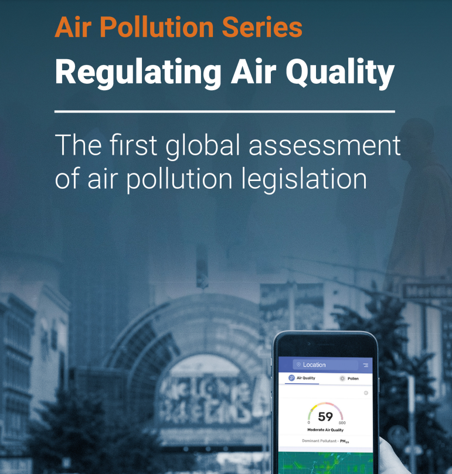

Seven West African countries have air quality limits written into law, according to a 2022 list from the Health Effects Institute. They are Benin, Burkina Faso, Côte d'Ivoire, The Gambia, Ghana, Nigeria and Senegal. Three of them, Senegal, Ghana and Côte d'Ivoire, also set a limit for fine particles (PM2.5), which reach deep into the lungs, as the [PM2.5 explainer](/what-is-particulate-matter-pm2.5-and-the-environmental-significance/) describes. Ghana's figure comes from a news report of an EPA statement, not from the standard text. Ghana passed new air quality management regulations in 2025 that require vehicle emission testing, and monitoring networks are growing in Accra, Dakar and Lagos. The limits are still looser than the World Health Organization (WHO) guidelines, and several countries have no national standard yet.

## What an air quality standard does

An ambient air quality standard is a legal limit on how much of a pollutant may be in the outdoor air. "Ambient" simply means the outdoor air everyone shares, as opposed to the air inside a factory chimney or a home.

A standard does three jobs. It fixes the level of pollution a government commits to keeping the air below. It gives regulators a legal trigger to act when a city goes above that level, for example by restricting a polluting factory. It also gives citizens and journalists a number to hold the government to. Without a standard, there is no official line to cross, so there is nothing to enforce.

The United Nations Environment Programme (UNEP) assessed air pollution laws worldwide in its report [Regulating Air Quality: the First Global Assessment of Air Pollution Legislation](https://www.unep.org/resources/report/regulating-air-quality-first-global-assessment-air-pollution-legislation). It found that many countries do not even require monitoring by law. Without monitoring, even a good standard cannot be checked:

> "While ambient air quality is monitored in many countries, this is not a legal requirement in at least 37 per cent of countries. In countries where monitoring is framed in legislation, important questions arise about the rigour of monitoring, as well as issues of capacity"

## What the WHO recommends

The WHO publishes air quality guidelines. A guideline is a recommendation based on health evidence. A standard is a limit a country writes into its own law. The WHO guideline binds no one, but the UNEP report explains why it is the usual benchmark:

> "The primary global guidance on air quality is scientific, as provided by the World Health Organization (WHO) air quality guideline values for ambient air quality. These guideline values are not intended to be binding upon States, but they reflect a high degree of scientific consensus, giving them global authority."

The [WHO global air quality guidelines of 2021](https://www.who.int/publications/i/item/9789240034228) give limits in micrograms per cubic metre, written µg/m³. A microgram is a millionth of a gram. So 15 µg/m³ means 15 millionths of a gram of pollutant in a cube of air one metre on each side.

Each limit also has an averaging period. This is the length of time over which the concentration is averaged before comparing it with the limit. An annual limit covers the average over a whole year and protects against long-term exposure. A 24-hour limit covers the average over one day and protects against short, severe episodes such as a harmattan dust day.

The pollutants in this post are PM2.5, PM10, nitrogen dioxide (NO2) and sulfur dioxide (SO2). For how these readings become a single daily score, see [Understanding the Air Quality Index](/understanding-the-air-quality-index-aqi/).

## What exists today

Two tables follow: the first compares each country's legal limits for particles (PM2.5 and PM10) with the WHO 2021 guidelines, the second does the same for gases. All values are in µg/m³. The "How it compares" column shows how many times higher the national limit is than the WHO guideline for the same averaging period. A country appears only where a published source gives its values.

*Particle limits as times the WHO 2021 guideline, from the table below. Sources are listed under the table.*

### Particles

| Country | Pollutant | Averaging period | National limit | WHO 2021 guideline | How it compares |
|---|---|---|---|---|---|
| Côte d'Ivoire | PM2.5 | Annual | 25 | 5 | 5 times |
| Côte d'Ivoire | PM2.5 | 24 hours | No limit listed | 15 | Not regulated |
| Ghana | PM2.5 | 24 hours | 35 | 15 | 2.3 times |
| Nigeria | PM2.5 | Any | No limit in the 2020 regulations | 5 (annual), 15 (24 hours) | Not regulated |
| Senegal | PM2.5 | Annual | 25 | 5 | 5 times |
| Senegal | PM2.5 | 24 hours | 75 | 15 | 5 times |
| Benin | PM2.5 | Any | No limit | 5 (annual), 15 (24 hours) | Not regulated |
| Côte d'Ivoire | PM10 | Annual | 40 | 15 | 2.7 times |
| Côte d'Ivoire | PM10 | 24 hours | 50 | 45 | 1.1 times |
| Nigeria | PM10 | Annual | 60 | 15 | 4 times |
| Nigeria | PM10 | 24 hours | 150 | 45 | 3.3 times |
| Senegal | PM10 | Annual | 40 | 15 | 2.7 times |
| Senegal | PM10 | 24 hours | 150 | 45 | 3.3 times |
| Benin | PM10 | Annual | 50 | 15 | 3.3 times |
| Benin | PM10 | 24 hours | 230 | 45 | 5.1 times |

Sources: Senegal, NS 05-062 as revised in 2019, from [Table 2 of Sow et al. (2021)](https://www.scirp.org/journal/paperinformation?paperid=108037), citing Senegal's air quality management centre. Côte d'Ivoire, Décret n°2017-125 of 22 February 2017, as tabulated in [Table 2 of Yapo et al. (2025)](https://www.scirp.org/pdf/gep_2173457.pdf). Ghana, the [EPA statement reported by MyJoyOnline (30 June 2026)](https://www.myjoyonline.com/air-pollution-exceeds-epas-own-standards-across-most-of-ghana-authority-reveals/). Nigeria, [NESREA](https://nesrea.gov.ng/wp-content/uploads/2025/05/NATIONAL_ENVIRONMENTAL_AIR_QUALITY_CONTROL_REGULATIONS_CURRENT_AMENDED.pdf) (Schedule XIII). Senegal (Norme Sénégalaise, 2003) and Benin (Décret 2001-110, 2001), [Mir Alvarez et al. 2020, Table 4](https://pmc.ncbi.nlm.nih.gov/articles/PMC7730241/). WHO, [WHO 2021 guidelines](https://www.who.int/publications/i/item/9789240034228).

### Gases

| Country | Pollutant | Averaging period | National limit | WHO 2021 guideline | How it compares |
|---|---|---|---|---|---|
| Côte d'Ivoire | NO2 | Annual | 40 | 10 | 4 times |
| Côte d'Ivoire | SO2 | 24 hours | 125 | 40 | 3.1 times |
| Nigeria | NO2 | Annual | 80 | 10 | 8 times |
| Nigeria | NO2 | 24 hours | 120 | 25 | 4.8 times |
| Nigeria | NO2 | 1 hour | 200 | Not compared in this post | Not compared |
| Nigeria | SO2 | Annual | 80 | Not compared in this post | Not compared |
| Nigeria | SO2 | 24 hours | 120 | 40 | 3 times |
| Nigeria | SO2 | 1 hour | 350 | Not compared in this post | Not compared |

Sources: [Yapo et al. (2025)](https://www.scirp.org/pdf/gep_2173457.pdf) for Côte d'Ivoire, [NESREA](https://nesrea.gov.ng/wp-content/uploads/2025/05/NATIONAL_ENVIRONMENTAL_AIR_QUALITY_CONTROL_REGULATIONS_CURRENT_AMENDED.pdf) for Nigeria and the [WHO 2021 guidelines](https://www.who.int/publications/i/item/9789240034228). The rows marked "not compared" are periods for which this post does not quote a WHO value.

### What the tables show

Côte d'Ivoire's 2017 decree is the most complete particle standard in the tables. It covers PM2.5 and PM10, and its daily PM10 limit of 50 is close to the WHO level of 45. Ghana's 35 µg/m³ PM2.5 limit is 2.3 times the WHO daily level, the smallest gap among the PM2.5 limits. Senegal's 2019 PM2.5 limits are 5 times the WHO levels. Nigeria and Benin set PM10 limits that are 3 to 6 times the WHO guideline, and neither has a PM2.5 limit in the published sources.

### Compliant is not the same as safe

A limit that is higher than the WHO guideline still has a use. Take Senegal as an example. A day with 140 µg/m³ of PM10 is within Senegal's 24-hour limit of 150. The same day is about 3 times the WHO daily level of 45. So a city can meet its national standard and still breathe air far above the WHO guideline. The same holds for Ghana. A day averaging 30 µg/m³ of PM2.5 is within the national limit of 35 but is twice the WHO daily level of 15. When a government report calls a city "compliant", that does not mean the air is safe by WHO terms. A reader can ask which limit the report used.

Part of the gap comes from age. Benin's instrument dates from 2001, long before the WHO lowered its guidelines in 2021. Senegal shows that limits can be tightened: its 2019 revision cut the daily PM10 limit from 260 to 150 µg/m³. The Côte d'Ivoire decree allows its daily PM10 limit to be exceeded up to 35 days a year, according to Yapo et al. The WHO allows 3 to 4 days.

## Country by country

### Countries with limits in law

**Côte d'Ivoire** has Décret n°2017-125 on air quality, dated 22 February 2017. A 2025 study by scientists at the national anti-pollution centre, the Centre Ivoirien Antipollution (CIAPOL), compared Abidjan measurements with the decree's limits. The Health Effects Institute's 2022 list also includes the country. The 2020 review that an earlier version of this post relied on says Côte d'Ivoire has no national standards. The review appears to have missed the decree.

**Ghana** publishes GS 1236:2019, *Environment and Health Protection: Requirements for Ambient Air Quality and Point Source/Stack Emissions*, through the Ghana Standards Authority. Ghana's Environmental Protection Authority (EPA) gives its national PM2.5 limit as 35 µg/m³ over 24 hours. Its statement does not name the instrument. No readable copy of the ambient table was available online, so Ghana's PM10 and gas limits are not in the tables. The EPA's 2018 [Greater Accra Air Quality Management Plan](https://www.epa.gov/system/files/documents/2026-03/greater-accra-region-air-quality-management-plan-25-sept-2018.pdf) mentions an earlier EPA PM10 guideline of 70 µg/m³, set before GS 1236 was published.

**Nigeria** has the most detailed set of gas limits. The National Environmental (Air Quality Control) Regulations, 2020, set ambient limits in Schedule XIII. They are enforced by the National Environmental Standards and Regulations Enforcement Agency (NESREA). The document is the amended version of rules first issued in 2014 as S.I. No. 64. Schedule XIII covers PM10, NO2 and SO2 but has no PM2.5 row. The Air Quality Life Index's [2025 Nigeria fact sheet](https://aqli.epic.uchicago.edu/files/Nigeria%20FactSheet_2025.pdf) refers to a national PM2.5 standard of 20 µg/m³. The regulation text has no PM2.5 row, so the tables show no limit. A journalist can ask NESREA which figure applies.

**Senegal** set its limits in a national standard, the Norme Sénégalaise NS 05-062, first applied in 2003. A 2019 revision tightened them and added PM2.5: 25 µg/m³ as a yearly average and 75 µg/m³ over 24 hours. Daily PM10 went from 260 to 150, and daily SO2 from 125 to 50 ([Sow et al. 2021, Table 2](https://www.scirp.org/journal/paperinformation?paperid=108037)). The 2020 scoping review by [Mir Alvarez et al.](https://pmc.ncbi.nlm.nih.gov/articles/PMC7730241/) still lists the 2003 values.

**Benin** adopted PM10 limits in Décret 2001-110. The same review lists no PM2.5 limit. It also notes that Benin's 2001 standards "have yet to be promulgated", meaning formally published and brought into force. So the limits may exist on paper only, and no agency can enforce them.

**Burkina Faso** has Décret n°2001-185 (2001), according to the review. It gives a single particle range of 200 to 300 µg/m³. It names no particle size and no averaging period, so it cannot be compared directly with the WHO guideline. I left it out of the tables.

**The Gambia** appears on the Health Effects Institute's 2022 list of countries with air quality standards in law. A 2026 [Gambian news report](https://mansabanko.gm/air-pollution-an-urgent-yet-overlooked-health-crisis-in-the-gambia/) says the country has no national ambient standards. The sources disagree, and no Gambian legal text was available online. The status is unclear.

### Countries where standards are being prepared

**Togo** is developing national standards. The coordinator of Togo's Air Quality Project, Lantam Djeri-Wake, was quoted in a [report published on 8 September 2026](https://www.myjoyonline.com/senegal-cape-verde-breathed-unsafe-air-for-more-than-120-days-in-2025-african-2026-report/). The coordinator said the project monitors 11 cities and has developed national standards. Consultations are under way.

**Liberia** had little regulatory activity on urban air pollution in the 2020 review, which noted that the government recognised the need for monitoring. The Clean Air for Liberia project, led by United Methodist University and [announced in February 2025](https://www.myjoyonline.com/fight-against-air-pollution-gets-major-boost-as-epic-awards-8-projects-to-improve-air-quality-monitoring/), aims to push for the country's first national standard.

### Countries with no confirmed standard

**Mali** has two decrees from 2000 and 2001 on pollution control, and fuel standards exist, according to the 2020 review. The sources give no ambient limit values. The review says **Guinea** has no official criteria for regulating air quality, citing an earlier study by Schwela. For **Cabo Verde, Guinea-Bissau, Mauritania, Niger and Sierra Leone**, the sources confirm no standard. Their status is unknown rather than confirmed absent. The Health Effects Institute's 2022 list does not include them, which fits that picture.

Status for Nigeria comes from the regulation text itself. Status for Ghana and Côte d'Ivoire comes from the sources named above. The rest comes from the December 2020 review, the 2022 list and the news reports cited. I have not checked national gazettes for instruments published after those dates.

## What is in progress

### Ghana

Ghana has the most documented set of recent changes. Its EPA says the Air Quality Management Regulations (L.I. 2507) were published in 2025. [Ghana News Agency](https://gna.org.gh/2025/09/air-quality-management-regulations-passed-into-law-epa/) reported on 6 September 2025 that Parliament had passed them. A [July 2026 report](https://www.myjoyonline.com/ghana-epa-honoured-at-africa-clean-air-forum-for-progress-in-tackling-air-pollution/) says they require industries to control emissions and vehicles to undergo emission testing. The same report says Ghana's national air quality standards are under review, informed by data from a new government-owned network in Tema.

The EPA's statement of 30 June 2026 says its network grew from eight regulatory-grade stations in 2005 to 15 regulatory monitors and 28 local sensors. These cover Accra, Tema, Kumasi, Sekondi-Takoradi and Tamale, and were added between 2018 and 2026. The statement also says the Greater Accra Air Quality Management Plan was relaunched in 2024. A Ghana Air Quality Portal streams real-time data. In July 2026, the EPA received an EPIC Air Quality Fund Milestone Award at the Africa Clean Air Forum, one of seven recipients.

In Accra, the [Breathe Accra project](https://www.cleanairfund.org/news-item/accra-breathe-cities/) reported in August 2024 a network of 60 low-cost sensors and three reference monitors. A [May 2026 report](https://www.myjoyonline.com/municipal-assemblies-gain-real-time-pollution-data-as-breathe-accra-expands-air-quality-monitoring-network/) says thirteen municipal assemblies are each receiving three more sensors. The assemblies plan to use local data to enforce bylaws on open burning. The IQAir 2025 report, as [reported on 27 March 2026](https://www.myjoyonline.com/ghanas-air-quality-improves-for-the-first-time-since-2021-country-places-11th-in-africa-iqair-2025-report/), put Ghana's national annual PM2.5 at 21.3 µg/m³, down from 35.8 in 2024. That is still more than four times the WHO annual guideline of 5.

### Senegal and Nigeria

Senegal set up its air quality management centre in 2009 with World Bank support, according to [a study by staff of the centre](https://www.scirp.org/journal/paperinformation?paperid=108037). The centre is the Centre de Gestion de la Qualité de l'Air (CGQA). The study describes six fixed stations in Dakar and a mobile laboratory truck. The 2020 review counted six stations but noted that the CGQA website listed five.

In Lagos, [ThisDay reported on 7 April 2021](https://www.thisdaylive.com/2021/04/07/championing-an-environmentally-sustainable-lagos/) that six air quality monitoring stations were built with the World Bank. They were handed to the Lagos State Environmental Protection Agency (LASEPA). They are at Alausa, Ikorodu, Abesan, Unilag, Lekki and Jankara. In February 2025, the [EPIC Air Quality Fund](https://www.myjoyonline.com/fight-against-air-pollution-gets-major-boost-as-epic-awards-8-projects-to-improve-air-quality-monitoring/) announced that the Lagos Metropolitan Area Transport Authority would deploy 30 monitors. It also said the Nigerian Institute of Medical Research would install 20 monitors in Lagos, Abuja and Ibadan to support national regulations. I did not confirm whether the 2021 stations still report data.

### Côte d'Ivoire, Liberia, The Gambia and the Sahel

The same February 2025 EPIC announcement says CIAPOL is launching a network of 10 low-cost monitors in Abidjan and Korhogo. The network is meant to inform changes to national standards. It says Liberia's first long-term PM2.5 monitoring system will use 20 low-cost sensors and one reference monitor. That system will support a push for a first national standard. In The Gambia, a Clean Air Initiative launched in 2023 uses low-cost sensors. A reference-grade monitor at the National Environment Agency feeds open data meant to support a national standard, according to the same Gambian news report.

Researchers have also run low-cost sensor stations in Niamey (2022), Labé in Guinea (2024) and Ouagadougou (2025). This comes from a [June 2026 study in *Environments*](https://mdpi-res.com/d_attachment/environments/environments-13-00351/article_deploy/environments-13-00351.pdf). These were research campaigns, not government networks, but they show that monitoring is feasible in these countries.

### Regional work and the WHO 2021 guidelines

At the regional level, the 2020 review reports an ECOWAS-wide pledge, as of January 2020, to harmonise fuel quality and standards. I did not confirm its later enforcement. In 2026, Ghana hosted a four-day regional workshop on air quality data and sensors for West Africa, according to the [30 June 2026 report](https://www.myjoyonline.com/air-pollution-exceeds-epas-own-standards-across-most-of-ghana-authority-reveals/).

On the WHO 2021 guidelines, none of the sources shows a West African country that has adopted them as national law. Standards are under review or in preparation in Ghana, Togo, Côte d'Ivoire and Liberia. Whether the new limits will follow the 2021 guideline values is not stated in the sources.

## Where to find the data

A limit only helps if someone measures the air against it. U.S. embassy monitors once fed AirNow, and that page now returns an error. The [Centre for Research on Energy and Clean Air](https://energyandcleanair.org/us-embassy-aq-data-halt/) reports that AirNow's embassy data went offline on 4 March 2025. The State Department then said it would stop sharing embassy data, citing funding constraints. The screenshot below shows the AirNow map while it still worked. The [guide to accessing air quality data from US embassies](/guide-to-accessing-air-quality-data-from-us-embassies-worldwide/) describes how that data was used.

The newer government and project networks above partly fill that gap. Ghana's EPA says its portal streams real-time data. [OpenAQ](https://openaq.org/) is a free alternative. It is a nonprofit that publishes air quality measurements from many countries through a map and an open API.

## What the gaps mean

Most West African particle limits are looser than the WHO guideline, and several countries have no standard. That does not mean nothing is happening. Standards are usually written after monitoring data exists, and Ghana, Togo, Liberia and Côte d'Ivoire are now building that data. The gaps show a reader where the legal basis for action is thin today and where it may improve soon.

If you are a journalist, ask your environment agency which PM2.5 limit applies, and report the answer, even if it is "none". For Ghana, ask when the review of national standards will finish and whether it will use the WHO 2021 values. If you are a student, download a year of PM2.5 readings for your city from OpenAQ, if a station there reports. Count the days above the WHO 24-hour level of 15 µg/m³. The WHO sets its 24-hour levels to be exceeded on no more than 3 to 4 days a year, so most days should fall at or below them.

If you work in government, the tables show where the gaps are. Adding a PM2.5 limit, updating limits that predate 2021, and promulgating adopted standards would each give agencies a legal basis to act. Ghana's 2025 regulations and the monitoring networks in Accra, Dakar and Lagos show how monitoring and enforcement powers can grow together.

Watch for four changes: the outcome of Ghana's standards review, a published Togo standard, Liberia's first standard, and a promulgation notice for Benin's standards. Before you cite any row above, check the national environment agency for a newer version.

Seven countries have limits in law, but only three cover PM2.5, and none is confirmed to follow the WHO 2021 guidelines. Several are now building the monitoring data that standards usually need.

**Update (27 November 2026):** I rewrote this post to cover more countries and ongoing efforts. I corrected the Côte d'Ivoire entry, which has a 2017 decree, and added Ghana's PM2.5 limit.

### References

1. Mir Alvarez, C., Hourcade, R., Lefebvre, B. and Pilot, E. (2020). **A Scoping Review on Air Quality Monitoring, Policy and Health in West African Cities**. *International Journal of Environmental Research and Public Health*, 17(23), 9151. [PMC7730241](https://pmc.ncbi.nlm.nih.gov/articles/PMC7730241/)
2. National Environmental Standards and Regulations Enforcement Agency (NESREA). **National Environmental (Air Quality Control) Regulations, 2020** (amended). [NESREA PDF](https://nesrea.gov.ng/wp-content/uploads/2025/05/NATIONAL_ENVIRONMENTAL_AIR_QUALITY_CONTROL_REGULATIONS_CURRENT_AMENDED.pdf)
3. World Health Organization (2021). **WHO global air quality guidelines: particulate matter (PM2.5 and PM10), ozone, nitrogen dioxide, sulfur dioxide and carbon monoxide**. [WHO](https://www.who.int/publications/i/item/9789240034228)
4. United Nations Environment Programme (2021). **Regulating Air Quality: the First Global Assessment of Air Pollution Legislation**. [UNEP](https://www.unep.org/resources/report/regulating-air-quality-first-global-assessment-air-pollution-legislation)
5. Health Effects Institute (2022). **The State of Air Quality and Health Impacts in Africa**. [State of Global Air](https://www.stateofglobalair.org/sites/default/files/documents/2022-10/soga-africa-report.pdf)
6. Yapo, S. L. H. et al. (2025). **Air Quality Assessment in a Protected Natural Area: A Case Study of Banco Forest, Abidjan (Côte d'Ivoire)**. *Journal of Geoscience and Environment Protection*, 13(8), 65 to 84. [SCIRP](https://www.scirp.org/pdf/gep_2173457.pdf)
7. Asharley, M. (30 June 2026). **Air Pollution exceeds EPA's own standards across most of Ghana, authority reveals**. MyJoyOnline. [Link](https://www.myjoyonline.com/air-pollution-exceeds-epas-own-standards-across-most-of-ghana-authority-reveals/)
8. Ghana EPA (2018). **The Greater Accra Metropolitan Areas Air Quality Management Plan**. [PDF](https://www.epa.gov/system/files/documents/2026-03/greater-accra-region-air-quality-management-plan-25-sept-2018.pdf)
9. Ghana News Agency (6 September 2025). **Air quality management regulations passed into law, EPA**. [GNA](https://gna.org.gh/2025/09/air-quality-management-regulations-passed-into-law-epa/)
10. MyJoyOnline (18 July 2026). **Ghana EPA honoured at Africa Clean Air Forum for progress in tackling air pollution**. [Link](https://www.myjoyonline.com/ghana-epa-honoured-at-africa-clean-air-forum-for-progress-in-tackling-air-pollution/)
11. MyJoyOnline (7 February 2025). **Fight against air pollution gets major boost as EPIC awards 8 projects to improve air quality monitoring**. [Link](https://www.myjoyonline.com/fight-against-air-pollution-gets-major-boost-as-epic-awards-8-projects-to-improve-air-quality-monitoring/)
12. Clean Air Fund (8 August 2024). **Accra Breathe Cities**. [Link](https://www.cleanairfund.org/news-item/accra-breathe-cities/)
13. MyJoyOnline (30 May 2026). **Municipal Assemblies gain real-time pollution data as Breathe Accra expands air quality monitoring network**. [Link](https://www.myjoyonline.com/municipal-assemblies-gain-real-time-pollution-data-as-breathe-accra-expands-air-quality-monitoring-network/)
14. MyJoyOnline (27 March 2026). **Ghana's air quality improves for the first time since 2021; country places 11th in Africa, IQAir 2025 report**. [Link](https://www.myjoyonline.com/ghanas-air-quality-improves-for-the-first-time-since-2021-country-places-11th-in-africa-iqair-2025-report/)
15. MyJoyOnline (8 September 2026). **Senegal, Cape Verde breathed unsafe air for more than 120 days in 2025, AfriCAN 2026 Report**. [Link](https://www.myjoyonline.com/senegal-cape-verde-breathed-unsafe-air-for-more-than-120-days-in-2025-african-2026-report/)
16. Study by CGQA staff. **Monitoring of Atmospheric Pollutant Concentrations in the City of Dakar, Senegal**. [SCIRP](https://www.scirp.org/journal/paperinformation?paperid=108037)
17. ThisDay (7 April 2021). **Championing an Environmentally-sustainable Lagos**. [Link](https://www.thisdaylive.com/2021/04/07/championing-an-environmentally-sustainable-lagos/)
18. Mansa Banko (2026). **Air Pollution: An Urgent Yet Overlooked Health Crisis in The Gambia**. [Link](https://mansabanko.gm/air-pollution-an-urgent-yet-overlooked-health-crisis-in-the-gambia/)
19. Bacci, M. et al. (2026). **Building and Maintaining Low-Cost Particulate Matter Monitoring Networks in Sub-Saharan Africa: Lessons from Burkina Faso, Niger, and Republic of Guinea**. *Environments*, 13, 351. [MDPI](https://mdpi-res.com/d_attachment/environments/environments-13-00351/article_deploy/environments-13-00351.pdf)
20. Air Quality Life Index (2025). **Nigeria Fact Sheet**. [AQLI](https://aqli.epic.uchicago.edu/files/Nigeria%20FactSheet_2025.pdf)
21. Centre for Research on Energy and Clean Air (2025). **U.S. embassy AQ data halt**. [CREA](https://energyandcleanair.org/us-embassy-aq-data-halt/)
