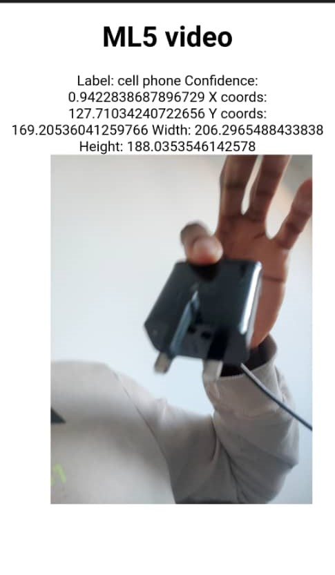

While machine learning is a practical tool, models are not infallible. They can be overconfident in their predictions. In the example below, a charger is misclassified as a cell phone with 94% confidence.

This example was captured using ml5.js and MobileNet, trained on ImageNet. The ImageNet dataset includes around 1,000 object categories. Performance depends on how well a category is represented in the training data. Here, the error likely happened because the dataset lacked sufficient examples of chargers to distinguish them from visually similar objects like phones.

## Why a model can be confidently wrong

The 94% figure does not mean the model is 94% sure in a human sense. It comes from the final classification step, the softmax function. Softmax converts raw output scores into numbers between 0 and 1 that sum to 1.

For class $i$ with raw score $z_i$, softmax computes $p_i = e^{z_i} / \sum_j e^{z_j}$. The model must distribute all probability mass among its pre-defined classes. There is no category for "unknown" or "none of the above". If a charger is not in the training taxonomy, the probability mass still has to go somewhere. Because a phone is the closest visual match in the list, it receives most of the score.

This is the closed-set assumption. Inputs that differ substantially from the training distribution are known as out-of-distribution (OOD) data. When evaluated on OOD inputs, a classifier still forces a choice from its fixed list, often with an arbitrarily high score.

The second issue is calibration. A model is well calibrated if, among all predictions made with 90% confidence, roughly 90% turn out to be correct. In [On Calibration of Modern Neural Networks](https://arxiv.org/abs/1706.04599) (ICML 2017), Guo, Pleiss, Sun, and Weinberger showed that modern neural networks tend to be poorly calibrated compared to older, shallower architectures. They traced this drop in calibration to increases in network depth, width, weight decay settings, and batch normalization.

## How practitioners address overconfidence

To deploy machine learning models safely, systems need ways to catch errors and filter out false positives. Fine-tuning models on domain-specific data helps, but post-processing and architecture adjustments are also necessary.

**Score calibration.** [Guo et al.](https://arxiv.org/abs/1706.04599) evaluated post-processing techniques applied after training. The simplest method, temperature scaling, proved effective across most benchmark datasets. Temperature scaling divides raw logits by a learned parameter $T$ before applying softmax. When $T > 1$, extreme probabilities soften toward uniform values without altering class rankings.

**Confidence thresholds and reject classes.** Instead of returning the highest-scoring class unconditionally, an application can reject predictions when the maximum probability falls below a set threshold. Alternatively, models can be trained with an explicit background or "unknown" class containing objects the system should ignore.

**Out-of-distribution detection.** In [A Baseline for Detecting Misclassified and Out-of-Distribution Examples in Neural Networks](https://arxiv.org/abs/1610.02136) (ICLR 2017), Hendrycks and Gimpel showed that maximum softmax probability functions as a straightforward baseline signal. Correct classifications typically generate higher peak probabilities than misclassifications or OOD inputs. While specialized OOD detectors outperform this baseline, it offers a zero-overhead initial filter.

**Targeted data collection.** If chargers matter to an application, training sets must include labeled chargers photographed across varied angles, lighting conditions, and backgrounds, alongside common look-alike items.

These techniques work best in combination. Calibration aligns predicted probabilities with true likelihoods, allowing thresholds and OOD detectors to reliably flag uncertain outputs.

Building reliable applications requires understanding these boundaries. Communicating model limitations clearly helps ensure systems are deployed where they add genuine value without misleading users.
