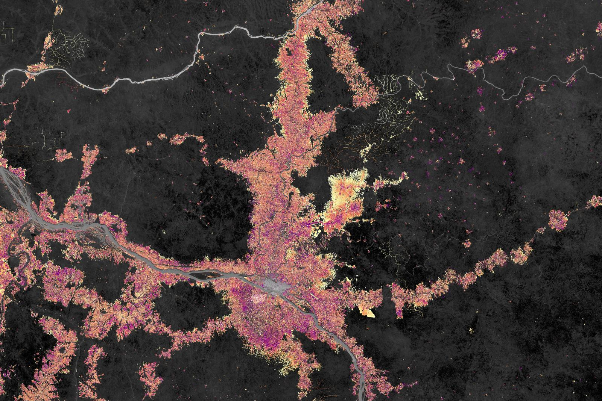
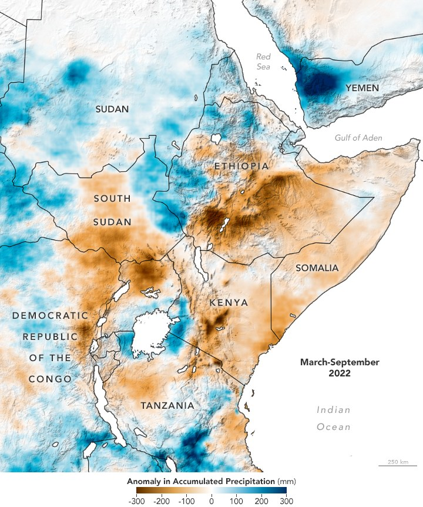
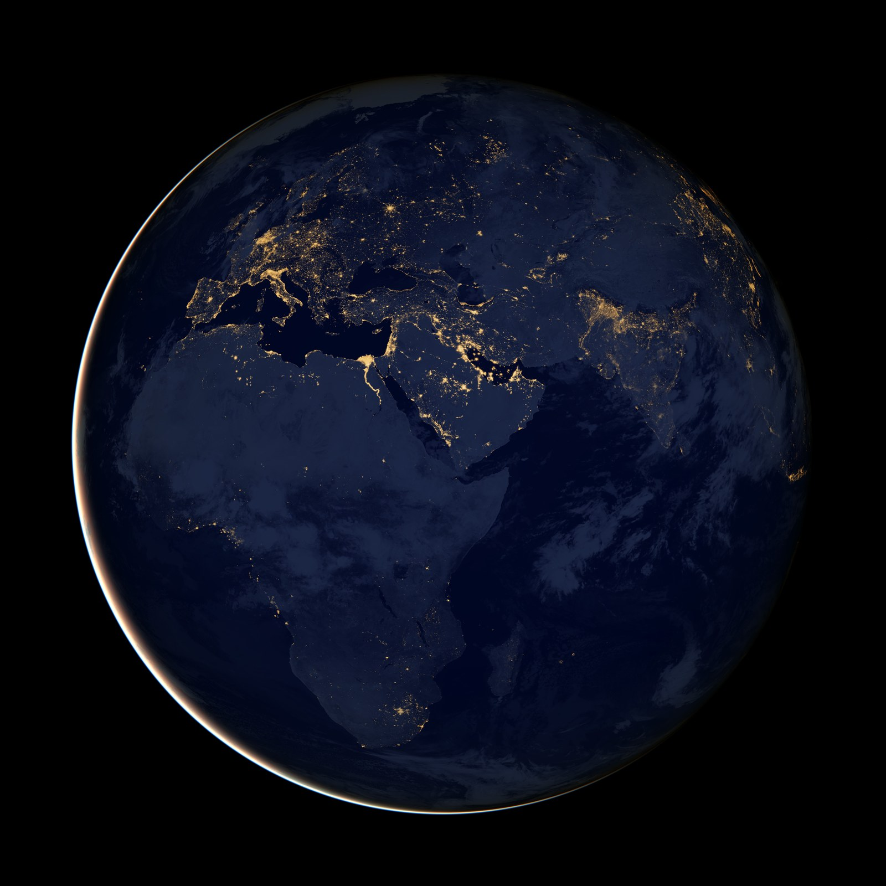
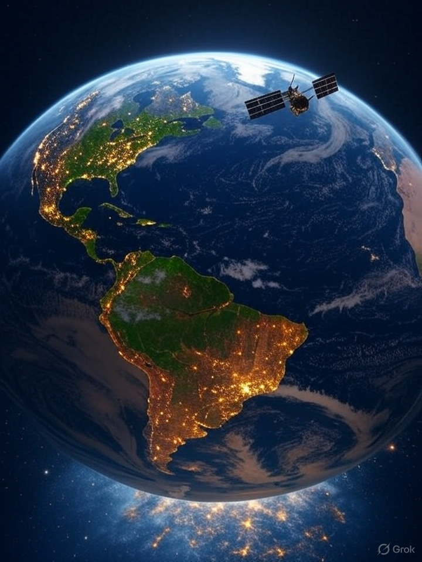

> **Correction (November 2026):** I revised this post to fix factual errors and remove figures I could not trace to a source. Several programmes were credited to the wrong organisations, and some satellite capabilities were described wrongly. I also replaced broken links with primary sources. The [editorial policy](/editorial-policy/) explains how I handle corrections.

Free images from the EU's [Sentinel](https://dataspace.copernicus.eu/) satellites show almost every farm, river and town in Africa, with new pictures every few days. Those images can already warn of drought, track forest loss and show where towns are spreading. Using them still takes skills and tools that cost time to build.

## What satellite data can already do

Most of the examples below run on free data from government satellites such as Sentinel and Landsat, a long-running US satellite series.

### Forest loss alerts

Landsat satellites photograph the same patch of ground again and again. Software compares the images and flags places where trees have disappeared. [Global Forest Watch](https://www.globalforestwatch.org/), run by the World Resources Institute (WRI), turns this into weekly alerts and yearly maps of tree cover loss. WRI reports that the tropics [lost 4.3 million hectares of primary forest in 2025](https://research.wri.org/gfr/latest-analysis-deforestation-trends). That is about 43,000 square kilometres, close to the size of Denmark. Rangers and journalists can use the alerts to spot illegal clearing while it is still going on.

### Free maps of Africa's farms and water

[Digital Earth Africa](https://www.digitalearthafrica.org/platform-resources/services) publishes ready-made maps for the whole continent. One shows where cropland is. Another shows lakes, rivers and reservoirs. Vegetation anomaly layers show where plants are greener or browner than usual. An agriculture officer can use them to spot a poor growing season without visiting every farm.

### Crop monitoring and harvest estimates

The [NASA Harvest](https://nasaharvest.org/) programme combines satellite images with reports from the ground. It maps which crops grow where and estimates harvests, including in Ukraine and in Africa. Governments and aid agencies can then plan food imports or relief before shortages hit.

They are also interesting for professionals in the tech space because some of their key impact areas include "data systems, artificial intelligence and machine learning

On their website they say

> Some key challenges to the uptake of satellite-derived information include access restrictions, inconvenience, difficulty of use, and lackluster automation. Our consortium framework enables us to work collaboratively across the agricultural sector and with the private sector in order to build accessible tools, ensure secure data sharing, and integrate with existing systems.

### Soil moisture and drought

ESA's [SMOS satellite](https://earth.esa.int/eogateway/missions/smos) measures how wet the top few centimetres of soil are, worldwide. Scientists have used its data to build an index for monitoring long-term drought. For farmers who depend on rain, dry soil is an early sign of crop trouble.

### Mapping where people live

Some satellites carry radar, often called SAR (synthetic aperture radar). They send out their own radio pulses and record the echoes, so they see through clouds and at night. The German Aerospace Center (DLR) built its [Global Urban Footprint](https://www.dlr.de/en/eoc/research-transfer/projects-missions/global-urban-footprint) from 180,000 TerraSAR-X and TanDEM-X radar scenes. It maps built-up areas worldwide at about 12 m resolution. Resolution is the size of the smallest detail an image shows, here a square about 12 m wide. Maps like this show how far towns have spread, which helps plan roads, water and schools.

### Night lights and the economy

Brighter lights at night often go with more economic activity. A [World Bank study](https://documents.worldbank.org/en/publication/documents-reports/documentdetail/658061583574075223/not-by-night-lights-alone-measuring-economic-growth-and-development-in-africa-using-satellite-imagery) tested night lights as a measure of growth in Africa. Its title, "Not by night lights alone", sums up the finding that lights need other data alongside them. Such measures matter most where official statistics are scarce or out of date.

### Putting unmapped places on the map

Many villages and neighbourhoods do not appear on any map. Volunteers in the [Missing Maps](https://www.missingmaps.org/) project, which Médecins Sans Frontières co-founded, trace buildings and roads from satellite images. Aid teams then use those maps to plan health work, such as reaching every household.

## What stops it today

### Sharp images cost money

Free government images are coarser than the best commercial ones. Sentinel-2 and Landsat show a field or a town block well, but not a single car. [Vantor](https://vantor.com/product/vivid/mosaic/), the company formerly called Maxar, sells global basemaps at 30 cm and 15 cm, as of November 2026. At 30 cm, a car is clearly visible. Commercial imagery like this is sold per image or by subscription, and licences can limit how it is shared.

### Raw data needs processing

Raw satellite images need correcting for haze, sensor angle and cloud before anyone can compare them. That work takes software, storage and skill. [Digital Earth Africa](https://www.digitalearthafrica.org/) removes much of it by publishing analysis-ready data for the whole continent, already cleaned and lined up. [Google Earth Engine](https://earthengine.google.com/) does the computing in the cloud, free for noncommercial use.

### Maps must reach the people who decide

A flood risk map only helps if it reaches the people planning evacuations, in a form they can use. Training is one way to close that gap. NASA's [ARSET programme](https://appliedsciences.nasa.gov/what-we-do/capacity-building/arset) teaches remote sensing to beginners for free. [SERVIR](https://servirglobal.net/), a NASA-led network with hubs in Africa, lists satellite data projects and partners across the continent.

## Where to get the data

### Government platforms

Governments fund many satellites and give much of the data away. [NASA Earthdata](https://earthdata.nasa.gov/) offers free access to large archives, including data from the MODIS sensor. Landsat data is free from the USGS through [EarthExplorer](https://earthexplorer.usgs.gov/). The EU's [Copernicus Data Space Ecosystem](https://dataspace.copernicus.eu/) offers free, full and open access to Sentinel data. I cover that programme in [Copernicus: powering Earth observation with Sentinel satellites](/copernicus-powering-earth-observation-with-sentinel-satellites/). JAXA's [G-Portal](https://gportal.jaxa.jp/gpr/) gives access to data from Japanese Earth observation satellites.

### Commercial providers

Companies sell sharper or more frequent images than most free sources. [Planet](https://www.planet.com/products/planet-imagery/) says its PlanetScope satellites image Earth's entire landmass every day at 3.7 m resolution, as of November 2026. That short revisit time, the gap between two images of the same place, helps track fast changes such as floods. [Airbus](https://www.airbus.com/en/space/earth-observation) offers optical and radar imagery from satellites such as Pléiades. [ICEYE](https://www.iceye.com/) sells radar (SAR) imagery, useful in rainy seasons when ordinary cameras see only cloud.

### Open platforms

My post [Google Earth Engine: a useful tool for satellite imagery](/gee_recommendation/) shows what Earth Engine can do. [Microsoft&#39;s Planetary Computer](https://planetarycomputer.microsoft.com/) is a large catalogue of environmental data for sustainability work. [Radiant Earth](https://www.radiant.earth/) runs [Source Cooperative](https://source.coop/), a place to publish and share open geospatial data. [Open Data Cube](https://www.opendatacube.org/) is the open-source software behind Digital Earth Africa.

## Where to start

The free Sentinel images over your district are already waiting. Three free steps turn them into something you can use:

1. Open the [Digital Earth Africa map](https://www.digitalearthafrica.org/platform-resources/services) and look at cropland or water layers for your own district.
2. Take a free online course from NASA's [ARSET programme](https://appliedsciences.nasa.gov/what-we-do/capacity-building/arset), which teaches remote sensing to beginners.
3. Look at [SERVIR](https://servirglobal.net/) for projects and partners near you.

Disclaimer: Some of the images in this post are AI-generated by Grok (xAI). The text was drafted with AI help, then checked and revised by me.
