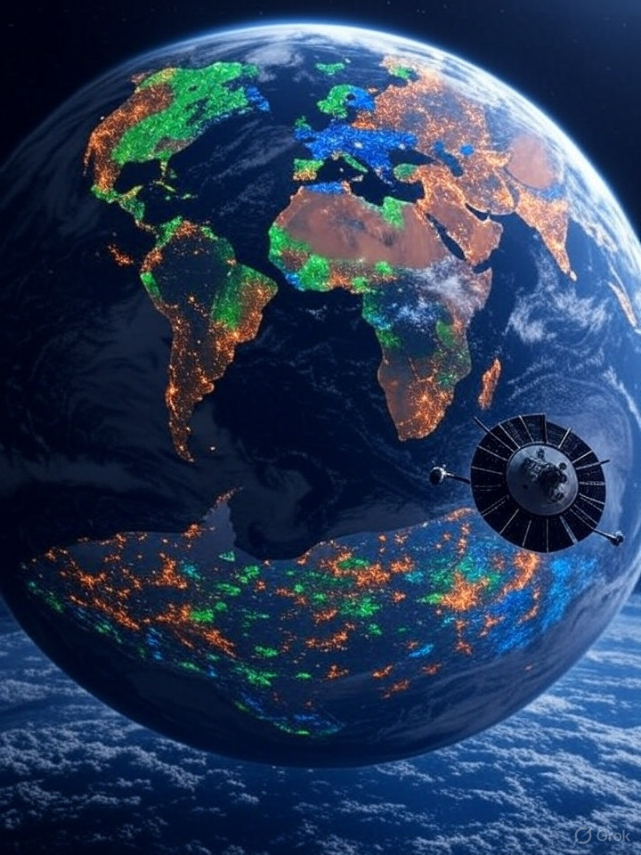

> **Correction (November 2026):** I revised this post to fix factual errors and remove figures I could not trace to a source. Several programmes were credited to the wrong organisations, and some satellite capabilities were described wrongly. I also replaced broken links with primary sources. The [editorial policy](/editorial-policy/) explains how I handle corrections.

Free [Sentinel](https://dataspace.copernicus.eu/) images of almost every farm, river and town in Africa arrive every few days. Turning them into decisions takes skills, tools and time that many teams lack. This post covers what satellite data can do for climate, food security and cities, and what stops it from being used. It ends with free places to start.

## The untapped potential

Below are some use cases for satellite data, each with an example of it in use.

### Environmental monitoring and climate science

Satellites can monitor the planet at scales that ground surveys alone can't match. Some of what they make possible:

- Tracking forest loss almost as it happens. [Global Forest Watch](https://www.globalforestwatch.org/), run by the World Resources Institute (WRI), publishes weekly alerts and yearly tree cover loss maps from Landsat data. WRI reports that the tropics [lost 4.3 million hectares of primary forest in 2025](https://research.wri.org/gfr/latest-analysis-deforestation-trends).
- Long records of polar ice. Microwave satellites show that [Arctic sea ice in September has shrunk sharply since 1979](https://climate.nasa.gov/vital-signs/arctic-sea-ice/). ESA's [CryoSat-2](https://earth.esa.int/eogateway/missions/cryosat) adds measurements of ice thickness, not just area.
- Measuring greenhouse gases from orbit. Japan's [GOSAT](https://www.gosat.nies.go.jp/en/) and NASA's [OCO-2](https://science.nasa.gov/mission/oco-2/) measure the average CO₂ concentration in the column of air below them. Scientists use this to study where carbon is released and absorbed.
- Early warning for storms. NOAA's [GOES satellites](https://www.goes.noaa.gov/) send continuous images of the Americas. Forecasters at the [National Hurricane Center](https://www.nhc.noaa.gov/) use them to track storms as they form.

### Agriculture and food security

- Free continental maps. [Digital Earth Africa](https://www.digitalearthafrica.org/platform-resources/services) publishes a cropland extent map, a waterbodies map and vegetation anomaly layers for the whole continent.
- Crop monitoring and harvest estimates. The [NASA Harvest](https://nasaharvest.org/) programme combines satellite data with ground data to map crops and estimate harvests, including in Ukraine and in Africa.
- Soil moisture and drought. ESA's [SMOS satellite](https://earth.esa.int/eogateway/missions/smos) measures moisture in the top few centimetres of soil worldwide. Scientists have used SMOS data to build an index for monitoring long-term drought.
- Irrigation and water use. [OpenET](https://openetdata.org/) uses Landsat thermal data to estimate how much water crops use, field by field, across the western United States.

### Urban planning and development

Cities are growing fast and need better planning tools. Satellites can supply some of them:

- 3D elevation data. The German Aerospace Center (DLR) built a [global elevation model from TanDEM-X radar data](https://www.dlr.de/en/research-and-transfer/projects-and-missions/tandem-x). It covers cities as well as open terrain.
- Mapping where people live. DLR's [Global Urban Footprint](https://www.dlr.de/en/eoc/research-transfer/projects-missions/global-urban-footprint) maps built-up areas worldwide at about 12 m resolution. DLR made it from 180,000 TerraSAR-X and TanDEM-X radar scenes.
- Watching the ground and structures move. Radar satellites can detect movement of a few millimetres. The [European Ground Motion Service](https://egms.land.copernicus.eu/) publishes such measurements from Sentinel-1 for most of Europe.

### Economic and social applications

Satellites also give socioeconomic insights, not just physical measurements:

- Night lights as a signal of economic activity. A [World Bank study](https://documents.worldbank.org/en/publication/documents-reports/documentdetail/658061583574075223/not-by-night-lights-alone-measuring-economic-growth-and-development-in-africa-using-satellite-imagery) tested night lights as a measure of growth in Africa. Its title, "Not by night lights alone", sums up the finding that lights need other data alongside them.
- Population maps for planning services. Meta and Columbia University's CIESIN published [high-resolution population maps](https://dataforgood.facebook.com/dfg/tools/high-resolution-population-density-maps) built from satellite imagery. Aid groups and network planners use them to find where people live.
- Humanitarian response. [UNOSAT](https://unosat.org/products/), the UN satellite centre, publishes damage and settlement maps after disasters and conflicts.

### Global health

Health researchers can use satellite data to:

- Study air pollution and health. [Wu and colleagues (2020)](https://pmc.ncbi.nlm.nih.gov/articles/PMC7673673/) linked long-term exposure to fine particles (PM2.5) with higher COVID-19 death rates in over 3,000 US counties. Their pollution estimates came from models that combine satellite and ground data.
- Put unmapped places on the map. Volunteers in the [Missing Maps](https://www.missingmaps.org/) project, which Médecins Sans Frontières co-founded, trace buildings and roads from satellite images. Aid teams then use those maps to plan health work.
- Track water quality. NOAA uses satellite data to [monitor and forecast harmful algal blooms in Lake Erie](https://coastalscience.noaa.gov/science-areas/habs/hab-forecasts/lake-erie/), a source of drinking water.

## The current reality

The barriers below are common ones, not the results of a survey.

### Focus areas and funding imbalances

Satellite data is used in many areas, but they don't all get the same attention or money. Climate change gets a lot of focus. Yet researchers often work in isolation, studying ice melt or CO₂ without linking their findings to farming or cities.

Companies invest in satellite data for large farms, but small farmers in poorer regions are often left out. The tools are too expensive or too complex for them. Defence and security projects get large budgets, but their data is often kept secret. Commercial uses grow fast because they make money, but they don't always serve needs like disaster preparedness.

### Implementation challenges

Turning satellite data into practical solutions is hard. Most of the technology and expertise sits in countries with large space programmes. Processing the data can take powerful computers, storage and complex software. Cloud platforms such as Digital Earth Africa and Earth Engine now remove much of the computing cost. Trained analysts are still scarce.

Governments and businesses also struggle to turn satellite insights into decisions. A flood risk map only helps if it reaches the people planning evacuations, in a form they can use. Much funding goes to new satellites, with less for training the people who would use the data.

> **Sidenote**: Most examples above come from organisations in North America, Europe and Asia. That reflects which sources I found while gathering links, not a lack of work elsewhere. I hope to follow up with a post on use cases in Africa.

### Systemic limitations

Some of the problems are structural. The best data and tools are often controlled by rich organisations or countries. Poorer regions may need the data most, for floods or food shortages, but often can't afford it. Checking satellite maps against conditions on the ground is also hard in remote places, which makes results harder to trust.

The people who understand satellites and the people who understand local problems also don't always work together. So the data doesn't always answer the right questions.

## Satellite data platforms and providers

Satellite data comes from government, commercial and open platforms.

### Government platforms

- [NASA Earthdata](https://earthdata.nasa.gov/) gives free access to large archives, including MODIS. Landsat data is also free from the USGS through [EarthExplorer](https://earthexplorer.usgs.gov/).
- The EU's [Copernicus Data Space Ecosystem](https://dataspace.copernicus.eu/) offers free, full and open access to Sentinel data.
- NOAA's [GOES Image Viewer](https://www.star.nesdis.noaa.gov/GOES/) shows near-real-time weather satellite imagery.
- JAXA's [G-Portal](https://gportal.jaxa.jp/gpr/) gives access to data from Japanese Earth observation satellites.

### Commercial providers

- [Planet](https://www.planet.com/) runs a large fleet of small satellites that image Earth's land almost daily at about 3 m resolution.
- [Maxar](https://www.maxar.com/) sells very high-resolution imagery, about 30 cm, from its WorldView satellites.
- [Airbus](https://www.airbus.com/en/space/earth-observation) offers optical and radar imagery from satellites such as Pléiades.
- [ICEYE](https://www.iceye.com/) sells radar (SAR) imagery, which can see through clouds and at night.

### Open and hybrid initiatives

- [Google Earth Engine](https://earthengine.google.com/) is a cloud platform that pairs public datasets such as Landsat, Sentinel and MODIS with computing power. It is free for noncommercial use and paid for commercial use. I have a separate post on it: [Google Earth Engine: A Useful Tool for Satellite Imagery](https://rdjarbeng.github.io/gee_recommendation/).
- [Microsoft's Planetary Computer](https://planetarycomputer.microsoft.com/) is a large catalogue of environmental data for sustainability work.
- [Radiant Earth](https://www.radiant.earth/) runs [Source Cooperative](https://source.coop/), a place to publish and share open geospatial data.
- [Open Data Cube](https://www.opendatacube.org/) is open-source software for analysing satellite data. It powers national and regional programmes, including [Digital Earth Africa](https://www.digitalearthafrica.org/), which offers free analysis-ready data for the whole continent.

### Data access reality

Data is more available than it used to be, but some barriers remain:

- Very high-resolution commercial imagery costs money, often with minimum order sizes.
- Free government data usually has coarser resolution than the best commercial imagery.
- Processing raw satellite data can require specialist skills and computing resources.
- Licences can limit how commercial data is used and shared.

The result is a digital divide. The most advanced capabilities stay with institutions that can pay for premium data and the processing that goes with it.

## The path forward

Satellite data can help with deforestation, crop yields, urban growth and health. Landsat, Sentinel and commercial fleets like Planet already support many of those uses. What stands in the way is unequal access, technical complexity, funding imbalances and silos between disciplines. Closing the gap will take training, collaboration and maps that people can act on.

If you are in Africa and want to start, three free steps work well:

1. Open the [Digital Earth Africa map](https://www.digitalearthafrica.org/platform-resources/services) and look at cropland or water layers for your own district.
2. Take a free online course from NASA's [ARSET programme](https://appliedsciences.nasa.gov/what-we-do/capacity-building/arset), which teaches remote sensing to beginners.
3. Look at [SERVIR](https://servirglobal.net/), a NASA-led network with hubs in Africa, for projects and partners near you.

Disclaimer: Some of the images in this post are AI-generated by Grok (xAI). The text was drafted with AI help, then checked and revised by me.
