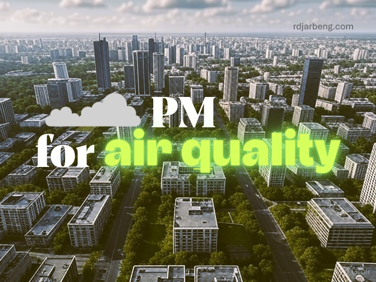

On [29 January 2026](/weather-report-kigali-29th-january-2026/), the CAMS forecast model put Kigali's PM2.5 at about 37 µg/m³ for the day. That is about two and a half times the WHO's 24-hour guideline. PM2.5 is the fine smoke and dust in the air that you breathe without seeing. This post explains what a number like 37 means, how much to trust it and what to do about it.

## What PM2.5 is

Particulate matter (PM) is a mix of solid and liquid particles floating in the air. The [US Environmental Protection Agency (EPA)](https://www.epa.gov/pm-pollution/particulate-matter-pm-basics) groups them by size. PM10 means particles 10 micrometres across or smaller. PM2.5 means particles 2.5 micrometres or smaller. A micrometre is a thousandth of a millimetre.

An average human hair is about 70 micrometres wide, [according to the EPA](https://www.epa.gov/pm-pollution/particulate-matter-pm-basics). That is roughly 30 times the largest PM2.5 particle, since $70 \div 2.5 = 28$. The largest PM10 particles are about a seventh of a hair's width.

PM2.5 is reported as a mass concentration. It is the number of micrograms of particles in one cubic metre of air, written µg/m³. A microgram is a millionth of a gram. A reading of 15 µg/m³ means 15 micrograms of fine particles in every cubic metre.

Size matters because of how far particles travel inside the body. Both PM10 and PM2.5 can reach deep into the lungs, and PM2.5 can even enter the bloodstream, [says the WHO](https://www.who.int/news/item/22-09-2021-new-who-global-air-quality-guidelines-aim-to-save-millions-of-lives-from-air-pollution).

## How much PM2.5 is too much

The [WHO's 2021 guidelines](https://www.who.int/publications/i/item/9789240034228) set guideline levels for PM2.5 of 15 µg/m³ averaged over 24 hours and 5 µg/m³ over a year. These are not safe limits. The evidence has found no level below which PM2.5 does no harm across a population ([COMEAP](https://www.gov.uk/government/publications/comeap-statement-response-to-who-air-quality-guidelines-2021/comeap-statement-response-to-publication-of-the-world-health-organization-air-quality-guidelines-2021)).

In 2019, 99% of the world's population lived where WHO guideline levels were not met ([WHO](https://www.who.int/news-room/fact-sheets/detail/ambient-(outdoor)-air-quality-and-health)). At an urban background site in Nairobi, PM2.5 averaged 21 µg/m³ in samples taken from 2008 to 2010 ([Gaita et al., 2014](https://doi.org/10.5194/acp-14-9977-2014)). That 2008 to 2010 average was four times the WHO yearly level.

Both short-term and long-term exposure to particulate matter are linked to illness and death from heart and lung disease. Long-term exposure is also linked to lung cancer and to harm during pregnancy and birth. A US study of about 500,000 adults linked long-term exposure to deaths from lung cancer and from heart and lung disease ([Pope et al., 2002](https://doi.org/10.1001/jama.287.9.1132)). In 2013, the WHO's cancer agency classed particulate matter as a cause of lung cancer ([WHO](https://www.who.int/teams/environment-climate-change-and-health/air-quality-and-health/health-impacts/types-of-pollutants)).

The [WHO fact sheet](https://www.who.int/news-room/fact-sheets/detail/ambient-(outdoor)-air-quality-and-health) estimates that outdoor air pollution caused 4.2 million premature deaths worldwide in 2019. About 89% were in low- and middle-income countries. Heart disease and stroke caused 68% of them, chronic lung disease 14%, lung infections 14% and lung cancer 4%. Outdoor and household air pollution together are linked to 6.7 million premature deaths a year.

In Africa, air pollution contributed to about 1.1 million deaths in 2019. About 63% of these were linked to household air pollution ([State of Global Air, 2022](https://www.stateofglobalair.org/resources/report/state-air-quality-and-health-impacts-africa)).

## Where PM2.5 comes from

Some particles are released straight into the air. These are primary particles. The [EPA](https://www.epa.gov/pm-pollution/particulate-matter-pm-basics) lists construction sites, unpaved roads, fields, smokestacks and fires. Burning fuel gives off black carbon, the soot from incomplete burning, along with organic particles ([Bond et al., 2013](https://doi.org/10.1002/jgrd.50171)). Wind lifts mineral dust, which can cross oceans ([Prospero, 1999](https://doi.org/10.1073/pnas.96.7.3396)). Breaking waves throw sea salt into the air near coasts ([Lewis & Schwartz, 2004](https://doi.org/10.1029/GM152)).

Other particles form in the air from gases. These are secondary particles, and the EPA says most particles form this way. Sulphur dioxide (SO₂) from power plants and industry turns into sulphate. Nitrogen oxides (NOₓ) from vehicles and industry turn into nitrate. Ammonia, mostly from fertiliser and livestock, combines with these to make ammonium salts ([Behera et al., 2013](https://doi.org/10.1007/s11356-013-2051-9)). Volatile organic compounds (VOCs) from fuels, solvents and plants react to form organic particles ([Hallquist et al., 2009](https://doi.org/10.5194/acp-9-5155-2009)).

### In African homes, cooking smoke leads

About 2.1 billion people cook on open fires or inefficient stoves, [says the WHO](https://www.who.int/news-room/fact-sheets/detail/household-air-pollution-and-health). The fuels include wood, crop waste, charcoal, coal, dung and kerosene. The same fact sheet says 923 million people in sub-Saharan Africa lacked clean cooking in 2022.

In the cooking areas of homes studied in Accra and The Gambia, biomass smoke was the largest source of PM2.5. It made up 39 to 62% of PM2.5 in Accra, depending on the neighbourhood, and 74 to 87% in Banjul and Basse ([Zhou et al., 2014](https://doi.org/10.1021/es404185m); [abstract on PubMed](https://pubmed.ncbi.nlm.nih.gov/24351083/)). Road dust and vehicles added 12 to 33% in Accra.

Outdoors in cities, traffic and dust matter more. In Nairobi, they together made up about 74% of PM2.5 at the sites studied ([Gaita et al., 2014](https://doi.org/10.5194/acp-14-9977-2014)). Fires add a seasonal layer. Fires in Africa account for 70% of the area burned worldwide, and most burn in the dry season ([NASA](https://svs.gsfc.nasa.gov/10832)).

## Where a PM2.5 reading comes from

The number in an app can come from very different instruments, and they are not equally accurate.

**Reference monitors** are the most accurate. The standard method pulls air through a filter for 24 hours, and a lab weighs the filter ([Barkjohn et al., 2021](https://doi.org/10.5194/amt-14-4617-2021)). Continuous monitors give hourly values. A common type, the beta attenuation monitor, collects particles on a tape and measures how much they block beta rays ([HORIBA](https://www.horiba.com/int/process-and-environmental/measuring-principles/beta-ray-absorption-method)). These monitors are costly and need trained staff.

**Low-cost sensors** shine a laser through the air and measure the light that particles scatter. Damp air changes how particles scatter light. In US tests, raw readings from PurpleAir sensors overestimated PM2.5 by about 40%. Humidity adds error, so the EPA's correction includes a humidity term ([Barkjohn et al., 2021](https://doi.org/10.5194/amt-14-4617-2021)). Placing a sensor next to a reference monitor lets you fit a correction. The [EPA](https://www.epa.gov/air-sensor-toolbox/air-sensor-performance-targets-and-testing-protocols) notes that sensor data quality varies widely.

**Satellite estimates** start from aerosol optical depth, a measure of how much particles in the whole column of air dim sunlight. A team at Washington University in St. Louis (USA) combines this with a chemistry model. They then calibrate it against ground monitors ([ACAG](https://sites.wustl.edu/acag/datasets/surface-pm2-5/)). This gives PM2.5 estimates for places with no monitor.

**Forecast models** such as the Copernicus Atmosphere Monitoring Service (CAMS) make [five-day global forecasts](https://atmosphere.copernicus.eu/global-forecast-plots) of aerosols. Its global grid cells are about 45 km across ([Open-Meteo](https://open-meteo.com/en/docs/air-quality-api)), so one value covers a whole city. The Kigali figure at the top of this post is a CAMS estimate, not a monitor reading.

Every value also covers a time window. Hourly values show changes through the day. A 24-hour average describes short-term exposure, and a yearly average long-term exposure ([WHO](https://www.who.int/news-room/feature-stories/detail/what-are-the-who-air-quality-guidelines)).

Apps show either the concentration in µg/m³ or an Air Quality Index (AQI) number from 0 to 500 or more ([AQI explainer](/understanding-the-air-quality-index-aqi/)). The US AQI for particles is based on a 24-hour average. For current conditions, the US [AirNow](https://www.airnow.gov/aqi/aqi-basics/using-air-quality-index/) site uses the NowCast, which works from recent hourly readings.

## Haze and climate

Fine particles are the main cause of reduced visibility, or haze, in parts of the US, including many national parks ([EPA](https://www.epa.gov/pm-pollution/particulate-matter-pm-basics)). The same happened on [a hazy day in Kigali in January 2026](/weather-report-kigali-29th-january-2026/), when model estimates put PM2.5 at about 37 µg/m³. The airport, normally visible across the valley, all but disappeared.

Particles also affect climate. Black carbon absorbs sunlight and warms the air. Sulphate and nitrate particles scatter sunlight and have a cooling effect. Particles also change how clouds form ([Bond et al., 2013](https://doi.org/10.1002/jgrd.50171); [IPCC, 2021](https://www.ipcc.ch/report/ar6/wg1/)).

## What to do with a PM2.5 reading

First, check the unit (µg/m³ or AQI) and the period it covers. Then check whether it came from a monitor, a sensor or a model. A 24-hour average above 15 µg/m³ is above the WHO guideline. The Kigali day from the top of this post is a worked example. It was a CAMS model value for a 45 km grid cell, not a monitor reading. At 37 µg/m³ it was about 2.5 times the WHO daily level. On the US scale it comes to an AQI of about 105, "Unhealthy for Sensitive Groups" ([AQI explainer](/understanding-the-air-quality-index-aqi/)).

On bad days, the [AirNow guide for particle pollution](https://www.airnow.gov/sites/default/files/2023-03/air-quality-guide-for-particle-pollution_0.pdf) advises sensitive groups to make outdoor activities shorter and less intense. Sensitive groups include people with heart or lung disease, older adults, children and teenagers. Coughing or shortness of breath are signs to take it easier.

At home, the biggest change is the cooking fuel. The [WHO](https://www.who.int/news-room/fact-sheets/detail/household-air-pollution-and-health) counts solar, electricity, biogas, LPG, natural gas and alcohol fuels as clean at the point of use. The WHO adds that women and children carry the greatest health burden from cooking smoke.

## References

- Barkjohn, K. K., Gantt, B., & Clements, A. L. (2021). Development and application of a United States-wide correction for PM2.5 data collected with the PurpleAir sensor. _Atmospheric Measurement Techniques, 14_, 4617 to 4637. https://doi.org/10.5194/amt-14-4617-2021
- Behera, S. N., Sharma, M., Aneja, V. P., & Balasubramanian, R. (2013). Ammonia in the atmosphere: A review on emission sources, atmospheric chemistry, and deposition on terrestrial bodies. _Environmental Science and Pollution Research, 20_(11), 8092 to 8131. https://doi.org/10.1007/s11356-013-2051-9
- Bond, T. C., Doherty, S. J., Fahey, D. W., et al. (2013). Bounding the role of black carbon in the climate system: A scientific assessment. _Journal of Geophysical Research: Atmospheres, 118_(11), 5380 to 5552. https://doi.org/10.1002/jgrd.50171
- Committee on the Medical Effects of Air Pollutants (COMEAP). (2021). Statement: response to publication of the World Health Organization air quality guidelines 2021. https://www.gov.uk/government/publications/comeap-statement-response-to-who-air-quality-guidelines-2021/comeap-statement-response-to-publication-of-the-world-health-organization-air-quality-guidelines-2021
- Copernicus Atmosphere Monitoring Service (CAMS). Global forecast plots. https://atmosphere.copernicus.eu/global-forecast-plots
- Gaita, S. M., Boman, J., Gatari, M. J., Pettersson, J. B. C., & Janhäll, S. (2014). Source apportionment and seasonal variation of PM2.5 in a Sub-Saharan African city: Nairobi, Kenya. _Atmospheric Chemistry and Physics, 14_, 9977 to 9991. https://doi.org/10.5194/acp-14-9977-2014
- Hallquist, M., Wenger, J. C., Baltensperger, U., et al. (2009). The formation, properties, and impact of secondary organic aerosol: Current and emerging issues. _Atmospheric Chemistry and Physics, 9_(14), 5155 to 5236. https://doi.org/10.5194/acp-9-5155-2009
- HORIBA. Beta ray absorption method. https://www.horiba.com/int/process-and-environmental/measuring-principles/beta-ray-absorption-method
- Intergovernmental Panel on Climate Change (IPCC). (2021). Climate change 2021: The physical science basis. https://www.ipcc.ch/report/ar6/wg1/
- Lewis, E. R., & Schwartz, S. E. (2004). _Sea salt aerosol production: Mechanisms, methods, measurements, and models_. American Geophysical Union. https://doi.org/10.1029/GM152
- NASA Scientific Visualization Studio. The fire continent. https://svs.gsfc.nasa.gov/10832
- Open-Meteo. Air quality API documentation. https://open-meteo.com/en/docs/air-quality-api
- Pope, C. A., Burnett, R. T., Thun, M. J., et al. (2002). Lung cancer, cardiopulmonary mortality, and long-term exposure to fine particulate air pollution. _Journal of the American Medical Association, 287_(9), 1132 to 1141. https://doi.org/10.1001/jama.287.9.1132
- Prospero, J. M. (1999). Long-range transport of mineral dust in the global atmosphere: Impact of African dust on the environment of the southeastern United States. _Proceedings of the National Academy of Sciences, 96_(7), 3396 to 3403. https://doi.org/10.1073/pnas.96.7.3396
- State of Global Air. (2022). The state of air quality and health impacts in Africa. Health Effects Institute. https://www.stateofglobalair.org/resources/report/state-air-quality-and-health-impacts-africa
- U.S. Environmental Protection Agency (EPA). Air sensor performance targets and testing protocols. https://www.epa.gov/air-sensor-toolbox/air-sensor-performance-targets-and-testing-protocols
- U.S. Environmental Protection Agency (EPA). Particulate matter (PM) basics. https://www.epa.gov/pm-pollution/particulate-matter-pm-basics
- U.S. Environmental Protection Agency (EPA), AirNow. Using the Air Quality Index. https://www.airnow.gov/aqi/aqi-basics/using-air-quality-index/
- Washington University Atmospheric Composition Analysis Group (ACAG). Surface PM2.5 datasets. https://sites.wustl.edu/acag/datasets/surface-pm2-5/
- World Health Organization (WHO). (2021). WHO global air quality guidelines: Particulate matter (PM2.5 and PM10), ozone, nitrogen dioxide, sulfur dioxide and carbon monoxide. https://www.who.int/publications/i/item/9789240034228
- World Health Organization (WHO). (2024). Ambient (outdoor) air quality and health. https://www.who.int/news-room/fact-sheets/detail/ambient-(outdoor)-air-quality-and-health
- World Health Organization (WHO). (2025). Household air pollution. https://www.who.int/news-room/fact-sheets/detail/household-air-pollution-and-health
- World Health Organization (WHO). Types of pollutants. https://www.who.int/teams/environment-climate-change-and-health/air-quality-and-health/health-impacts/types-of-pollutants
- Zhou, Z., Dionisio, K. L., Verissimo, T. G., et al. (2014). Chemical characterization and source apportionment of household fine particulate matter in rural, peri-urban, and urban West Africa. _Environmental Science & Technology, 48_(2), 1343 to 1351. https://doi.org/10.1021/es404185m
