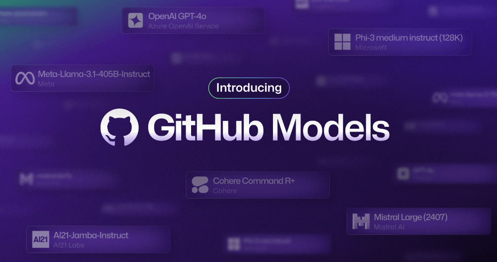

---
key_points:
  - "GitHub has introduced GitHub Models, enabling AI engineers to access industry-leading large and small language models directly on the platform."
  - "The models available include Llama 3.1, GPT-4o, GPT-4o mini, Phi 3, and Mistral Large 2, which can be used through a built-in playground within GitHub."
  - "Users can interact with these models for free, test different prompts and model parameters, and provide feedback to help refine and improve the tool."
  - "GitHub Models are accessible to all developers with a GitHub account, and users can sign up for the waitlist to be among the first to experience this innovative tool."
title: "Introducing GitHub Models (Retired July 2026)"
author: Richard
date: 2025-08-05
image: /assets/images/github_models_pic.png
tags: [AI, GitHub,AI engineer]
image_alt: "Cover image for Introducing GitHub Models"
category: "AI"
---

> **Update, 21 November 2026: GitHub Models has been retired.** GitHub shut it down for all customers on 30 July 2026, after brownouts on 16 and 23 July. The playground, model catalog, inference API and bring-your-own-key access are gone ([GitHub changelog](https://github.blog/changelog/2026-07-30-github-models-is-now-retired/)). For model access, GitHub's [retirement notice](https://github.blog/changelog/2026-07-01-github-models-is-being-fully-retired-on-july-30-2026/) points to Microsoft Foundry for a broad model catalog, and to GitHub Copilot for AI workflows on GitHub. The waitlist and links below no longer work. This post is kept as a record of the 2024 launch.

GitHub is enabling the rise of the AI engineer with the introduction of GitHub Models, bringing the power of industry-leading large and small language models to its more than 100 million users directly on the platform.

With GitHub Models, every developer can become an AI engineer, or so they say, with the right tools and training. From playground to coding with the model in Codespaces to production deployment via Azure, GitHub Models demonstrates how simple it can be. Users are invited to sign up for the waitlist to be among the first to experience GitHub Models. By joining the waitlist, users will have the opportunity to test and provide feedback on this innovative tool, helping GitHub to refine and improve it.

GitHub Models include access to models such as Llama 3.1, GPT-4o, GPT-4o mini, Phi 3, and Mistral Large 2. Users can interact with these models through a built-in playground that allows them to test different prompts and model parameters for free, right within GitHub. More details can be found in the full blog post by GitHub CEO, Thomas Dohmke! 🚀

### Resources to Keep You Up-to-Date:

- [GitHub Models Blog Post](https://github.blog/news-insights/product-news/introducing-github-models/)
- [GitHub Models Demo Video](https://www.youtube.com/watch?v=WiBB8Lsgl7I)
- [GitHub Models Documentation](https://docs.github.com/en/github-models)
- ~~Sign Up for the Waitlist~~ (closed; GitHub Models was retired on 30 July 2026)

[Image source](https://github.com/orgs/community/discussions/134377)