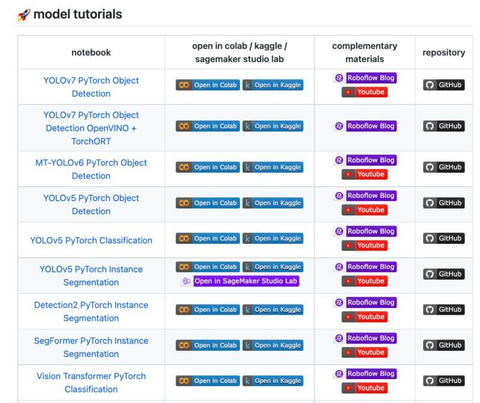

---
key_points:
  - "The post provides free Roboflow computer vision notebooks on GitHub for training your own models."
  - "The tutorials cover Yolov7, Yolov6, and Yolov5 models, including object detection, classification, and segmentation."
  - "The notebooks are designed to help users build high-quality computer vision models with step-by-step guidance."
  - "The tutorials are available for free on GitHub, making them accessible to anyone interested in learning computer vision."
title: "Free Roboflow Notebooks for Training Your Own Computer Vision Models"
author: Richard
date: 2025-08-10
image: /assets/images/comp_vision_roboflow.jpeg
tags: [Computer Vision, Machine Learning, AI]
image_alt: "Cover image for Free Roboflow Notebooks for Training Your Own Computer Vision Models"
series: "Getting Started with Machine Learning"
series_part: 7
category: "Computer Vision"
---

Are you looking to learn how to build a computer vision model?

High-quality computer vision tutorials can be found on GitHub, thanks to Piotr Skalski and the Roboflow team.

### Step-by-Step Guides to Build:

- Yolov7 on Pytorch
- Yolov6 on Pytorch
- Yolov5 Object Detection, Classification, Segmentation

[Explore the Tutorials](https://github.com/roboflow/notebooks)

Original post by [Salomon Levy](https://www.linkedin.com/in/salomonlevy-kelley) on [LinkedIn](https://www.linkedin.com/feed/update/urn:li:activity:7011395129466912768?utm_source=share&utm_medium=member_desktop)🔗

#computervision #yolov5 #machinelarning #github
