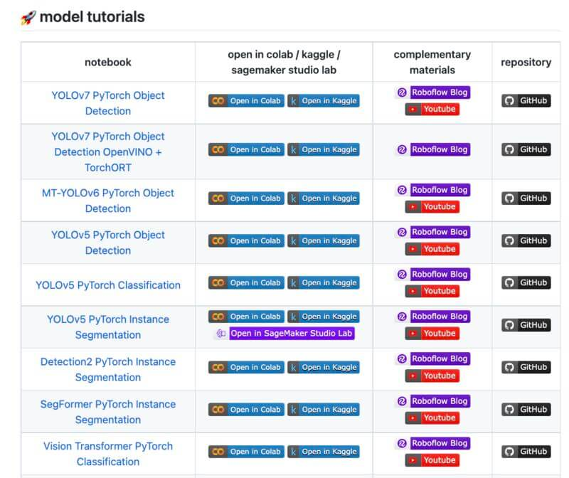

---
key_points:
  - "The free roboflow/notebooks repository on GitHub, from Piotr Skalski and the Roboflow team, holds dozens of step-by-step computer vision tutorials that open in Google Colab or Kaggle."
  - "The model tutorials cover YOLO versions from Scaled-YOLOv4 and YOLOv5 up to YOLO11 and YOLO26, plus RF-DETR, RT-DETR, Florence-2 and PaliGemma."
  - "Segmentation and zero-shot notebooks include SAM, SAM2, SAM3, Grounding DINO, YOLO-World and YOLOE, and a computer vision skills section covers tracking, counting and auto-labelling."
  - "Running a notebook takes a few steps: open it from its Colab badge, switch on a GPU, add a Roboflow API key as a Colab secret, and run the cells in order."
title: "Free Roboflow Notebooks for Training Your Own Computer Vision Models"
author: Richard
date: 2025-08-10
image: /assets/images/comp_vision_roboflow.jpeg
tags: [Computer Vision, Machine Learning, AI]
image_alt: "Cover image for Free Roboflow Notebooks for Training Your Own Computer Vision Models"
series: "Getting Started with Machine Learning"
series_part: 7
category: "Computer Vision"
ai_assistance:
  - drafting
---

Are you looking to learn how to build a computer vision model?

High-quality computer vision tutorials can be found on GitHub, thanks to Piotr Skalski and the Roboflow team.

The screenshot above is from when I first shared this, when the headline notebooks were YOLOv5, YOLOv6 and YOLOv7. The [roboflow/notebooks](https://github.com/roboflow/notebooks) repository has grown a lot since then. Below is what it holds as of November 2026.

## Step-by-step guides to build

The README groups the notebooks into model tutorials, tracker tutorials and computer vision skills. The model tutorials section alone lists 61 notebooks.

### YOLO models

There is a fine-tuning notebook for almost every YOLO release:

- YOLO26, for object detection and instance segmentation
- YOLOv12 and YOLOv10, for object detection
- YOLO11, for object detection and instance segmentation
- YOLOv9, for object detection
- YOLOv8, for detection, segmentation, classification, pose estimation and oriented bounding boxes
- The older ones: YOLOv7, MT-YOLOv6, YOLOv5 (detection, classification, segmentation) and Scaled-YOLOv4

### Other detectors

Notebooks also cover transformer-based detectors such as RF-DETR, RT-DETR and DETR, plus Faster R-CNN, RTMDet and YOLO-NAS. RF-DETR has extra notebooks for segmentation, keypoints and tracking with several trackers, including ByteTrack.

### Segmentation and zero-shot models

Zero-shot models find objects from a text prompt, without training on your own labels. The repository has notebooks for:

- Segment Anything: SAM, SAM2, SAM-2.1 fine-tuning, SAM3 and FastSAM
- Zero-shot detection with Grounding DINO, YOLO-World and YOLOE
- Detection with vision-language models: Florence-2, PaliGemma and PaliGemma2, Qwen2.5-VL, Qwen3-VL and Google Gemini

### Computer vision skills

This section shows whole tasks rather than single models. Examples include counting vehicles with YOLOv8 and ByteTrack, estimating vehicle speed, and auto-labelling a dataset with Grounding DINO and SAM. There is also a notebook on training a package detector from just two labelled images.

## How to run a notebook in Colab

Each row in the README has an "Open in Colab" badge, and most also have a Kaggle badge. These steps follow the setup cells of the [YOLO11 object detection notebook](https://github.com/roboflow/notebooks/blob/main/notebooks/train-yolo11-object-detection-on-custom-dataset.ipynb):

1. Find the notebook in the README table and click its Colab badge. This opens a copy in your browser.
2. Turn on a GPU. In Colab, go to `Edit` → `Notebook settings` → `Hardware accelerator`, choose `GPU` and save. The first code cell runs `nvidia-smi` to confirm it worked.
3. Add your Roboflow API key. Copy it from your [Roboflow settings](https://app.roboflow.com/settings/api) page. In Colab, open `Secrets` (the key icon in the left pane) and save it as `ROBOFLOW_API_KEY`. The notebook uses it to download a dataset.
4. Run the cells from top to bottom. The early cells install the libraries and test a pre-trained model before fine-tuning starts.

The README also explains how to run the notebooks locally with Jupyter, or in Amazon SageMaker Studio Lab. If a notebook breaks, the README asks you to open a bug report.

[Explore the Tutorials](https://github.com/roboflow/notebooks)

Original post by [Salomon Levy](https://www.linkedin.com/in/salomonlevy-kelley) on [LinkedIn](https://www.linkedin.com/feed/update/urn:li:activity:7011395129466912768?utm_source=share&utm_medium=member_desktop)🔗
