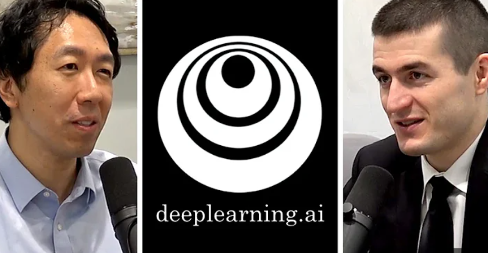

---
key_points:
  - "Lex Fridman and Andrew Ng discuss the challenges students face when learning deep learning concepts."
  - "Andrew Ng shares his insights on the most difficult concepts in deep learning, providing a high-level overview of AI and machine learning."
  - "Lex asks about the most common struggles in deep learning, to which Andrew Ng responds thoughtfully, sparking a fascinating exchange."
  - "The podcast episode offers valuable insights for those interested in pursuing a career in deep learning, covering work culture, colleagues, and management."
  - "Listeners are encouraged to explore Andrew Ng's company, deeplearning.ai, for highly-regarded machine learning courses."
title: "Lex Fridman and Andrew Ng on Deep learning - Lex Podcast"
author: Richard
date: 2025-08-26
image: /assets/images/andrewng_lex.png
tags: [Lex Fridman, Artificial Intelligence, Machine Learning, Lex podcast, Andrew Ng]
image_alt: "Cover image for Lex Fridman and Andrew Ng on Deep learning - Lex Podcast"
category: "AI"
---

Join Lex Fridman and Andrew Ng as they delve into the exciting world of deep learning in this podcast episode. These AI legends share valuable insights on not just deep learning, but also the critical factors to consider when making a career choice between a PhD or a job at a top organization. They also discuss tips on pursuing a career in deep learning, including the importance of work culture, colleagues, and management.

In the episode, Lex poses the question, "What are the concepts in deep learning that students struggle with the most?" Andrew Ng provides a thought-provoking answer and even turns the question back on Lex, making for a fascinating exchange. Although some of the concepts may be unfamiliar to those new to machine learning, the conversation provides a high-level overview of AI and deep learning that is sure to benefit all listeners.

For those interested in learning more about deep learning, check out Andrew Ng's company, deeplearning.ai, which offers highly-regarded machine learning courses. Get started on your AI journey with this insightful podcast episode - watch the AI Podcast Clip on "Advice on Getting Started in Deep Learning" [here](https://www.youtube.com/watch?v=1k37OcjH7BM).

#AI #DeepLearning #MachineLearning #AndrewNg #LexFridman #CareerAdvice #Podcast #Learning #Tech #Innovation