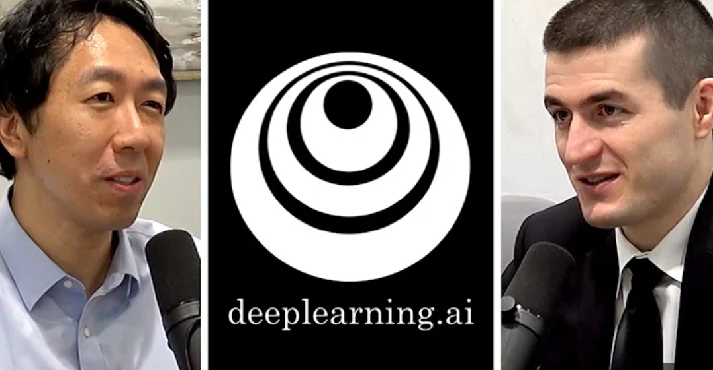

---
key_points:
  - "Lex Fridman and Andrew Ng discuss the challenges students face when learning deep learning concepts."
  - "Andrew Ng shares his insights on the most difficult concepts in deep learning, providing a high-level overview of AI and machine learning."
  - "Lex asks about the most common struggles in deep learning, to which Andrew Ng responds thoughtfully, sparking a fascinating exchange."
  - "The podcast episode offers valuable insights for those interested in pursuing a career in deep learning, covering work culture, colleagues, and management."
  - "Listeners are encouraged to explore Andrew Ng's company, deeplearning.ai, for highly-regarded machine learning courses."
title: "Lex Fridman and Andrew Ng on Deep learning - Lex Podcast"
author: Richard
date: 2025-08-26
image: /assets/images/andrewng_lex.png
tags: [Lex Fridman, Artificial Intelligence, Machine Learning, Lex podcast, Andrew Ng]
image_alt: "Cover image for Lex Fridman and Andrew Ng on Deep learning - Lex Podcast"
category: "AI"
ai_assistance:
  - drafting
---

Join Lex Fridman and Andrew Ng as they delve into the exciting world of deep learning in this podcast episode. These AI legends share valuable insights on not just deep learning, but also the critical factors to consider when making a career choice between a PhD or a job at a top organization. They also discuss tips on pursuing a career in deep learning, including the importance of work culture, colleagues, and management.

In the episode, Lex poses the question, "What are the concepts in deep learning that students struggle with the most?" Andrew Ng provides a thought-provoking answer and even turns the question back on Lex, making for a fascinating exchange. Although some of the concepts may be unfamiliar to those new to machine learning, the conversation provides a high-level overview of AI and deep learning that is sure to benefit all listeners.

For those interested in learning more about deep learning, check out Andrew Ng's company, deeplearning.ai, which offers highly-regarded machine learning courses. Get started on your AI journey with this insightful podcast episode - watch the AI Podcast Clip on "Advice on Getting Started in Deep Learning" [here](https://www.youtube.com/watch?v=1k37OcjH7BM).

## About the episode

The full conversation is [episode #73 of the Lex Fridman Podcast](https://lexfridman.com/andrew-ng/), "Andrew Ng: Deep Learning, Education, and Real-World AI". It was released on 20 February 2020 and runs about an hour and a half. The full video is [on YouTube](https://www.youtube.com/watch?v=0jspaMLxBig). The clip linked above is a short excerpt from it.

Andrew Ng's [own site](https://www.andrewng.org/) lists his roles. He founded DeepLearning.AI, co-founded Coursera, and was the founding lead of the Google Brain team. He is also an adjunct professor at Stanford, executive chairman of LandingAI, and managing general partner at AI Fund.

## What the conversation covers

The points below follow the chapter list on the [episode page](https://lexfridman.com/andrew-ng/).

- **Online education (05:05).** Ng talks about the early days of online courses, before moving on to teaching on a whiteboard at 16:07.
- **Early deep learning (17:46 and 23:17).** He covers early research at Stanford with Pieter Abbeel and the early days of deep learning.
- **Getting started in deep learning (33:23).** This chapter is about deeplearning.ai and how to begin learning the field. A short section on unsupervised learning follows at 45:55.
- **Careers and the PhD question (56:12 and 58:56).** They discuss building a career in deep learning and whether you should get a PhD.
- **Building AI companies (1:03:28 and 1:11:14).** Ng explains AI Fund, which builds startups, and Landing.ai, which helps established companies grow their AI work.
- **Artificial general intelligence (1:20:44).** The episode closes on AGI.

#AI #DeepLearning #MachineLearning #AndrewNg #LexFridman #CareerAdvice #Podcast #Learning #Tech #Innovation