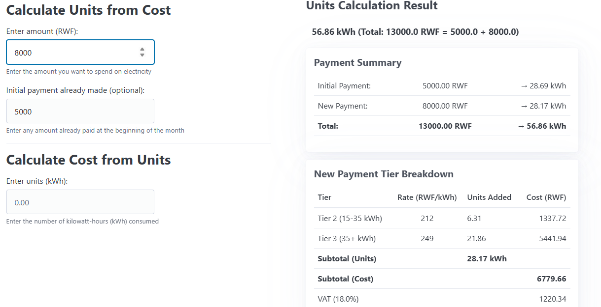

The Rwanda Utilities Regulatory Authority (RURA) has notified the public of a revision to the Electricity End-User Tariff. The revised tariffs will take effect on 01 October 2025.
In residential households, the threshold for the lowest consumption bracket has been extended from 15 kWh to 20 kWh per month, maintaining affordability for basic needs. 

## Rate changes for residential households

**0-20 kWh** per month: RWF **89** per kWh (unchanged from previous rate).
**20-50 kWh** per month: RWF **310** per kWh, an increase from RWF **212**.
Above **50 kWh** per month: RWF **369** per kWh, up from RWF **249**.

For a detailed breakdown of the new rates, see the tables below (VAT exclusive; 18% VAT applies to all rates).

### A. Tariffs for All Customer Categories

| Customer Category | Monthly Block | Tariff (RWF/kWh) |
| --- | --- | --- |
| **Residential (Households)** | 0-20 kWh | 89 |
|  | >20-50 kWh | 310 |
|  | >50 kWh | 369 |
| **Non-Residential** | 0-100 kWh | 355 |
|  | >100 kWh | 376 |
| **Telecom Towers** | All consumed kWh | 289 |
| **Hotels** (annual consumption < 660,000 kWh) | All consumed kWh | 239 |
| **Health Facilities, Schools, and Higher Learning Institutions** | All consumed kWh | 214 |
| **Broadcasters** | All consumed kWh | 276 |
| **Small Industries** (manufacturing and mining 5,000-100,000 kWh annual, hotels above 660,000 kWh, commercial data centers) | All consumed kWh | 175 |
| **Medium Industries** (manufacturing and mining 100,000-1,000,000 kWh annual, water pumping and treatment) | All consumed kWh | 133 |
| **Large Industries** (manufacturing ≥1,000,000 kWh annual, shared broadcasting infrastructure, public EV charging) | All consumed kWh | 110 |
| **Steel, Mining, and Cement Industries** (≥1,000,000 kWh annual) | All consumed kWh | 97 |

### B. Tariffs for Industrial Customers with Smart Meters (Postpaid)

(VAT exclusive; includes energy charge and maximum demand charge per kVA/month)

The last three columns are the maximum demand charge in RWF per kVA per month.

| Industry Category | Energy Charge (RWF/kWh) | Peak Hours (6:00 PM to 10:59 PM) | Off-Peak Hours (11:00 PM to 7:59 AM) | Shoulder Hours (8:00 AM to 5:59 PM) |
| --- | --- | --- | --- | --- |
| **Small** | 175 | 11,017 | 0 | 4,008 |
| **Medium** | 133 | 10,514 | 0 | 3,588 |
| **Large** (Manufacturing ≥1,000,000 kWh) | 110 | 7,184 | 0 | 2,004 |
| **Steel, Mining, Cement** (≥1,000,000 kWh) | 97 | 7,184 | 0 | 2,004 |

### C. Flat Rates for Industrial Customers without Smart Meters (Prepaid)

(VAT exclusive)

| Industry Category | Flat Rate (RWF/kWh) |
| --- | --- |
| **Small** | 175 |
| **Medium** | 156 |
| **Large** | 124 |

For more information, visit [www.rura.rw](https://www.rura.rw).

**Correction (November 2026):** An earlier version of the tables above had some wrong figures. It listed non-residential use above 100 kWh and telecom towers at 386, small industries at 176, and a small-industry off-peak demand charge of 7,590. The [RURA public notice](https://rura.rw/fileadmin/user_upload/RURA/Documents/Tariffs/Public_Notice_on_Electricity_End_User_Tariff__October_2025_.pdf) gives 376, 289, 175 and 0. Broadcasters (276) were also missing. The tables now match the notice.

## Old and new rates side by side

The table below compares the 2020 tariff with the October 2025 tariff. The old rates come from RURA's [2020 board decision](https://rura.rw/fileadmin/user_upload/RURA/Documents/Tariffs/Board_Decision_on_Electricity_End_User_Tariffs_in_Rwanda.pdf). The new rates come from the 2025 public notice. All figures are RWF per kWh, VAT exclusive.

| Customer category | 2020 tariff | October 2025 tariff |
| --- | --- | --- |
| Households, first block | 89 (0-15 kWh) | 89 (0-20 kWh) |
| Households, up to 50 kWh | 212 (15-50 kWh) | 310 (20-50 kWh) |
| Households, above 50 kWh | 249 | 369 |
| Non-residential, 0-100 kWh | 227 | 355 |
| Non-residential, above 100 kWh | 255 | 376 |
| Telecom towers | 201 | 289 |
| Hotels | 157 | 239 (below 660,000 kWh a year) |
| Health facilities | 186 | 214 (now also schools and higher learning institutions) |
| Broadcasters | 192 | 276 |

Industrial rates are harder to compare. The 2020 decision put small industries at up to 22,000 kWh a year. The 2025 notice uses 5,000 to 100,000 kWh. The size bands moved, so the old and new industrial prices do not describe the same customers.

## Why RURA changed the tariff

The [public notice](https://rura.rw/fileadmin/user_upload/RURA/Documents/Tariffs/Public_Notice_on_Electricity_End_User_Tariff__October_2025_.pdf) says the revision aligns prices with real supply costs. It notes the tariff was last revised in 2020. It also states its aims. These are to protect basic household use and give health facilities and schools preferential rates. Others are to push industries toward off-peak hours and to support e-mobility charging.

[KT Press](https://www.ktpress.rw/2025/09/new-power-tariffs-small-consumers-manufacturers-are-biggest-winners) adds more detail. It reports that the dollar rose from about RWF 1,000 to above RWF 1,400 since the last tariff. It says about 83% of the utility's operating costs are pegged to the dollar. It puts the average tariff increase at 15.1%, from RWF 186 to 214 per kWh.

The [New Times](https://www.newtimes.co.rw/article/29797/news/energy/electricity-tariffs-to-be-reviewed-every-three-months) reported that the Ministry of Infrastructure plans to review tariffs every three to four months. The goal is to keep tariffs in line with production costs.

## What it means for a household or small business

The figures below use the block rates in the two tables. Each block is charged only on the kWh inside it, as the calculator further down does. They exclude VAT.

- **A household using 20 kWh a month** paid RWF 2,395 under the 2020 tariff (15 kWh at 89, plus 5 kWh at 212). It now pays RWF 1,780. That is about 26% less, because the first block grew to 20 kWh.
- **A household using 50 kWh a month** paid RWF 8,755. It now pays RWF 11,080, about 27% more.
- **A household using 100 kWh a month** paid RWF 21,205. It now pays RWF 29,530, about 39% more.
- **A small shop using 100 kWh a month** on the non-residential tariff paid RWF 22,700. It now pays RWF 35,500, about 56% more.

So the change depends on how much you use. Households using up to about 26 kWh a month pay the same or less. Households above that, and small businesses, pay more. Schools and health facilities see a smaller rise than other non-residential users.

**Update (November 2026):** As of November 2026, RURA's [tariffs page](https://www.rura.rw/publications/tariffs) still lists the October 2025 notice as its most recent electricity tariff.

Included below is a post from Rwanda Utilities Regulatory Authority announcing the revised tariffs.

<blockquote class="twitter-tweet">
The Rwanda Utilities Regulatory Authority (RURA) hereby notifies the public that the Electricity End-User Tariff has been revised pursuant to the provisions of Law Nº09/2013 of 01 March 2013 establishing RURA.  The revised tariff shall come into force on 01 October 2025 <a href="https://t.co/0KXbG8w2sY">pic.twitter.com/0KXbG8w2sY</a>
&mdash; Rwanda Utilities Regulatory Authority - RURA (@RURA_RWANDA) <a href="https://twitter.com/RURA_RWANDA/status/1968345033389797563?ref_src=twsrc%5Etfw">September 17, 2025</a></blockquote> 

## App for electricity calculation

Calculating how much electricity I get from the table is time consuming, so I created an app to help calculate this. It gives the approximate units in kWH you receive per RWF and vice versa. This takes into account the 18% VAT and displays the breakdown of costs across tiers. Also added a feature to calculate the remaining kWH if you have already paid for electricity at the beginning of the month.

Find it [here](https://rwanda-energy-calculator.onrender.com/)

**External sources:**

- [All Africa](https://allafrica.com/stories/202509180078.html)
- [New times Rwanda](https://www.newtimes.co.rw/article/29789/news/energy/rura-announces-new-electricity-tariffs-here-is-what-we-know)
