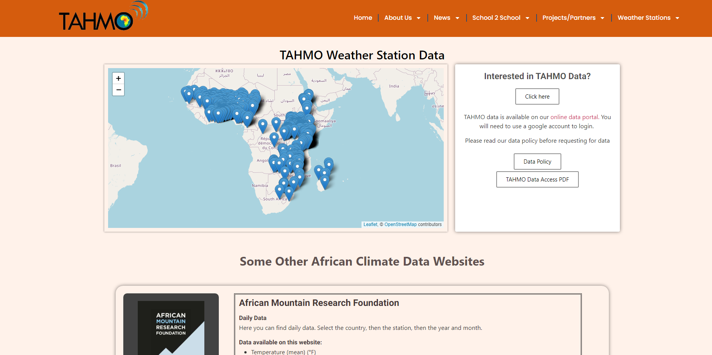
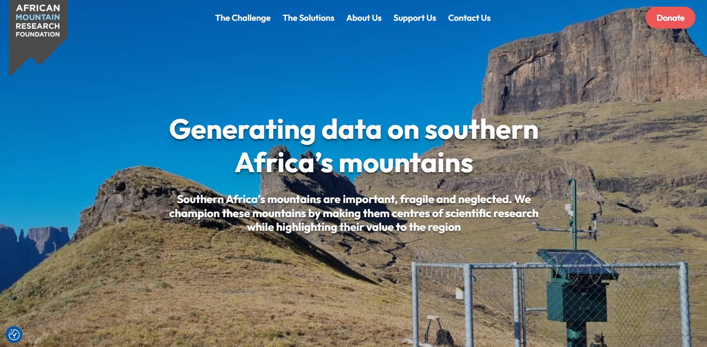
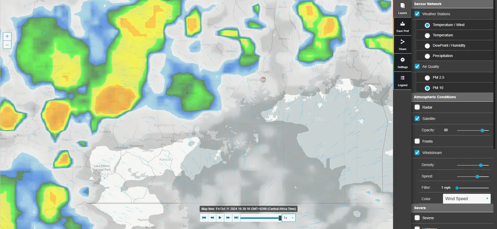
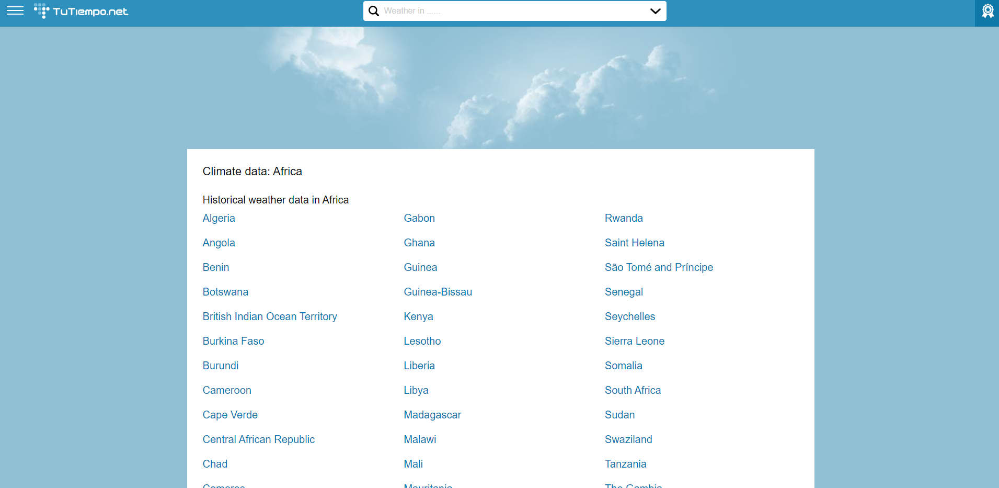
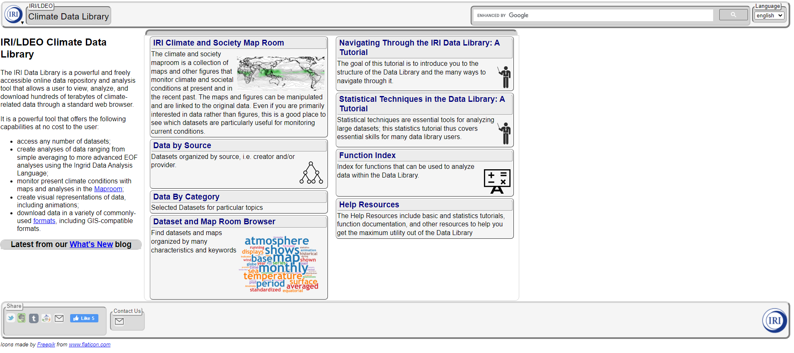
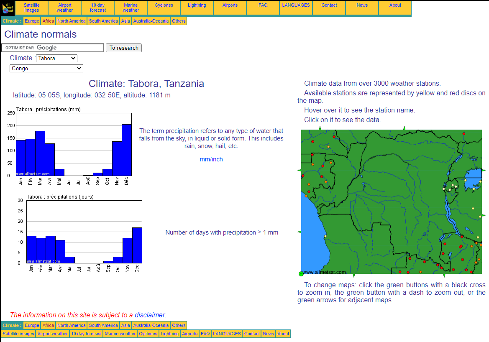
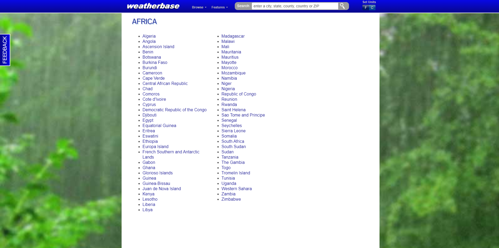
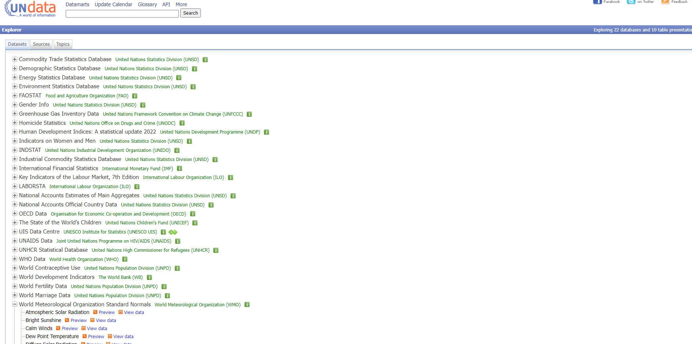
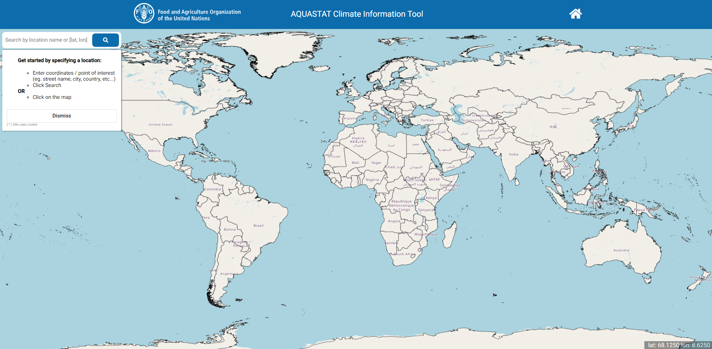
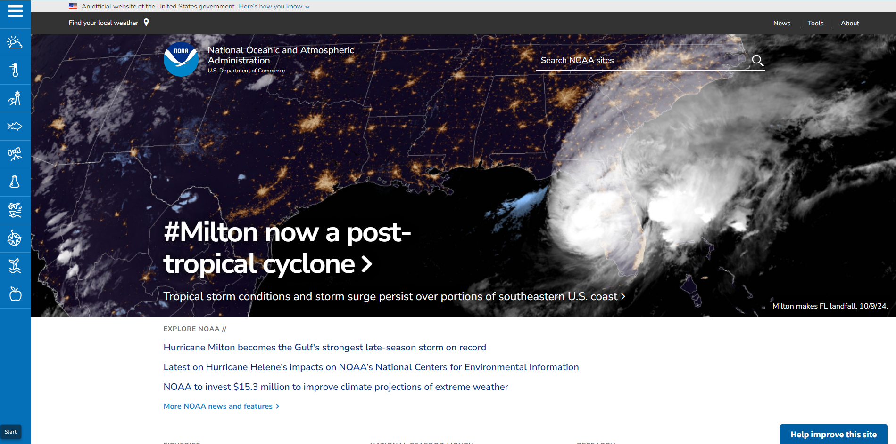

---
key_points:
  - "TAHMO runs weather stations across sub-Saharan Africa. Its station data sits behind a login on its data portal, you request it under a data policy, and it also offers a cleaned daily rainfall dataset and a sample download."
  - "For long station records, NOAA's GHCN-daily holds daily temperature and rainfall from more than 100,000 stations worldwide, including African ones, as free plain-text files. Climate Data Online is the search interface for the same archive."
  - "The African Mountain Research Foundation shares free data from eleven high-elevation stations in Lesotho, Malawi, South Africa and Zimbabwe, with records from 2020."
  - "Sites such as Tutiempo, Weather Underground, All Met Sat and Weatherbase are quick for looking up one town, but they show station summaries on web pages, so check the station and units before you use them in research."
title: Top Websites for African Climate Data
date: 2025-10-09 12:12:00
author: Richard
image: /assets/images/weather_post/wunderground.webp
video: ""
layout: post
tags: [Climate data, Africa, data for climate, websites for environmental data, climate data in Africa]
image_alt: "Cover image for Top Websites for African Climate Data"
card_items:
  - name: "TAHMO (Trans-African Hydro-Meteorological Observatory)"
    image: "/assets/images/weather_post/tahmo.png"
    url: "https://tahmo.org/climate-data/"
    badge_1: "Station data"
    badge_2: "Login and request"
    description: "Station observations from TAHMO's network, through a data portal that needs a Google login and a request under its data policy. A cleaned daily rainfall dataset and sample data are linked from the same page."
    link_text: "Visit TAHMO"

  - name: "African Mountain Research Foundation"
    image: "/assets/images/weather_post/african_mr.png"
    url: "https://africanmountainresearch.com/the-solutions/our-data/"
    badge_1: "High elevation"
    badge_2: "4 countries"
    description: "Eleven mountain weather stations in Lesotho, Malawi, South Africa and Zimbabwe, with an archive from 2020. Wind, temperature, humidity, pressure, rainfall and solar radiation, free for research and policy use."
    link_text: "Visit the data page"

  - name: "Weather Underground"
    image: "/assets/images/weather_post/wunderground.webp"
    url: "https://www.wunderground.com/history"
    badge_1: "Daily history"
    badge_2: "Search by city or airport"
    description: "Look up past daily weather for a city or airport code, mostly from airport reports, plus personal weather stations where people have installed them. Units default to Fahrenheit and can be switched."
    link_text: "Visit Weather Underground"

  - name: "Tutiempo"
    image: "/assets/images/weather_post/tutiempo.png"
    url: "https://en.tutiempo.net/climate/africa.html"
    badge_1: "Station history"
    badge_2: "Country lists"
    description: "Monthly and daily station summaries for most African countries, browsed by country and station. Record length varies; for Ghana the year list starts in 1942 with gaps."
    link_text: "Visit Tutiempo"

  - name: "IRI Data Library"
    image: "/assets/images/weather_post/iri_data.png"
    url: "https://iridl.ldeo.columbia.edu/"
    badge_1: "Gridded datasets"
    badge_2: "Free analysis tools"
    description: "Columbia University's free repository of climate datasets, with in-browser analysis, maps and downloads in common formats, including GIS-ready files."
    link_text: "Visit IRI Data Library"

  - name: "All Met Sat"
    image: "/assets/images/weather_post/allmetsat.png"
    url: "https://www.allmetsat.com/en/climate/africa.php"
    badge_1: "Climate normals"
    badge_2: "3,000+ stations"
    description: "A clickable map of climate normals for more than 3,000 stations in Africa and nearby regions. The same site shows airport weather reports (METAR)."
    link_text: "Visit All Met Sat"

  - name: "Weatherbase"
    image: "/assets/images/weather_post/weatherbase.png"
    url: "https://www.weatherbase.com/weather/country.php3?r=AFR&refer=&regionname=Africa"
    badge_1: "City averages"
    badge_2: "Travel use"
    description: "Monthly climate averages by city, aimed at travellers. Useful for a quick look, not for analysis."
    link_text: "Visit Weatherbase"

  - name: "UNdata: WMO climate normals"
    image: "/assets/images/weather_post/undata.png"
    url: "https://data.un.org/Explorer.aspx?d=CLINO"
    badge_1: "1961 to 1990 normals"
    badge_2: "CSV and XML"
    description: "World Meteorological Organization standard normals, mostly for 1961 to 1990, by station and month. Free download as CSV or XML, up to 100,000 records at a time."
    link_text: "Visit UNdata"

  - name: "FAO Climate Information Tool"
    image: "/assets/images/weather_post/aquastat.png"
    url: "https://aquastat.fao.org/climate-information-tool"
    badge_1: "Any location"
    badge_2: "Interpolated"
    description: "Click anywhere on the map for long-term monthly climate values estimated from nearby stations, including rainfall, temperature and reference evapotranspiration."
    link_text: "Visit the tool"

  - name: "NOAA GHCN-daily"
    image: "/assets/images/weather_post/noaa.png"
    url: "https://www.ncei.noaa.gov/products/land-based-station/global-historical-climatology-network-daily"
    badge_1: "Daily station records"
    badge_2: "Free download"
    description: "Daily maximum and minimum temperature and rainfall from more than 100,000 stations in 180 countries and territories, as free plain-text files, one per station."
    link_text: "Visit GHCN-daily"
series: "Free Satellite and Climate Data"
series_part: 5
category: "Climate & Environment"
content_type: guide
---
If you need weather or climate data for an African town, the first question is what kind you need: readings from a real station, long-term averages, or an estimate for a place with no station at all. The sites below cover those three cases, and each entry says what is there, where it covers, and whether you need to log in or ask.

This list began from [TAHMO's climate data page](https://tahmo.org/climate-data/), which links to most of these sites. Each entry here is rewritten from the site's own pages, and all figures and links were checked on 26 November 2026.

## Quick comparison

| Site | Best for | What's there | Coverage | Access |
|---|---|---|---|---|
| [TAHMO](https://tahmo.org/climate-data/) | Station readings | Station observations; cleaned daily rainfall | TAHMO stations in sub-Saharan Africa | Google login on the portal, request under a data policy |
| [African Mountain Research Foundation](https://africanmountainresearch.com/the-solutions/our-data/) | Station readings | Wind, temperature, humidity, pressure, rainfall, solar radiation | 11 mountain stations in Lesotho, Malawi, South Africa, Zimbabwe; from 2020 | Free, live and historical download |
| [Weather Underground](https://www.wunderground.com/history) | Station readings | Past daily weather by city or airport | Worldwide, where a station reports | Free on the web |
| [Tutiempo](https://en.tutiempo.net/climate/africa.html) | Station readings | Monthly and daily station summaries | Most African countries; some stations back to the 1940s | Free on the web |
| [IRI Data Library](https://iridl.ldeo.columbia.edu/) | Gridded data | Gridded and station climate datasets with analysis tools | Global | Free, download in many formats |
| [All Met Sat](https://www.allmetsat.com/en/climate/africa.php) | Long-term averages | Climate normals per station | More than 3,000 stations in Africa and nearby | Free on the web |
| [Weatherbase](https://www.weatherbase.com/weather/country.php3?r=AFR&refer=&regionname=Africa) | Long-term averages | Monthly city averages | Cities worldwide | Free on the web |
| [UNdata (WMO normals)](https://data.un.org/Explorer.aspx?d=CLINO) | Long-term averages | Monthly normals, mostly 1961 to 1990 | 141 countries and territories | Free, CSV or XML |
| [FAO Climate Information Tool](https://aquastat.fao.org/climate-information-tool) | Estimates anywhere | Long-term monthly values estimated from nearby stations | Any point on land | Free on the web |
| [NOAA GHCN-daily](https://www.ncei.noaa.gov/products/land-based-station/global-historical-climatology-network-daily) | Station readings | Daily temperature and rainfall | More than 100,000 stations in 180 countries and territories | Free plain-text files |

## TAHMO

TAHMO installs and runs automatic weather stations across sub-Saharan Africa. Its data is not an open download: you sign in to the [TAHMO data portal](https://portal.tahmo.org/) with a Google account and request data under TAHMO's data policy, which is linked as a PDF from the climate data page. The same page offers a cleaned daily precipitation dataset with quality flags, which TAHMO suggests for checking satellite rainfall products and forecasts, and a sample file you can download first. **[Visit TAHMO](https://tahmo.org/climate-data/)**

## African Mountain Research Foundation

The foundation runs eleven weather stations on mountains in Lesotho, Malawi, South Africa and Zimbabwe. The highest is at 3,162 m in Lesotho, and the archive starts in 2020. The stations record wind speed and direction, air temperature, relative humidity, pressure, rainfall and solar radiation. Each station has its own live data link on the data page, and the historical data can be exported. The foundation says the data is free for research, academic study and policy work. **[Visit the data page](https://africanmountainresearch.com/the-solutions/our-data/)**

## Weather Underground

On the historical weather page you type a city, airport code or ZIP code and pick a date; the year list starts at 1920. In most African cities the readings come from the airport, so a "city" record is usually one airport station. Values show in Fahrenheit by default; switch to Celsius in settings. **[Visit Weather Underground](https://www.wunderground.com/history)**

## Tutiempo

Tutiempo lists stations by country for most of Africa. You pick a station, then a year, to see monthly and daily summaries of temperature, rainfall, humidity, wind and visibility. Record length varies a lot: Ghana's list offers years from 1942, but with a jump from 1945 to 1973, and stations do not all report every year. **[Visit Tutiempo](https://en.tutiempo.net/climate/africa.html)**

## IRI Data Library

The IRI Data Library at Columbia University hosts hundreds of terabytes of climate datasets, mostly gridded products such as rainfall and temperature analyses. You can average, map and animate data in the browser, then download it in common formats, including GIS-ready ones. Its Maproom has ready-made maps of current and recent climate conditions. It is free. **[Visit IRI Data Library](https://iridl.ldeo.columbia.edu/)**

## All Met Sat

All Met Sat shows climate normals for more than 3,000 stations on a clickable map of Africa and nearby regions; you click a station dot to see its monthly averages. The site also shows current airport weather reports (METAR), but its climate pages hold long-term averages, not daily records. **[Visit All Met Sat](https://www.allmetsat.com/en/climate/africa.php)**

## Weatherbase

Weatherbase gives monthly climate averages for cities and is written for travel planning. Use it for a quick sense of a city's seasons, not for analysis. **[Visit Weatherbase](https://www.weatherbase.com/weather/country.php3?r=AFR&refer=&regionname=Africa)**

## UNdata: WMO climate normals

UNdata hosts the World Meteorological Organization's standard climate normals, mostly for 1961 to 1990, with some stations covering shorter periods. Values are monthly, per station, for variables such as temperature. You filter by country and download up to 100,000 records at a time as CSV or XML. These are averages, not daily data, and the period is old, so check whether a newer national normal exists for your country. **[Visit UNdata](https://data.un.org/Explorer.aspx?d=CLINO)**

## FAO Climate Information Tool

You click a point on the map and it estimates long-term monthly climate values from nearby stations, so you get numbers even where there is no station. Variables include rainfall, temperature, humidity, wind speed, sunshine and reference evapotranspiration. This is the tool's current address; the old AQUASTAT link now redirects. Because the values are interpolated, they will be rougher in places with few stations. **[Visit the tool](https://aquastat.fao.org/climate-information-tool)**

## NOAA GHCN-daily

The Global Historical Climatology Network daily (GHCN-daily), run by NOAA's National Centers for Environmental Information, combines daily station records from national weather services and other archives and runs common quality checks on them. It has more than 100,000 stations in 180 countries and territories. The main variables are maximum and minimum temperature and daily rainfall, and about half the stations report rainfall only. Records range from under a year to more than 175 years. You can download one plain-text file per station, or search the same archive through [Climate Data Online](https://www.ncei.noaa.gov/cdo-web/). In November 2026 NOAA's page warned that some access portals were unavailable during a move to the cloud. **[Visit GHCN-daily](https://www.ncei.noaa.gov/products/land-based-station/global-historical-climatology-network-daily)**

## Which one to use

For a daily station time series, start with GHCN-daily and check whether your area has a station with the years you need. If it does not, see whether TAHMO has a station nearby and request its data, or, for mountain sites in southern Africa, use the African Mountain Research Foundation. Tutiempo and Weather Underground are fine for a quick look at one town but are summaries on web pages, mostly from airports. For long-term averages, use the WMO normals on UNdata or All Met Sat. For a place with no station, the FAO tool gives an estimate; for gridded rainfall and temperature, use the IRI Data Library or the posts below.

## Related posts

For gridded data and satellite products, see my [Google Earth Engine guide](/gee_recommendation/). For free hourly weather history at any coordinate through a simple API, see [Open-Meteo's historical weather archive](/open-meteo-archive-free-historical-weather-data/).

**Update (November 2026):** Revised to credit TAHMO's list, correct the African Mountain Research Foundation and All Met Sat entries, update the FAO tool link, point NOAA to GHCN-daily, and describe each site from its own pages.
