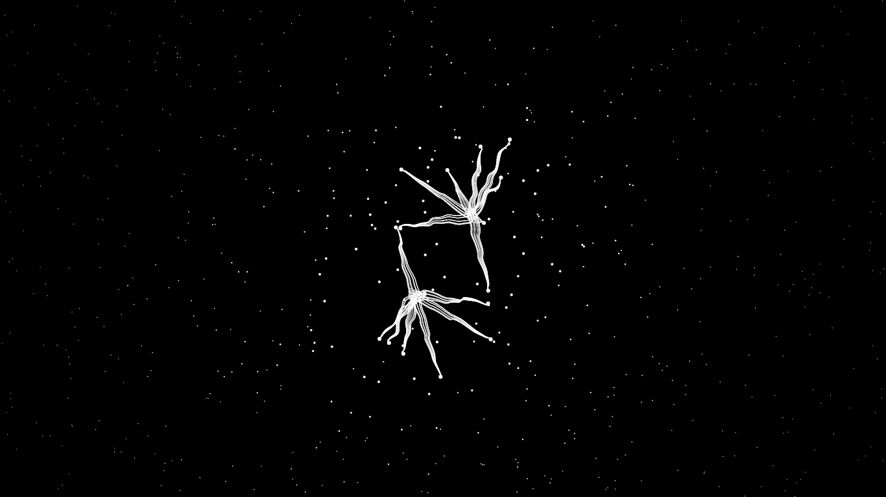
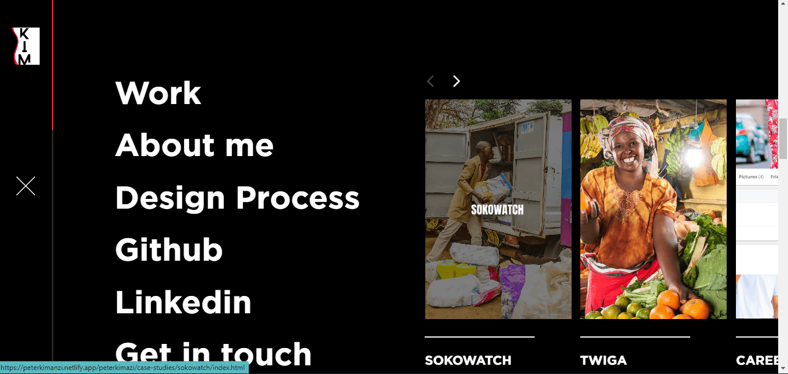

_Developer from Nairobi, Kenya._

I found a repository of web development projects on GitHub which belongs to Peter Kimanzi, a web developer from Nairobi. The site that really caught my eye was a kind of animation that follows the mouse cursor as it moves on the screen and was inspired by the TV series Stranger Things.

I admire his work and I am also surprised to see he built some of his websites, including his portfolio website, with just HTML, CSS, and JavaScript.

Beautiful! In my opinion, for one man’s work.

Here is a screen recording of the [Stranger Things site](https://peter-kimanzi.github.io/Stranger-things-animation/). Notice the mouse pointer and how the "creatures" follow it.

<video width="100%" preload="metadata" controls muted playsinline>
  <source src="{{ '/assets/videos/kimanzi_stranger_things.mp4' | relative_url }}" type="video/mp4">
  Your browser does not support the video tag.
</video>

The animation follows a mouse, so it doesn't respond as well to touch on a phone.

Find his portfolio site here:

[Peter Kimanzi's Portfolio Website](https://peterkimanzi.netlify.app/)

And his GitHub repository if you want to explore it as well:

[Peter Kimanzi's GitHub Repository](https://github.com/peter-kimanzi)

He’s also on LinkedIn: [Peter Kimanzi](https://www.linkedin.com/in/peter-kimanzi-002299206/)

Interesting developer, interesting repository.

_Disclaimer: I have not met nor know Peter personally._

