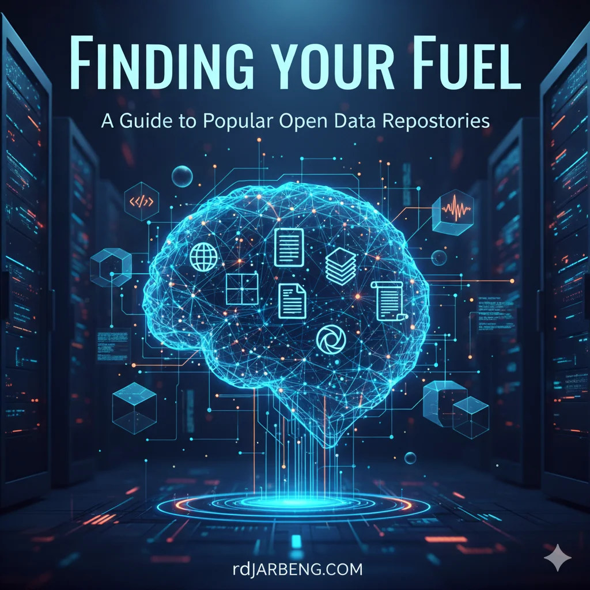

In data science and machine learning, data is the new oil—it's the fuel that powers our models and insights. But finding the _right_ data can be a challenge. Whether you're a seasoned researcher, a data scientist looking for a competition, or a student just starting, knowing where to look is key.

Here’s a breakdown of some of the most popular and useful open data repositories available today.

The list below is grouped by the topics I write about most: air quality, Earth observation, Africa and general machine learning. The cards at the end of the post cover more general repositories, such as Google Dataset Search, OpenML and the AWS Registry of Open Data.

## Air quality

**[OpenAQ](https://openaq.org/)** is a nonprofit that gathers air quality measurements from monitoring stations around the world. It covers pollutants such as PM2.5, PM10, ozone, NO₂, SO₂, CO and black carbon. Data comes through a map or an open API, and the API [needs a free key](https://docs.openaq.org/using-the-api/api-key) sent with each request.

**[AirQo](https://www.airqo.net/)** is an air quality monitoring network for African cities, run by Makerere University in Uganda. It publishes real-time, hyperlocal readings, and its Air Quality API gives both raw and calibrated data.

US embassy monitors are another source in many African capitals. I covered how to get that data in [this guide to US embassy air quality data](/guide-to-accessing-air-quality-data-from-us-embassies-worldwide/). The [air quality hub](/air-quality/) collects my other posts on the topic.

## Earth observation

**[Copernicus Data Space Ecosystem](https://dataspace.copernicus.eu/)** gives free access to imagery from the European Sentinel satellites, covering land, ocean and atmosphere. You can browse and download in the Copernicus Browser, or use APIs such as STAC, openEO and Sentinel Hub. My post on [what each Sentinel satellite measures](/copernicus-powering-earth-observation-with-sentinel-satellites/) explains which mission to pick.

**[Google Earth Engine Data Catalog](https://developers.google.com/earth-engine/datasets)** describes itself as holding more than forty years of imagery and scientific datasets. It includes Landsat, Sentinel and MODIS, plus climate, terrain and land cover layers. See my [introduction to Earth Engine](/gee_recommendation/) for a short worked example.

**[NASA Earthdata](https://www.earthdata.nasa.gov/)** is the entry point to NASA's Earth science archive, which the site puts at more than 178 petabytes. The Earthdata Search tool lets you find, compare and download data. According to the [Earthdata Login page](https://urs.earthdata.nasa.gov/), the data is free to all except where international agreements apply.

## Africa-focused

**[Zindi](https://zindi.world/)** hosts AI competitions, courses and a community of data scientists, and each competition comes with its own dataset. I wrote up two of them: the [Ghana crop disease detection challenge](/zindi-ghana-crop-disease-detection-challenge/) and the [urban heat island challenge](/zindi-urban-heat-island-prediction-challenge/).

**[Humanitarian Data Exchange (HDX)](https://data.humdata.org/)** is an open platform linked to the [Centre for Humanitarian Data](https://centre.humdata.org/), a service of the UN Office for the Coordination of Humanitarian Affairs (OCHA). It is the [main source](https://en.wikipedia.org/wiki/Humanitarian_Data_Exchange) of the Common Operational Datasets, the shared reference data that humanitarian responders use across sectors.

For weather and climate records, my list of [websites for African climate data](/top-websites-for-african-climate-data/) goes further.

## General machine learning

**[Kaggle Datasets](https://www.kaggle.com/datasets)** holds thousands of user-published datasets. Each one usually has shared notebooks, so you can see how others cleaned and modelled it.

**[Hugging Face Datasets](https://huggingface.co/datasets)** is strongest for text, audio and images. The `datasets` Python library loads them straight into your code.

**[UCI Machine Learning Repository](https://archive.ics.uci.edu/)** is one of the oldest dataset archives, running since 1987. Its datasets are small and tidy, which suits teaching and quick benchmarks.

One change since this post first went up: the Papers With Code datasets page now redirects to [Hugging Face's trending papers](https://huggingface.co/papers/trending), so the card for it below no longer leads to a dataset list.

