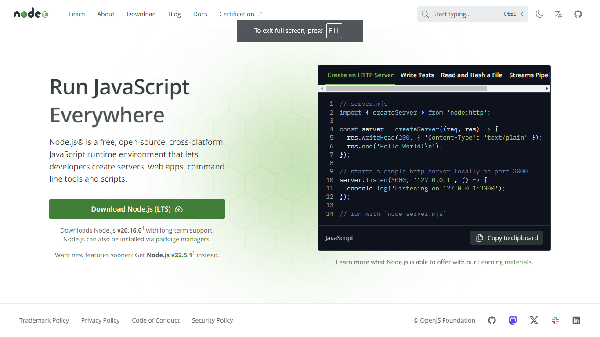

# How to install NodeJs on the Raspberry Pi 4
Tested on Raspberry Pi 4B using the terminal

Steps:
Assuming you have a Raspberry Pi already setup. If you need help setting up find resources [here](https://www.raspberrypi.com/documentation/computers/getting-started.html)
1. Turn on the raspberry Pi. <br> _Optional: If you are not using a monitor you can ssh into the Raspberry Pi and run the commands from there._
2. Open a terminal window
3. Run these commands to download node version 18.18.0 (LTS) from the terminal on the Raspberry Pi. You need to copy and paste these into the terminal or use a bash script.

### Commands
```
wget https://nodejs.org/dist/v18.18.0/node-v18.18.0-linux-armv7l.tar.xz

tar -xvf node-v18.18.0-linux-armv7l.tar.xz
cd node-v18.18.0-linux-armv7l
sudo cp -R * /usr/local/
```
### Check installation
4. To check if the NodeJs installation worked run this:
```
node --version
```

This should print out the current NodeJs version; The commands given installed version 18.18.0. For installing packages **npm** should come installed with your version of NodeJs if you installed a recent version of NodeJs.

## Installing different Node versions
_Optional_
If you wish to change the node version to install, you can change the link in the command. Here we used version 18.18.0: `https://nodejs.org/dist/v18.18.0/node-v18.18.0-linux-armv7l.tar.xz`

but you can use any link from the [NodeJs download page](https://nodejs.org/en/download) . Use the ARM7 linux binaries link (`armv7l`) on a 32-bit Raspberry Pi OS. On the 64-bit version of Raspberry Pi OS, use the `arm64` link instead.


## Replacing Node.js 18 with Node.js 16

Some older projects only run on Node.js 16. If Node.js was installed with `apt`, you can swap versions with the [NodeSource](https://github.com/nodesource/distributions) repository.



### Remove the existing Node.js version

```
sudo apt remove nodejs
```

If you installed Node.js from the tarball above instead, `apt` won't find it. Delete the copied files from `/usr/local/` (`bin/node`, `bin/npm`, `bin/npx`, `lib/node_modules`, `include/node`) before installing another version.

### Add the NodeSource repository for Node.js 16

```
curl -fsSL https://deb.nodesource.com/setup_16.x | sudo -E bash -
```

### Install Node.js 16

```
sudo apt install -y nodejs
```

Check the version with `node -v`. It should print `v16.x.x`.

Node.js 16 stopped receiving security updates in September 2023 (see the [Node.js release schedule](https://github.com/nodejs/release#end-of-life-releases)). Use it only for a project that needs it, and move to a supported version when you can.
