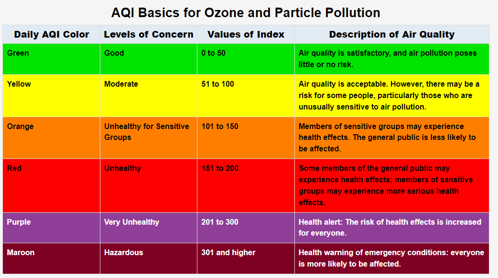

There is no single Air Quality Index. Many countries run their own ([Wikipedia list of national indices](https://en.wikipedia.org/wiki/Air_quality_index#Indices_by_location)), with different scales, colours and cut-offs (see [international AQI standards](#international-aqi-standards) below). This post explains the most widely quoted one: the US Air Quality Index, run by the U.S. Environmental Protection Agency (EPA). It is the scale behind [AirNow](https://www.airnow.gov/), which also reports readings from monitors at some US embassies and consulates abroad. Many air quality apps use it too. Unless stated otherwise, "AQI" below means the US AQI.

## How the AQI Works

The AQI uses a color-coded system with six categories, each representing a different level of health concern. These categories are based on index values that range from 0 to 500+. As the AQI value increases, so does the level of air pollution and the associated health risks.

Here's a breakdown of the AQI categories for the United States:

| AQI Category | Index Values | Health Concern | Color Code |
| --- | --- | --- | --- |
| Good | 0-50 | Minimal or no risk | Green |
| Moderate | 51-100 | Potential risk for sensitive individuals | Yellow |
| Unhealthy for Sensitive Groups | 101-150 | Health effects for sensitive groups | Orange |
| Unhealthy | 151-200 | Health effects possible for general public | Red |
| Very Unhealthy | 201-300 | Health alert for everyone | Purple |
| Hazardous | 301+ | Emergency conditions | Maroon |

[_Image source_](https://www.airnow.gov/aqi/aqi-basics/)

## Key Pollutants Measured

The EPA establishes AQI values for five major air pollutants regulated by the Clean Air Act:

1. Ground-level ozone
2. Particle pollution (PM2.5 and PM10)
3. Carbon monoxide
4. Sulfur dioxide
5. Nitrogen dioxide

Each of these pollutants has a national air quality standard set by the EPA to protect public health.

## Using the AQI

### Where the PM2.5 AQI comes from

The official daily AQI for PM2.5 uses the [24-hour](https://www.airnow.gov/aqi/aqi-basics/using-air-quality-index/) average concentration measured at a monitoring station, in micrograms per cubic metre (µg/m³). In the US these are regulatory monitors run by state and local agencies. Outside the US, AirNow also shows readings from monitors at some US embassies and consulates.

The AQI you see on AirNow during the day is different. It is a "current" AQI worked out from the NowCast, an average of the concentrations over the previous 12 hours that gives more weight to recent hours when air quality is changing fast, for example during a fire ([EPA technical assistance document, May 2026](https://document.airnow.gov/technical-assistance-document-for-the-reporting-of-daily-air-quailty.pdf)). Apps that use low-cost sensors or satellite and model estimates may convert those to an AQI too, but those numbers are less accurate than a reference monitor. For example, uncorrected PurpleAir sensors read PM2.5 about 40% too high ([Barkjohn et al., 2021](https://doi.org/10.5194/amt-14-4617-2021)).

The EPA's [Air Quality Guide for Particle Pollution](https://www.airnow.gov/sites/default/files/2023-03/air-quality-guide-for-particle-pollution_0.pdf) gives this advice for PM:

- **Green (0-50)**: A great day to be active outside.
- **Yellow (51-100)**: Unusually sensitive people should consider shorter, less intense outdoor activities.
- **Orange (101-150)**: Sensitive groups should make outdoor activities shorter and less intense, and take more breaks.
- **Red (151-200)**: Sensitive groups should avoid long or intense outdoor activities. Everyone else should reduce them.
- **Purple (201-300)**: Sensitive groups should avoid all physical activity outdoors. Everyone else should avoid long or intense activities.
- **Maroon (301+)**: Everyone should avoid all physical activity outdoors.

Sensitive groups here include people with heart or lung disease, older adults, children and teenagers, and outdoor workers.

## Importance of the AQI

The AQI turns a concentration into a colour and a plain instruction. That lets people, especially those in sensitive groups, decide whether to cut back on time outdoors. In the US, state and local agencies use it to issue smoke and pollution warnings in a form the public already knows. Few African cities have an agency doing this yet.

Regulators such as the EPA judge compliance against legal concentration limits in µg/m³, not against the AQI number ([EPA fact sheet](https://www.epa.gov/system/files/documents/2024-02/pm-naaqs-air-quality-index-fact-sheet.pdf)).

## How to Access AQI Information

You can easily access AQI information for your area through various channels:

- **AirNow Website**: The EPA's AirNow website provides real-time AQI data for locations across the United States.
- **Mobile Apps**: Many weather and air quality apps include AQI information.
- **Local News**: Many local news stations include AQI forecasts in their weather reports.
- **State and Local Air Quality Agencies**: These agencies often provide detailed local air quality information.

## Calculate the AQI from PM readings

The Air Quality Index (AQI) used by the US EPA measures both **PM2.5** and **PM10**. PM2.5 refers to particulate matter with a diameter of 2.5 micrometers or smaller, while PM10 includes particles up to 10 micrometers in diameter ([EPA PM basics](https://www.epa.gov/pm-pollution/particulate-matter-pm-basics)). [What PM2.5 is](/what-is-particulate-matter-pm2.5-and-the-environmental-significance/) covers where these particles come from.

To calculate the AQI from PM readings, the process involves several steps:

1. **Take the 24-hour average concentration** of PM2.5 or PM10 (in micrograms per cubic meter, µg/m³). A single reading from a sensor app is not enough, because the breakpoints are set for 24-hour averages.
2. **Compare the measured concentration** to the EPA's AQI breakpoints, which define ranges of concentrations and corresponding AQI values. The PM2.5 breakpoints are in the table below.

3. **Use the formula** to calculate the AQI for the specific pollutant: 

   $$ \text{AQI} = \left( \frac{\text{IHI} - \text{ILO}}{\text{BPHI} - \text{BPLO}} \right) \times (\text{Cp} - \text{BPLO}) + \text{ILO} $$

   Where:

- **BPHI** and **BPLO** are the upper and lower concentration breakpoints of the band that contains Cp.
- **IHI** and **ILO** are the AQI values at the top and bottom of that same band.
- **Cp** is the actual concentration of the pollutant.

4. **Select the highest AQI value** among all pollutants to represent the overall AQI for the area.

### PM2.5 breakpoints

These are the breakpoints for a 24-hour PM2.5 average. The EPA announced new values on 7 February 2024, and they have applied since 6 May 2024 ([EPA fact sheet](https://www.epa.gov/system/files/documents/2024-02/pm-naaqs-air-quality-index-fact-sheet.pdf)).

| AQI category | AQI values | PM2.5 since May 2024 (µg/m³) | PM2.5 before May 2024 (µg/m³) |
| --- | --- | --- | --- |
| Good | 0 to 50 | 0.0 to 9.0 | 0.0 to 12.0 |
| Moderate | 51 to 100 | 9.1 to 35.4 | 12.1 to 35.4 |
| Unhealthy for Sensitive Groups | 101 to 150 | 35.5 to 55.4 | 35.5 to 55.4 |
| Unhealthy | 151 to 200 | 55.5 to 125.4 | 55.5 to 150.4 |
| Very Unhealthy | 201 to 300 | 125.5 to 225.4 | 150.5 to 250.4 |
| Hazardous | 301 and above | 225.5 and above | 250.5 and above |

The "Good" ceiling dropped to 9.0 to match the EPA's new annual PM2.5 standard of 9.0 µg/m³. The 24-hour standard stayed at 35 µg/m³, which is why the Moderate band still ends at 35.4. A calculator or paper dated before May 2024 used the old column.

The [WHO's 2021 guidelines](https://www.who.int/publications/i/item/9789240034228) are stricter on both counts: 15 µg/m³ for a 24-hour average against the US 35, and 5 µg/m³ for a yearly average against the US 9.0. A day at the WHO's 24-hour limit of 15 µg/m³ already counts as Moderate on the US scale.

### Why Use a Formula Instead of Simple Categories?

The AQI calculation uses a [piecewise linear function](https://en.wikipedia.org/wiki/Piecewise_linear_function) rather than simple categorical assignments for several important reasons:

1. **Precise Measurements**: The formula provides exact AQI values within each category through linear interpolation between breakpoints. For example, for a 24-hour average PM2.5 of 20 µg/m³, the formula gives an AQI of about 71 with the current breakpoints (about 68 with the pre-2024 ones), rather than just assigning it to the "Moderate" category.
2. **A different slope in each band**: The index is a straight line inside each band, but the slope changes from band to band. So doubling the AQI does not mean doubling the pollution:

    - AQI 50 is 9.0 µg/m³ of PM2.5, while AQI 100 is 35.4 µg/m³, almost four times as much.
    - AQI 150 is 55.4 µg/m³, while AQI 300 is 225.4 µg/m³, about four times as much.

3. **Daily and yearly limits are separate tests**: The daily AQI describes one day. The annual standard is judged on the yearly mean concentration, not on an average of daily AQI values. Every day can stay under the 24-hour limit of 35 µg/m³ while the yearly mean is above the 9.0 µg/m³ annual standard. A year where most days sit around 15 µg/m³ would do exactly that.

_Update (November 2026): an earlier version of this list averaged AQI values over a year and called the index "non-linear". Both were misleading, so the list now uses concentrations instead._

## International AQI Standards

As the introduction says, there is no universal AQI. National indices differ in several ways:

### Scale Ranges

The scale used to represent air quality can differ significantly between countries:

- **United States**: Uses a 0-500+ scale
- **European Union**: No number at all, just six bands from Good to Extremely poor
- **China**: Utilizes a 0-500 scale, similar to the US but with different breakpoints
- **India**: Uses a 0-500 scale with six categories, from Good to Severe
- **Canada**: Uses the Air Quality Health Index (AQHI) with a scale of 1-10+

### Pollutants Measured

Countries track different sets of pollutants ([Wikipedia overview](https://en.wikipedia.org/wiki/Air_quality_index)):

- **United States**: PM2.5, PM10, ozone, carbon monoxide, sulfur dioxide and nitrogen dioxide
- **China**: the same six pollutants
- **India**: those six plus ammonia and lead
- **Canada's AQHI**: only ozone, PM2.5 and nitrogen dioxide

### Breakpoint Values

The concentration levels that trigger different AQI categories vary by country:

- These differences mostly follow each country's own air quality standards. In the US, for example, an AQI of 100 generally matches the short-term national standard for that pollutant ([AirNow AQI basics](https://www.airnow.gov/aqi/aqi-basics/)).

### Category Names and Colors

The warning levels and their colours differ between countries. The US and Chinese scales both have six bands with the same AQI ranges, but different names, and China's fifth band is a darker purple.

![Two air quality colour scales as strips. The US AQI has six bands: Good, 0 to 50, green; Moderate, 51 to 100, yellow; Unhealthy for Sensitive Groups, 101 to 150, orange; Unhealthy, 151 to 200, red; Very Unhealthy, 201 to 300, purple; Hazardous, 301 and above, maroon. China's AQI also has six bands: Excellent, 0 to 50, green; Good, 51 to 100, yellow; Lightly polluted, 101 to 150, orange; Moderately polluted, 151 to 200, red; Heavily polluted, 201 to 300, a darker purple than the US one; Severely polluted, above 300, maroon.](/assets/images/diagrams/aqi-colour-scales.svg)

Sources: the [EPA technical assistance document](https://document.airnow.gov/technical-assistance-document-for-the-reporting-of-daily-air-quailty.pdf) for the US, and China's standard [HJ 633-2026](https://www.mee.gov.cn/ywgz/fgbz/bz/bzwb/jcffbz/202602/t20260225_1144441.shtml), in force since 1 March 2026 (in Chinese; the English band names are common translations). The colour values come from the [Wikipedia tables](https://en.wikipedia.org/wiki/Air_quality_index): #8f3f97 for the US purple and #99004c for China's.

Other scales split the range differently. The European Air Quality Index has six bands, from Good to Extremely poor. Canada's [AQHI](https://www.canada.ca/en/environment-climate-change/services/air-quality-health-index/about.html) has four risk levels: Low (1 to 3), Moderate (4 to 6), High (7 to 10) and Very high (above 10).

### Calculation methods

Countries turn concentrations into an index in different ways:

- **Straight lines between breakpoints**: the US AQI, China's AQI and India's National AQI all work out a sub-index for each pollutant by drawing a straight line between two breakpoints, the formula above. The overall index is the highest sub-index ([EPA technical assistance document](https://document.airnow.gov/technical-assistance-document-for-the-reporting-of-daily-air-quailty.pdf) for the US; [Wikipedia overview](https://en.wikipedia.org/wiki/Air_quality_index) for China and India).
- **Bands only**: the [European Air Quality Index](https://airindex.eea.europa.eu/AQI/index.html) does not give a number. Each pollutant is placed in one of six bands, from Good to Extremely poor, and the overall band is that of the worst pollutant.
- **A health-risk formula**: Canada's [Air Quality Health Index](https://www.canada.ca/en/environment-climate-change/services/air-quality-health-index/about.html) combines ozone, particulate matter and nitrogen dioxide, weighted by the health risk each carries, into a single 1 to 10+ score ([Stieb et al., 2008](https://doi.org/10.3155/1047-3289.58.3.435)). Because the three terms are added, several moderate pollutants together can push the score up.

Averaging periods differ too, from one hour to 24 hours, depending on the pollutant and the country.

### Implications of Varying Standards

Because there is no single AQI, the same air can get different numbers on different scales. When your app shows an AQI, first check which scale it uses; many use the US one. Then look for the PM2.5 figure in µg/m³ and compare it with the WHO's 15 for a day or 5 for a year. That comparison works in any country.

## References

1. [AirNow: AQI Basics](https://www.airnow.gov/aqi/aqi-basics/)
2. [World Health Organization: Air quality and health](https://www.who.int/teams/environment-climate-change-and-health/air-quality-and-health/health-impacts)
3. [American Lung Association: State of the Air](https://www.lung.org/research/sota)
4. [Centers for Disease Control and Prevention: Air Quality](https://www.cdc.gov/air-quality/about/)
5. [Wikipedia: Air quality index](https://en.wikipedia.org/wiki/Air_quality_index)
6. [Canada: the air quality health index](https://www.canada.ca/en/environment-climate-change/services/air-quality-health-index/about.html)
7. [Standards for air quality in different countries](https://atmotube.com/blog/standards-for-air-quality-indices-in-different-countries-aqi)
