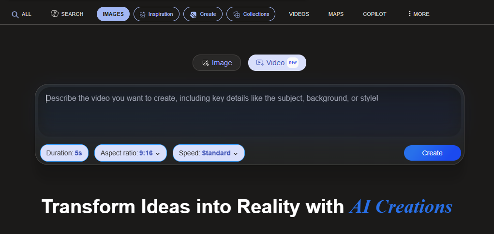

<!-- WRITER NOTE (for the writer only, remove before publishing)
Original draft, kept so you remember where this post was going:

Microsoft Bing image generator doesn't have an option to add an image. 

Veo3 does, this enables you to do multiple generations that you can combine later to make a longer video.

END WRITER NOTE -->

Generative video represents the most computationally demanding frontier in generative artificial intelligence. While text-to-image synthesis matured into commercial production pipelines by 2023, expanding synthesis into the temporal dimension introduces severe physical constraints: subject permanence, fluid dynamics, light transport consistency, and camera trajectory stability.

Consumer interfaces like Microsoft Designer and Bing Image Creator demonstrate these early limitations. While capable of generating impressive static images, basic consumer portals frequently omit input image conditioning when testing video capabilities. Users are restricted to conversational text prompts, leaving the underlying model to invent subject geometries from scratch on every run.

In contrast, advanced foundational video models like [Google Veo](https://deepmind.google/technologies/veo/), engineered by Google DeepMind, place image-to-video (I2V) conditioning at the core of the creative pipeline. Understanding how image conditioning stabilizes spatiotemporal diffusion reveals how generative tools are transitioning from short novelty clips into controllable filmmaking instruments.

| Generation Paradigm | Primary Input Modality | Production Applicability |
| :--- | :--- | :--- |
| **Text-to-Video (T2V)** | Text prompt alone | Initial concept brainstorming, rapid scene prototyping |
| **Image-to-Video (I2V)** | Reference keyframe plus text prompt | Character identity preservation, specific camera choreography |
| **Video-to-Video (V2V)** | Source video footage plus style prompt | Motion transfer, stylistic re-rendering, digital rotoscoping |

## The Fundamental Problem of Temporal Consistency

In traditional text-to-image diffusion, a model samples noise from a Gaussian distribution and iteratively denoises the latent representation according to a text prompt.

When applied naively to video by generating individual frames sequentially, the process suffers from severe temporal flicker. Because the random noise seed changes between frames, minor variations in pixel intensity cause a subject's facial features, clothing buttons, or background architecture to mutate every fraction of a second.

| Synthesis Approach | Motion Coupling | Visual Artifacts |
| :--- | :--- | :--- |
| **Frame-by-Frame Generation** | Independent random noise per frame | Severe flicker, identity mutation, anatomical distortion |
| **Spatiotemporal Coupling (Veo)** | Factored 3D attention over latent tensor volume | Consistent identity, photorealistic trajectories, coherent lighting |

## The Architectural Foundation of Google Veo

Google Veo addresses temporal flicker through a unified spatiotemporal architecture built upon latent diffusion transformers.

### 1. 3D Spatiotemporal Latent Representation

Rather than processing raw RGB video frames, which requires astronomical memory bandwidth, Veo compresses video clips into a low-dimensional latent space using a temporal video autoencoder. The latent tensor incorporates dimensions for batch size, channel depth, temporal frames ($$T$$), height ($$H$$), and width ($$W$$). Denoising occurs directly within this compact spatiotemporal volume.

### 2. Factored Spatial and Temporal Attention

Scaling transformer attention across high-definition video frames is computationally prohibitive because standard full self-attention scales quadratically with sequence length:

$$\mathcal{O}((T \times H \times W)^2)$$

Veo factors the self-attention mechanism into two decoupled operations:
- **Spatial Attention Layers:** Compute attention across spatial pixels within each individual time frame ($$H \times W$$), resolving visual sharpness, texture fidelity, and local lighting.
- **Temporal Attention Layers:** Compute cross-attention strictly along the time axis ($$T$$) for each spatial coordinate, modeling physical velocity, momentum, and occlusion boundaries.

This factorization maintains computational tractability while enforcing rigid physical rules across extended temporal windows.

| Processing Stage | Target Domain | Computational Role |
| :--- | :--- | :--- |
| **Input Latent Volume** | Raw spatiotemporal tensor | Encodes temporal duration and spatial resolution |
| **Spatial Attention Layer** | Single frame ($$H \times W$$) | Enforces sharpness, lighting fidelity, and texture realism |
| **Temporal Attention Layer** | Frame trajectory ($$T$$) | Tracks pixel momentum and prevents character morphing |
| **Denoised Output Tensor** | Final latent sequence | Reconstructs coherent 1080p 60 FPS motion |

### 3. Cinematic Prompt Understanding

Veo was trained on extensive datasets enriched with professional filmmaking annotations. The model understands specific cinematography vocabulary:

- **Lens Profiles:** 35mm shallow depth of field, 24mm wide-angle distortion, telephoto compression, anamorphic lens flares.
- **Camera Trajectories:** Dolly zoom, crane shot, aerial orbital pan, handheld tracking.
- **Atmospheric Lighting:** Volumetric rays, golden hour backlighting, rim lighting, neon reflection on wet pavement.

## Why Image Conditioning (I2V) Changes the Production Workflow

The primary distinction between basic consumer chatbots and production video models is image conditioning. Feeding a reference image into Veo before applying text prompts solves three critical production bottlenecks:

| Conditioning Step | Mechanism | Production Impact |
| :--- | :--- | :--- |
| **1. Reference Keyframe** | Visual latent prior encoder | Extracts face, hair, and clothing vectors |
| **2. Spatial Conditioning** | Locks high-resolution features | Prevents subject drift across different camera angles |
| **3. Temporal Initialization** | Sets initial boundary conditions | Establishes starting vector for fluid camera moves |

### 1. Identity Preservation Across Camera Angles

When constructing a multi-shot narrative sequence, the viewer expects the protagonist to maintain identical facial features, clothing, and hair styling across different camera setups. By generating a high-detail static character portrait in an image generator (such as Imagen 3 or Midjourney), the creator passes that image into Veo as an input anchor. The model animates the visual asset rather than inventing a new person from scratch.

### 2. Scene Composition Control

Text prompts are inherently ambiguous. Describing a complex corporate boardroom with seventeen participants and specific branding logos through text alone produces unpredictable compositions. Preparing the master layout in an image editor and submitting it as a reference image ensures that set design, architecture, and lighting conform to exact art direction.

## Multi-Shot Extension: Chaining Generations into Continuous Scenes

Single generations from frontier video models typically span four to six seconds. While sufficient for quick B-roll inserts, longer scenes require chaining multiple generations together without visible seams.

Creators utilize the terminal frame chaining methodology:

1. **Generate the Initial Clip:** Create the initial five-second sequence using an image prompt and directional text.
2. **Export the Terminal Frame:** In a video editor like DaVinci Resolve or Adobe Premiere, pause on the final frame ($$T_{\text{final}}$$) and export it as an uncompressed PNG image.
3. **Condition the Next Clip:** Import this exported frame back into Veo as the reference image for the subsequent generation.
4. **Direct the Action:** Craft the new prompt to describe the next physical movement starting from that exact frozen posture.

By repeating this chaining sequence, five-second clips connect into twenty-second and thirty-second continuous narrative sequences with reliable visual continuity.

## Comparative Benchmarks: Frontier Video Generation Models

| Model Architecture | Maximum Resolution | Primary Strengths | Conditioning Modes |
| :--- | :--- | :--- | :--- |
| **Google Veo** | 1080p @ 60 FPS | Cinematic lens grammar, physical consistency | Text, Image, Mask, Terminal Frames |
| **OpenAI Sora** | 1080p @ 30 FPS | World simulation, long temporal coherence | Text, Image, Video loop |
| **Runway Gen-3 Alpha** | 1080p @ 30 FPS | Directing motion brush, camera control presets | Text, Image, Keyframe pairs |
| **Kling AI** | 1080p @ 30 FPS | Complex human anatomy, dynamic action choreography | Text, Image, Multi-angle |

### DeepMind SynthID Integration

An essential element of Google's enterprise video deployment is provenance tracking. Veo integrates DeepMind's [SynthID](https://deepmind.google/technologies/synthid/) watermarking technology.

SynthID embeds an imperceptible, cryptographically verifiable digital signature directly into the frequency components of video frames during generation. The watermark survives video compression, frame-rate conversions, social media re-encoding, and color grading filters, allowing automated scanners to identify AI-generated media without degrading the viewer's visual experience.

## Summary

Generative video tools that rely solely on text prompts remain constrained to short, disconnected novelty clips. By integrating image-to-video reference conditioning, factored spatiotemporal attention, and terminal frame chaining, Google Veo demonstrates how generative computer vision is evolving into a disciplined, multi-shot visual storytelling platform.
