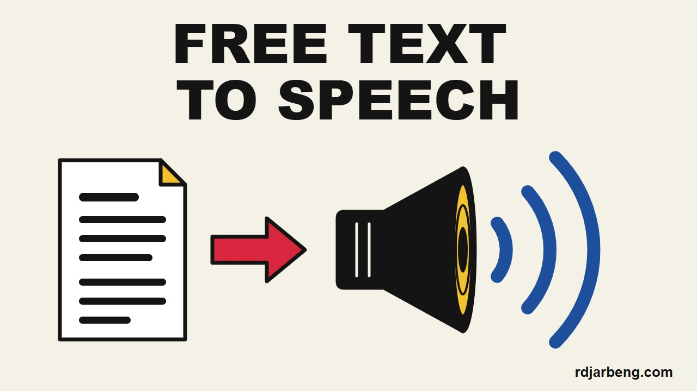

Text-to-speech (TTS) technology has undergone an unprecedented transformation. For decades, synthetic speech was characterized by the robotic, monotone cadences of formant synthesizers and concatenative acoustic engines. Early screen readers stitched together pre-recorded phoneme snippets, resulting in unnatural pitch shifts and awkward pauses that caused rapid listener fatigue.



Modern neural speech synthesis models operate on fundamentally different acoustic principles. By leveraging deep neural networks, diffusion processes, and neural vocoders, modern systems synthesize human speech complete with natural prosody, breathing cadences, emotional inflection, and context-aware pronunciation.

For content creators, educators, software engineers, and individuals who absorb long-form text through auditory listening, finding high-quality speech synthesis without expensive subscription commitments requires navigating promotional paywalls. This analysis evaluates the premier free text-to-speech platforms and offline engines available in 2026, examining their underlying architectures, usage limits, and licensing terms.

| Synthesis Era | Primary Technology | Acoustic Quality |
| :--- | :--- | :--- |
| **1980s: Formant Synthesis** | DECtalk, Klatt synthesizers | Mathematical rule-based robotics with flat pitch |
| **2000s: Concatenative Selection** | Unit selection databases | Stitched recorded voice slices with audible seams |
| **2018s: Deep Neural Vocoders** | WaveNet, Tacotron 2 | Autoregressive acoustic sampling matching human rhythm |
| **2026s: Latent Diffusion and Zero-Shot** | Flow matching, diffusion transformers | Real-time expressive synthesis with breathing and context awareness |

## The Architecture of Modern Neural Speech Synthesis

To evaluate the capabilities and trade-offs of modern tools, it is helpful to examine how neural text-to-speech functions beneath the surface. The pipeline converts unstructured text strings into raw digital audio waveforms across three distinct stages:

```text
Input Text: "Dr. Smith paid 45 dollars on Jan 12th."
                    |
                    v
[ 1. Text Normalization and G2P Conversion ]
  * Expands abbreviations ("Doctor Smith")
  * Converts currency ("forty-five dollars")
  * Maps characters to International Phonetic Alphabet (IPA)
                    |
                    v
[ 2. Acoustic Model (Spectrogram Prediction) ]
  * Transformer or diffusion network
  * Generates 80-band Mel-Spectrogram (Frequency over Time)
                    |
                    v
[ 3. Neural Vocoder (HiFi-GAN / BigVGAN) ]
  * Inverts spectral frames into raw 24-bit / 48kHz Audio Waveform
```

### Stage 1: Text Normalization and Grapheme-to-Phoneme Mapping

Raw text contains non-standard tokens such as dates, monetary figures, URL paths, and abbreviations. The front-end parser expands these elements and resolves heteronyms (words with identical spellings but contrasting pronunciations based on context, such as "read" in present versus past tense). The normalized text is converted into phonemic representations.

### Stage 2: Acoustic Mel-Spectrogram Generation

The acoustic model, frequently built upon transformer backbones or latent diffusion architectures, maps the sequence of phonemes to a visual representation of sound known as a mel-spectrogram. This stage determines pacing, sentence-level stress, vocal timbre, and emotional prosody.

### Stage 3: Neural vocoder synthesis

A mel-spectrogram contains frequency and amplitude data but lacks phase information. The neural vocoder, typically an ultra-fast generative adversarial network like HiFi-GAN or BigVGAN, reconstructs the missing phase data, generating raw audio waveforms at sample rates up to 48,000 Hertz.

## Top Free Platforms Evaluated

| Platform | Primary Advantage | Free Tier Quota | Commercial Licensing |
| :--- | :--- | :--- | :--- |
| **TTSMaker** | Direct MP3 downloads | 20,000 characters/week | Permitted for commercial use |
| **ElevenLabs** | Extreme emotional fidelity | 10,000 characters/month | Attribution required on free tier |
| **Microsoft Edge** | Unlimited browser reading | Completely unlimited | Personal accessibility only |
| **NaturalReader** | Natural flowing document audio | Unlimited web streaming | Personal study and reading |
| **TTSReader** | Long-form document player | Unlimited web streaming | Personal accessibility only |
| **Piper / Kokoro** | Offline local privacy | Unlimited local execution | Permissive open-source licenses |

### 1. TTSMaker: The Creator Utility Standard

For video producers, course creators, and social media editors who require direct audio file downloads without mandatory account creation, [TTSMaker](https://ttsmaker.com/) has established itself as an essential tool.

- **Feature Profile:** The service supports over fifty languages with hundreds of voice profiles. A critical advantage is its explicit commercial usage policy, which grants free users the legal right to utilize generated voice tracks across monetized YouTube videos, podcasts, and commercial advertisements.
- **Operational Limits:** The free tier provides up to 20,000 characters per week. Certain standard neural voices feature unlimited usage without consuming character balances.
- **Trade-Offs:** While neural options sound natural, older baseline voices on the platform exhibit noticeable robotic inflection on technical terminology.

### 2. ElevenLabs: Industry-Leading Emotional Fidelity

[ElevenLabs](https://elevenlabs.io/) remains the performance benchmark for synthetic speech realism. Its proprietary Multilingual v2 model interprets punctuation and semantic context to introduce subtle human vocal traits, including natural pauses, hesitant breaths, and expressive pitch variations.

- **Feature Profile:** The platform provides access to pre-made actor libraries and basic voice design tools.
- **Operational Limits:** The free tier provides 10,000 characters per calendar month, which resets on a monthly billing cycle. This allowance equates to roughly ten minutes of spoken audio.
- **Trade-Offs:** The monthly character quota depletes rapidly during long-form audio production. Commercial deployment under the free tier requires providing visible attribution to ElevenLabs.

### 3. Microsoft Edge Read Aloud: The Hidden Desktop Engine

Many users seeking high-quality document narration overlook a powerful engine integrated directly into their existing desktop operating system. The [Microsoft Edge](https://www.microsoft.com/edge) web browser includes a native "Read Aloud" feature powered by the same neural voices that drive enterprise Microsoft Azure Cognitive Speech Services.

- **Feature Profile:** By opening any online article, web page, or local PDF document within Edge, users can activate Read Aloud via the toolbar icon or the `Ctrl+Shift+U` keyboard shortcut.
- **Operational Limits:** The service is completely unlimited and requires no account registration, third-party software installation, or API billing.
- **Trade-Offs:** The tool is designed strictly as an active audio reader rather than an audio exporter. Extracting the generated audio stream into standalone MP3 files requires routing desktop audio through virtual loopback drivers like VB-Audio Cable or recording the browser tab via Audacity.

### 4. NaturalReader and TTSReader: Cloud Document Readers

For studying extended PDF documents, research papers, and web articles, dedicated browser readers provide uninterrupted continuous narration.

- **[NaturalReader](https://www.naturalreaders.com/online/):** Specializes in natural flow and educational document listening. The platform allows users to paste text, upload PDF or Word files, and listen with synchronized word highlighting, making it an optimal companion for proofreading and studying.
- **[TTSReader](https://ttsreader.com/):** Functions as a lightweight in-browser audio player designed for reading extended written material.

- **Feature Profile:** Users can paste lengthy text blocks, import e-book formats, or drag and drop multi-page PDF documents. The application maintains continuous playback across tabs and automatically caches playback positions in local browser storage.
- **Operational Limits:** Web streaming is completely free and unmetered.
- **Trade-Offs:** File downloading is restricted on the free tier, positioning the tool primarily as an accessibility reader rather than an asset creation utility.

## The Local Alternative: Open-Source Offline Models

For software engineers, data scientists, and privacy-conscious users handling confidential documents, sending proprietary text to commercial cloud APIs introduces security risks. Recent advances in compact machine learning models allow high-fidelity neural speech to execute entirely on local hardware.

| Advantage | Operational Benefit | Technical Enabler |
| :--- | :--- | :--- |
| **Zero Subscription Costs** | Indefinite execution on existing CPU/GPU hardware | Quantized ONNX runtime binaries |
| **Complete Data Privacy** | No confidential text transmitted over public internet | Air-gapped local execution |
| **Ultra-Low Latency** | Sub-100 millisecond generation times without API queues | Compact 82M parameter weights |
| **Infinite Scale** | Synthesize complete technical audiobooks without quotas | Zero API rate limits or credit meters |

### Piper TTS

[Piper](https://github.com/rhasspy/piper) is an ultra-fast, local neural text-to-speech system optimized for the Raspberry Pi and consumer PCs. Built on the VITS (Variational Inference for Text-to-Speech) architecture and compiled into ONNX runtime binaries, Piper synthesizes speech faster than real-time even on basic CPU cores. It is the speech backend for open-source home automation platforms like Home Assistant.

### Kokoro-82M

Released in late 2024 and expanding throughout 2025 and 2026, [Kokoro](https://huggingface.co/hexgrad/Kokoro-82M) is an 82-million parameter open-weight model that delivers audio quality comparable to commercial cloud providers while remaining compact enough to run in browser WebAssembly runtimes or local Python environments. Because its weights are published under permissive open-source licenses, developers can integrate it directly into offline applications without licensing fees.

## Selecting the Right Tool for Specific Workflows

Matching the appropriate speech engine to your specific requirements ensures optimal productivity:

1. **Short-Form Video and Social Media:** Utilize TTSMaker to generate clean, commercially licensed MP3 files without registration overhead.
2. **High-Impact Narrative Audio:** Deploy ElevenLabs for character dialogue and podcast introductions where subtle emotional inflection and vocal warmth are essential.
3. **Study, Research, and Accessibility:** Open long-form academic papers, books, and web articles in Microsoft Edge to take advantage of unlimited Azure neural playback.
4. **Automated Pipelines and Data Privacy:** Deploy Piper TTS or Kokoro locally via Python or Docker to synthesize unlimited text without cloud dependencies or recurring operational costs.
