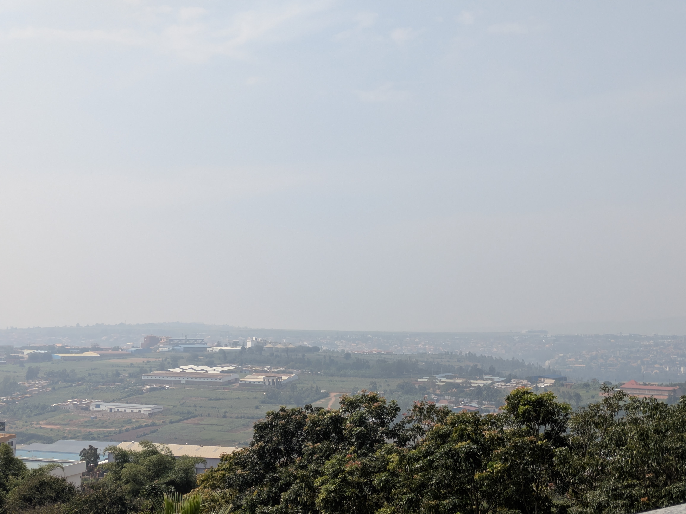

Today, Kigali is shrouded in a dense haze that has significantly reduced visibility across the city. The atmosphere feels heavy, with the usual crisp views of the surrounding hills obscured by the mist.

The photograph above, taken at 10:17 AM from the Kigali Special Economic Zone, illustrates just how thick the haze is. At the time I wasn't sure if the haze was dust, smoke or just water vapour. Fog usually clears by 8 AM, and this didn't. The model data further down points to fine particles rather than dust. Typically, this vantage point offers a fairly clear view of the Kigali International Airport; however, today the airport terminal is barely distinguishable, ghosting into the white-grey horizon on the far right side of the frame. It is a clear record of the conditions that morning.

## Indoor Environmental Data

To complement the photo, I pulled indoor environmental data from our sensor array deployed at Carnegie Mellon University Africa. The instrumentation paints a picture of a warm and moderately humid indoor environment.

Across our functional sensor sets, the indoor temperature held steady at an average of **25°C**. Humidity levels were also consistent, hovering between **60% and 67%** for the majority of the devices. It is worth noting that one distinct sensor, the BME0, reported a significantly drier reading of approximately 46%, while another unit (BME2) was flagged for calibration issues and excluded from this analysis.

## Fine particles, not coarse dust or fog: what was in the air outside

The indoor sensors can't say what the haze was made of. For the outdoor picture I used the [Open-Meteo air quality API](https://open-meteo.com/en/docs/air-quality-api), which serves estimates from the Copernicus Atmosphere Monitoring Service (CAMS) model. These are model values (retrieved on 24 November 2026) for a grid cell about 40 km across. That is larger than the whole city, so a smoky neighbourhood and a clean hilltop get the same value. They are not readings from a monitor in Kigali.

| 29 January 2026, Kigali time | Model estimate |
| --- | --- |
| PM2.5, daily mean | 37 µg/m³ |
| PM2.5, 7 AM peak | 51 µg/m³ |
| PM2.5 at 10 AM, when the photo was taken | 37 µg/m³ |
| PM10, daily mean | 39 µg/m³ |
| Dust (part of PM10), daily mean | 3 µg/m³ |

The estimated PM2.5 was about 2.5 times the WHO's 24-hour guideline of 15 µg/m³ (see the [WHO's 2021 air quality guidelines](https://www.who.int/publications/i/item/9789240034228)). On the US [AQI](/understanding-the-air-quality-index-aqi/) scale, 37 µg/m³ over 24 hours is about 105, "Unhealthy for Sensitive Groups". On a day like that, people with asthma or heart conditions, children and older people are advised to cut down on long or hard exercise outdoors.

Almost all of the PM10 was PM2.5, and dust made up only about 3 µg/m³ of it. PM10 covers particles up to 10 micrometres, about a seventh of the width of a hair, and desert dust is mostly the larger ones. A dust haze would show PM10 well above PM2.5. Fog is water droplets, which the model does not count as PM2.5 at all.

So the haze was most likely fine particles (PM2.5), not coarse dust or fog. Particles this small come mainly from burning (fires, cooking and traffic) or form in the air from other pollutant gases. The model alone can't say which, or whether they were local or carried in from elsewhere in the region.

I didn't notice a smell of smoke that morning, which might seem to rule smoke out. It doesn't. Much of the smell of fresh smoke comes from gases, and those can react and spread out as smoke travels, so smoke that has drifted a long way can arrive as haze with little smell. Particles formed in the air from other gases have no smell either. A haze you can't smell can still be bad air.

It was not a one-day event either. In the model, daily PM2.5 over Kigali rose from about 17 µg/m³ on 23 January to 38 µg/m³ on 28 January, and stayed above 20 µg/m³ until early February. The source of that rise is unknown.

Ground monitors in Kigali, such as [AirQo](https://www.airqo.net/)'s network or the stations on [OpenAQ](https://openaq.org/), would show whether the model was right. If you have readings from that day, I'd like to compare them. [What PM2.5 is](/what-is-particulate-matter-pm2.5-and-the-environmental-significance/) has its own explainer.
