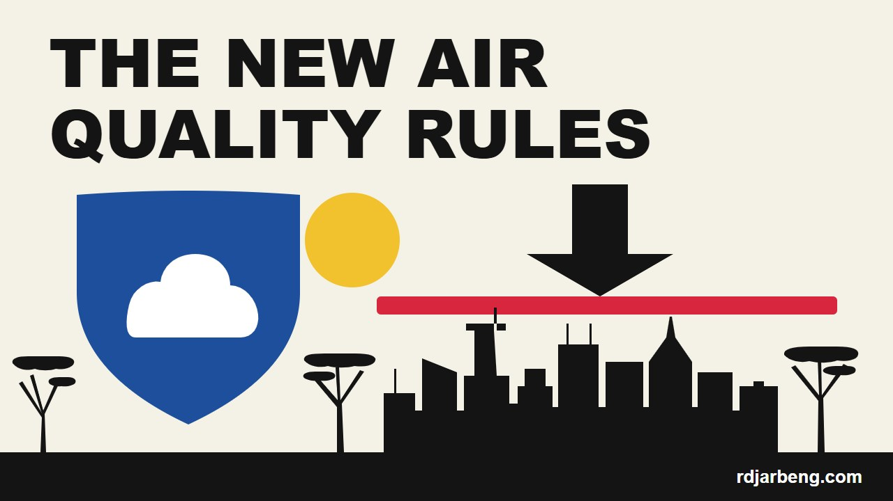

In September 2021, the [World Health Organization](https://www.who.int/publications/i/item/9789240034228) released an update to its Global Air Quality Guidelines, marking the first major revision in sixteen years. This document represents a structural realignment in environmental epidemiology and public health policy. Rather than a routine adjustment of numerical exposure thresholds, it codifies a fundamental re-evaluation of the relationship between atmospheric composition and human biology. The guidelines reflect an overwhelming body of clinical and satellite evidence demonstrating that adverse cardiovascular and respiratory damage occurs at concentrations significantly lower than previously recognized.

For the African continent, these revised thresholds present a sharp operational contrast. On one side, they offer a rigorous, science-based benchmark for protecting public health in an era of rapid urbanization, industrialization, and demographic expansion. On the other side, the gap between current ambient air quality in major African metropolitan centers and the 2021 targets is vast. To prevent policy paralysis, the framework incorporates an explicit system of Interim Targets, establishing a stepwise trajectory for gradual pollution reduction.

This analysis investigates the technical foundations of the 2021 guidelines, the cellular pathology justifying the focus on fine particulate matter and tropospheric ozone, and practical implementation pathways across Kigali, Nairobi, Accra, and South Africa.

## The Evolution of Global Air Quality Benchmarks

The modern framework for atmospheric regulation evolved over four decades of changing epidemiological methodologies.

| Guideline Edition | Primary Focus | Key Atmospheric Thresholds |
| :--- | :--- | :--- |
| **1987 European Guidelines** | Regional industrial focus based on Western European cohorts | High-pollution thresholds tailored to temperate coal smog |
| **2005 Global Update** | Four classical pollutants with global applicability | Differentiated PM2.5 (10 ug/m³) and PM10 (20 ug/m³) annual limits |
| **2021 Revised Guidelines** | Rigorous multi-cohort systematic reviews | 50% PM2.5 reduction (5 ug/m³), 75% NO2 reduction (10 ug/m³), peak O3 metric |

### The 1987 European Genesis

The genesis of international air quality standardization traces back to 1987 with the publication of the first [Air Quality Guidelines for Europe](https://www.miteco.gob.es/content/dam/miteco/es/calidad-y-evaluacion-ambiental/temas/atmosfera-y-calidad-del-aire/guidelinesforairquality-2000_tcm30-188065.pdf). Scientific understanding at that time derived almost entirely from toxicological and occupational cohort studies conducted in Western Europe and North America. These initial standards reacted directly to the visible industrial smog and sulfurous coal plumes that accompanied post-war industrial expansion.

The 1987 framework did not account for tropical meteorology, intense solar irradiance, high ambient mineral dust concentrations, or the nutritional profiles of developing economies. Despite these geographic limitations, the European document functioned as the international standard for nearly a decade, demonstrating the global need for unified environmental health guidance.

### The 2005 Global Update: Establishing Classical Pollutants

Recognizing that regional benchmarks failed to address global atmospheric realities, the WHO convened an international working group to develop globally applicable recommendations, culminating in the [2005 Global Update](https://www.who.int/news-room/questions-and-answers/item/who-global-air-quality-guidelines).

The 2005 release focused on four classical pollutants: particulate matter (PM), ozone (O3), nitrogen dioxide (NO2), and sulfur dioxide (SO2). Its primary structural innovation was differentiating coarse particles (PM10, aerodynamic diameter below 10 micrometers) from fine particulate matter (PM2.5, diameter below 2.5 micrometers). The 2005 standard set the annual mean limit for PM2.5 at 10 micrograms per cubic meter. Although viewed as ambitious at the time, subsequent epidemiological data revealed that this concentration remained associated with substantial mortality.

### The 2021 Revision: A New Era of Exposure Stringency

The 2021 guidelines synthesized systematic reviews of observational cohorts across millions of patients. Improved satellite remote sensing, paired with chemical transport modeling and ground-level validation, allowed researchers to quantify exposure response curves down to near-background levels.

The resulting guidelines cut existing thresholds substantially. The recommended annual ceiling for PM2.5 was reduced by half, from 10 to 5 micrograms per cubic meter. The annual guideline for nitrogen dioxide was reduced by 75 percent, from 40 to 10 micrograms per cubic meter, reflecting evidence that NO2 acts as a potent toxic agent independently of its role as an ozone precursor:

| Pollutant | Averaging Period | 2005 Guideline | 2021 Guideline | Percent Reduction |
| :--- | :--- | :--- | :--- | :--- |
| **PM2.5** | Annual Mean | 10 ug/m³ | 5 ug/m³ | 50% decrease |
| | 24-Hour Mean | 25 ug/m³ | 15 ug/m³ | 40% decrease |
| **PM10** | Annual Mean | 20 ug/m³ | 15 ug/m³ | 25% decrease |
| | 24-Hour Mean | 50 ug/m³ | 45 ug/m³ | 10% decrease |
| **Nitrogen Dioxide (NO2)** | Annual Mean | 40 ug/m³ | 10 ug/m³ | 75% decrease |
| | 24-Hour Mean | N/A | 25 ug/m³ | Newly added |
| **Ozone (O3)** | Peak Season | N/A | 60 ug/m³ | Newly added |
| | 8-Hour Mean | 100 ug/m³ | 100 ug/m³ | Unchanged |
| **Sulfur Dioxide (SO2)** | 24-Hour Mean | 20 ug/m³ | 40 ug/m³ | Adjusted baseline |
| **Carbon Monoxide (CO)** | 24-Hour Mean | N/A | 4 mg/m³ | Newly added |

The data confirms a supralinear concentration-response relationship for fine particulate matter. The steepness of the health curve is greatest at the lowest concentrations, meaning that significant clinical benefits occur when reducing pollution even in relatively clean environments.

### The Strategic Value of Interim Targets

For developing countries where ambient PM2.5 averages 30 to 80 micrograms per cubic meter, an immediate 5 microgram target appears unreachable through near-term policy. Recognizing this reality, the WHO embedded four [Interim Targets](https://www.ssph-journal.org/journals/international-journal-of-public-health/articles/10.3389/ijph.2021.1604465/full) into the standard:

| Milestone Stage | Annual Mean PM2.5 Target | Expected Reduction in Attributable Mortality |
| :--- | :--- | :--- |
| **Baseline Urban Exposure** | 30 to 80 ug/m³ | High baseline cardiovascular and respiratory risk |
| **Interim Target 1 (IT-1)** | 35 ug/m³ | ~15% reduction in attributable mortality |
| **Interim Target 2 (IT-2)** | 25 ug/m³ | ~25% cumulative reduction |
| **Interim Target 3 (IT-3)** | 15 ug/m³ | ~37% cumulative reduction |
| **Final WHO Guideline** | 5 ug/m³ | Up to 80% global reduction in particulate mortality |

Interim Target 1 (35 micrograms per cubic meter annual mean) provides a practical starting point. Epidemiological modeling indicates that moving an urban population from high uncontrolled pollution down to Interim Target 1 reduces attributable mortality by roughly fifteen percent. Achieving the final 5 microgram guideline prevents up to eighty percent of particulate-related deaths globally.

## The Physiology of Harm: Why Fine Particulates Dominate Health Risks

Among all regulated atmospheric constituents, PM2.5 commands the highest research priority due to its physical capacity to penetrate biological barriers:

| Respiratory / Vascular Compartment | Filtration & Penetration Dynamics | Pathological Impact |
| :--- | :--- | :--- |
| **Nasal Cavity & Upper Pharynx** | Traps coarse dust particles (> 10 μm) in mucus | Mucociliary clearance and sneezing reflexes |
| **Trachea & Bronchial Tree** | Filters intermediate particles (PM10 to PM2.5) | Bronchial irritation, chronic cough, and mucus hypersecretion |
| **Alveolar Gas Exchange Sacs** | PM2.5 settles deep in alveolar fluid | Local alveolar macrophage activation and pulmonary inflammation |
| **Capillary Endothelial Membrane** | Ultrafine particles (< 0.1 μm) cross 0.5 μm barrier | Direct translocation into systemic bloodstream |
| **Systemic Blood Circulation** | Distribution to heart, kidneys, and brain | Endothelial dysfunction, systemic hypertension, and stroke |

### Inhalation, Aerodynamic Sizing, and Translocation

The parameter 2.5 refers to the aerodynamic diameter of the particle in micrometers. A strand of human hair measures between 50 and 70 micrometers in cross-section, while a grain of beach sand measures roughly 90 micrometers. A PM2.5 particle is roughly thirty times smaller than the diameter of a human hair.

When air enters the respiratory tract, anatomical structures act as progressive mechanical filters. The nasal vestibule, turbinates, and pharynx trap coarse particles above 10 micrometers in airway mucus, where cilia sweep them upward to be cleared.

Particles below 2.5 micrometers follow turbulent airflow into the deepest branches of the respiratory tree, settling within the alveoli. The alveolar-capillary barrier separating alveolar air from capillary blood measures approximately 0.5 micrometers in thickness to enable passive diffusion of oxygen and carbon dioxide.

Clinical and histological research demonstrates that the ultrafine fraction of PM2.5, specifically particles with diameters below 0.1 micrometers, translocates directly across this delicate barrier. Once inside the lumen of the capillary, these combustion particles enter systemic blood circulation, travelling through the cardiac chambers, the renal parenchyma, hepatic tissue, and across the blood-brain barrier.

### Cellular Mechanisms of Injury and Vascular Pathology

Once inside the bloodstream and lung parenchyma, particulate toxins trigger several distinct cellular pathways:

1. **Endothelial Dysfunction:** Chemical constituents adsorbed onto particle surfaces, including polycyclic aromatic hydrocarbons and heavy metals, penetrate vascular endothelial cells through macropinocytosis. This induces mitochondrial oxidative stress, uncoupling endothelial nitric oxide synthase and impairing vasodilation. The resulting vessel rigidity is a primary precursor to hypertension and accelerated atherosclerosis.
2. **Macrophage Activation and Systemic Cytokines:** In the pulmonary alveoli, resident macrophages phagocytose foreign particulate cores. Unable to digest mineral or elemental carbon matrices, these immune cells release pro-inflammatory cytokines, including interleukin-1 beta (IL-1$\beta$), interleukin-6 (IL-6), and tumor necrosis factor-alpha (TNF-$\alpha$). These mediators circulate throughout the vascular tree, establishing chronic, low-grade systemic inflammation.
3. **Platelet Activation and Hypercoagulability:** Circulating nanoparticles interact directly with blood platelets and fibrinogen, promoting thrombocytosis and lowering the threshold for thrombus formation. This mechanism explains the direct statistical correlation between acute particulate spikes and same-day hospital admissions for ischemic stroke and myocardial infarction.

## Ground-Level Ozone: Photochemical Kinetics and Food Security

While particulate matter dominates clinical attention, the 2021 guidelines introduced a peak season exposure metric for ground-level ozone (60 micrograms per cubic meter). In Africa, ozone represents an urgent secondary threat driven by meteorological and socioeconomic factors.

| Photochemical Stage | Chemical Reactants & Atmospheric Drivers | Kinetic / Physiological Consequence |
| :--- | :--- | :--- |
| **1. Solar Excitation** | High ultraviolet irradiance ($h\nu$) and high temperatures | Photolysis of $NO_2$ generating reactive oxygen radicals |
| **2. Radical Coupling** | $NO_x$ from combustion + VOCs from biomass | Formation of ground-level tropospheric ozone ($O_3$) |
| **3. Biological Exposure** | Inhalation and stomatal uptake | Oxidation of lung epithelium ("internal sunburn") and foliar cell necrosis |

### Photochemical Formation Dynamics

Ground-level ozone is not emitted directly from tailpipes or chimneys. It is a secondary pollutant formed through non-linear photochemical reactions between nitrogen oxides (NOx) and volatile organic compounds (VOCs) under the action of ultraviolet radiation:

$$\text{NO}_2 + h\nu \longrightarrow \text{NO} + \text{O}(^3\text{P})$$

$$\text{O}(^3\text{P}) + \text{O}_2 + \text{M} \longrightarrow \text{O}_3 + \text{M}$$

In tropical and subtropical Africa, this reaction proceeds rapidly due to intense year-round solar irradiance, elevated ambient temperatures, and massive seasonal emissions of NOx and VOCs from savannah fires, agricultural slash-and-burn cycles, and domestic charcoal preparation. Atmospheric chemistry soundings over southern and central Africa consistently document elevated tropospheric ozone plumes throughout the dry season.

### The Ozone-Agricultural Penalty

Beyond its capacity to cause oxidative damage to human pulmonary epithelial linings, ozone acts as a systemic toxin to vegetation. Ozone enters plant foliage through open stomata during normal daytime gas exchange. Inside the leaf interior, it oxidizes plant cell membranes, degrading chlorophyll complexes and inhibiting photosynthetic carbon assimilation:

| Staple Crop | Geographic Region | Measured Annual Yield Loss |
| :--- | :--- | :--- |
| **Common Beans** | Uganda | 14% to 17% reduction |
| **Wheat** | Southern Africa | 6% to 12% reduction |
| **Maize** | Sub-Saharan Africa | 4% to 9% reduction |
| **Soybeans** | Southern Africa | 8% to 16% reduction |

Research across eastern and southern Africa confirms that ozone pollution reduces staple bean yields by up to seventeen percent in rural production corridors. In regions where agricultural productivity underpins economic resilience and caloric security, ground-level ozone directly undermines food supply systems.

## African Research Imperatives: Overcoming the Data Deficit

Implementing the revised WHO guidelines across the continent requires addressing the severe sparsity of continuous air monitoring infrastructure:

| Pyramid Tier | Monitoring Modality | African Deployment Reality |
| :--- | :--- | :--- |
| **Apex (Tier 1)** | Regulatory Reference-Grade Stations (BAM, Gravimetric) | Extremely sparse: ~1 station per 16 million residents |
| **Middle (Tier 2)** | Calibrated Low-Cost Optical Sensors | Emerging municipal grids (Accra, Nairobi, Kigali) |
| **Base (Tier 3)** | Satellite Remote Sensing & Chemical Transport Models | Continental coverage (MODIS, Sentinel-5P TROPOMI, GEOS-Chem) |

Sub-Saharan Africa possesses roughly one reference-grade air monitoring station for every sixteen million citizens, compared to one station per three hundred thousand residents across Western Europe. Bridging this information deficit requires focusing technical resources on four domains:

### 1. Chemical Source Apportionment

Municipalities cannot construct targeted emission controls without identifying the chemical composition of particulate matter. Unlike North American or European cities where vehicular traffic and point-source factories dominate emissions, the urban African aerosol profile incorporates diverse sources:

- Resuspended crustal and mineral dust from unpaved road shoulders.
- Elemental and black carbon from domestic charcoal and firewood cookstoves.
- Open combustion of municipal solid waste due to gaps in municipal collection.
- High-sulfur exhaust from aging vehicle fleets lacking catalytic converters.

Applying receptor modeling techniques, such as Positive Matrix Factorization (PMF) on filter samples, enables researchers to quantify source contributions and direct municipal capital toward the most impactful emission sectors.

### 2. The Household-Ambient Exposure Continuum

In informal settlements across African cities, the conceptual distinction between indoor and outdoor air pollution collapses. Compact dwelling footprints constructed from permeable materials allow smoke from interior biomass cookstoves to vent into narrow neighborhood streets, elevating ambient concentrations.

Conversely, roadside traffic exhaust readily infiltrates homes. Measuring personal exposure requires longitudinal cohort studies that deploy wearable, low-power particulate monitors to capture cumulative 24-hour exposures.

### 3. Low-Cost Optical Sensors and Local Calibration

Reference-grade beta-attenuation monitors and gravimetric samplers routinely exceed 25,000 USD per installation, placing wide-scale deployments beyond municipal environmental budgets. Low-cost optical particle counters costing under 500 USD provide an alternative for spatial mapping, but require rigorous local calibration.

High ambient humidity and tropical temperatures cause hygroscopic growth of sulfate and sea-salt aerosols, leading uncalibrated optical sensors to report particulate counts up to 300 percent above actual dry mass. Collocating low-cost sensors alongside reference monitors to train gradient-boosted regression and random forest calibration algorithms ensures dependable localized data.

## Municipal Case Studies: Clean Air Interventions in Practice

Cities across Africa are deploying innovative policy frameworks to align municipal operations with the WHO Interim Targets:

| Municipality | Primary Policy Initiative | Measurable Public Health Outcome |
| :--- | :--- | :--- |
| **Kigali** | Fortnightly Car-Free Days | 15% reduction in PM2.5 on designated days |
| **Nairobi** | Municipal Sensor Grid (50 nodes) | Hyper-local alerts for primary schools and clinics |
| **Accra** | Breathe Accra & Waste Climate Action Plan | Integrated waste diversion and transport BRT |
| **South Africa** | Highveld Priority Area Regulation | Industrial compliance litigation and emission reforms |

### Kigali, Rwanda: Policy Innovation and Vehicle Standards

Kigali has pioneered urban environmental interventions through targeted civic initiatives. In 2016, the municipal government introduced car-free days, which have since expanded into fortnightly events. On these days, major arterial roads close to private vehicular traffic to host community athletics and clinical health screenings.

Multi-year environmental monitoring reveals that ambient PM2.5 levels drop by fifteen percent during car-free Sundays compared to standard traffic patterns, avoiding hundreds of disability-adjusted life years annually. In parallel, Rwanda enacted Euro 4 fuel and vehicle emission standards, accompanied by mandatory tailpipe emissions testing for commercial motorcycles and passenger fleets.

### Nairobi, Kenya: Hyper-Local Sensing and Action Plans

Nairobi established a strong statutory foundation by enacting the Nairobi Air Quality Act of 2022 and publishing the Air Quality Action Plan for 2025 through 2029. To support this framework, the city deployed fifty municipal low-cost optical sensing nodes across primary schools and healthcare clinics.

The network streams real-time data to a public dashboard, transforming air quality management from a national abstraction into a neighborhood-level priority. School administrators utilize the data to adjust outdoor athletic schedules during midday pollution peaks, protecting vulnerable pediatric populations.

### Accra, Ghana: Multi-Sectoral Climate Integration

Accra faces extreme seasonal dust storms driven by northeast continental Harmattan trade winds, alongside dense urban emissions from transport and informal waste burning. Through the Breathe Accra initiative, the city deployed sixty monitoring nodes across fifteen municipal assemblies.

The data integrates into the Accra Climate Action Plan, pairing air quality objectives with waste management initiatives. Diverting organic refuse from open dumps to composting facilities eliminates uncontrolled waste combustion while simultaneously lowering methane and black carbon emissions.

### South Africa: The Highveld Industrial Compliance Gap

South Africa presents an instructive contrast. As the most heavily industrialized economy on the continent, the nation maintains extensive reference monitoring infrastructure. However, its Highveld Priority Area encompasses one of the highest concentrations of coal-fired thermal power plants (operated by Eskom), petrochemical refineries, and open-cast coal mines globally.

South Africa's National Ambient Air Quality Standards remain substantially more lenient than WHO recommendations. Ambient conditions categorized as acceptable under domestic standards exceed the 2021 WHO guidelines by several multiples. The situation demonstrates that data collection alone does not guarantee clean air; scientific measurements must be supported by enforceable legal frameworks and political will to achieve meaningful public health protection.

## Strategic recommendations for regional policy

The 2021 WHO Air Quality Guidelines confirm that particulate matter and tropospheric ozone are systemic toxins that threaten human cardiovascular health and agricultural resilience. For African policymakers and environmental researchers, actionable next steps include:

1. **Legislate Stepwise Interim Targets:** National environmental ministries should formally adopt WHO Interim Target 1 (35 ug/m³) and Target 2 (25 ug/m³) as binding national standards, establishing realistic regulatory compliance milestones.
2. **Harmonize Vehicle and Fuel Standards:** Expanding the East African Community's harmonized low-sulfur diesel fuel regulations across regional economic blocs will prevent the importation of sub-standard, high-polluting transport fuels.
3. **Expand Calibrated Hybrid Sensor Networks:** Combine satellite aerosol optical depth retrievals with ground-based low-cost optical sensors calibrated against regional reference monitors to eliminate urban data deficits.
4. **Link Clean Cooking with Ambient Air Quality:** Direct national climate finance and clean energy subsidies toward domestic liquefied petroleum gas and electric induction cooking, targeting household emissions that drive neighborhood-scale pollution.
