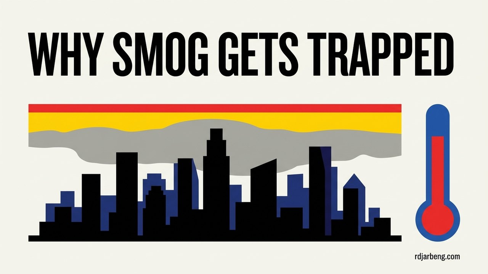

Under typical tropospheric conditions, atmospheric air temperature decreases steadily with increasing altitude. Sunlight heats the ground, and the warmed surface transfers sensible heat upward into the air column through conduction and turbulent convection. Because atmospheric pressure falls exponentially with height according to the barometric formula, rising air parcels expand adiabatically and cool. The standard environmental lapse rate averages a decrease of roughly 6.5 degrees Celsius for every 1,000 meters of vertical ascent, as documented by the [NOAA National Weather Service](https://www.weather.gov/jetstream/atmos).

A temperature inversion occurs when this fundamental profile reverses. Instead of cooling aloft, an intermediate atmospheric layer warms with altitude. This reversal creates a layer of warm, lower-density air resting directly above colder, denser air near the surface. The boundary between these air masses acts as a fluid lid that suppresses vertical circulation, trapping moisture, particulate matter, and chemical pollutants within the lowest hundreds of meters of the urban canopy.

| Atmospheric Regime | Altitude Gradient ($$\frac{dT}{dz}$$) | Thermal Structure | Dynamic Convection |
| :--- | :--- | :--- | :--- |
| **Standard Atmosphere** | Negative ($$\frac{dT}{dz} < 0$$) | Warm surface air underlies cold air aloft | Active vertical mixing and pollutant dispersal |
| **Temperature Inversion** | Positive ($$\frac{dT}{dz} > 0$$) | Cold, dense air trapped beneath warm inversion lid | Stable thermal stratification; vertical suppression |

## Thermodynamic principles and lapse rates

The stability of the atmospheric boundary layer depends on the relationship between the environmental lapse rate and adiabatic expansion rates. When dry air ascends without exchanging heat with surrounding air, it cools at the dry adiabatic lapse rate:

$$\Gamma_d = \frac{g}{c_p} \approx 9.8 \text{ } ^\circ\text{C/km}$$

Here, $$g$$ represents gravitational acceleration (9.81 m/s$$^2$$) and $$c_p$$ denotes the specific heat capacity of dry air at constant pressure (1005 J/kg$$\cdot$$K). If water vapor in the parcel condenses, latent heat release lowers this rate to the saturated adiabatic lapse rate, typically between 4 and 7 degrees Celsius per kilometer.

Meteorologists evaluate static stability using the vertical gradient of potential temperature $$\theta$$, defined as the temperature an air parcel would attain if brought adiabatically to a standard reference pressure of 1000 hPa:

$$\theta = T \left( \frac{P_0}{P} \right)^{\frac{R_d}{c_p}}$$

In an inversion layer, temperature increases with altitude, yielding:

$$\frac{dT}{dz} > 0 \implies \frac{d\theta}{dz} \gg 0$$

The buoyancy frequency, or [Brunt-Väisälä frequency](https://glossary.ametsoc.org/wiki/Brunt-vaisala_frequency) $$N$$, quantifies the frequency at which a displaced fluid parcel oscillates within a stably stratified environment:

$$N^2 = \frac{g}{\theta} \frac{d\theta}{dz}$$

When $$N^2 > 0$$, the atmosphere is statically stable. Any parcel forced upward becomes colder and denser than its new surroundings, producing a downward restoring force that immediately pulls it back toward its initial position. The inversion layer acts as an impermeable dynamic boundary, preventing vertical turbulence from penetrating upward into the free troposphere.

| Atmospheric Layer | Thermodynamic Property | Fluid Dynamics Behavior |
| :--- | :--- | :--- |
| **Warm Inversion Layer** | Low density, warm air aloft | Functions as a rigid ceiling over the boundary layer |
| **Inversion Boundary** | Buoyancy frequency ($$N^2 > 0$$) | Exerts negative buoyant restoring force on rising air parcels |
| **Ground Boundary Layer** | High density, cold surface air | Particulate matter ($$\text{PM}_{2.5}$$) and $$\text{NO}_2$$ trapped at breathing level |

## The four primary inversion mechanisms

Temperature inversions develop through several distinct thermodynamic and meteorological mechanisms.

### 1. Radiation inversions

Radiation inversions represent the most common ground-level variety. During long, clear winter nights with calm winds, the Earth's surface radiates longwave thermal infrared energy directly toward space according to the Stefan-Boltzmann law:

$$j^* = \sigma T^4$$

Because dry air is relatively transparent to infrared radiation outside water vapor absorption bands, the ground cools much faster than the overlying air. Through molecular conduction and minimal mechanical shear, a shallow layer of air directly in contact with the frozen ground cools rapidly, while air several hundred meters aloft remains comparatively warm. Radiation inversions establish shortly after sunset, reach maximum intensity right before dawn, and dissolve once solar insolation warms the surface enough to re-establish buoyant convective plumes.

### 2. Subsidence inversions

Subsidence inversions occur on synoptic weather scales within persistent high-pressure anticyclones. Within high-pressure systems, massive bodies of air sink slowly toward the surface. As this air descends into regions of higher ambient pressure, it undergoes adiabatic compression:

$$T_2 = T_1 \left( \frac{P_2}{P_1} \right)^{\frac{R_d}{c_p}}$$

Because the upper layers of the sinking air mass descend through a greater pressure differential than the lower layers, the top of the sinking column warms more rapidly than its base. This generates an elevated inversion layer, frequently situated between 500 and 1,500 meters above sea level. Subsidence inversions can persist uninterrupted across entire geographic regions for weeks at a time.

### 3. Advection inversions

Advection inversions form when a warm, moist horizontal air mass moves horizontally across a significantly colder surface, such as snowpack, sea ice, or upwelling cold coastal waters. The underlying cold surface chills the lowest layer of the passing air through sensible heat exchange, while the upper portion retains its maritime heat. This mechanism generates dense advection fog along coastal shorelines and maintains prolonged low-altitude capping in sub-polar regions.

### 4. Frontal inversions

During frontal passages, air masses of contrasting temperatures and densities collide. Because cold air is denser than warm air, an advancing warm front ascends gradually over the retreating cold wedge. In the transition zone along the frontal surface, an observer ascending vertically measures an abrupt temperature increase across the boundary, creating a localized frontal inversion accompanied by widespread cloud cover and stratiform precipitation.

## Topographic trapping and basin geometry

Geographical topography amplifies the duration and severity of temperature inversions. Mountain valleys and structural basins act as natural physical reservoirs for cold air drainage.

| Topographic Feature | Meteorological Mechanism | Impact on Air Quality |
| :--- | :--- | :--- |
| **Mountain Slopes** | Radiational cooling chills nocturnal air | Triggers katabatic gravity drainage winds down into valleys |
| **Inversion Cap** | Warm air aloft seals the mountain basin | Traps stagnant cold pool over the valley floor |
| **Valley Basin** | Enclosed physical depression | Accumulates industrial emissions, woodsmoke, and vehicle exhaust |

At night, cold air forming along high mountain ridges becomes denser than ambient air at identical altitudes. Gravity pulls this chilled air down ravines and hillsides in the form of katabatic drainage winds. The dense, cold fluid accumulates at the lowest elevation of the valley floor, displacing warmer air upward.

If surrounding mountain ranges shelter the basin from prevailing synoptic winds, mechanical wind shear cannot penetrate to churn the layers together. Urban centers situated within topographic bowls, including the Salt Lake City basin, Mexico City, Santiago, and Kathmandu, frequently remain sealed beneath stagnant inversion caps that hold vehicular and domestic emissions close to city streets for consecutive days.

## Air pollution surges and the box model

The direct human consequence of a temperature inversion is an exponential surge in ground-level air pollution. Under normal convective conditions, the planetary boundary layer expands during midday to a mixing height $$H$$ of 1,500 to 2,500 meters, diluting ground-level emissions into a massive volume of circulating air.

During an intense surface inversion, the effective mixing height collapses down to 50 to 150 meters. The steady-state concentration $$C$$ of a non-reactive air pollutant in an urban airshed can be estimated using the classic [steady-state box model](https://www.epa.gov/scram/air-quality-dispersion-modeling-alternative-models):

$$C = C_b + \frac{Q \cdot L}{H \cdot W \cdot U}$$

In this formulation:
- $$C_b$$ is the background concentration of the pollutant entering the airshed.
- $$Q$$ is the emission rate per unit area (g/s$$\cdot$$m$$^2$$) from vehicles, factories, and residential heating.
- $$L$$ is the along-wind length of the urban area.
- $$H$$ is the vertical mixing height beneath the inversion cap.
- $$W$$ is the crosswind width of the city.
- $$U$$ is the average wind speed ventilating the basin.

| Parameter | Normal Midday Atmosphere | Winter Inversion Event |
| :--- | :--- | :--- |
| **Mixing Height ($$H$$)** | 2,000 meters | 100 meters |
| **Wind Speed ($$U$$)** | 5.0 m/s | 0.8 m/s |
| **Ventilation Factor ($$H \times U$$)** | 10,000 m²/s | 80 m²/s |
| **Dilution Capacity** | 100% (Baseline) | **0.8% of Baseline** |
| **Relative Surface $$\text{PM}_{2.5}$$** | 12 µg/m³ | **150 µg/m³** |

When wind speed $$U$$ falls near zero and mixing height $$H$$ drops twentyfold, the ventilation factor $$(H \cdot U)$$ plummets by more than two orders of magnitude. The same volume of tailpipe exhaust and wood smoke emitted into this constrained air volume causes concentrations of fine particulate matter (PM2.5), nitrogen dioxide (NO2), and carbon monoxide to spike into hazardous ranges.

The historic Great Smog of London in December 1952 provides a stark illustration of this thermodynamic trap. A persistent anticyclone created a deep radiation inversion over the Thames basin, reducing the mixing height to under sixty meters. Coal smoke from millions of fireplaces and industrial boilers accumulated beneath the stagnant ceiling, resulting in estimated excess mortality exceeding 10,000 deaths over several weeks and prompting modern clean air legislation worldwide.

## Modern monitoring and dispersion forecasting

Environmental agencies monitor inversion dynamics using automated atmospheric sounding tools:

1. **Radiosonde Balloons:** Weather balloons launched twice daily measure pressure, temperature, and relative humidity aloft to map lapse rates.
2. **Doppler Wind Profilers and Ceilometers:** Optical backscatter LIDAR systems detect aerosol layers directly, pinpointing the exact elevation of the inversion lid by tracking particulate density boundaries.
3. **Microwave Radiometers:** Ground-based passive radiometers measure atmospheric thermal radiation emitted by oxygen and water molecules, calculating vertical temperature soundings continuously without balloon launches.

Understanding the thermodynamic mechanics of temperature inversions allows atmospheric scientists to predict severe pollution events days in advance. When weather models forecast a stable anticyclone and nocturnal boundary layer decoupling over an urban basin, municipal authorities can enact emergency industrial curfews, restrict heavy-duty diesel traffic, and issue public health advisories to protect vulnerable populations before the air stagnates.
