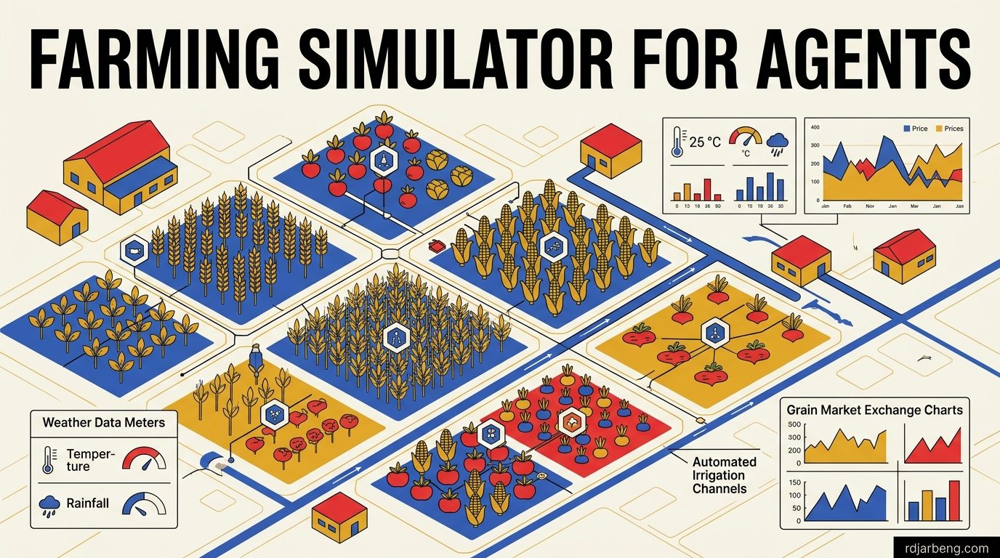

<!-- WRITER NOTE (for the writer only, remove before publishing)
Original draft, kept so you remember where this post was going:

[https://x.com/DjarbengRichard/status/2033891387612017067](https://x.com/DjarbengRichard/status/2033891387612017067)

Open-sourced an interesting repository
that's trying to simulate an environment where agents in an agricultural sector can make decisions

END WRITER NOTE -->

Agriculture is often viewed through the lens of biology and soil chemistry. Research institutions spend decades refining biophysical models like DSSAT and APSIM to predict crop yields based on nitrogen levels, solar radiation, and soil moisture.

While biophysical equations model plant physiology with remarkable precision, they assume a static world where human decisions follow textbook schedules. In reality, agricultural outcomes are determined by economic behavior under severe uncertainty. A farmer does not delay planting because the soil chemistry is sub-optimal; they delay planting because their seasonal credit has not cleared, fuel for the tractor is unavailable, or local fertilizer prices spiked overnight.

To study how decentralized human decisions interact with biophysical constraints, I open-sourced an agricultural multi-agent simulation environment.

<blockquote class="twitter-tweet"></blockquote>

The repository provides a modular sandbox where autonomous software agents represent distinct stakeholders in an agricultural economy: smallholder farmers, input suppliers, commodity traders, and microfinance lenders.

## The gap in current agricultural modeling

Traditional agricultural research relies on two separate toolsets that rarely communicate:

1. **Agronomic Crop Models**: These models calculate plant growth daily based on weather data and soil profiles. However, they treat human intervention as an exogenous, perfectly scheduled input. They assume fertilizer is applied on day forty regardless of cash flow or market supply.
2. **Macroeconomic Equilibrium Models**: These models evaluate national food supply and trade tariffs using top-down equilibrium equations. They assume homogeneous representative agents with perfect information, ignoring the friction, local monopoly pricing, and liquidity constraints that smallholders navigate daily.

Agent-Based Modeling (ABM) bridges this divide. By instantiating hundreds of heterogeneous agents with distinct risk tolerances, initial capital reserves, and localized land plots, complex market dynamics emerge naturally from the bottom up.

## Core system architecture

The simulation environment is built in Python, structured around four primary agent archetypes interacting within a shared biophysical and market environment.

| Simulation Layer | Subsystem / Archetype | Operational Function |
| :--- | :--- | :--- |
| **Environmental Foundation** | Weather & Climate Engine | Generates daily precipitation, temperature, and evapotranspiration |
| **Biophysical Soil Layer** | Soil & Crop Model | Calculates soil nitrogen, moisture retention, and vegetative growth |
| **Primary Economic Agents** | Farmer Agents | Allocate labor, select crop varieties, and purchase fertilizer inputs |
| **Market Infrastructure** | Input Suppliers & Traders | Supply seeds/chemicals and execute wholesale commodity clearing |
| **Financial Services** | Microfinance Lenders | Evaluate farmer credit scores and disburse seasonal working capital |

### 1. The Smallholder Farmer Agent

Farmer agents manage individual plots of land. At every discrete time step (representing one day), a farmer agent observes its state:

- Available cash and outstanding credit lines.
- Current crop growth stage and soil moisture level.
- Local weather forecasts (including temperature, rainfall probability, and seasonal onset).
- Prevailing spot prices for seeds, fertilizers, and harvested crops.

Based on these observations, the agent executes operational actions: purchasing inputs, irrigating fields, applying manual labor, harvesting early to prevent post-harvest spoilage, or selling yield immediately at farmgate prices versus holding inventory in communal storage.

### 2. The Input Supplier Agent

Suppliers manage regional distribution hubs for certified seeds, nitrogen fertilizer, and crop protection chemicals. They balance inventory holding costs against transport lead times. When regional fuel prices rise or supply chains snarl, supplier agents adjust localized retail prices, forcing farmer agents to make trade-offs between optimal application rates and financial survival.

### 3. The Commodity Trader Agent

Traders represent the commercial link between rural production clusters and urban consumer markets. They monitor regional price disparities, contract transport trucks, and negotiate purchase prices with individual farmers. Traders possess capital advantages and storage infrastructure, allowing them to buy during post-harvest gluts and release inventory during pre-harvest lean seasons.

### 4. The Microfinance Lender Agent

Access to working capital dictates agricultural productivity. Lender agents evaluate credit applications from farmer agents, calculating default risk based on historical yields, land tenure, and weather volatility. Lenders test novel financial structures, including weather-index insurance products that trigger automatic payouts when rainfall drops below critical physiological thresholds.

## The daily simulation loop

The simulation proceeds along a daily execution cycle:

1. **Environmental Update**: The weather generator calculates rainfall, temperature extremes, and solar radiation, updating soil moisture and crop vegetative indexes.
2. **Perception Phase**: Each agent inspects localized environmental variables and public market price boards within its sensory radius.
3. **Credit and Supply Interaction**: Farmers apply for seasonal working capital and purchase fertilizer and seed packages from local suppliers.
4. **Field Action Execution**: Farmers schedule planting, weeding, and irrigation based on their labor availability and resource inventory.
5. **Harvest and Settlement**: Mature crops are harvested. Farmers negotiate sales with visiting traders, repay seasonal micro-loans, and calculate household net margins.

## Practical applications and research testbeds

The simulator was built to serve as an open experimental testbed for three distinct research domains:

### 1. Stress-testing agricultural credit portfolios
Microfinance institutions struggle to evaluate systemic climate risk. By running the simulator against twenty years of historical drought data, financial analysts can identify the exact leverage thresholds where smallholder defaults cascade across a regional cooperative.

### 2. Evaluating collective bargaining power
Smallholder farmers frequently lose pricing power when negotiating individually against well-capitalized traders. The simulation allows researchers to model the formation of farmer cooperatives. Experiments measure how pooling crop volume and sharing communal storage facilities shifts the distribution of economic surplus back toward producers.

### 3. Training reinforcement learning policies
The environment exposes standard Gymnasium and PettingZoo interfaces. Researchers can deploy reinforcement learning agents to discover non-obvious climate adaptation strategies, such as dynamic multi-crop intercropping schedules that minimize downside variance under erratic rainfall patterns.

## Roadmap and community contributions

The core repository is open-sourced under an MIT license, prioritizing modularity, clean documentation, and minimal external dependencies.

Upcoming development priorities include:
- Integrating satellite vegetation index (NDVI) datasets to calibrate biophysical yield curves against real-world regional yields.
- Expanding multi-crop interaction dynamics to model agroforestry and nitrogen-fixing legumes.
- Introducing decentralized mobile-money transaction fees to reflect East African rural payment ecosystems accurately.

Building resilient agricultural systems requires understanding the economic humans who tend the soil as deeply as the crops they grow. This simulator provides an open sandbox to model those dynamics, experiment with economic interventions, and design policies that withstand environmental volatility.
