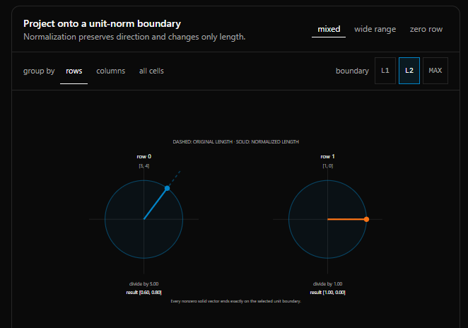
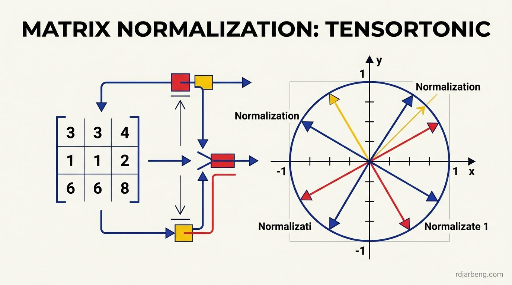

<!-- WRITER NOTE (for the writer only, remove before publishing)
Original draft, kept so you remember where this post was going:

What do the circles mean, how do we go from a matrix or vector to circles and lengths for normalized vectors



END WRITER NOTE -->

On [TensorTonic](https://www.tensortonic.com/), known within the engineering community as an algorithmic training ground for machine learning, challenges focus on building neural network primitives from scratch. Rather than calling high-level framework wrappers, engineers must implement the underlying matrix transformations directly using NumPy.



One foundational problem on the platform asks candidates to implement **Matrix Normalization**. The problem description features a diagram with vectors projecting onto circles:


Understanding what those circles represent geometrically clarifies why normalization is essential across attention mechanisms, embeddings, and gradient stability.

## What the circles actually mean

In two-dimensional space ($$\mathbb{R}^2$$), any vector can be represented as an arrow from the origin $$(0, 0)$$ to a coordinate $$(x, y)$$.

The length or magnitude of that vector is its Euclidean distance from the origin, known formally as the **L2 norm**:

$$
\|\mathbf{v}\|_2 = \sqrt{x^2 + y^2}
$$

When a vector is normalized, each of its components is divided by its total length:

$$
\hat{\mathbf{v}} = \left( \frac{x}{\|\mathbf{v}\|_2}, \frac{y}{\|\mathbf{v}\|_2} \right) = (\hat{x}, \hat{y})
$$

Calculating the length of this new vector demonstrates that its magnitude is always exactly 1:

$$
\|\hat{\mathbf{v}}\|_2 = \sqrt{\hat{x}^2 + \hat{y}^2} = \sqrt{\frac{x^2 + y^2}{x^2 + y^2}} = 1
$$

In Cartesian geometry, the set of all points satisfying the equation:

$$
x^2 + y^2 = 1
$$

defines the **unit circle** centered at the origin with a radius of 1.

The circle in the TensorTonic visualization is that unit circle. When you normalize a matrix of two-dimensional row vectors, you take arrows of arbitrary lengths pointing in various directions and pull or push their tips so they land precisely on the perimeter of the circle.

The directional angle of each vector remains unchanged. Only the magnitude is standardized to 1. In higher dimensions ($$\mathbb{R}^n$$), the circle generalizes into a unit hypersphere ($$\mathbb{S}^{n-1}$$).

## Row-wise versus column-wise normalization

A 2D matrix can be normalized along two distinct axes, each serving different purposes in machine learning:

### 1. Row-wise normalization (axis=1)

In row-wise normalization, each row of the matrix is treated as an independent vector:

$$
\mathbf{X}_{\text{norm}}[i, :] = \frac{\mathbf{X}[i, :]}{\|\mathbf{X}[i, :]\|_2}
$$

This is the standard transformation applied in:
- **Cosine Similarity**: Normalizing embedding vectors allows cosine similarity to be computed as a simple dot product: $$\cos(\theta) = \mathbf{u} \cdot \mathbf{v}$$.
- **Attention Layers**: Normalizing query and key vectors stabilizes dot-product attention scores in Transformer architectures.
- **Computer Vision Embeddings**: Face recognition models (like ArcFace) project face embeddings onto a unit hypersphere so distances depend solely on angular identity rather than image brightness.

### 2. Column-wise normalization (axis=0)

In column-wise normalization, each column represents a single feature across all samples:

$$
\mathbf{X}_{\text{norm}}[:, j] = \frac{\mathbf{X}[:, j]}{\|\mathbf{X}[:, j]\|_2}
$$

This ensures that one feature with massive scale (such as annual salary in dollars) does not dominate features with small numerical ranges (such as age in years) during gradient descent.

## The numerical stability problem: Zero vectors

A critical edge case in production normalization is the null vector $$\mathbf{v} = (0, 0, \dots, 0)$$.

The L2 norm of an all-zero vector is:

$$
\|\mathbf{0}\|_2 = 0
$$

Dividing by zero results in `NaN` (Not a Number) or `Inf` (Infinity) values, which propagate through neural networks and destroy weight updates.

To prevent division by zero, implementations add a small numerical stabilizer $$\epsilon$$ (typically $$10^{-12}$$):

$$
\hat{\mathbf{v}} = \frac{\mathbf{v}}{\|\mathbf{v}\|_2 + \epsilon}
$$

Alternatively, implementations detect vectors where the norm is zero and leave them unchanged as zero vectors.

## The complete NumPy implementation

Here is the clean, vectorized Python solution for the TensorTonic matrix normalization challenge:

```python
import numpy as np

def normalize_matrix(matrix: np.ndarray, axis: int = 1, eps: float = 1e-12) -> np.ndarray:
    """
    Normalizes a 2D matrix along the specified axis using the L2 norm.

    Parameters:
    - matrix: Input 2D numpy array.
    - axis: 1 for row-wise normalization, 0 for column-wise normalization.
    - eps: Small numerical stabilizer to prevent division by zero.

    Returns:
    - Normalized numpy array of the same shape.
    """
    matrix = np.asarray(matrix, dtype=np.float64)

    # Compute Euclidean norm along the axis while keeping dimensions for broadcasting
    norms = np.linalg.norm(matrix, ord=2, axis=axis, keepdims=True)

    # Prevent division by zero using maximum thresholding
    norms = np.maximum(norms, eps)

    # Broadcast division across the matrix
    return matrix / norms

if __name__ == "__main__":
    # Example 3x3 matrix representing 3 data samples with 3 features each
    X = np.array([
        [3.0, 4.0, 0.0],
        [1.0, 1.0, 1.0],
        [0.0, 0.0, 0.0]  # Zero vector edge case
    ])

    X_normalized = normalize_matrix(X, axis=1)

    print("Original Matrix:")
    print(X)
    print("\nNormalized Matrix (Row-wise):")
    print(np.round(X_normalized, 4))

    # Verify that non-zero row norms equal 1.0
    row_lengths = np.linalg.norm(X_normalized, axis=1)
    print("\nRow Magnitudes:")
    print(np.round(row_lengths, 4))
```

### The role of keepdims=True

When `np.linalg.norm` computes row norms on a $$(3, 3)$$ matrix, it collapses the specified dimension, returning a 1D array of shape $$(3,)$$.

Attempting to divide a $$(3, 3)$$ array by a $$(3,)$$ array triggers NumPy broadcasting errors or divides along the wrong axis.

Specifying `keepdims=True` preserves the collapsed axis with length 1, returning an array of shape $$(3, 1)$$. NumPy then broadcasts the division across all columns of each row automatically.

## Framework equivalents: PyTorch and Scikit-Learn

In deep learning production pipelines, normalization is usually delegated to optimized framework functions:

- **PyTorch**:
  ```python
  import torch
  import torch.nn.functional as F

  tensor = torch.tensor([[3.0, 4.0, 0.0], [1.0, 1.0, 1.0]])
  normalized = F.normalize(tensor, p=2, dim=1, eps=1e-12)
  ```
- **Scikit-Learn**:
  ```python
  from sklearn.preprocessing import normalize

  normalized = normalize(X, norm="l2", axis=1)
  ```

Understanding the underlying mathematics ensures that when you see circle projections on algorithm challenges or embedding visualizations, you recognize them as unit vectors mapped onto the boundary of the unit hypersphere.
