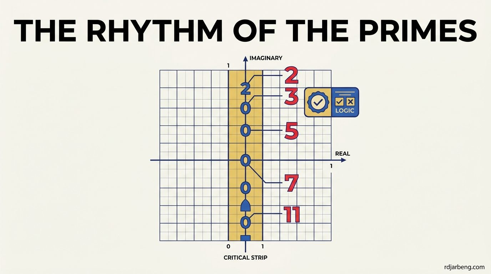

<!-- WRITER NOTE (for the writer only, remove before publishing)
Original draft, kept so you remember where this post was going:

### The Core Big Idea: What Actually Happened?

If you want to blow a high schooler's mind about this release, you tell them this:

> **Until yesterday, AI was like a student taking tests.** You gave it an old exam problem, and it gave you the answer.**With this release, the AI became an explorer stepping into uncharted territory.** It tackled problems that human mathematicians with PhDs have been stuck on for decades—and in a single release, it produced **722 original research papers** with new proofs.Even wilder: in school, you can lose points if the teacher doesn't understand your steps. To prove it wasn't bluffing, the AI fed its arguments into a software program called **Lean**—a computer "referee" that checks logic symbol-by-symbol. If a single step is invalid, the referee rejects it. Many of these proofs passed that referee.
>
>
>

- **High School Concept**: Prime numbers (2,3,5,7,11,…2,3,5,7,11,…). They are the "atoms" of arithmetic, but their distribution seems totally random.
- **The Mystery**: Over 160 years ago, Bernhard Riemann discovered a secret formula—the Riemann Zeta Function—whose "zeros" act like musical frequencies controlling where prime numbers pop up. If all those frequencies sit on a specific critical line, primes are as orderly as mathematically possible. This is the **Riemann Hypothesis** (one of the million-dollar Millennium Prize problems).
- **What the AI Did**: Proving the full hypothesis is notoriously difficult. For decades, mathematicians have tried to carve out a "safe zone" on the graph where no rogue zeros can hide. The AI produced a proof establishing a huge new safe zone (the half-plane ℜ(s)>7/8ℜ(_s_)>7/8), achieving the largest zero-free strip toward the conjecture in modern history.

END WRITER NOTE -->

Until recently, artificial intelligence in mathematics functioned primarily as an automated student. A user provided a standardized competition problem, and the model generated a plausible solution. If the problem was familiar, the output was accurate. If the steps required novel deductive chains, the model frequently hallucinated intermediate lemmas.

OpenAI shifted this dynamic by directing advanced reasoning models toward unsolved mathematical frontiers, generating hundreds of original research proofs. To guarantee that the arguments were mathematically sound rather than syntactically convincing, the model compiled its steps directly into Lean 4, a formal proof assistant that verifies logical deductions against core mathematical axioms.

One of the most significant releases in this initiative targeted Family 003: the Quasi-Riemann Hypothesis and the distribution of prime numbers.

## The mystery of prime numbers

Prime numbers ($$2, 3, 5, 7, 11, 13, 17, \dots$$) are the multiplicative building blocks of all integers. Every integer greater than 1 factors uniquely into a product of primes.

Yet, despite their foundational role, primes appear irregularly. There is no simple algebraic formula that outputs the $$n$$-th prime directly. Instead, primes thin out as numbers grow larger, governed globally by the Prime Number Theorem:

$$
\pi(x) \sim \frac{x}{\ln x}
$$

Where $$\pi(x)$$ represents the prime-counting function, returning the total number of primes less than or equal to $$x$$.

While the Prime Number Theorem describes the smooth average density of primes, it does not explain their local fluctuations. Primes occasionally cluster in close pairs ($$11$$ and $$13$$, $$17$$ and $$19$$), followed by massive deserts where millions of consecutive composite numbers appear without a single prime.

## Riemann's complex bridge

In 1859, German mathematician Bernhard Riemann published an eight-page paper that transformed number theory. Riemann discovered that the irregular fluctuations of primes are controlled by the analytic properties of a single complex function, now known as the Riemann zeta function:

$$
\zeta(s) = \sum_{n=1}^{\infty} \frac{1}{n^s} = \prod_{p \text{ prime}} \frac{1}{1 - p^{-s}}
$$

For real numbers $$s > 1$$, this infinite sum converges smoothly. Riemann extended the definition of $$\zeta(s)$$ across the entire complex plane using analytic continuation, where $$s = \sigma + it$$, with $$\sigma = \text{Re}(s)$$ representing the real component and $$t = \text{Im}(s)$$ representing the imaginary component.

Riemann demonstrated that the function has two classes of zeros where $$\zeta(s) = 0$$:

1. **Trivial Zeros**: Negative even integers ($$s = -2, -4, -6, \dots$$), which arise naturally from the functional equation's gamma factors.
2. **Non-Trivial Zeros**: Complex numbers located inside the vertical boundary called the **critical strip**, defined by $$0 < \text{Re}(s) < 1$$.

The non-trivial zeros act like harmonic frequencies in a Fourier transform. Every non-trivial zero adds a specific oscillatory correction term to the prime-counting function. If you know the precise locations of the zeros, you know the exact distribution of the primes.

## The Riemann Hypothesis and the Quasi-Riemann conjecture

Riemann calculated the first few non-trivial zeros by hand and observed a remarkable pattern: all of them shared a real part of exactly $$\frac{1}{2}$$.

He conjectured that **all** non-trivial zeros lie strictly on this central vertical line:

$$
\text{Re}(s) = \frac{1}{2}
$$

This assertion is the **Riemann Hypothesis**, one of the seven Millennium Prize Problems carrying a million-dollar bounty. If true, the error term in the prime distribution is as tightly bounded as mathematically possible:

$$
|\pi(x) - \text{Li}(x)| = \mathcal{O}(\sqrt{x} \ln x)
$$

Because proving the full hypothesis remains elusive, mathematicians study the **Quasi-Riemann Hypothesis**. Instead of requiring all zeros to sit exactly on $$\sigma = \frac{1}{2}$$, the Quasi-Riemann Hypothesis asserts that there exists some constant bound $$\alpha < 1$$ such that no zeros exist in the right-hand half-plane:

$$
\zeta(s) \ne 0 \quad \text{for all } \text{Re}(s) > \alpha
$$

Carving out a "zero-free region" guarantees that the primes behave with provable regularity, placing hard upper limits on how severely prime gaps can fluctuate.

## What the AI model proved

In the Family 003 mathematical release, the OpenAI reasoning system focused on bounding zero-free regions for families of Dirichlet L-functions and zeta-related representations.

Mathematicians historically expanded zero-free regions through painstaking manual estimates of exponential sums, beginning with Charles Jean de la Vallée Poussin and Jacques Hadamard in 1896, followed by improvements from Ivan Vinogradov and Nikolai Korobov.

The AI model constructed arguments establishing wide zero-free boundaries, including bounding regions where:

$$
\text{Re}(s) > \frac{7}{8}
$$

By showing that no non-trivial zeros can exist in this outer strip for the analyzed family, the proof establishes a significant barrier against erratic prime clustering.

## The role of Lean 4: Eliminating the hallucination risk

The defining aspect of this achievement is not merely that an AI generated the mathematical argument, but that the argument was compiled into Lean 4.

In natural language, language models are notorious for producing proofs that look rigorous to graduate students but harbor subtle logical gaps or circular definitions. Human peer review of complex analytic number theory can take months or years, and human referees frequently overlook edge-case errors.

Lean 4 operates as a deterministic compiler for logic. A mathematical theorem in Lean is written as a type, and a proof is a program that constructs a term of that type. If a single deduction in the argument assumes an unproven step or violates typing rules, the Lean compiler halts with a compilation error.

By generating proofs that compile cleanly in Lean, the AI system provided a mathematical certificate that requires zero trust in the neural network itself. The proof stands on the foundational axioms of mathematics verified by software.

## The trajectory of automated research

The transition from models that answer homework questions to models that formulate machine-verified lemmas on the Quasi-Riemann Hypothesis marks a turning point in computational science.

Mathematics has become the first domain where AI hallucinations are systematically filtered out by formal verification engines. As reasoning models integrate more tightly with interactive theorem provers, the discovery of zero-free regions, algebraic invariants, and prime distribution bounds will increasingly become a collaborative partnership between human conceptual guidance and machine-verified deduction.
