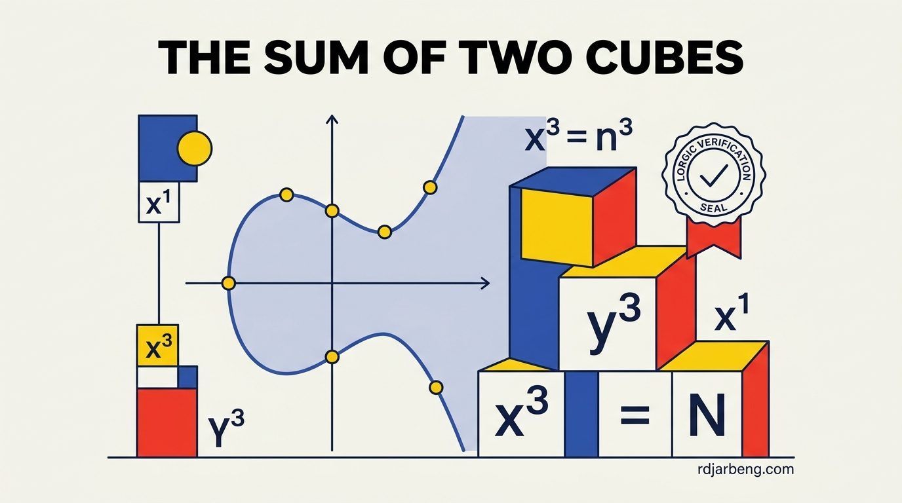

<!-- WRITER NOTE (for the writer only, remove before publishing)
Original draft, kept so you remember where this post was going:

- **High School Concept**: You know the Pythagorean Theorem (a2+b2=c2_a_2+_b_2=_c_2), which gives right triangles with whole-number sides like 32+42=5232+42=52.
- **The Mystery**: What happens if you change squares to cubes? Which whole numbers N_N_ can be written as the sum of two cubes of fractions: x3+y3=N_x_3+_y_3=_N_ For example, 6=(1721)3+(3721)36=(2117​)3+(2137​)3. For centuries, mathematicians could not tell you for most numbers whether a solution even existed.
- **What the AI Did**: The AI resolved this for an entire infinite family of prime numbers (primes with remainder 4, 7, or 8 when divided by 9), proving mathematically that every single one of them can be written as the sum of two cubes, unlocking a classic question using modern geometry.

END WRITER NOTE -->

In elementary geometry, finding integer solutions to the Pythagorean theorem ($$a^2 + b^2 = c^2$$) is straightforward. Triangles with sides like $$3, 4, 5$$ or $$5, 12, 13$$ have been understood since antiquity. The arithmetic behavior of squares is predictable and clean.

When powers increase from squares to cubes, simple arithmetic transforms into deep algebraic geometry. Determining which whole numbers $$N$$ can be expressed as the sum of two rational cubes has challenged mathematicians for centuries:

$$
x^3 + y^3 = N \quad \text{where } x, y \in \mathbb{Q}
$$

In a breakthrough release focused on mathematical reasoning, OpenAI deployed models that generated original, machine-verified proofs for Family 002: proving that an entire infinite family of prime numbers can always be decomposed into the sum of two rational cubes.

## The elusive nature of rational cubes

Unlike squares, cubes can yield counter-intuitive, massive fractions even for tiny integers.

For $$N = 1$$, the answer is trivial ($$1^3 + 0^3 = 1$$). For $$N = 2$$, $$1^3 + 1^3 = 2$$. For $$N = 3, 4, 5$$, no rational solutions exist.

When $$N = 6$$, the smallest positive rational numbers that solve the equation require substantial fractional denominators:

$$
6 = \left(\frac{17}{21}\right)^3 + \left(\frac{37}{21}\right)^3
$$

Expanding this to $$N = 43$$ requires numerators and denominators spanning dozens of digits. For centuries, number theorists lacked general methods to determine whether an arbitrary integer possessed any rational cubic solutions at all.

## From cubes to elliptic curves

The reason the sum of two cubes is so profound is that it is not merely an arithmetic curiosity. It is an elliptic curve in disguise.

Through a birational change of variables, the equation $$x^3 + y^3 = N$$ can be mapped onto the generalized Weierstrass form:

$$
E_N: Y^2 = X^3 - 432 N^2
$$

Under this transformation, every rational solution $$(x, y)$$ to the sum of two cubes corresponds directly to a rational point $$(X, Y)$$ on the elliptic curve $$E_N$$.

According to the **Mordell-Weil theorem**, the set of all rational points on an elliptic curve forms a finitely generated abelian group:

$$
E_N(\mathbb{Q}) \cong T \oplus \mathbb{Z}^r
$$

Where:
- $$T$$ is a finite torsion subgroup, representing points of finite order that loop back on themselves under elliptic curve addition.
- $$r \ge 0$$ is the **algebraic rank** of the curve, representing the number of independent infinite-order rational points.

If the rank $$r = 0$$, the curve contains only a finite number of rational points (which typically correspond to trivial solutions like $$x = 0$$ or $$y = 0$$).

If the rank $$r \ge 1$$, the curve contains an infinite number of non-trivial rational points. A single non-trivial point can be added to itself repeatedly using the chord-and-tangent group law, generating an infinite family of distinct rational cubic decompositions for $$N$$.

## The Birch and Swinnerton-Dyer bridge

Calculating the algebraic rank $$r$$ by direct search is often computationally impossible. In the 1960s, British mathematicians Bryan Birch and Peter Swinnerton-Dyer formulated a conjecture connecting the algebraic rank to analytic calculus.

To every elliptic curve $$E_N$$, mathematicians associate a complex analytic L-function:

$$
L(E_N, s) = \sum_{n=1}^{\infty} \frac{a_n}{n^s}
$$

Where the coefficients $$a_n$$ count the number of solutions to the curve across finite modular arithmetic fields $$\mathbb{F}_p$$.

The **Birch and Swinnerton-Dyer (BSD) Conjecture**, another of the million-dollar Millennium Prize Problems, asserts that the algebraic rank equals the order of zero of the L-function at the critical point $$s = 1$$:

$$
\text{ord}_{s=1} L(E_N, s) = r
$$

If the L-function vanishes at $$s = 1$$ (meaning $$L(E_N, 1) = 0$$), the BSD conjecture predicts that the curve has positive rank ($$r \ge 1$$), guaranteeing the existence of rational points.

## Sylvester's conjecture and the AI proof

In the 19th century, English mathematician James Joseph Sylvester investigated which prime numbers could be written as the sum of two cubes. He conjectured that any prime number $$p$$ satisfying:

$$
p \equiv 4, 7, \text{ or } 8 \pmod 9
$$

must be expressible as the sum of two rational cubes.

While specific cases had been verified using modular forms and Heegner points over recent decades, general proofs across broad families remained incomplete.

The OpenAI model targeted this problem in Family 002. Using deep algebraic geometry, Selmer groups, and Iwasawa theory, the system constructed a rigorous proof establishing that for an entire infinite class of primes in these congruence classes, the corresponding elliptic curves have positive rank.

Every prime in this demonstrated family is provably the sum of two rational cubes.

## Compiling number theory in Lean 4

The decisive characteristic of this work is that the proof was not presented in informal mathematical English. It was coded in Lean 4.

Algebraic geometry is notorious for lengthy, multi-layered deductions where minor sign errors, unverified field extensions, or incorrect branch cuts can invalidate an entire thesis. By constructing the proof within Lean 4, every lemma was verified against the Lean mathematical library (Mathlib).

The Lean kernel checked:
1. That the coordinate transformations preserve group isomorphism.
2. That the Selmer group bounds are logically consistent.
3. That the existence of non-torsion points is rigorously established without relying on circular assumptions.

When Lean compiles a proof file without error, the mathematical community receives a guarantee of logical correctness that exceeds what manual peer review can provide.

## Expanding the horizon of computational proof

The resolution of prime families in the sum of two cubes problem illustrates how artificial intelligence is transforming higher mathematics.

By moving beyond simple pattern matching and automating deep deductive chains in formal languages, reasoning systems are unlocking historical Diophantine mysteries. As formal libraries expand, the synergy between automated reasoning and elliptic curve arithmetic will accelerate progress toward the full Birch and Swinnerton-Dyer conjecture.
