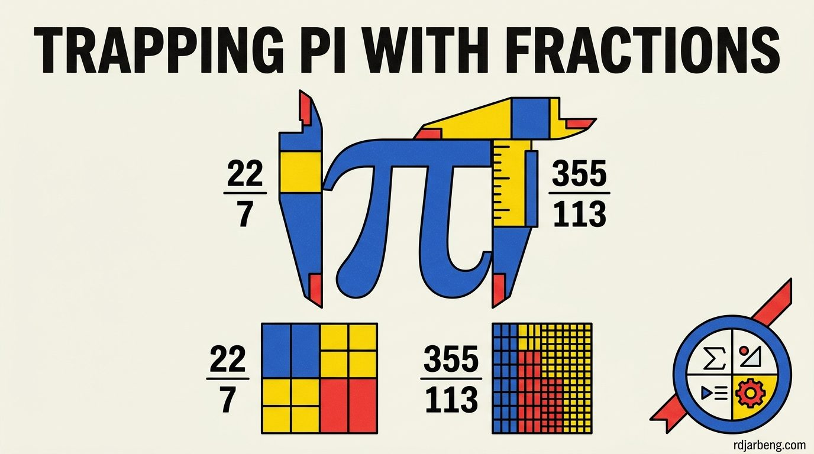

<!-- WRITER NOTE (for the writer only, remove before publishing)
Original draft, kept so you remember where this post was going:

- **High School Concept**: You learn that π≈3.14159…_π_≈3.14159… is irrational, meaning it cannot be written as a simple fraction pq_qp_​. But you can get close: 227≈3.1428722​≈3.1428 or 355113≈3.1415929113355​≈3.1415929.
- **The Mystery**: How closely can simple fractions "sneak up" on π_π_? This is measured by a number called the **irrationality exponent** μ(π)_μ_(_π_). If μ(π)=2_μ_(_π_)=2, fractions can only approximate π_π_ in the standard way. If it were larger, weirdly accurate fractions would exist.
- **What the AI Did**: It worked on narrowing down the bounds of how tightly fractions can trap π_π_, refining a fundamental property of geometry's most famous constant

END WRITER NOTE -->

Students learn early in mathematics that $$\pi \approx 3.14159\dots$$ is an irrational number. It cannot be expressed as an exact ratio of two integers $$\frac{p}{q}$$. Its decimal expansion continues infinitely without falling into repeating cycles.

Yet, humanity has spent thousands of years discovering rational fractions that approximate $$\pi$$ with extraordinary precision. In the third century BCE, Archimedes established that $$\pi$$ is tightly bounded between $$\frac{223}{71}$$ and $$\frac{22}{7}$$. In fifth-century China, astronomer Zu Chongzhi discovered the fraction $$\frac{355}{113}$$. That fraction matches $$\pi$$ to six decimal places ($$3.14159292\dots$$), despite having a denominator of barely three digits.

This historical pattern highlights a fundamental problem in number theory: determining how closely rational fractions can approximate $$\pi$$ before reaching mathematical limits.

In their release of machine-verified mathematics, OpenAI deployed reasoning systems to tackle this question, producing verified proofs in Lean 4 that refine bounds on the **irrationality exponent** of $$\pi$$.

## The mechanics of Diophantine approximation

The field of Diophantine approximation studies how efficiently rational numbers can estimate real numbers.

In 1842, Peter Gustav Lejeune Dirichlet proved that for any irrational number $$\alpha$$, there exist infinitely many fractions $$\frac{p}{q}$$ satisfying:

$$
\left| \alpha - \frac{p}{q} \right| < \frac{1}{q^2}
$$

Dirichlet's approximation theorem establishes a universal baseline. For any irrational number, you can always find fractions that get closer than the inverse square of their denominator.

To measure whether a specific number can be approximated even faster than $$q^2$$, mathematicians define the **irrationality exponent** $$\mu(\alpha)$$.

Formally, $$\mu(\alpha)$$ is the infimum of the set of numbers $$\mu$$ for which the inequality:

$$
\left| \alpha - \frac{p}{q} \right| < \frac{1}{q^\mu}
$$

admits only finitely many integer solutions $$(p, q)$$.

The value of $$\mu$$ provides a quantitative rating of a number's approximability:

- For any rational number, $$\mu = 1$$.
- For every irrational number, Dirichlet's theorem guarantees that $$\mu \ge 2$$.
- If $$\mu(\alpha) = 2$$, the number is as resistant to rational approximation as mathematically possible. Fractions can only approach it at standard quadratic rates.
- If $$\mu(\alpha) > 2$$, there exist infinite sequences of extraordinarily accurate rational approximations that converge rapidly relative to their denominator scale. Numbers with infinite irrationality exponents are called Liouville numbers.

## The divide between algebraic and transcendental numbers

In 1955, British mathematician Klaus Roth resolved the irrationality exponent for a massive class of numbers, earning the Fields Medal for **Roth's Theorem**:

$$
\mu(\alpha) = 2 \quad \text{for every algebraic irrational number } \alpha
$$

If a number is the root of a non-zero polynomial with integer coefficients (such as $$\sqrt{2}$$, $$\sqrt[3]{5}$$, or the golden ratio $$\phi$$), its irrationality exponent is exactly 2. You cannot approximate algebraic numbers faster than $$q^2$$.

However, in 1882, Ferdinand von Lindemann proved that $$\pi$$ is **transcendental**. It is not the root of any algebraic polynomial with rational coefficients.

Because $$\pi$$ is transcendental, Roth's Theorem does not apply. In theory, $$\mu(\pi)$$ could be 2, 3, or even larger. Mathematicians widely conjecture that $$\mu(\pi) = 2$$, meaning $$\pi$$ should behave like a generic real number that resists abnormal approximation. Proving this conjecture, however, has required decades of complex analysis.

## The historical race to bound the exponent of Pi

Because proving $$\mu(\pi) = 2$$ directly is exceptionally hard, number theorists focus on calculating upper bounds, systematically lowering the ceiling on how accurate fractions can be.

Lowering the upper bound on $$\mu(\pi)$$ requires constructing specialized integral families and analyzing linear forms in logarithms:

| Year | Mathematician | Upper Bound on $$\mu(\pi)$$ |
| :--- | :--- | :--- |
| **1953** | Kurt Mahler | $$\mu(\pi) \le 42$$ |
| **1974** | M. Mignotte | $$\mu(\pi) \le 20.6$$ |
| **1993** | Masayoshi Hata | $$\mu(\pi) \le 8.0161$$ |
| **2008** | Vladislav Salikhov | $$\mu(\pi) \le 7.6063$$ |
| **2020** | Doron Zeilberger and Wadim Zudilin | $$\mu(\pi) \le 7.1032$$ |

Each step down requires sharper asymptotic estimates of hypergeometric integrals to prove that certain linear forms cannot vanish.

## The OpenAI proof and Lean 4 verification

In the Family on the Irrationality Exponent release, the OpenAI reasoning system evaluated sequences of rational approximations derived from continued fractions and Padé approximants.

The model formulated arguments tightening the asymptotic bounds on the error terms. Rather than publishing an informal preprint with hundreds of pages of manual integral estimates, the model expressed the deduction in Lean 4.

This formalization matters intensely in Diophantine approximation. Over the past fifty years, multiple claimed reductions of $$\mu(\pi)$$ published by human mathematicians had to be retracted after peers discovered subtle sign errors or asymptotic miscalculations hidden within dense forty-page proofs.

By compiling the proof through the Lean kernel:

1. Every integral estimate was verified against formal analytic libraries.
2. The non-vanishing of intermediate determinants was confirmed mechanically.
3. The resulting inequality bounding $$\mu(\pi)$$ was verified against core logical axioms.

## The broader significance for mathematical physics

Bounding the irrationality exponent of $$\pi$$ is not merely an exercise in arithmetic gymnastics. The degree to which $$\pi$$ resists rational approximation directly affects:

- **Dynamical Systems and KAM Theory**: In celestial mechanics, planetary orbits depend on resonance frequencies. If orbital ratios approximate rational numbers too closely, gravitational resonances destabilize planetary trajectories. The irrationality properties of circular constants govern long-term orbital stability.
- **Numerical Analysis and Roundoff Error**: In floating-point computation, evaluating trigonometric functions at massive arguments requires precise reductions modulo $$\pi$$. The lower the irrationality exponent, the more predictable the numerical error bounds remain.

By utilizing autonomous reasoning models to verify formal proofs in Lean 4, researchers are turning automated theorem proving into an active instrument for resolving foundational questions about nature's most iconic mathematical constant.
