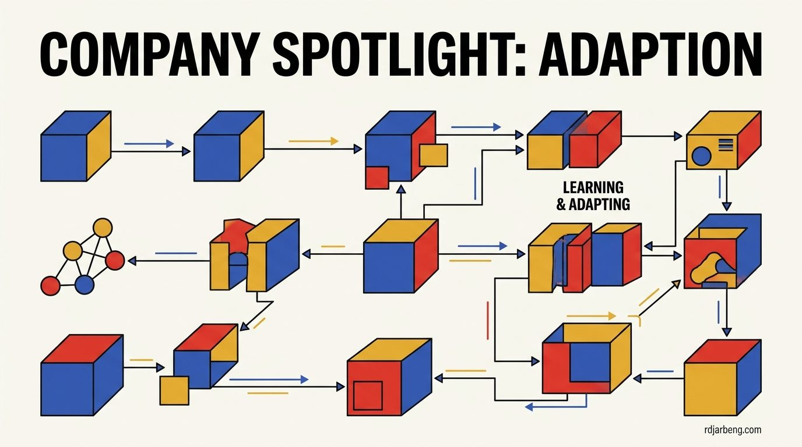

<!-- WRITER NOTE (for the writer only, remove before publishing)
Original draft, kept so you remember where this post was going:

[https://adaptionlabs.ai/](https://adaptionlabs.ai/)

The last decade has been characterized by brute force: larger and larger volumes of compute to build larger and larger monolithic systems.

Intelligence shouldn’t be frozen in training data or updated in slow expensive cycles.

We are betting against scaling, and instead building efficient AI that continually learns.

Where others chase scale, we are building adaptability-first systems

## Why have we become elevated prompt engineers?

Today’s AI is expensive, static, and slow to change. A handful of companies build monolithic, one-size-fits-all-models optimized for the average use case.

Averages erase the exceptional. Whether that’s because of your country, language, industry or your pursuit at the edge of what’s possible.

Tools should exist to extend human capability. Instead, we contort. We rephrase. We mould our requests to compensate for AI limitations.

Most models work well until your use case doesn’t fit. Then you’re on your own.

END WRITER NOTE -->

The previous decade of artificial intelligence development was characterized by brute force. Frontier labs poured unprecedented capital into larger GPU clusters, assembled trillion-token datasets, and trained massive monolithic architectures. The underlying thesis was straightforward: if you scale parameters and training compute high enough, general reasoning emerges.

While this scaling doctrine produced capable foundation models, it also introduced a systemic architectural bottleneck: static checkpoints. Once training completes, the model weights are frozen permanently. The model never learns from its mistakes, never incorporates new domain knowledge directly into its parameters, and remains trapped at its historical cutoff date.

[Adaption Labs](https://adaptionlabs.ai/) is building an alternative approach. Instead of treating intelligence as a static monolith that requires periodic multi-million-dollar retraining cycles, they are engineering systems designed around continual learning and real-time adaptation.

## The limits of prompt engineering as a workaround

Because deployed models cannot learn, software engineers spend enormous effort contorting their inputs to compensate for static parameters. This practice became known as prompt engineering.

When a model fails on a specialized edge case, the developer cannot simply teach the network the new rule. Instead, the developer must:

1. Intercept the user request.
2. Query a vector database to retrieve relevant context snippets through Retrieval-Augmented Generation (RAG).
3. Stuff the retrieved documents into an expanding context window.
4. Craft intricate system prompts instructing the model to ignore its pre-trained defaults in favor of the injected text.

This workflow is an operational band-aid. RAG and prompt stuffing simulate memory within the context buffer, but they do not alter the underlying network. The moment the context window clears, the model reverts to its original baseline state. Every interaction begins from scratch, burning inference tokens to re-teach the system facts it encountered seconds earlier.

## The problem of averages in monolithic scaling

Foundation models are optimized for the statistical average of their training data. When a model trains on trillions of tokens scraped from the public internet, it internalizes the consensus worldview and common distributions of web corpora.

This statistical averaging erases specialization:

- **Regional and Cultural Specificity**: Dialects, localized business conventions, and specialized legal frameworks get smoothed over by dominant internet corpora.
- **Proprietary Workflows**: Unique manufacturing processes, internal codebases, and domain-specific terminology rarely match public internet distributions.
- **Edge-Case Performance**: Monolithic models perform adequately on textbook tasks, but struggle as soon as an enterprise workflow diverges from standard templates.

When an operational task does not fit the statistical average, an engineer has two expensive options: accept mediocre accuracy, or build an isolated fine-tuning pipeline.

## Why traditional fine-tuning falls short

Traditional fine-tuning does not solve the problem of living intelligence. Fine-tuning is an offline, batch-oriented process:

1. Data teams collect, clean, and annotate thousands of specialized examples.
2. The model undergoes secondary gradient updates using low-rank adaptation (LoRA) or full-parameter tuning.
3. Quality assurance engineers run evaluation benchmarks to confirm that the fine-tuned checkpoint has not suffered from catastrophic forgetting.
4. The deployment team swaps the old serving container for the newly compiled checkpoint.

This cycle takes weeks or months. It cannot respond to operational feedback in real time, cannot adapt dynamically to an individual user's preferences, and incurs continuous cloud compute costs.

## Adaption's architectural thesis: Continual learning

Adaption Labs approaches the problem from first principles: intelligence should not be frozen in amber.

In cognitive science, biological intelligence does not require complete retraining to integrate a single correction. A human engineer who learns a new API does not forget how to speak English or write code. Biological neural networks resolve the **stability-plasticity dilemma**: they maintain stable long-term representations while dynamically allocating plastic circuits to integrate fresh feedback.

Adaption's engineering focus centers on building adaptability-first architectures that:

- **Learn Continuously from Interaction**: Update parameters and specialized sub-networks directly from user corrections and task execution feedback without requiring offline batch training.
- **Prevent Catastrophic Forgetting**: Isolate updates to localized weight manifolds so that acquiring new capabilities does not degrade core reasoning benchmarks.
- **Operate with Compute Efficiency**: Enable on-the-fly model adaptation without requiring high-powered training clusters for every incremental update.

## The engineering hurdles ahead

Building continual learning systems is one of the most challenging frontiers in computer science. Three primary technical hurdles must be resolved before continual systems can replace static checkpoints at enterprise scale:

1. **Catastrophic Interference**: Deep neural networks naturally tend to overwrite existing weights when exposed to non-stationary data streams. Preventing this requires novel regularization mechanisms, dynamic routing networks, or modular parameter buffers.
2. **Safety and Drift Verification**: In static models, red-teaming occurs once before deployment. In an adaptive model that updates its internal state dynamically, safety guardrails must operate continuously to ensure the system does not drift into toxic or invalid behavioral states.
3. **Inference Latency Overhead**: Integrating feedback during or immediately following inference must not introduce unacceptable response delays for interactive user workflows.

## The next era of model architectures

The first era of modern generative AI established that massive scale unlocks general linguistic competence. However, scaling alone cannot overcome the fundamental limitation of static weights.

Software tools exist to extend human capability, not to force humans into endless prompt contortions. Companies like Adaption Labs represent the beginning of a necessary architectural transition: moving away from brittle, monolithic models toward resilient, modular systems that learn, specialize, and adapt alongside the humans who operate them.
