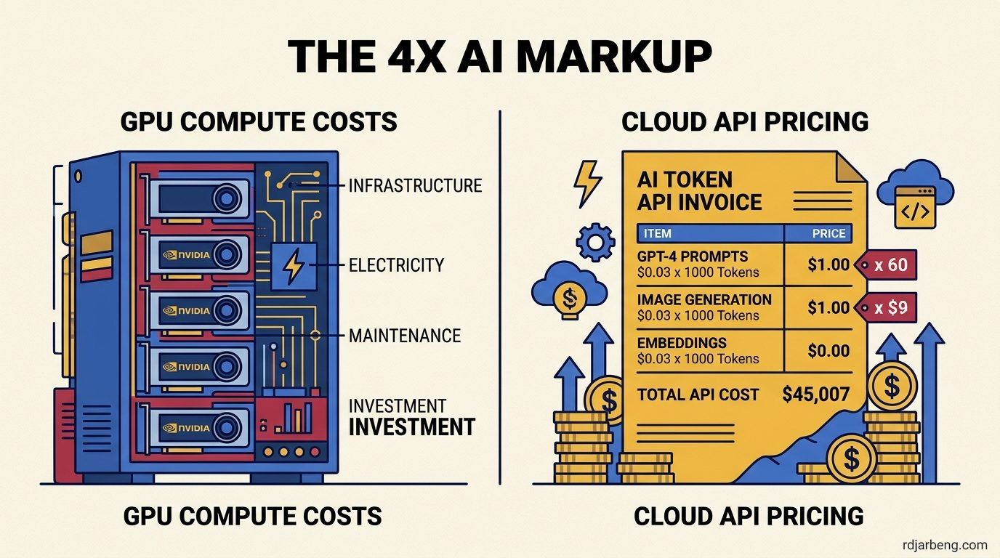

A recurring argument across engineering forums claims that development teams overpay massively when calling proprietary frontier models:

> "You are paying a 4x markup every time you call OpenAI or Anthropic. An A100 GPU running a 70B open-weights model only costs a fraction of that per million tokens. You are just subsidizing GPT-5 and GPT-6 training."

The math sounds compelling on paper. A bare-metal GPU appears to generate tokens at a small fraction of commercial API prices. However, this comparison skips half the infrastructure balance sheet. Before rewriting your architecture or leasing raw GPUs to reduce inference bills, examine the operational realities governing self-hosted compute.

## 1. The theoretical hardware math

When an application calls a Large Language Model, the service bills for input tokens processed and output tokens generated.

The self-hosting economic argument relies on steady-state saturation:

- An enterprise open-weight model (such as Llama 3 70B) requires significant GPU memory (VRAM).
- To serve it at production latency, teams lease raw hardware (such as NVIDIA A100 or H100 instances) from specialized cloud providers like CoreWeave, Lambda Labs, or RunPod.
- Assuming an operator runs that hardware at continuous 100 percent saturation twenty-four hours a day, the underlying compute and electricity costs work out to roughly $0.50 to $0.90 per million tokens.
- By comparison, proprietary frontier models (such as GPT-4o or Claude 3.5 Sonnet) historically billed between $4.00 and $15.00 per million output tokens depending on performance tier and reasoning capabilities.

Looking solely at these raw numbers leads many engineers to assume that proprietary providers charge an arbitrary 80 percent margin to fund speculative research.

## 2. Where the argument holds merit

Frontier labs do operate distinct business models compared to pure infrastructure providers:

1. **R&D Amortization**: Frontier AI labs spend billions of dollars training foundation models from scratch. Inference margins contribute directly toward capital expenditures for next-generation training clusters and safety evaluations.
2. **Commoditized Infrastructure Alternatives**: Companies such as Together AI, Fireworks, and DeepInfra do not train $500 million foundation models from zero. They serve open-weight weights (such as Llama, DeepSeek, and Mistral) on optimized inference runtimes. Because their overhead consists strictly of networking and hardware leases, their retail prices reflect tighter infrastructure margins.
3. **Workload Arbitrage**: If an application performs reliably on an open-weight model like Llama 70B or DeepSeek-R1, continuing to pay frontier proprietary rates for routine summarization or classification is unnecessary expenditure.

## 3. The hidden costs of bare-metal GPUs

The simple math claiming massive savings assumes a fantasy scenario: continuous, uninterrupted GPU utilization with zero administrative overhead. In production environments, running raw GPUs introduces three severe cost multipliers.

### A. The utilization penalty and idle compute

A leased A100 or H100 GPU incurs billing charges every second it remains provisioned, regardless of incoming request volume.

If a SaaS application serves users located primarily in one geographical region, incoming traffic drops during nighttime hours. During off-peak windows, provisioned GPUs consume power and rack space while generating zero revenue.

An A100 renting at approximately $1.80 per hour costs roughly $1,300 per month. If incoming traffic only utilizes 30 percent of the card's available capacity over a 30-day period, the effective cost per million tokens triples immediately from $0.60 to $1.80.

### B. Memory constraints and tensor parallelism

A 70-billion parameter model cannot run unquantized on a single 80 GB GPU without running out of memory. The 16-bit model weights alone occupy approximately 140 GB of VRAM. Serving this workload requires:

- A multi-GPU node running tensor parallelism across at least two 80 GB A100s or four smaller cards.
- High-bandwidth inter-GPU interconnects (such as NVLink) to prevent memory transfer bottlenecks during token generation.
- Ample VRAM headroom allocated for the Key-Value (KV) cache, which stores attention states across concurrent client sessions.

When concurrent user requests increase, the KV cache expands rapidly. If memory runs out, the inference engine begins queuing requests, causing latency spikes and dropped connections.

### C. Site reliability and engineering overhead

Operating self-hosted inference clusters requires managing containerized runtimes (such as vLLM or TensorRT-LLM), configuring dynamic autoscaling, provisioning automated failover, mitigating cold-start delays, and monitoring CUDA driver compatibility.

A single experienced Machine Learning Infrastructure engineer commands a substantial annual salary. Spending engineering hours managing GPU clusters to save $800 a month on API fees represents negative return on investment.

## 4. Architectural tiers: Frontier, Serverless, and Dedicated

Rather than treating model serving as a binary choice between proprietary APIs and bare-metal servers, evaluate workloads across three distinct operational tiers:

| Operational Tier | Recommended Workload | Core Trade-offs |
| :--- | :--- | :--- |
| **Frontier APIs** (OpenAI, Anthropic, Google) | Monthly spend under $1,000, or workloads demanding complex multi-step reasoning and tool use. | Higher per-token rates, compensated by zero maintenance, instant scale-to-zero, and top-tier reasoning capabilities. |
| **Serverless Open-Weights** (Fireworks, Together AI, Groq) | Monthly spend between $1,000 and $10,000 where open-weight models achieve acceptable accuracy. | Low per-token prices with zero GPU cluster management. Teams pay strictly for generated tokens with no idle compute penalties. |
| **Dedicated Clusters** (RunPod, Lambda, CoreWeave) | Monthly spend exceeding $10,000 with steady, predictable, 24/7 traffic volume or strict data sovereignty requirements. | Maximum unit margin control and custom kernel optimizations, requiring dedicated infrastructure engineering staff. |

## Practical cost optimization

Frontier models carry an indisputable infrastructure markup. A portion of every dollar spent on proprietary APIs finances research clusters, safety audits, and upcoming foundation training runs.

However, API pricing also purchases convenience, elastic auto-scaling, zero server maintenance, and state-of-the-art reasoning performance. For teams processing modest volumes or unpredictable burst traffic, paying that markup is substantially cheaper than maintaining idle hardware.

Most engineering organizations achieve maximum cost efficiency by testing hosted open-weight providers like Fireworks or Together AI before leasing bare-metal compute. This strategy captures 80 percent of the cost reduction without adding a single line of server maintenance to the team's backlog.
