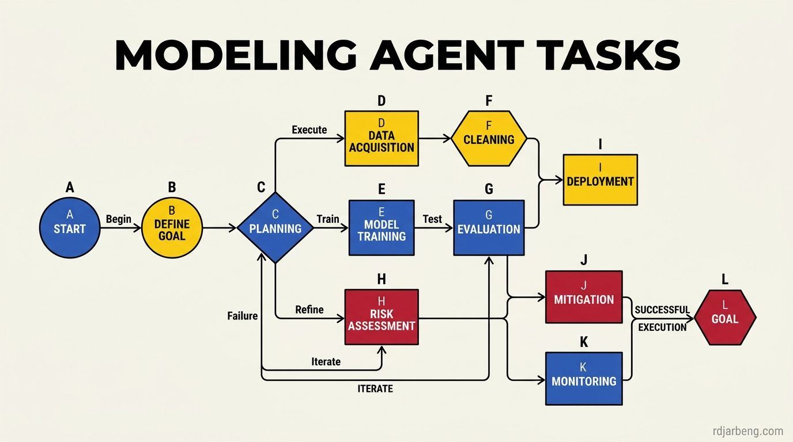

<!-- WRITER NOTE (for the writer only, remove before publishing)
Original draft, kept so you remember where this post was going:

How would a way an agent approaches a task be modeled in the agent economy. Can you make it a straight line graph where the agent goes from start to finish. How would you model a task that cannot be completed no matter how many tokens, what about  a task that takes a large number of tokens, what about a task which doesn't even depend on tokens? Is there a mathematical representation of this? Does this visualization help, how many paths are there from start to expected result? Does an approximate result work?

Let's start with a few assumptions.

1. The model will start at a fixed node called the start
2. The model will end at an end node called the goal/ final output
3. There will be a path from the start to the end goal

If we model the agent task as a diagram, perhaps a graph going from tasks to a final output. We now have a start node that moves left to right and finally lands in a goal node. There are an infinite number of nodes that may be inserted between the start and goal node. 
To make our diagram complete we are going to have some level of branching from node to node that can also be infinite. Now you have a kind of directed graph that shoots forth in different directions with multiple interconnected nodes that converge on an end goal.

Now let's take a look at the way our AI agents work. 
starting from a start goal they work on a number of tasks until they reach an end goal that the user is satisfied with. for the purposes of this modeling we will denote it goal', (goal prime) for the goal the model produces, vs goal which is the actual intended goal the user intended.

From [anthropic](https://www.anthropic.com/research/writing-tools-for-agents): 

> In computing, deterministic systems produce the same output every time given identical inputs, while _non-deterministic_ systems—like agents—can generate varied responses even with the same starting conditions

END WRITER NOTE -->

How would a way an agent approaches a task be modeled in the agent economy. Can you make it a straight line graph where the agent goes from start to finish. How would you model a task that cannot be completed no matter how many tokens, what about  a task that takes a large number of tokens, what about a task which doesn't even depend on tokens? Is there a mathematical representation of this? Does this visualization help, how many paths are there from start to expected result? Does an approximate result work?

Let's start with a few assumptions.

1. The model will start at a fixed node called the start
2. The model will end at an end node called the goal/ final output
3. There will be a path from the start to the end goal

If we model the agent task as a diagram, perhaps a graph going from tasks to a final output. We now have a start node that moves left to right and finally lands in a goal node. There are an infinite number of nodes that may be inserted between the start and goal node. 
To make our diagram complete we are going to have some level of branching from node to node that can also be infinite. Now you have a kind of directed graph that shoots forth in different directions with multiple interconnected nodes that converge on an end goal.

Now let's take a look at the way our AI agents work. 
starting from a start goal they work on a number of tasks until they reach an end goal that the user is satisfied with. for the purposes of this modeling we will denote it goal', (goal prime) for the goal the model produces, vs goal which is the actual intended goal the user intended.

From [anthropic](https://www.anthropic.com/research/writing-tools-for-agents): 

> In computing, deterministic systems produce the same output every time given identical inputs, while _non-deterministic_ systems—like agents—can generate varied responses even with the same starting conditions


Most discussions of AI agents treat task execution as an informal chat session that happens to run code. In production environments, treating an agent as a conversational partner obscures how systems fail, where tokens disappear, and why identical prompts produce wildly divergent results. To build reliable multi-agent systems, engineering teams must model agent tasks formally. This analysis develops a graph-theoretic framework for agent task execution, examining path topologies, token expenditure bounds, and the fundamental divergence between intended objectives and observed outputs.



## The basic state space model

An autonomous agent task begins with an initial state, consumes computational resources through iterative tool actions, and terminates at a stopping condition. We can formalize this execution environment as a directed graph:

$$
\mathcal{G} = (\mathcal{V}, \mathcal{E}, \mathcal{W})
$$

Where:
- $$\mathcal{V}$$ represents the set of all possible system states. A state $$v \in \mathcal{V}$$ encapsulates the agent's context window, file system modifications, running process tables, and external database records at a given time step.
- $$\mathcal{E} \subseteq \mathcal{V} \times \mathcal{V}$$ represents the directed edges. An edge $$e = (v_i, v_j)$$ exists if the agent can transition from state $$v_i$$ to state $$v_j$$ by invoking a tool, generating text, or receiving external input.
- $$\mathcal{W}: \mathcal{E} \to \mathbb{R}^+$$ assigns a non-negative cost to every transition, measured in input tokens, output tokens, wall-clock latency, and API dollar costs.

The execution begins at a designated start state $$S \in \mathcal{V}$$. The user assigns an intended goal state $$G \in \mathcal{V}$$. The agent's objective is to construct a path $$P = (S = v_0, v_1, v_2, \dots, v_k)$$ such that the final state $$v_k$$ satisfies the requirements of $$G$$.

## The goal divergence problem

In deterministic software, the destination state is explicitly coded. In probabilistic agent systems, the agent terminates at a state $$G'$$ that it believes satisfies the user prompt:

$$
\delta = \mathcal{D}(G, G')
$$

Where $$\mathcal{D}$$ is a domain-specific distance metric measuring discrepancies between what the user requested and what the agent delivered.

Three distinct conditions characterize the relationship between $$G$$ and $$G'$$:

1. **Exact Convergence ($$\delta = 0$$)**: The produced state matches all structural, functional, and stylistic constraints specified by the user. A unit test suite passing completely is an example of exact convergence.
2. **Acceptable Approximation ($$0 < \delta \le \epsilon$$)**: The produced state deviates slightly from the ideal objective but remains within the user's tolerance threshold $$\epsilon$$. An essay written with valid facts but slightly different paragraph ordering falls into this category.
3. **Task Failure ($$\delta > \epsilon$$)**: The agent terminates prematurely, hallucinated completion, or satisfied a distorted interpretation of the prompt while leaving core requirements unfulfilled.

Because agents evaluate their own stopping conditions, an agent often declares success at a state $$G'$$ where $$\delta$$ is unacceptably large. Solving this requires external verification nodes that test invariants independently of the generating model.

## Execution topologies

The structure of the transition graph determines how reliably an agent can navigate from start to finish. In real-world workloads, agent trajectories take one of four distinct topological shapes.

### 1. The linear pipeline

The simplest model is a straight-line sequence of state transitions without branching:

$$
S \xrightarrow{e_1} v_1 \xrightarrow{e_2} v_2 \xrightarrow{e_3} \dots \xrightarrow{e_k} G
$$

Linear paths occur in scripted agent workflows where deterministic tools execute sequentially (for example, fetch URL, parse HTML, extract table, write CSV). The branching factor is exactly 1. Reliability is high, but the system possesses zero ability to recover if any tool invocation fails.

### 2. The directed branching tree

When an agent employs reflection, planning, or self-correction, the graph expands into a tree:

```
          [Planning: v1]
           /          \
    [Approach A: v2]  [Approach B: v3]
        |                  |
    [Test Fail: v4]   [Test Pass: v5]
        |                  |
    [Backtrack: v1]   [Terminal Goal: G]
```

At state $$v_1$$, the model samples multiple possible reasoning paths or tool combinations. If an attempted branch leads to an error state $$v_4$$, the agent backtracks to an earlier checkpoint and traverses an alternative branch.

The computational cost scales with the branching factor $$b$$ and the search depth $$d$$. While a linear pipeline consumes $$O(d)$$ tokens, unconstrained branching trees consume exponential resources:

$$
\text{Cost} = \sum_{t=0}^{d} b^t \cdot \bar{w}
$$

Where $$\bar{w}$$ represents the average token cost per node.

### 3. Absorbing cycles and doom loops

The most hazardous topology in autonomous agent workflows is the directed cycle:

$$
v_i \to v_{i+1} \to v_{i+2} \to v_i
$$

A cycle occurs when an agent encounters an unexpected error, attempts a generic remediation step, receives the same error, and repeats the identical tool call. Because language models have finite context windows, earlier error messages eventually roll off the context buffer, causing the model to forget that it already attempted that exact fix.

In graph theory, an absorbing state is a state that cannot be left once entered. A cycle of error handling tools functions as an absorbing sink, trapping the agent until its execution budget is exhausted.

### 4. Convergence onto multi-milestone DAGs

Production-grade agent architectures structure tasks as Directed Acyclic Graphs (DAGs) with explicit milestone gates. Instead of permitting an unconstrained random walk through state space, the orchestrator divides the task into topological milestones:

$$
S \to \mathcal{M}_1 \to \mathcal{M}_2 \to \dots \to \mathcal{M}_m \to G
$$

Within milestone $$\mathcal{M}_i$$, the agent may branch and retry locally. However, execution cannot transition to milestone $$\mathcal{M}_{i+1}$$ until a deterministic validator verifies that all state invariants for $$\mathcal{M}_i$$ are satisfied. This prevents early errors from compounding downstream.

## The token budget horizon

Every step along an edge consumes finite tokens. Let $$B$$ represent the maximum token budget allocated for a task. The set of reachable states is strictly bounded by this budget:

$$
\mathcal{V}_{\text{reachable}}(B) = \left\{ v \in \mathcal{V} \;\middle|\; \exists \text{ path } P = (S, \dots, v) \text{ such that } \sum_{e \in P} \mathcal{W}(e) \le B \right\}
$$

This constraint categorizes tasks into three distinct feasibility classes:

1. **Sub-Budget Solvable**: A valid path exists to a state $$G'$$ where $$\delta \le \epsilon$$, and the cumulative cost along the optimal path is strictly less than $$B$$.
2. **Budget-Starved**: A valid path to an acceptable goal exists in the state graph, but the minimum path length exceeds $$B$$. The agent exhausts its budget and halts mid-execution.
3. **Unreachable Goals**: No path exists from $$S$$ to any state within the $$\epsilon$$-neighborhood of $$G$$, regardless of token budget size. Tasks that require offline information, non-existent API credentials, or mathematically impossible operations fall into this class. Providing infinite tokens to an agent tasked with an unreachable goal simply accelerates billing costs without altering the outcome.

## Incorporating environmental non-determinism

Real agents do not operate in closed mathematical vacuums. They interact with web APIs, file systems, operating system kernels, and network sockets. These environments introduce non-deterministic state transitions.

When an agent issues a tool call $$a \in \mathcal{A}$$, the transition to the next state is governed by a probability distribution:

$$
\mathcal{P}(v_{t+1} \mid v_t, a)
$$

An external server might return an HTTP 200, an HTTP 429 rate limit, or an HTTP 500 internal error for identical inputs. Consequently, the agent graph is not static. It represents a Partially Observable Markov Decision Process (POMDP).

An agent navigating a POMDP must balance exploitation (following the path with highest historical probability of reaching $$G$$) with exploration (testing environmental responsiveness before committing irreversible state changes).

## Architectural guardrails for production agents

Formalizing agent tasks as graphs directly informs system architecture. Five concrete engineering guardrails prevent state-space traps:

1. **Topological Checkpointing**: Serialize the complete environment state at every milestone. If an agent enters a suspected cycle, roll the system back to the previous checkpoint rather than allowing the model to self-diagnose in-context.
2. **Cycle Detectors on Tool Signatures**: Hash each tool call and its serialized arguments. If an agent executes an identical tool hash within a sliding window of three actions, interrupt execution immediately and inject a deterministic constraint into the prompt.
3. **Hard Horizon Cutoffs**: Impose a maximum edge traversal count in addition to raw token limits. A task that takes more than thirty tool invocations without transitioning to a new milestone is almost certainly trapped in an unrecoverable sink.
4. **Independent Verifiers**: Separate the agent generating changes from the agent evaluating completion. The generating agent must never have authority to declare that $$\mathcal{D}(G, G') = 0$$.
5. **Divergence Metrics**: Define measurable pass criteria (such as test coverage thresholds, schema validation, or structural linters) that evaluate output artifacts externally.

## Toward a calculus of agent workflows

As autonomous agents transition from experimental demos to infrastructure backbones, treating their behavior as mysterious emergent phenomena becomes untenable. Agent operations are path traversals through high-dimensional state graphs.

By measuring branching factors, calculating token-weighted path lengths, and constraining state transitions with topological checkpoints, engineering teams can predict reliability, contain cloud expenditures, and guarantee convergence. The future of agent engineering lies not in prompting models to try harder, but in building rigorous graph architectures that make failure states unreachable.
