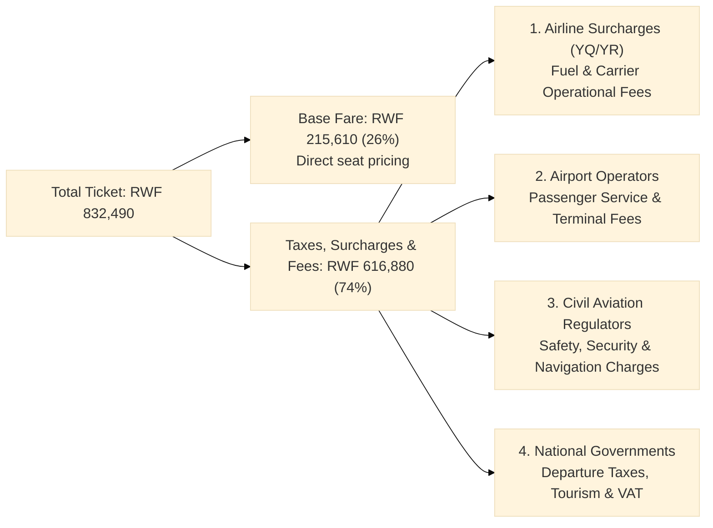

Anyone who has looked at regional flight bookings across Africa has likely encountered a striking pricing split. In a standard intra-African booking used here as an illustration, an itinerary priced on [RwandAir](https://www.rwandair.com/) breaks down as follows:

* **Total Ticket Price:** RWF 832,490
* **Base Fare:** RWF 215,610 (about 25.9%)
* **Taxes and Fees:** RWF 616,880 (about 74.1%)

Nearly three-quarters of the total price sits in the "Taxes and Fees" column, while the base fare (the actual seat on the aircraft) accounts for barely a quarter of the bill.

This pattern is not unique to RwandAir, nor is it confined to Rwanda. Passengers booking on Ethiopian Airlines, Kenya Airways, ASKY, Air Peace, or Air Côte d'Ivoire routinely see statutory fees and surcharges match or dwarf the base fare. Looking at the mechanics of international ticketing explains where that 74% actually goes.

## Deconstructing the "Taxes & Fees" Line Item

When an airline website displays a single aggregated line labeled "Taxes, Surcharges & Fees," it gives the impression that government tax authorities collect the entire sum.

Under the ticketing standards established by the [International Air Transport Association (IATA)](https://www.iata.org/), that figure is actually a composite pool distributed among four main groups:

## 1. Carrier-Imposed Surcharges (IATA Codes: YQ and YR)

Under standard electronic ticketing formats overseen by [IATA](https://www.iata.org/en/programs/passenger/ticketing/), the fees block combines mandatory external government levies with carrier-imposed surcharges, designated by two-letter codes such as YQ and YR.

| Code | Designation | Purpose and Destination | Recipient |
| :--- | :--- | :--- | :--- |
| **Base Fare** | Seat Transportation Fare | Core inventory pricing for the flight sector | Airline |
| **YQ** | Carrier-Imposed Surcharge | Historically designated for fuel cost adjustments | Airline |
| **YR** | Carrier-Imposed Surcharge | Distribution fees, insurance, or booking system costs | Airline |
| **Airport / Country Codes** (`RW`, `QA`, `UG`) | Statutory Passenger Charges | Terminal operations, security, civil aviation oversight | Airport Authority / Government |

### Why Fuel Surcharges Remain in the Fee Block

During periods of high oil price volatility in the early 2000s, airlines introduced floating fuel surcharges to avoid repeatedly refiling base fare tariffs across global distribution systems (GDS). Although oil markets eventually normalized, carrier-imposed surcharges remained a permanent convention.

Airlines keep YQ and YR in the surcharge bucket for specific operational reasons:

* **Loyalty Program Redemptions:** Frequent-flyer programs (such as RwandAir Dream Miles, Ethiopian ShebaMiles, or Kenya Airways Asante Rewards) generally allow passengers to redeem points against the base fare, while requiring all carrier surcharges and statutory taxes to be paid in cash.
* **Corporate Discounts and Travel Agency Commissions:** Corporate volume contracts and travel agent commission rates typically calculate discounts solely against the base fare, leaving carrier surcharges intact.
* **Jet Fuel Premiums in Africa:** According to data published by the [African Airlines Association (AFRAA)](https://afraa.org/), aviation turbine fuel in Africa costs 15% to 20% more than global benchmarks due to inland transport logistics, regional import tariffs, and pipeline bottlenecks. Airlines absorb this volatility through carrier surcharges.

## 2. Airport Operators: Passenger Service Charges and Infrastructure Debt

Airports require major capital outlays to construct and maintain runways, terminal halls, baggage routing machinery, and tarmac lighting.

In high-density markets across Europe and East Asia, airports spread these capital costs across tens of millions of passengers annually. In contrast, many African airports handle smaller annual passenger volumes. To service airport expansion debt and maintain terminal operations, operators levy higher unit fees per passenger:

* **Passenger Service Charge (PSC):** Assessed per departing (and sometimes arriving) passenger to fund terminal concourses, check-in infrastructure, and boarding gates.
* **Airport Infrastructure Development Levies:** Surcharges specifically dedicated to amortizing loans for runway expansions or terminal construction.
* **Apron and Baggage Handling Fees:** Terminal charges covering ground handling and screening infrastructure.

On international departures within sub-Saharan Africa, passenger service charges commonly range between \$40 and \$70 USD per passenger per leg. On a round trip passing through two international airports, passenger facility fees alone can contribute \$80 to \$140 USD to the total.

## 3. Civil Aviation Authorities: Safety, Security, and Navigation

Every international flight operates under regulations defined by the [International Civil Aviation Organization (ICAO)](https://www.icao.int/). National civil aviation authorities (such as the Rwanda Civil Aviation Authority, Kenya Civil Aviation Authority, or Ghana Civil Aviation Authority) receive mandatory levies from each ticket:

* **Aviation Safety Oversight Fees:** Funds mandatory audits of airline fleets, flight crew licensing, and maintenance certifications.
* **Aviation Security Surcharges:** Mandated under international civil aviation guidelines (ICAO Annex 17) to fund screening personnel, perimeter security, baggage inspection scanners, and border biometrics.
* **Air Navigation and En-Route Levies:** While airlines pay route navigation fees directly for flying through national airspace corridors, certain jurisdictions include passenger-side regulatory levies in the ticket breakdown.

## 4. National Treasuries and Government Agencies

The remaining segment consists of direct fiscal measures collected by state institutions:

* **Government Departure Taxes:** Fixed charges imposed by finance ministries on commercial passengers departing across national borders.
* **Tourism Development Levies:** Collected to support destination marketing and conservation programs.
* **Value Added Tax (VAT) or Sales Taxes:** Assessed on domestic or regional sectors in jurisdictions where commercial aviation is not zero-rated.

## The Regional Picture: What the Data Shows

The high tax burden on African air travel is extensively documented by both AFRAA and IATA.

Data from the [AFRAA Study on Taxes, Charges, and Fees in African Aviation](https://afraa.org/) outlines clear continental trends:

* **Double the Global Average:** Passengers departing on international flights in Africa pay an average of roughly \$68 USD in government taxes, fees, and airport charges. This is more than double the average in Europe (~\\$32 USD) or the Middle East (~\\$34 USD).
* **Regional Disparities:** In Western and Central Africa, international passenger taxes and airport fees average \$90 to \$110 USD per departure. In countries like Gabon and Sierra Leone, cumulative passenger taxes and fees on specific international itineraries have exceeded \$290 USD.
* **Fees Matching Base Fares:** AFRAA reports that on multiple intra-African routes, cumulative non-fare taxes and charges regularly exceed the base airfare itself.
* **Fiscal Treatment:** Both IATA and AFRAA point out that many finance ministries historically treated commercial aviation as a luxury commodity rather than critical transport infrastructure, applying heavy levies to generate hard-currency revenue.

The table below illustrates how a sample intra-African ticket of RWF 832,490 (about 620 USD) distributes across these categories:

| Component | Share | Approximate Amount | Purpose |
| :--- | :--- | :--- | :--- |
| **Base Fare** | ~25.9% | RWF 215,610 (~160 USD) | Core airline seat and flight operation |
| **Carrier Surcharges (YQ/YR)** | ~35% to 40% | RWF 290,000 (~215 USD) | Fuel offset, booking systems, distribution |
| **Airport Passenger Service Charges (PSC)** | ~20% to 25% | RWF 180,000 (~135 USD) | Terminal facilities, runway debt service, baggage systems |
| **Civil Aviation & Government Taxes** | ~10% to 14% | RWF 90,000 (~65 USD) | Safety oversight, security screening, departure levies |

## International Policy Guidelines: ICAO Doc 9082

The international benchmark governing these charges is [ICAO's Policies on Charges for Airports and Air Navigation Services (Doc 9082)](https://www.icao.int/publications/Documents/9082_cons_en.pdf).

Doc 9082 defines specific rules to keep charges fair and economically sustainable:

1. **Cost-Relatedness:** Civil aviation charges must reflect the actual cost of providing, maintaining, and operating airport or navigation infrastructure.
2. **Transparency and Consultation:** Airport operators must consult airline operators before introducing or raising passenger facility charges.
3. **Dedicated Reinvestment:** Funds gathered through civil aviation charges should be reinvested directly into aviation infrastructure rather than diverted to general government treasuries.

The [IATA Focus Africa Initiative](https://www.iata.org/en/programs/focus-africa/) works directly from ICAO Doc 9082, urging African governments to avoid unilateral fee increases and ensure airport charges reflect demonstrable operating costs.

## Continental Consequences and the SAATM Framework

The combination of high taxes, fragmented airspace, and expensive aviation fuel produces significant economic ripple effects across Africa:

* **The Routing Paradox:** It is frequently cheaper and faster for a passenger to fly from an African capital to Europe or the Gulf (via Paris, Istanbul, Addis Ababa, or Doha) and connect back into a neighboring nation than to take a direct flight across the immediate border.
* **Suppressed Passenger Demand:** Studies cited by AFRAA show that air travel demand in Africa has a price elasticity between -2.3 and -3.1. High ticket costs directly depress tourism, academic mobility, and regional trade.
* **The Single African Air Transport Market (SAATM):** To address these bottlenecks, the African Union established the [Single African Air Transport Market (SAATM)](https://afcac.org/en/saatm) under Agenda 2063, managed by the [African Civil Aviation Commission (AFCAC)](https://afcac.org/). SAATM works to dismantle restrictive bilateral air service agreements (BASAs), standardize fee structures, and reduce the non-fare tax burden across participating member states.

Until regional taxation and airport charge frameworks are harmonized, high fee-to-fare ratios will remain a standard feature of commercial aviation on the continent.

## References and Further Reading

1. **African Airlines Association (AFRAA):** [Study on Taxes, Charges, and Fees in African Aviation](https://afraa.org/): Statistical analysis of passenger charges across Northern, Western, Central, Eastern, and Southern Africa.
2. **International Air Transport Association (IATA):** [Focus Africa Initiative](https://www.iata.org/en/programs/focus-africa/): Industry programs on reducing passenger taxes and improving intra-African connectivity.
3. **International Civil Aviation Organization (ICAO):** [ICAO's Policies on Charges for Airports and Air Navigation Services (Doc 9082)](https://www.icao.int/publications/Documents/9082_cons_en.pdf): The international regulatory framework defining cost-recovery principles for airport charges.
4. **African Civil Aviation Commission (AFCAC):** [Single African Air Transport Market (SAATM)](https://afcac.org/en/saatm): The African Union flagship initiative under Agenda 2063.
5. **IATA Standards:** [Passenger Ticketing and Fare Construction Standards](https://www.iata.org/en/programs/passenger/ticketing/): Explanations of base fares, carrier-imposed surcharges (YQ/YR), and international tax codes.
