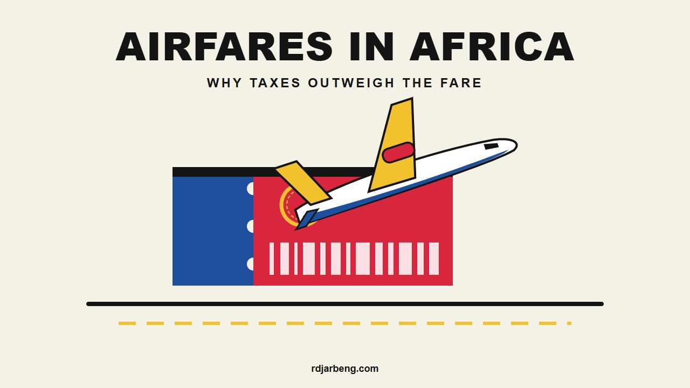
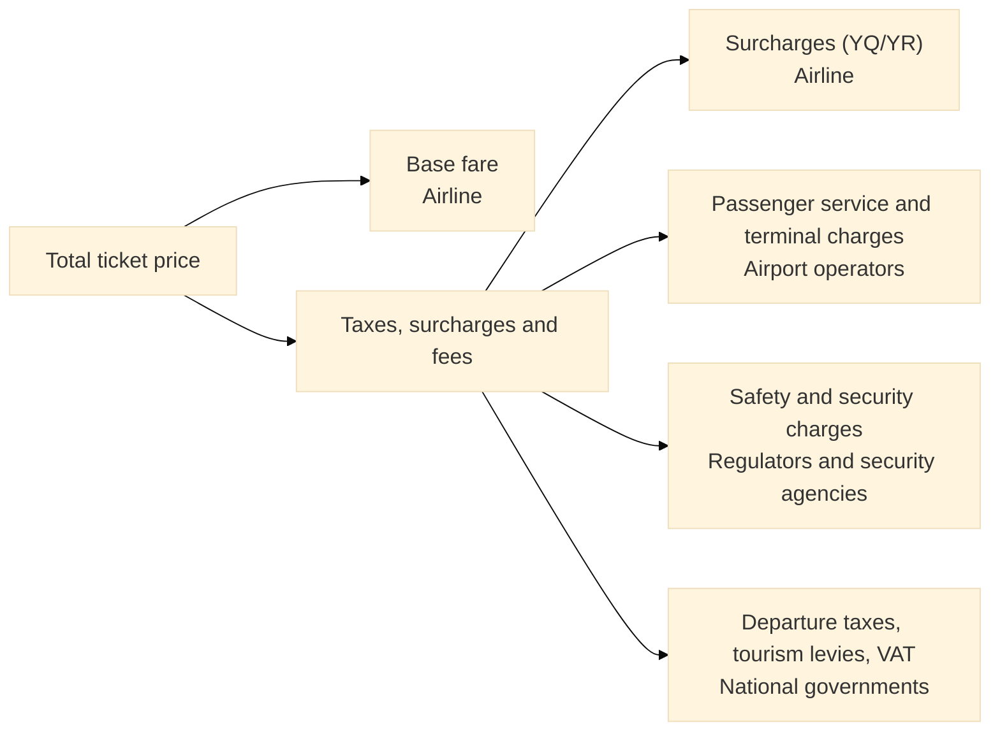
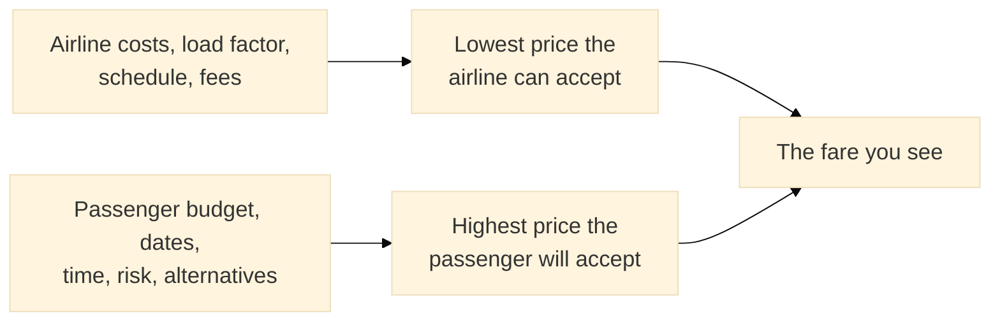

Search for a flight between two African cities and the result can look wrong: a neighboring capital costs more than a trip to Europe, the cheapest option connects through a third country, and the base fare is smaller than the fees stacked on top of it. One intra-African booking used as the example for this post came to RWF 832,490 (about USD 570), of which RWF 215,610 was the base fare and RWF 616,880 was "taxes and fees."

That is 74% in fees, and it makes a good screenshot. It is also the far end of the range. In the worked ticket examples published in the [AFRAA 2024 study on taxes and charges](https://afraa.org/wp-content/uploads/2025/06/Taxes-Fees-and-Charges-Study-2024.pdf), taxes made up anywhere from 10% to 74% of the total price, and AFRAA's summary is that they generally exceed 35% of the total on an airline's most affordable fares. Those are still heavy numbers, but one receipt cannot explain them, and neither can blaming one airline or one government.

A ticket price is what happens when two people with different problems meet. One is an airline with a very expensive machine that has to earn money every day under the rules of every country it touches. The other is a traveler with a date, a budget, and a list of things they would rather not go through. Working out why tickets cost what they do means starting with each of them, and the airline comes first because its costs set the floor.

## Start with one airplane

Imagine you run an airline with a single 150-seat narrowbody. You lease it, so the payment is due every month whether it flies or not. Before a given flight departs, you have committed to the crew, the fuel plan, the maintenance that accumulates with every cycle, the landing and handling bills, and the navigation fees for the airspace you will cross. Once the doors close, an empty seat saves you almost nothing.

Suppose a 2.5 hour flight costs USD 30,000 all in. These are invented round numbers, used only to show the mechanics, but the arithmetic holds at any scale:

| Seats sold | Share of seats filled | Cost each passenger must cover |
| :--- | :--- | :--- |
| 150 | 100% | USD 200 |
| 125 | 83.6% (global average, 2025) | USD 239 |
| 113 | 75.3% (Africa average, 2025) | USD 266 |
| 90 | 60% | USD 333 |

The two middle rows use real figures. [IATA's full-year 2025 data](https://www.iata.org/en/pressroom/2026-releases/2026-01-29-02/) put the global passenger load factor at 83.6% and Africa's at 75.3%, the lowest of any region. Africa's figure was up on the year, and demand there is growing quickly, but the gap to Europe (84.8%) is still large. On this flight, the difference between the global and African averages adds about USD 26 to what every passenger has to cover, before any African cost has been priced in.

The obvious fix is to cut the price and fill the plane, and sometimes that works. It only works if there are enough people on that route, on that day, who would fly at the lower price. So the next decision matters more than the price itself: where the airplane goes, and when.

## Deciding where the plane goes and when

Where the plane goes is the hardest question an airline answers, because every option uses up the same limited hours. A schedule has to fit routes the airline is legally allowed to fly, airports that are open when it wants to land, crew duty limits, maintenance slots, and the times of day people want to travel. A flight that leaves at a convenient hour in one city may arrive at a useless hour in the next, and the plane still has to get home.

Those constraints decide how many hours the aircraft earns money. Say the lease and other fixed costs of ownership run to USD 400,000 a month, again a made-up figure. Fly 300 hours a month and each hour carries about USD 1,333. Fly 200 hours and each hour carries USD 2,000. On a 2.5 hour flight with 113 passengers, that is the difference between roughly USD 30 and USD 44 per person. A plane that sits on the ground at an outstation, waiting for the next viable departure, charges its passengers for the wait.

Short routes add another penalty. An airline pays for takeoff, climb, landing, and a turnaround on every flight regardless of length, so the cost per kilometer is higher on a one hour hop than on a five hour sector. Many of the routes people most want in Africa are short, and many carry too few passengers for a daily nonstop.

That thin demand explains the hubs. [IATA reports](https://www.iata.org/en/about/worldwide/ame/blog/africa-growth-strengthens-but-structural-challenges-keep-airline-profitability-marginal/) that only 19% of intra-African routes have direct flights. If a route has 30 passengers a day, no airline can fill a 150-seat aircraft with them alone. Combine those 30 with people from a dozen other cities at Addis Ababa, Nairobi, Lomé, Casablanca, Johannesburg, or Cairo, and each onward flight can be full. Hubs are the reason some small cities have any international service, and they are also the reason a trip across one border can route through a third country.

Traffic rights narrow the choice further. An airline can generally only carry passengers between two foreign countries when the agreements between governments allow it, and much of Africa's market still runs on such agreements. The [Single African Air Transport Market (SAATM)](https://afcac.org/en/saatm), managed by the [African Civil Aviation Commission (AFCAC)](https://afcac.org/) under the African Union's Agenda 2063, was created to replace them with open access. As of June 2026, [AFCAC's position](https://africanpilot.africa/one-african-sky-saatm-implementation-takes-centre-stage-in-lome/) was that 38 states had signed the commitment, 12 had completed regulatory alignment and open access, 16 had partly done so, and 10 had signed without demonstrable change. An airline cannot plan a sensible route through a country that has signed the paper and kept the restrictions.

So the plane now has a schedule, shaped as much by law and demand as by what the airline would choose. Every flight on it comes with bills, and in Africa most of those bills are larger than they are elsewhere.

## What it costs to keep the plane flying

Those bills start with fuel, the largest variable cost. IATA's [regional breakdown from December 2025](https://www.iata.org/en/about/worldwide/ame/blog/africa-growth-strengthens-but-structural-challenges-keep-airline-profitability-marginal/) compares African costs with global averages:

| Cost area | How much higher in Africa (IATA) |
| :--- | :--- |
| Jet fuel | 17% |
| Taxes and charges | 12% to 15% |
| Air navigation charges | 10% |
| Maintenance, insurance, and capital | 6% to 10% |

Fuel has been especially painful in 2026. [Jet fuel reached USD 171 a barrel](https://www.ecofinagency.com/news-services/3003-54244-jet-fuel-at-171-divides-african-airlines-into-haves-and-have-nots) in March after war broke out in the Middle East, and IATA's [June 2026 outlook](https://africanpilot.africa/africas-airline-profitability-expected-to-weaken-despite-strong-traffic-growth/) expects an average of USD 152 for the year, up from USD 90 in 2025.

Maintenance works against African carriers through distance. Airbus has estimated that [80% to 90% of African airlines' maintenance budget](https://aviationweek.com/mro/services-support/airbus-african-mro-inflection-point) goes to providers overseas. Sending a component or an engine abroad costs freight, hard currency, and time, and an aircraft waiting for a part earns nothing while the lease keeps running.

Regulation adds a less visible layer. Every international flight operates under standards set through the [International Civil Aviation Organization (ICAO)](https://www.icao.int/), and each national authority oversees its own licensing, audits, and security. An airline crossing several borders deals with several regulators, several sets of paperwork, and several local arrangements for handling and security. That compliance is worth paying for, as the safety figures later in this post show, but a carrier with a small fleet spreads its cost over very few flights.

Getting paid is another cost, and following one ticket shows why. Say you buy a seat in Cameroon and pay in CFA francs. The airline's biggest bills, such as aircraft leases and spare parts, are due in US dollars, usually to companies abroad. So the airline has to change your francs into dollars at a bank and send those dollars out of the country.

That step only works if the country has enough dollars to hand over. When it runs short, the airline's money sits in a local bank account until the central bank or commercial banks release it, sometimes for months or longer. The industry calls this blocked funds. It is a bit like being paid your salary in a currency your landlord will not accept, then being told to queue before you can exchange it. As of March 2026, [IATA counted USD 774 million of airline money stuck this way in Africa](https://www.zawya.com/en/economy/africa/the-growing-costs-of-aviation-in-africa-w8i4i6x3), about 80% of the world total, with Algeria (USD 258 million), the Central African franc zone (USD 105 million), Mozambique, Eritrea, and Angola at the top of the list.

The wait costs money because the local currency can lose value in the meantime. If your ticket was worth USD 1,000 on the day you paid and the currency falls 4% before the airline can convert it, the airline ends up with USD 960.

That sounds small until you see how little a route earns. An IATA illustration in the same article takes one daily 170-seat 737-800 between Yaoundé and Addis Ababa, 70% full, at an average fare of USD 1,000. That brings in about USD 43.8 million a year, and at Africa's average profit per passenger the route makes only about USD 57,000. If that revenue loses 4% while waiting to leave the country, the airline loses about USD 1.75 million, and a route that was barely profitable ends the year nearly USD 1.7 million down. An airline facing that risk can charge more to cover it or fly there less, and passengers feel either choice.

The profit figure in that example is the part most people find hardest to believe. IATA's December 2025 forecast was USD 1.30 of net profit per passenger in Africa against USD 7.90 globally. After the fuel spike, its June 2026 update cut the African figure to [USD 0.40 per passenger, a 0.2% margin](https://africanpilot.africa/africas-airline-profitability-expected-to-weaken-despite-strong-traffic-growth/). High African fares are not producing high African airline profits. Most of the money is passing through the airline to someone else, and the ticket has a line that shows where.

## Reading the "taxes and fees" line

That line looks like a government bill, but it is a pool with several owners:

Ticketing systems identify each item with a code, and those codes are usually printed on the e-ticket or fare breakdown:

| Code | What it is | Who keeps it |
| :--- | :--- | :--- |
| Base fare | Price of the seat for the flight | Airline |
| YQ | Carrier-imposed surcharge, historically for fuel | Airline |
| YR | Carrier-imposed surcharge, such as distribution or insurance costs | Airline |
| Country and airport codes (`RW`, `QA`, `UG`, and others) | Statutory taxes and passenger charges | Airport authority or government |

This table is why the 74% receipt cannot be read as a tax rate. Any part of that total coded YQ or YR went to the airline, so the base fare understates what the airline received. Airlines started adding fuel surcharges during the oil price swings of the 2000s because a separate surcharge was easier to change than thousands of filed fares. The surcharges stayed for commercial reasons as well. Frequent flyer programs commonly make members pay surcharges in cash on award tickets, and corporate discounts and agent commissions are often calculated on the base fare alone. Leaving costs in a surcharge protects them from those deductions.

### What airports, regulators, and treasuries collect

Airports have to pay for runways, terminals, lighting, and baggage systems, and they often borrow to do it. A large European or Asian airport spreads those costs across tens of millions of passengers. A smaller African airport has the same runway to maintain and far fewer people to bill, so its passenger service charges and development levies come out higher per head. Civil aviation authorities such as those in Rwanda, Kenya, and Ghana collect further amounts for safety oversight and security screening, which ICAO Annex 17 requires states to organize. Finance ministries then add departure taxes, tourism levies, and in some places VAT.

AFRAA's study, drawing on IATA data from September 2024, shows how much the total depends on where you start:

| Sub-region | Average per international departure | Average per regional departure |
| :--- | :--- | :--- |
| West Africa | USD 109.49 | USD 96.98 |
| Central Africa | USD 106.62 | USD 85.84 |
| East Africa | USD 63.32 | USD 52.82 |
| Southern Africa | USD 34.50 | USD 33.33 |
| North Africa | USD 25.27 | USD 26.31 |

The continental average for an international departure is USD 68, more than double the USD 32 AFRAA reports for Europe and the USD 34 for the Middle East. The spread between countries is wider still. An international departure from Gabon carried USD 297.70 in these charges, Sierra Leone USD 294, Nigeria USD 180, and Ghana USD 111.50, while Morocco was at USD 25.10, Malawi USD 5, and Libya USD 1.30.

The bill is also split into more pieces. A passenger leaving an African country on an international flight pays an average of 3.5 different taxes, charges, and fees on that departure, compared with 2.53 in Europe and 2.69 in the Middle East. Changing planes can add one more: 42 of the 52 countries AFRAA reviewed charge passengers for transferring through their airports, and that adds an average of USD 34.40 to the ticket. A connection can therefore carry a fee that a nonstop on the same trip would not.

Some individual fees stand out. IATA has singled out [Tanzania's USD 45 one-way API-PNR fee](https://www.zawya.com/en/economy/africa/the-growing-costs-of-aviation-in-africa-w8i4i6x3), a charge linked to sending passenger details to border authorities, which adds USD 90 to a round trip.

Fixed charges hit cheap tickets hardest. A USD 100 charge on a USD 800 fare is 11% of the total. On a USD 75 fare it is 57%. That is why AFRAA's short-route examples reach the highest shares, up to 74%, while its long-route examples top out at 44%, and why the fares that could bring new passengers into the market are the ones fees distort the most.

### Charges, taxes, and the scale trap

ICAO separates two things the receipt blends together. In its [policies on charges (Doc 9082)](https://www.icao.int/sites/default/files/Meetings/2026/ATconf7/Doc9082_ICAO-Policies-on-Charges_en.pdf), a charge is designed to recover the cost of providing an aviation facility or service, while a tax is designed to raise government revenue and generally does not go back into aviation in full. The same document sets out four principles for charges: they should not discriminate between users, should relate to cost, should be transparent, and should follow consultation with the airlines paying them.

Airports in low-traffic markets have a fair argument under those rules, because their costs per passenger are higher. The difficulty is the feedback loop. High per-passenger charges discourage travel, and lower traffic pushes the cost per passenger up again. AFRAA notes that most high-charge airports draw low to average traffic, and that 12 of the 23 countries in West and Central Africa charge over USD 100 even though those two regions together carried only 23% of the continent's traffic. North Africa, with 35% of the traffic, mostly charges under USD 50. AFRAA also argues that air transport is still treated across the continent as a luxury service, which makes it an easy target for revenue.

All of this describes the seller's side of the transaction. The person holding the phone is working through a different set of numbers.

## From the passenger's seat

The passenger's numbers start with a date that often cannot move: a wedding, a visa appointment, the start of a semester, a funeral. Within that window they are looking for the most comfort they can get at a price they can live with, while avoiding the things that have gone wrong before or that a cousin warned them about. That list includes very long layovers, overnight connections, airlines with poor reputations, lost bags, and schedules that change without warning.

So the ticket price is only part of what they are comparing. Take a nonstop at USD 450 and a one-stop at USD 340 with a nine hour layover and USD 25 in food at the hub. These are illustrative numbers again:

| | Nonstop | One stop, nine hour layover |
| :--- | :--- | :--- |
| Ticket | USD 450 | USD 340 |
| Food during layover | USD 0 | USD 25 |
| Traveler whose time is worth USD 5 an hour | USD 450 | USD 410 |
| Traveler whose time is worth USD 30 an hour | USD 450 | USD 635 |

The student choosing between these flights should take the connection. The consultant who loses a billable day should pay for the nonstop. Neither one is wrong, and that gap is what an airline is trying to measure.

Risk belongs in the sum too, and here perception and data do not always match. Punctuality varies widely by airline. In Cirium's 2025 figures, [FlySafair was on time for about 91% of its flights](https://www.ewn.co.za/2026/01/15/flysafair-sets-regional-standard-for-punctuality-with-91-of-flights-on-time) and [South African Airways for about 81%](https://www.businessdailyafrica.com/bd/corporate/shipping-logistics/south-african-airways-now-africa-most-punctual-5338622), with Kenya Airways reported at about 76%. A late first leg on a two-flight trip can cost the second, so an airline's punctuality record is worth more to someone with a tight connection.

Baggage has a worse reputation than the regional numbers support. [SITA's figures for 2024](https://africanpilot.africa/middle-east-africa-reports-strong-mishandled-bag-numbers-as-global-air-travel-hits-records) put the Middle East and Africa combined at 6.02 mishandled bags per 1,000 passengers, slightly better than the global 6.3. The two regions are reported together, so that says little about any one African airport, but it does suggest the problem is uneven and not universal.

Safety is the concern where the data does back up the worry, although it is improving. [IATA's 2025 safety report](https://nairametrics.com/2026/03/10/africa-records-highest-aviation-accident-rate-globally-in-2025-iata/) recorded 7.86 accidents per million sectors in Africa, down from 12.13 in 2024 and still far above the global 1.32. Many travelers respond by paying more for an airline they trust, and that willingness to pay is itself a force in the market. [Visa rules](https://www.devdiscourse.com/article/business/3891940-iata-urges-africa-to-treat-aviation-as-economic-engine-amid-high-costs-and-safety-gaps) narrow the options again: nearly half of intra-African travel still requires a visa before departure, so the cheapest connection on the screen may run through a country the traveler cannot enter or transit easily.

The airline cannot see inside each traveler's head, but it can see when they book, where they fly, and which fares they choose, and that is enough to price for the differences.

## Where the two meet

Pricing for those differences is the job of revenue management, which explains why the person next to you may have paid half of what you did. An airline does not sell a flight at one price. It splits the seats into [ordered fare classes](https://aerocorner.com/blog/airline-ticket-pricing/), releases a limited number at each price, and keeps some back for the late bookers who usually pay most. When a bucket sells out, the next price appears, which is why a fare can jump overnight without anything having changed about the flight.

The system is balancing two numbers that pull against each other: yield, the average amount each passenger pays, and load factor. Raise prices too far and seats fly empty. Lower them too far and the flight is full and still loses money. The break-even load factor is unit cost divided by yield, so every cost increase described above forces the airline either to fill more seats or to charge more for each one.

Competition decides how much room the airline has. On a route with several carriers and frequent service, the traveler's alternatives put a ceiling on what anyone can charge. On a route with one carrier flying a few times a week, the alternative may be a two-day road trip or a connection through another continent, and the ceiling is much higher. This is one reason the same airline can look cheap on one route and expensive on another. It also explains why a trunk route to Europe, flown by large aircraft with several competing airlines, can undercut a short regional hop.

Demand research adds an uncomfortable detail. Economists measure how many people stop flying when fares rise, and they call the result price elasticity. A [2007 study by InterVISTAS for IATA](https://www.iata.org/en/iata-repository/publications/economic-reports/estimating-air-travel-demand-elasticities---by-intervistas) estimated that on flights within sub-Saharan Africa, a 10% fare increase went with about 6% to 13% fewer passengers, depending on the statistical model. The same two models gave about 13% to 28% fewer passengers within Europe. In other words, African travelers in that data were less likely to give up a flight when the price went up.

The authors put that down to a small middle class, with higher-income travelers making up much of the traffic. People flying for business or with money to spare tend to keep flying when fares rise. IATA today says something that sounds opposite: [low GDP per capita makes the market more price sensitive](https://www.iata.org/en/about/worldwide/ame/blog/africa-growth-strengthens-but-structural-challenges-keep-airline-profitability-marginal/). The study is old, but my reading is that both can be true because they describe different people. Those already flying can often absorb a higher fare. The much larger group who would fly at a lower fare never buy a ticket, so they never show up in the booking data.

Bringing that group into the market means moving the numbers on the airline's side and the numbers on the government's side at the same time.

## What would move the price

Each cost in this post has a corresponding fix, and some are under way. West Africa has the most direct test. [ECOWAS adopted a Supplementary Act](https://www.ecowas.int/ecowas-adopts-measures-to-reduce-air-transport-taxes-and-charges-and-lower-the-cost-of-air-travel-in-west-africa-from-1st-january-2026/) that abolishes air transport taxes and cuts passenger and security charges by 25% from January 2026. Its [implementation plan was adopted only in July 2026](https://centreforaviation.com/news/ecowas-adopts-plan-for-implementing-policy-on-aviation-charges-and-tariffs-1365020), when Côte d'Ivoire was reported as the first member to implement fully. I could not find published data yet showing what happened to fares, and that outcome depends on airlines passing the savings on, which competition makes more likely.

Open skies attack the network problem. SAATM's implementers have added [124 new intra-African routes, 22 of them using fifth freedom rights](https://africanpilot.africa/one-african-sky-saatm-implementation-takes-centre-stage-in-lome/), according to AFCAC. [Five airlines](https://www.ch-aviation.com/news/158125-five-african-airlines-unite-for-joint-mro-efficiency-drive) (Royal Air Maroc, EgyptAir, Kenya Airways, Ethiopian, and South African Airways' technical arm) are working together to keep more maintenance in Africa, and clearing blocked funds would remove a risk airlines currently price into every sale. ICAO's principles give governments a ready framework for separating real cost recovery from revenue raising, and IATA has been pressing African states to apply them.

Those changes would help, but they leave one input untouched. Household incomes set how many people can pay for a seat at all, and a market with more travelers lowers almost every per-passenger figure in this post, from airport charges to the cost of an empty seat.

## What to do when you book

Nobody can change incomes or airport charges from a booking page, but the same reasoning can save you money and trouble on your next trip.

1. Add up the whole trip before you pick the cheaper flight. Take the two fares and add what each one will cost beyond the ticket: meals during a long layover, a hotel if the connection is overnight, and any day of work you lose. If a USD 340 connection ends up costing you USD 425 once you count all that, the USD 450 nonstop is the better buy.
2. If you live near a border, price the trip from the other airport as well. Departure charges depend on the country you leave from: USD 180 from Nigeria, USD 111.50 from Ghana, and USD 25.10 from Morocco in AFRAA's data. Search the same dates from each airport you could realistically use, then add the bus fare or hotel it takes to get there. Base fares differ too, so compare final prices and not just the charges.
3. Open the price breakdown before you spend miles. Many booking pages and e-tickets list each charge with its code. Items marked YQ or YR are the airline's own surcharges, and on an award ticket you often still pay them in cash. An airline with large surcharges can make a "free" ticket surprisingly expensive, so check that amount before you use your miles.
4. Check the visa rules for the connecting country before you pay. Look up whether your passport needs a transit visa there, using that country's immigration website or by asking the airline. Do it even if you never plan to leave the airport, because a cheap connection is worthless if you are refused boarding.
5. If your date cannot move, buy once the price is acceptable. The cheapest fare buckets sell first, so waiting for a drop on a firm date usually works against you, especially on routes with few flights a week.
6. Give yourself time at the connecting airport. Choose a layover with a few hours of margin over the shortest one on offer, particularly if the first flight is on an airline that often runs late. Flight tracking sites such as [FlightAware](https://www.flightaware.com/) show how a specific flight has performed recently. Booking both flights on one ticket also helps, since the airline will usually rebook you if its own delay makes you miss the second flight.

The price on that screen is the result of a long chain: one aircraft with fixed bills, a schedule bent by law and thin demand, costs that run above world averages, charges collected by parties the airline does not control, and a traveler weighing money against time and risk. For a wider view of how this industry fits together, see the [introduction to the aerospace industry](/i-wanna-fly-an-introduction-to-the-aerospace-industry/) on this site.

## References and further reading

1. **African Airlines Association (AFRAA):** [Taxes and Charges Study Review 2024](https://afraa.org/wp-content/uploads/2025/06/Taxes-Fees-and-Charges-Study-2024.pdf). Taxes, charges, and fees by country and sub-region, using IATA data from September 2024.
2. **IATA:** [Africa: Growth Strengthens but Structural Challenges Keep Airline Profitability Marginal](https://www.iata.org/en/about/worldwide/ame/blog/africa-growth-strengthens-but-structural-challenges-keep-airline-profitability-marginal/) (December 2025). Regional cost differentials, connectivity, and profitability.
3. **IATA:** [Full-year 2025 passenger demand](https://www.iata.org/en/pressroom/2026-releases/2026-01-29-02/). Load factors by region.
4. **ICAO:** [Policies on Charges for Airports and Air Navigation Services (Doc 9082, Tenth Edition, 2024)](https://www.icao.int/sites/default/files/Meetings/2026/ATconf7/Doc9082_ICAO-Policies-on-Charges_en.pdf). Definitions of charges and taxes, and the four charging principles.
5. **African Civil Aviation Commission (AFCAC):** [Single African Air Transport Market (SAATM)](https://afcac.org/en/saatm). The African Union's open skies program under Agenda 2063.
6. **InterVISTAS for IATA:** [Estimating Air Travel Demand Elasticities](https://www.iata.org/en/iata-repository/publications/economic-reports/estimating-air-travel-demand-elasticities---by-intervistas) (2007). Fare elasticity estimates by market.
7. **ECOWAS:** [Measures to reduce air transport taxes and charges](https://www.ecowas.int/ecowas-adopts-measures-to-reduce-air-transport-taxes-and-charges-and-lower-the-cost-of-air-travel-in-west-africa-from-1st-january-2026/). The West African reform effective January 2026.
