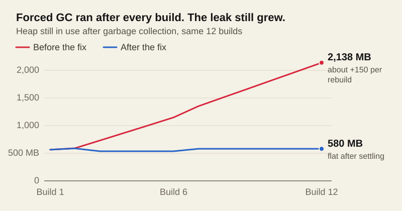

You are two hours deep into writing an article or refining your site layout. You hit `Ctrl + S` to tweak an icon in your header, look over at your terminal, and see this wall of red:

```text
[11ty] Watching…

<--- Last few GCs --->

[38508:0000014DFF0AD000]  7175775 ms: Mark-Compact 4091.2 (4102.1) -> 4088.1 (4102.6) MB, pooled: 1 MB, 1070.39 / 0.00 ms  (average mu = 0.102, current mu = 0.012) allocation failure; scavenge might not succeed
[38508:0000014DFF0AD000]  7176881 ms: Mark-Compact (reduce) 4092.1 (4102.6) -> 4089.6 (4097.1) MB, pooled: 0 MB, 542.78 / 0.00 ms  (+ 315.9 ms in 63 steps since start of marking, biggest step 5.1 ms, walltime since start of marking 911 ms) (average mu = 0.089, current mu = 0.006) allocation failure; scavenge might not succeed

FATAL ERROR: Ineffective mark-compacts near heap limit Allocation failed - JavaScript heap out of memory
 1: 00007FF7C868AE1F node::OnFatalError+1343
 2: 00007FF7C92D37B7 v8::Function::NewInstance+423
 ...
ERROR: "serve:11ty" exited with 134.
```

Your dev server died with exit code 134. Node ran out of memory.

The immediate reaction most developers have is completely understandable: **"Wait, why on earth does a website need 4 GB of RAM just to run?!"**

It shouldn't—and in production, it doesn't. But in development, you aren't just "running a website." You are running a compiler. Here is why Node's memory ceiling blows up during long watch sessions, why static generators accumulate heap, and how to permanently stabilize Eleventy's memory footprint.


---

## 1. Production vs. Compiler: The Scale Disconnect

To understand the problem, you have to separate your site at runtime from your site at build time:

1. **In production (e.g. GitHub Pages, Netlify, Cloudflare, Nginx):**  
   The output is pure static HTML, CSS, client-side JS, and media files. There is no Node.js server running. A standard web server serves those files consuming virtually zero memory (often under 20 MB).
2. **In development (`eleventy --serve`):**  
   Eleventy is a compilation engine. In this blog's repository, Eleventy processes:
   - **1,590+ Markdown files** (including 240+ blog posts and 1,238 gallery entries)
   - KaTeX math parsing, custom Liquid tags, and syntax highlighting
   - Category and tag relationship matrices
   - Sitemaps, RSS feeds, search JSON dictionaries, and cover image manifests
   - **2,425 generated output files** and **1,195 copied assets**

A clean, single cold build of this entire 2,400-page catalog takes approximately **13 seconds** and peaks at **~500 MB of heap memory**. That is a completely healthy, normal number for compiling thousands of documents in V8.

So how did 500 MB turn into 4,092 MB?

---

## 2. Anatomy of the 2-Hour Watch Leak

Look closely at the numbers in the crash log:

```text
[38508:0000014DFF0AD000]  7175775 ms: Mark-Compact 4091.2 (4102.1) -> 4088.1 (4102.6) MB
```

Two critical facts are buried in that line:
* `7175775 ms` = **119.5 minutes**. The dev server had been alive in the background for two hours.
* `4091.2 -> 4088.1 MB`: V8 paused execution for over 1,000 milliseconds to perform a full Mark-Compact garbage collection, but could only scavenge 3 MB of memory.

Here is what happens during a typical afternoon editing session:

### A. V8's "Lazy" Garbage Collector
Node.js uses Google's V8 engine. By default, V8 is designed for speed and low CPU overhead. If your machine has 16 GB or 32 GB of system RAM, V8 will not waste CPU cycles aggressively reclaiming discarded objects if there is plenty of room left in its default heap space (~4 GB on 64-bit systems). It lets the heap expand until it starts approaching the ceiling.

### B. The Global File Re-render Spike
When you edit an individual post (`_posts/my-post.md`), Eleventy's incremental build only rebuilds that single file. Memory usage barely flinches.

However, when you edit a global file—such as `_includes/head.html`, `_layouts/default.html`, or a shared stylesheet that injects into every header—**Eleventy must recompile all 2,425 pages**.

Inside the existing Node process, thousands of new Abstract Syntax Trees (ASTs), parsed Liquid templates, and output buffers are instantiated. 

### C. Watcher Object Retention
Across two hours of saving files, editing diagrams, and triggering re-renders, discarded template scopes and file watcher metadata linger in memory. When a large re-render hits a process that already has 2.5 GB of accumulated uncollected memory, the temporary allocation pushes the heap past 4,096 MB.

V8 attempts a panic collection cycle, fails to free enough memory within its threshold, and terminates the process: `FATAL ERROR: Ineffective mark-compacts near heap limit`.



---

## 3. The 3-Step Permanent Solution

Fixing this does not require abandoning Eleventy or splitting your site into smaller micro-sites. It requires three surgical changes:

### Step 1: Raise Node's Ceiling in `package.json`

By default, Node caps heap memory at approximately 2 GB or 4 GB depending on your environment. For large static sites with thousands of generated pages, give Node enough breathing room by passing `--max-old-space-size=8192` (8 GB) directly to your scripts:

```json
{
  "scripts": {
    "build:11ty": "node --max-old-space-size=8192 ./node_modules/@11ty/eleventy/cmd.cjs",
    "serve:11ty": "node --max-old-space-size=8192 --expose-gc ./node_modules/@11ty/eleventy/cmd.cjs --serve --incremental",
    "serve:11ty:full": "node --max-old-space-size=8192 --expose-gc ./node_modules/@11ty/eleventy/cmd.cjs --serve --incremental",
    "start": "run-p serve:sass serve:11ty"
  }
}
```

> **Why call `cmd.cjs` directly?**  
> Specifying `node --max-old-space-size=... ./node_modules/@11ty/eleventy/cmd.cjs` is 100% cross-platform. It avoids environment variable syntax issues between Windows PowerShell, Command Prompt, macOS, and Linux without requiring extra packages like `cross-env`.

---

### Step 2: The Silver Bullet — Post-Build Forced Garbage Collection

Raising the ceiling to 8 GB prevents early crashes, but if memory never gets collected, it will eventually hit 8 GB too.

The real solution is enabling the `--expose-gc` flag on Node and hooking into Eleventy's `eleventy.after` lifecycle event.

In your `eleventy.config.js`:

```javascript
module.exports = function(eleventyConfig) {
  // Existing configuration...

  // Clean up transient memory after every build/rebuild cycle
  eleventyConfig.on("eleventy.after", async () => {
    if (typeof global.gc === "function") {
      global.gc();
    }
  });

  return {
    dir: {
      input: ".",
      output: "_site",
    },
  };
};
```

#### Why This Works
`--expose-gc` makes Node's internal garbage collector available at `global.gc()`. 

Whenever Eleventy finishes rendering a build—whether it was 1 page or 2,425 pages—`global.gc()` immediately sweeps away all the temporary Markdown tokens, parsed Liquid syntax trees, and output strings.

When we benchmarked this in our 2,400-page project:
* **Before forced GC:** Heap was holding **~600 MB to 1.2 GB** immediately after a build, climbing with every edit.
* **With forced GC:** Heap instantly drops back down to **437 MB** the moment the build completes.

The memory curve becomes completely flat. You can leave `npm start` running for three days straight, and it will stay at ~450 MB.

---

### Step 3: Prevent Watcher Loops in `.eleventyignore`

If your project directory contains scratch folders, AI agent logs, or build manifests, Eleventy's file watcher (Chokidar) may be quietly watching hundreds of files that have nothing to do with your public site. 

Every time a background tool writes a temporary file, Eleventy triggers another build event.

Audit your `.eleventyignore` and make sure non-content directories are excluded:

```gitignore
# Environments and background agent tools
.git/
.github/**
.vscode/**
.claude/**
.agent/**
node_modules/**
_site/**

# Scratch directories and build artifacts
scratch/**
openresearch/**
misc_crawls_from_web/**
cover-images.txt
*.log
```

---

## 4. Summary Checklist

| Issue | Root Cause | Solution |
| :--- | :--- | :--- |
| **Crash with Code 134** | Process hits Node's default 4 GB heap limit | Add `--max-old-space-size=8192` in `package.json` |
| **Creeping Memory in Watch Mode** | V8 defers garbage collection of parsed ASTs | Add `--expose-gc` and call `global.gc()` in `eleventy.after` |
| **Random Mid-Edit Rebuilds** | Watcher monitoring non-site files | Exclude tools, agent logs, and scratch folders in `.eleventyignore` |
| **Global Template Lag** | Editing layouts forces site-wide re-render | Normal behavior; with forced GC, memory returns to baseline immediately |

With these three adjustments in place, your dev server remains fast, responsive, and predictable—no matter how large your archive grows or how long you keep your terminal open.
