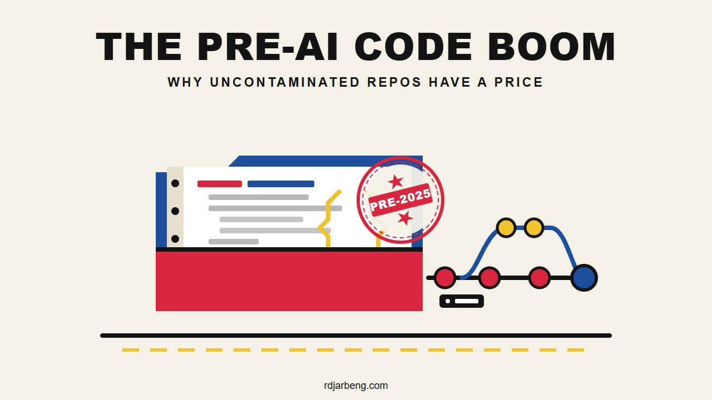

AI training data has entered a new phase. During the first two years of large language model development, labs scraped whatever was publicly available across GitHub, documentation sites, and open forums.

Now buyers are targeting private repositories written before 2025.

One clear example surfaced recently in an email distributed to members of the Andela developer community, pointing to a request on [Pangea.ai's code licensing board](https://pangea.ai/code-licensing/companies?id=1376#request). The outreach invited developers to license private source code repositories committed before 2025, offering $1,000 per 1 million tokens. In language model training, a token is a chunk of characters or word fragments that models use to measure text volume, roughly equating to 70,000 to 100,000 lines of code. The cutoff date and the focus on private repositories point to practical problems facing model developers: data contamination, copyright exposure, benchmark leakage, and the collapse in data diversity caused by AI tools themselves.

---

## Why pre-2025 code has value

Between 2022 and 2024, developer workflows shifted toward automated assistance. In an update on Copilot adoption, [GitHub reported](https://github.blog/ai-and-ml/github-copilot/github-copilot-now-has-a-better-ai-model-and-new-capabilities/) that Copilot was already generating 46% of developers' code files on average across all languages, rising to 61% in Java.

Because developers push assisted code directly to public repositories, public code written after 2023 contains large amounts of synthetic logic: code generated by machine learning models rather than authored from scratch by human engineers. When a new model trains on the output of an older model, the training process runs into data contamination.

A July 2024 study published in *Nature* by researchers from Oxford, Cambridge, Toronto, and Imperial College examined this dynamic in detail: [*"AI models collapse when trained on recursively generated data"*](https://www.nature.com/articles/s41586-024-07566-y). The authors demonstrated that recursive training leads to model collapse:
1. Rare patterns and edge cases drop out of the training distribution first.
2. The model converges on repetitive, average outputs.
3. Errors and minor hallucinations accumulate until subsequent models produce unusable responses.

In software engineering, synthetic code introduces specific operational risks. An analysis of 153 million lines of code published by [GitClear](https://www.gitclear.com/coding_on_copilot_data_shows_downward_pressure_on_code_quality) found that the expansion of AI assistants corresponded with increased code churn (code that is rewritten or deleted shortly after being committed) and a drop in refactoring activity (cleaning up and reorganizing existing code to keep systems maintainable over time). Generated code can pass unit tests while introducing structural repetition. It does not reflect the operational trade-offs made by engineers keeping software stable under real user workloads.

Code committed before 2025 acts as an unpolluted baseline. It contains genuine commit histories, debugging steps, architectural trade-offs, and edge cases handled by humans without machine intervention.

---

## Why Git commit history matters more than static files

When data brokers buy access to repositories (the project folders where code and its history live), they rarely want a zip file of the latest release. They want the full `.git` directory, including commit logs (the timestamped notes written every time a developer saves a milestone) and incremental diffs (the exact line-by-line records showing which characters were added, modified, or deleted).

There is a technical reason for this distinction. Modern coding agents such as SWE-agent, Devin, and Cursor do not write whole applications from scratch in a single prompt. They operate by reading a repository, diagnosing an issue, and applying targeted diffs to existing files.

Training a model on static source code only teaches it the destination. It shows what a finished service looks like, but it reveals nothing about how that service arrived at its current structure. 

In contrast, Git commit history teaches the model the trajectory of software development:
* A commit message records human intent in plain language.
* The associated diff shows the exact edits required to fulfill that intent.
* A sequence of commits shows how an engineer identified a defect, tested an initial fix, reverted an approach that broke backwards compatibility, and settled on an optimal patch.

This commit-level granularity provides supervised training data for multi-step reasoning. If an AI lab wants an autonomous agent that can resolve real software issues, training on paired commit messages and diffs is far more valuable than training on static file trees.

---

## Benchmark leakage and private codebases

Public code suffers from another structural problem: evaluation contamination, often called benchmark leakage.

When researchers evaluate coding models, they test them against standardized benchmarks like HumanEval, MBPP, and SWE-bench. These benchmarks consist of programming puzzles and real-world GitHub issues with known solutions. However, because foundation models ingest vast web crawls during their initial pre-training phase, they often absorb those benchmark questions and answers beforehand. A model that scores 85% on a public benchmark may simply be recalling solutions it already saw in training, like a student who got a copy of the exam sheet before the test, rather than reasoning through the problem.

Private repositories offer model developers an unpolluted evaluation suite. If an AI lab evaluates a model against a private codebase written in 2021, researchers know with certainty that the model never encountered those proprietary endpoints, internal schemas, or architectural constraints during pre-training. Private repositories provide an honest measurement of whether a model can navigate unfamiliar software.

---

## Existing data licensing deals

The Pangea posting reflects a wider transition from open web scraping to commercial data deals:

* **Stack Overflow and model labs:** In May 2024, OpenAI announced a [direct partnership with Stack Overflow](https://openai.com/index/openai-and-stack-overflow-partnership/) through the OverflowAPI. The value of that dataset was not raw code snippets, but the human feedback loop: upvotes, downvotes, revisions, and accepted answers accumulated over 15 years.
* **Reddit's data licensing:** In February 2024, [Reuters reported](https://www.reuters.com/technology/reddit-ai-content-licensing-deal-with-google-sources-say-2024-02-22/) that Reddit signed an artificial intelligence content licensing agreement with Google worth roughly $60 million annually, followed by a separate data agreement with OpenAI. Forums like `r/programming` and `r/sysadmin` contain long records of operational troubleshooting that cannot be produced synthetically.
* **Curated code repositories:** The BigCode initiative, led by ServiceNow and Hugging Face, published the architecture for [The Stack v2](https://arxiv.org/abs/2402.19173). The project specifically tracks software licensing, repository metadata, and provenance to give model builders clean training corpora with explicit opt-out controls.
* **Specialized human data platforms:** Firms like Scale AI and Surge AI employ experienced software engineers to write original code, draft detailed technical rationale, and solve novel algorithmic tasks under controlled environments where AI autocomplete tools are explicitly banned. Labs pay premium hourly rates for these datasets because verified human problem-solving cannot be fabricated at scale.

---

## How much code is 1 million tokens?

The advertised rate of $1,000 per 1 million tokens sounds substantial, but the payout depends on how tokenization pipelines count source code.

In programming languages:
* 1 token represents roughly 3 to 4 characters (about half a keyword or variable name).
* 1 formatted line of code contains 10 to 14 tokens on average.
* 1 million tokens equals roughly 70,000 to 100,000 lines of code.

| Component | Pipeline handling | Net token credit |
| :--- | :--- | :--- |
| `node_modules/` and `vendor/` | Stripped completely | 0 tokens |
| `package-lock.json` and lockfiles | Discarded entirely | 0 tokens |
| `dist/`, `build/`, compiled assets | Discarded entirely | 0 tokens |
| Auto-generated schemas and migrations | Filtered out | 0 tokens |
| Original proprietary logic and Git diffs | Kept after deduplication | ~5,000 to 15,000 tokens ($5 to $15) |

A repository that takes up 100 MB on disk rarely contains 100 MB of original source code. Modern software projects bundle massive external files. Folders like `node_modules` or `vendor` contain third-party libraries downloaded from open-source registries, while lockfiles like `package-lock.json` simply record dependency version numbers and download paths. A single lockfile can contain hundreds of thousands of tokens of structured JSON that required zero human programming to create. Ingestion systems discard these files entirely. What remains after deduplication is the core handwritten logic, meaning an average personal project might yield between $10 and $50.

### Deduplication and filtering pipelines

Data ingestion engines apply rigorous filtering before calculating token payouts:
1. **Deduplication:** Algorithms such as MinHash and Locality-Sensitive Hashing (LSH) detect near-duplicate files across millions of repositories, operating like automated plagiarism detectors for software. If several repositories share the same boilerplate utility function or copied script, that code is counted once and credited only to the original source.
2. **Boilerplate removal:** Standard configuration files, continuous integration scripts, and framework scaffolding are excluded from compensation metrics.
3. **Language density differences:** Verbose languages like Java or C++ produce more characters and tokens for a given feature than concise languages like Python or Go. Ingestion pipelines normalize volume against syntactic complexity to prevent low-information bloat from inflating payouts.

---

## The legal limits on selling old code

Even developers with repositories from 2020 face legal constraints when attempting to license them.

### Employment contracts and client ownership
Most code written by engineers does not belong to them:
* **Salaried employees:** Standard employment agreements assign intellectual property to the employer under work-for-hire doctrines: the legal rule that an employer automatically owns whatever an employee creates on company time or equipment. Employees cannot legally license internal tools, service code, or scripts written during their tenure.
* **Agency and freelance contractors:** Client Master Services Agreements (MSAs) and Statements of Work assign deliverables to the client. In talent networks like Andela, where engineers work as embedded contractors for external companies, client contracts almost universally vest full code ownership in the hiring company. Unless an agreement contains explicit terms reserving proprietary ownership of custom modules, the paying client holds the rights.
* **Personal projects:** Personal side projects rarely reach 100,000 lines of original proprietary logic without incorporating open-source libraries that carry their own license terms.

### Indemnification clauses
Data broker agreements require contributors to sign legal warranties:
1. You certify that you hold complete, unencumbered ownership of the code.
2. You certify that the repository does not contain third-party copyleft code (such as GPL or AGPL libraries) without required attribution. Copyleft licenses legally require any project incorporating their code to remain open and freely shareable under the same terms, making them incompatible with commercial proprietary training datasets.
3. You certify that no client trade secrets or confidential materials are included.

If an employer or client discovers their internal repository was submitted to an AI training pipeline, the contributor bears the legal liability. The risk of violating an employment contract or non-disclosure agreement outweighs small token payouts.

### Forgotten credentials in Git history
Older private repositories frequently contain credentials committed before environment variable hygiene became standard practice:
* Database connection strings and local secrets.
* Old API keys and internal test tokens.
* Internal server names and internal team addresses.

Automated regex filters catch standard key formats, but custom configuration files and embedded connection strings can slip through. Once an AI model finishes training, that text is absorbed directly into its internal neural network weights: the billions of mathematical parameters that govern how the model generates language. You cannot search and delete an individual password or secret from trained weights without discarding the model and retraining it from scratch.

---

## Regulatory pressure and data provenance

The shift toward paid code licensing is also driven by regulatory compliance.

Under the European Union's Artificial Intelligence Act, providers of general-purpose AI models must document and publish comprehensive summaries of the data used to train their systems. Indiscriminate web scraping leaves AI companies vulnerable to copyright claims and compliance penalties in European jurisdictions.

In the United States, ongoing copyright litigation regarding open-source code ingestion has made tech companies cautious about using unverified repositories without documented consent. Licensing private code through formal contracts establishes a clear chain of custody. The data broker verifies repository provenance, tracks contributor consent, and provides the AI lab with commercial indemnity against future infringement claims.

---

## Who can actually participate?

Because individual contributors face strict ownership limits, the market for private code licensing is practical for two specific groups:

1. **Founders of closed startups:** Companies that shut down where founders retained the intellectual property. The software has no operational future, making licensing a way to recover residual value.
2. **Software agencies with proprietary tooling:** Development firms that created internal scaffolding, starter platforms, or deployment engines under client contracts that explicitly preserved the agency's ownership.

For individual developers, pre-2025 code has high value to AI labs precisely because it is rare and uncontaminated. The same contracts that made it valuable ensure that very few people have the legal right to sell it.
