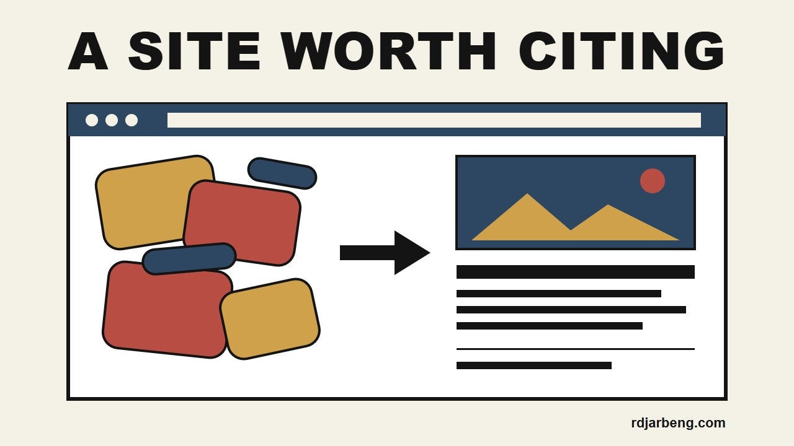
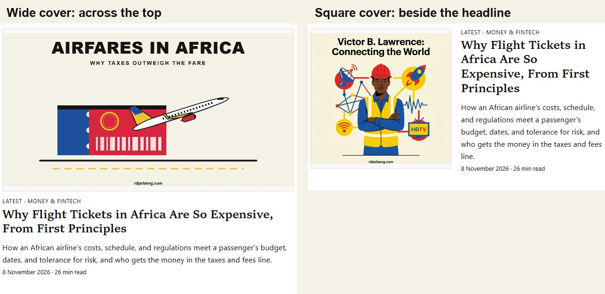
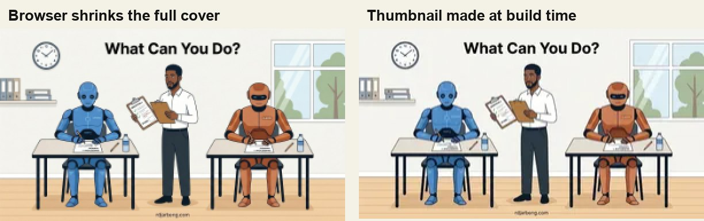
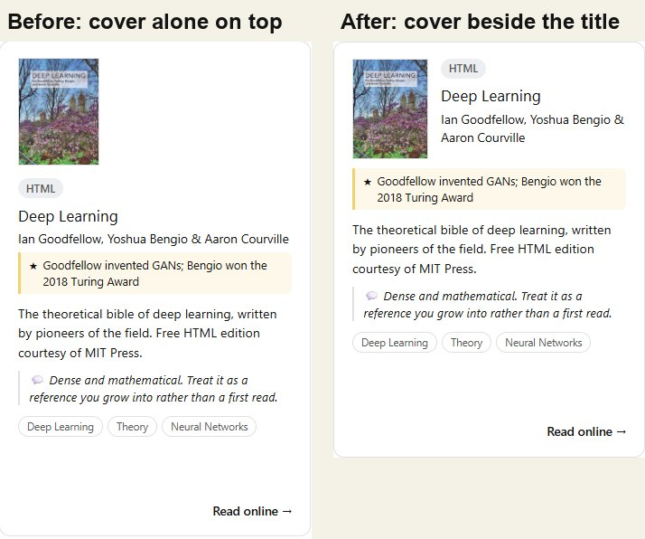

I took a look at my site's homepage and decided I wanted a remodel. Before, there were two main items on first load: a card with four sentences about me, and a carousel with six of my most recent posts. Directly underneath those were six of my most recent posts again, the same ones you had just seen in the carousel. The rest of the site had its own problems. Cards sat inside other cards, labels were rounded blue pills, and small cover images were either cropped or blurry. Text sat on top of busy pictures, scrollbars appeared under rows of links, and some sections left large empty blocks at tablet widths. The about page had my job dates wrong.

## What I wanted the homepage to be

I want this site to be something a professor, a university page or a careful journalist would be comfortable linking to. Search engines already found it. The question was whether a person who landed here would trust it. Over one long weekend I went through the site with that question in mind and changed more than I expected to.

## Start with trust, not looks

Before touching any design, I listed what a careful reader checks before linking to a page. Who wrote this? What do they actually know? Where did the numbers come from? Is it kept up to date, and what happens when it's wrong?

Most of the answers were missing or hidden. So the first changes weren't visual at all:

- An [editorial policy](/editorial-policy/) that says how posts are sourced, how I use AI tools, and how corrections work.
- A short "AI assistance" note on posts where AI did a lot of the work, linking to that policy.
- Dated "how it ended" updates on posts that had gone stale, like the [Vercel security incident](/security-alert-vercel-security-incident-april-2026/) and the [Axios npm attack](/critical-supply-chain-attack-on-axios-npm-package/). Writing those turned up two errors of my own, which I corrected on the page instead of quietly editing.
- A reader note thanking the person who reported a broken code block in my [Eleventy guide](/building-a-modern-blog-with-eleventy-3-x-liquid-edition/), with what was wrong and how it was fixed.

None of this is glamorous, but it's the difference between a blog post and a source.

## The about page

The old about page was a column of cards: rounded boxes, coloured skill pills with logos, project tiles, a donate button. It looked like a template, and it said less than a plain CV would.

I rebuilt it as an academic CV page. A photo and links at the top, then sections with a label on the left: experience, education, projects, writing, skills. Each role is one line with its dates and place, and the details are tucked behind a "+" so the page stays short. Project thumbnails stayed, because people who aren't technical want to see what something looks like.

The part I didn't expect: the dates were wrong. The page said I'd been at the Kigali Collaborative Research Center since October 2025, when it's October 2026, and it blurred which work happened in Kigali and which in Pittsburgh. When I gave the page to an AI agent, it repeated those mistakes back to me. So the fix had two halves. Every role now shows its dates and city in plain text, and the page also carries a dated role history in structured data, which search engines and agents read. The author bio under every post and the site's `llms.txt` state the same history.

## The homepage

The homepage had a different problem. The first screen showed an About card, then a carousel, and the carousel held the same six posts that appeared right below it as "Latest Posts". A visitor saw everything twice and learned nothing about what the site is for.

It took a few attempts to get right. A "Start here" carousel with text laid over the images looked like every AI-generated landing page: blue pills, rounded corners, text you couldn't read on busy covers. Turning it into scrolling cards was better, but nobody clicks carousel arrows, and the horizontal scrollbar looked broken.

What finally worked was a simple front page:

- A masthead with my name, one line on what the site covers, and a "Now" line about what I'm working on.
- The newest post as a lead story, with its cover and a short summary.
- An "Also new" list of the next four posts, each with a small thumbnail.
- "Browse by topic": four areas I actually write about, each with three posts to start with.

Nothing repeats on that screen. The topic lists skip any post already shown above them, so the newest post never appears twice.

## Cards inside cards

Most of the visual noise came from one habit: putting cards inside other cards. A topic group was a rounded box with a pill-shaped label, and inside it sat more rounded boxes, each with its own border and shadow.

I removed almost all of it. Topic groups are now a heading with a thin rule, and posts sit directly on the page as an image, a title and a line of text, separated by space and hairlines. The site reads calmer, and it turns out the boxes weren't doing any work the spacing couldn't do.

## Images that fit their shape

Two image problems kept coming back.

First, shape. My covers come in two shapes, wide 16:9 and square, and the layout was forcing both into one frame, so either the picture got cropped or space was wasted. The site now reads each cover's real size when it builds. A wide cover goes across the top of the lead story; a square one sits beside the headline so the text fills the space next to it.

Second, sharpness. The small thumbnails looked blurry, because the browser was shrinking a 1,300-pixel cover into a 150-pixel box. The site now makes proper thumbnails at build time with [eleventy-img](https://www.11ty.dev/docs/plugins/image/), sized for where they're shown. They're sharper and much smaller to download. The homepage gallery had a worse version of the same problem: it was loading NASA's full-size space photos, some 6,000 pixels wide and over 2 MB each, to show small cards. It now asks NASA for an 800-pixel version.

## Small fixes that added up

A lot of the work was small, and most of it came from looking at the site at different widths:

- A site-wide rule added padding to every image, which put dark strips above and below pictures inside frames.
- The section links on smaller screens were rounded blue pills with a scrollbar under them. They're now plain text tabs.
- The footer left a big empty block at tablet widths, and the contact email ran into the links next to it.
- The Enlighten book list said "0 books" on my dev server and had no covers. It now shows all 13, each with its cover.
- The page scrollbar is thinner and follows the light or dark theme.

## What I'd tell myself at the start

Decide who you want to trust the site before you change how it looks. What made this site feel unofficial wasn't the colours. It was the missing dates and sources, the posts shown twice, and boxes and pills where plain spacing would have done the job.

And look at the page at more than one width. Nearly every problem I fixed this weekend was invisible on my laptop and obvious on a phone or a half-width window.
