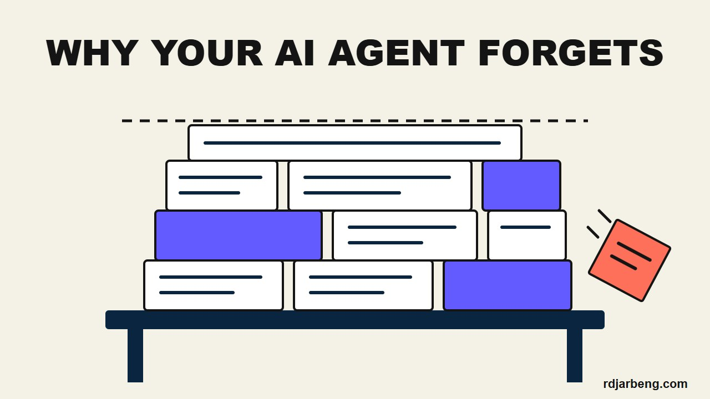
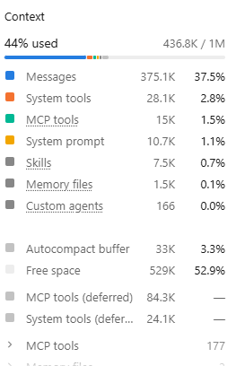

My coding agent kept forgetting instructions I had given it an hour earlier. It happened in long sessions, usually after a message saying the conversation was being "compacted". The agent was not being careless. As far as it could tell, I had never said anything of the sort. Why does this happen most of them say they have a 1 Million context window is that not enough?

Well, the reason is how these agents handle memory, and the fix is mostly a matter of where you write things down. My examples come from Claude Code, but the same thing happens in Cursor, GitHub Copilot, Codex and Gemini CLI, and there is [a comparison of how each one handles it](#the-same-desk-in-other-agents-and-ides) below.



## The agent does not remember. It rereads.

It turns out that a language model has no memory between requests. When I send a message, Claude Code sends the model the full conversation so far, plus a set of instructions, and the model writes its next step. Then all of it is sent again for the step after that.

So the model's "memory" is a big document it rereads every time. Anthropic calls that document the **context window** and describes it as the model's "working memory", separate from everything it learned in training ([context windows guide](https://platform.claude.com/docs/en/build-with-claude/context-windows)). Andrej Karpathy, an OpenAI co-founder and former head of AI at Tesla, describes the result well: LLMs have something like "anterograde amnesia", the condition from the film *Memento*, where you cannot form new long-term memories ([Software Is Changing (Again)](https://www.youtube.com/watch?v=LCEmiRjPEtQ), June 2025).

I find it easiest to picture a desk. Everything the agent needs for the next step has to be on the desk: my instructions, the conversation, the files it is working on. The desk has a fixed size, and it is measured in **tokens**, small chunks of text such as a word, part of a word or a punctuation mark ([glossary](https://platform.claude.com/docs/en/about-claude/glossary)).

## What is on the desk, and how much it weighs

The desk is never empty, even before I type. The [context window page in the Claude Code docs](https://code.claude.com/docs/en/context-window) says that before your first prompt, "CLAUDE.md, auto memory, MCP tool names, and skill descriptions all load into context." In plain terms: your project's instruction file (CLAUDE.md), notes the agent has saved about you (auto memory), the names of tools from any plug-ins you have connected, such as a GitHub or database connector (MCP servers), and one-line labels for saved procedures called skills. All four come up again later. Under all of that sits the system prompt, the instructions Anthropic writes that tell the agent what tools it has and how to behave.

<picture>
<source srcset="/assets/images/diagrams/context-desk-1.static.svg" media="(prefers-reduced-motion: reduce)">

</picture>

You can see this for yourself. Type `/context` in Claude Code and it shows how full the window is as a grid of coloured blocks, broken down by category ([commands reference](https://code.claude.com/docs/en/commands)). In my own sessions it usually shows about 7 percent used before I have sent my first question. Yours will differ depending on how many skills, plug-ins and instruction files you have set up, and on the window size, which depends on the model you are using (`/model` shows it): 7 percent of a 200,000-token window is about 14,000 tokens, while 7 percent of 1 million is about 70,000. The docs' own example adds up to roughly 7,850 tokens before the first prompt, and they call those numbers illustrative.

Then, as the agent works, every file it reads, every command output and every search result lands on the desk too.

<picture>
<source srcset="/assets/images/diagrams/context-desk-2.static.svg" media="(prefers-reduced-motion: reduce)">

</picture>

Some rough weights give a feel for what fills it. Where a number is my own estimate, I say so.

| Thing on the desk | Roughly how many tokens |
|---|---|
| "Hello, Claude" with a one-line system prompt | 14, in Anthropic's own [token counting example](https://platform.claude.com/docs/en/build-with-claude/token-counting) |
| A screenshot 1,000 by 1,000 pixels | 1,296. Images cost one token per 28 by 28 pixel square ([vision docs](https://platform.claude.com/docs/en/build-with-claude/vision)) |
| A 500-line source file | about 5,000 to 7,500 (my estimate at 10 to 15 tokens per line) |
| A 200-line CLAUDE.md | a few thousand (my estimate) |
| A test run or build that prints 1 MB of output | about 290,000 to 370,000 (my estimate from 1 million characters) |

The last row is the one to notice. An hour of chatting with the agent might add up to tens of thousands of tokens. One noisy test run that prints everything can outweigh all of it.

<picture>
<source srcset="/assets/images/diagrams/context-desk-3.static.svg" media="(prefers-reduced-motion: reduce)">

</picture>

`/context` shows which of these is taking the room in your own session: instruction files, tools or the conversation. Developers calling the API can use Anthropic's free [token counting endpoint](https://platform.claude.com/docs/en/build-with-claude/token-counting) to check a message's size before sending it.

The Claude Code desktop app shows the same breakdown in its interface, with a few extra details (screenshot below).



Side note on Antigravity IDE: I can confirm, antigravity doesn't have any such feature and I have looked thoroughly through its preferences, there are no such settings available. You will have to ask the model if you are using the IDE (Integrated Development Environment). I have defaulted to asking the model being used in antigravity "How much of your context is being used in this chat?"

## When the desk is full: compaction
From the anthropic [blog](https://www.anthropic.com/engineering/effective-context-engineering-for-ai-agents): 
> An agent running in a loop generates more and more data that could be relevant for the next turn of inference, and this information must be cyclically refined.

Eventually a long session fills the desk. Claude Code then does what you would do with a desk covered in paper: it writes a summary of the important bits, clears the desk, and puts the summary back down. That is **compaction**. Anthropic's [context engineering post](https://www.anthropic.com/engineering/effective-context-engineering-for-ai-agents) (29 September 2025) describes it as summarising the conversation and starting a new context window with that summary.

Here is a visual for you, so you can see how your previous instruction will 'disappear' from the context:

<picture>
<source srcset="/assets/images/diagrams/context-compaction.static.svg" media="(prefers-reduced-motion: reduce)">

</picture>

It happens automatically near the top of the window. The [model configuration docs](https://code.claude.com/docs/en/model-config#context-window-and-auto-compaction) say the exact point depends on your model and settings. Models with a native 1 million token window compact "at about 967K tokens by default" (by my rough arithmetic, somewhere between half and two-thirds of all seven Harry Potter books; there is more on sizes at the end), while some setups, such as Sonnet 4.6 or Opus 4.6 without the extended window, or with the 1M window turned off, use a 200,000-token window and compact at that boundary instead. On a 200,000-token setup, a session that reads a few large files or runs a few noisy test suites can get there within an hour. You can also trigger the compact action by hand with `/compact`, or set an earlier point with `/autocompact` ([commands reference](https://code.claude.com/docs/en/commands)).

## What survives, and what quietly disappears

As you can see as careful as the compaction process might be eventually some of the information that was previously in the context window will be lost. The Claude Code [context window page](https://code.claude.com/docs/en/context-window#what-survives-compaction) has a table of what survives compaction. In plain terms:

- **Comes back word for word:** the system prompt, your project-root CLAUDE.md and auto memory. These are reloaded from disk.
- **Comes back trimmed:** skills you already used are re-attached, but capped at 5,000 tokens each and 25,000 tokens in total. Claude Code re-reads up to five of the files it was working on, most recently changed first.
- **Comes back when needed:** CLAUDE.md files and rules that belong to particular folders reload when the agent works in those folders again.
- **Becomes a summary:** everything else. Your messages, its replies, the files it read, the commands it ran, the dead ends you hit together. All of it becomes "a structured summary."

A summary is lossy by design. It keeps what seemed important at the moment it was written, in fewer words. Here are the kinds of things that get lost in that squeeze. These are illustrations, not quotes from a real summary.

**1. A rule you only said in chat.** Say that early in a session I tell the agent: "Only run database commands against my local copy, never the live database." It follows that rule all morning while we fix a bug in how orders are saved. After compaction, the summary might say "The user is fixing a bug in the orders table." The goal survived. The rule did not, so an hour later the agent runs its clean-up script against the live database, the one real customers are using.

**2. A dead end you already tried.** We try fixing a bug by upgrading the app's date library, every timestamp in the app breaks, and we agree to stay on the old version instead. The summary keeps "kept the date library on version 2". It may not keep *why*. Later, the agent spots the old version, decides it is outdated, and helpfully suggests upgrading it. We are back where we started.

**3. The exact details.** Earlier the agent read an error message, a stack trace and three config files. After compaction it knows it "fixed the checkout crash", not the exact line numbers or the wording of the error. To get those back it has to reread the files (more tokens) or work from a fuzzy memory of them.

**4. The end of a long skill.** If I used a long skill early in the session, only its first 5,000 tokens come back after compaction. If the important step was near the bottom, it may be gone.

| Where the information lived | After compaction |
|---|---|
| Something I said in chat | Kept only if the summary kept it, and maybe shortened |
| Something the agent read in a file | Summarised; the file has to be read again for detail |
| A line in my project CLAUDE.md | Reloaded word for word |
| A note in a file the agent can reread (`NOTES.md`, a plan, a to-do list) | Still on disk, word for word |

Compaction also costs something. The [costs page](https://code.claude.com/docs/en/costs) notes that "/compact reads the conversation it summarizes, so compacting a large context is itself a large request."

## Forgetting without compaction

Compaction is not the only way an instruction gets lost. On a 1 million token window, many sessions never compact at all, and the agent can still drift away from something you said earlier. The instruction is still on the desk; it is just buried.

Anthropic says that "as token count grows, accuracy and recall degrade", which it calls **context rot** ([context windows guide](https://platform.claude.com/docs/en/build-with-claude/context-windows)). The [Lost in the Middle](https://arxiv.org/abs/2307.03172) study (2023) found that models struggle most with information in the middle of a long input, and Chroma's [Context Rot](https://www.trychroma.com/research/context-rot) report (July 2025) found performance dropped as inputs grew across 18 models.

So a rule given once in chat, two hours and fifty files ago, is competing with everything that came after it. A rule in CLAUDE.md is sent fresh as part of the instructions every time. This is also why Anthropic's [best practices page](https://code.claude.com/docs/en/best-practices) now says that "with a 1M-token window on most current models and compaction near the top of it, you'll rarely run out of context", and still recommends keeping sessions short. Running out of room is rarer than it used to be. Getting worse answers from a cluttered desk is not.

Both kinds of forgetting have the same fix: keep what matters in files, and keep the desk tidy.

## The same desk in other agents and IDEs

None of this is special to Claude Code. Every coding agent built on a language model rereads a limited window, and they have all landed on the same three answers: an instruction file that loads every session, a way to summarise a long conversation, and some form of saved memory, under different names. As of November 2026:

| Tool | Instruction file it reloads | When the window fills | Memory across sessions |
|---|---|---|---|
| Claude Code | `CLAUDE.md` (or `AGENTS.md`) ([docs](https://code.claude.com/docs/en/memory)) | Auto-compaction, or `/compact` | Auto memory (`MEMORY.md`) |
| OpenAI Codex CLI | `AGENTS.md`, one per folder from the repo root down ([docs](https://learn.chatgpt.com/docs/agent-configuration/agents-md)) | `/compact`, and automatic compaction you can configure ([prompting guide](https://developers.openai.com/cookbook/examples/gpt-5/codex_prompting_guide)) | "Memories", off by default ([docs](https://developers.openai.com/codex/memories)) |
| Google Gemini CLI | `GEMINI.md`, which can be switched to `AGENTS.md` ([docs](https://geminicli.com/docs/cli/gemini-md/)) | `/compress` replaces the chat with a summary, and it also compresses automatically past a threshold ([commands](https://geminicli.com/docs/reference/commands)) | Saved chats you can resume, plus the GEMINI.md files |
| Cursor | Rules in `.cursor/rules/`, or `AGENTS.md` ([docs](https://cursor.com/docs/context/rules)) | Summarises long conversations automatically, or `/summarize` ([changelog 1.6](https://cursor.com/changelog/1-6)) | Use rules files for anything that must persist |
| GitHub Copilot (VS Code agent mode) | `.github/copilot-instructions.md`, or `AGENTS.md` ([docs](https://code.visualstudio.com/docs/copilot/customization/custom-instructions)) | Summarises automatically, or `/compact` ([docs](https://code.visualstudio.com/docs/agents/run/sessions/manage-sessions)) | Copilot Memory, for repository facts and your preferences ([docs](https://code.visualstudio.com/docs/agents/run/memory)) |
| Windsurf (Cascade) | Rules files, or `AGENTS.md` ([docs](https://docs.devin.ai/desktop/cascade/memories)) | Not covered in the docs I checked; start a new conversation for a new task | Auto-generated memories, kept per workspace on your machine |
| Cline | `.clinerules/`, or `AGENTS.md` ([docs](https://docs.cline.bot/features/cline-rules)) | Auto Compact near the limit, `/smol` by hand, or `/newtask` to hand over to a fresh task ([docs](https://docs.cline.bot/features/auto-compact)) | None built in; the "Memory Bank" is a way of keeping notes in Markdown files ([docs](https://docs.cline.bot/features/memory-bank)) |

Two things stand out. First, **AGENTS.md** has become the shared answer to the instruction file. The [agents.md](https://agents.md/) site describes it as "a simple, open format for guiding coding agents" and lists Codex, Cursor, GitHub Copilot, Gemini CLI, Windsurf, Zed and many others as supporting it. If you switch between tools, one AGENTS.md at the root of your project means your rules travel with you. Second, the advice in this post carries over unchanged: whatever the tool calls its summary step, things said only in chat are at risk, and things in a file the tool reloads are not. A fresh chat per task, a short instruction file and a progress file work just as well in Cursor or Copilot as in Claude Code. The fixes below use Claude Code's commands; in other tools, "start fresh" means opening a new chat or session (Cline's `/newtask` carries a short handover into it), and "put it in CLAUDE.md" means putting it in whichever instruction file your tool reloads.

## How to stop losing instructions

Two fixes do most of the work: put lasting rules in a file the agent reloads, and start a fresh session for each task. The rest keep the desk small so compaction comes later or not at all.

### Put lasting rules in CLAUDE.md

A **CLAUDE.md** file is a plain Markdown file of notes the agent reads at the start of every session: how to build and test the project, conventions, gotchas, and rules like "never touch the live database". Because the project-root CLAUDE.md is reloaded from disk after compaction, a rule there comes back word for word. The [memory docs](https://code.claude.com/docs/en/memory) recommend exactly this: put instructions in CLAUDE.md if you want them to persist.

There can be several of these files. The [memory docs](https://code.claude.com/docs/en/memory) list one in your user folder for every project, one in the project root that you commit and share, a `CLAUDE.local.md` for personal notes you keep out of Git, and ones in subfolders that load only when the agent works there. Other agents use the same idea under other names: **AGENTS.md** is shared by several coding agents, including OpenAI's Codex, Google's Gemini CLI uses **GEMINI.md**, and Claude Code "can read AGENTS.md as your project instructions" when there is no CLAUDE.md.

Keep it short, though. Everything in CLAUDE.md sits on the desk in every session, and every line "takes a little of Claude's attention on every task" ([best practices](https://code.claude.com/docs/en/best-practices)). The [memory docs](https://code.claude.com/docs/en/memory) recommend you "target under 200 lines per CLAUDE.md file," because "longer files consume more context and reduce adherence." The best practices page gives a test for each line: leave it out if Claude could find the information by reading the code.

### Keep a progress file for the current task

Decisions, dead ends and next steps for today's work do not belong in CLAUDE.md, but they still need to survive. Anthropic's [context engineering post](https://www.anthropic.com/engineering/effective-context-engineering-for-ai-agents) calls this structured note-taking: the agent keeps notes, such as a to-do list or a `NOTES.md` file, outside the context window and reads them back later. A progress file can be very plain:

```markdown
# Progress: add "forgot password" to the app

## Rules
- Database commands only on the local copy. Never the live database.

## Decided
- Stay on date library v2. Upgrading to v3 broke every timestamp (tried Tuesday).
- Send reset emails through the email service the app already uses. Don't add a new one.

## Done
- Reset email template and the "forgot password" link on the login page.

## Next
- Make reset links expire after one hour.
- Write tests for an expired link and a used link.
```

To make the agent read it without being reminded, add one line to CLAUDE.md such as "Before continuing any task, read PROGRESS.md." Since CLAUDE.md comes back after compaction, that pointer comes back with it. CLAUDE.md can also pull a file in directly with `@path/to/file`, though the [memory docs](https://code.claude.com/docs/en/memory) note that imported files load every session, so they cost space every time.

For bigger features the [best practices page](https://code.claude.com/docs/en/best-practices) suggests a version of this: have Claude interview you, write the result to `SPEC.md`, then "start a fresh session to build from it, so the build begins with a clean context."

### Start fresh between unrelated tasks

The [best practices page](https://code.claude.com/docs/en/best-practices) says to use "/clear between unrelated tasks. It costs nothing, and it means the next task doesn't keep paying for the previous one's history." In practice: the checkout bug is fixed, and now I want to start on the "forgot password" feature, so I run `/clear`. The [costs page](https://code.claude.com/docs/en/costs) suggests `/rename` first so you can `/resume` the old session later. This was my biggest habit change: one session per task, not one session per day.

The [best practices page](https://code.claude.com/docs/en/best-practices) has a related tip. When a session goes wrong and you have corrected the agent twice without luck, "/clear plus one new prompt that folds in what you learned works better almost every time." The failed attempts are still on the desk, distracting it.

### Check what survived

After a compaction, I ask the agent to list the rules I have given it in this session. If one is missing or shortened, that is my cue to move it into CLAUDE.md. Auto memory is worth checking too: Claude Code saves short notes about you and your project in a `MEMORY.md` index, and only its first 200 lines or 25KB load each session ([memory docs](https://code.claude.com/docs/en/memory)). `/memory` opens those files, so you can see whether a preference was actually saved or only said in chat.

### Keep long manuals on the shelf with skills

A **skill** is a folder with a `SKILL.md` file of instructions for one kind of task, such as "how we write release notes". The agent "sees the name and description in every session, but only reads the full file when the task calls for it" ([best practices](https://code.claude.com/docs/en/best-practices)). So a long procedure that would bloat CLAUDE.md can live in a skill, with only its one-line label on the desk. The [costs page](https://code.claude.com/docs/en/costs) says this "keeps your base context smaller." The same page suggests turning off MCP servers you are not using with `/mcp`, since their tool names sit on the desk too.

### Give noisy work its own desk with subagents

A **subagent** is a helper that does a side task at its own desk, in "its own context window" ([subagents docs](https://code.claude.com/docs/en/sub-agents)). If the agent needs to search fifty files to answer one question, a subagent can do the messy searching and bring back a short answer, so the main desk stays clear. Anthropic's [context engineering post](https://www.anthropic.com/engineering/effective-context-engineering-for-ai-agents) describes subagents using "tens of thousands of tokens or more" exploring and returning a summary of often 1,000 to 2,000 tokens. They are not free: their work still counts toward your usage.

### Tell compaction what to keep

When I do compact, I pass focus instructions, for example `/compact keep the API changes and the test commands` ([best practices](https://code.claude.com/docs/en/best-practices)). The [costs page](https://code.claude.com/docs/en/costs) also shows how to add a "Compact instructions" section to CLAUDE.md so every compaction follows the same rule.

## Going deeper: what rereading costs, and why the desk can't just grow

Those fixes are enough to stop most forgetting. The rest of this post explains why the desk is priced and sized the way it is, and why "just make it bigger" is harder than it sounds.

### Every reread costs money

Tokens come in two kinds. **Input tokens** are everything sent to the model: instructions, the conversation so far, files and tool results. **Output tokens** are everything the model writes back, including its thinking. On Anthropic's [pricing page](https://platform.claude.com/docs/en/about-claude/pricing) (November 2026), output costs five times the input price for each current model:

| Model | Input (per million tokens) | Output (per million tokens) |
|---|---|---|
| Claude Opus 5.5 | $4 | $20 |
| Claude Sonnet 5.5 | $2 | $10 |
| Claude Haiku 5.5 (prompts up to 100,000 tokens) | $0.10 | $0.50 |
| Claude Haiku 5.5 (prompts over 100,000 tokens) | $0.50 | $2.50 |

In agent work most tokens are still input, because the whole desk is resent every step. A one-word reply from me ("yes") can trigger a request carrying tens of thousands of input tokens of history. As rough arithmetic of my own: a task of 50 steps, each resending 80,000 tokens, is 4 million input tokens, or $16 at Opus 5.5's input price before any caching discount. On a Pro or Max subscription you do not pay per token, but the same tokens count toward your plan's usage limits, which `/usage` shows ([commands reference](https://code.claude.com/docs/en/commands)).

Two things soften this. **Prompt caching** lets the API reuse its work when the start of a request matches a recent one. The [prompt caching docs](https://platform.claude.com/docs/en/build-with-claude/prompt-caching) say cached reads cost a tenth of the normal input price on most models, and the [best practices page](https://code.claude.com/docs/en/best-practices) says the cache "lasts about an hour on a subscription and five minutes on an API key." A stable CLAUDE.md is cheap to resend, and a session left idle past the cache lifetime costs more on its next message. Caching changes what you pay, not how much of the window is used ([context windows guide](https://platform.claude.com/docs/en/build-with-claude/context-windows)).

The other is **how hard the model thinks**. Claude Code has effort levels from `low` to `max` ([effort docs](https://platform.claude.com/docs/en/build-with-claude/effort)), and "thinking tokens are billed as output tokens" ([costs page](https://code.claude.com/docs/en/costs)). Thinking also stays on the desk: on current models, earlier turns' thinking is kept in context and billed as input on later turns ([extended thinking docs](https://platform.claude.com/docs/en/build-with-claude/extended-thinking), which give the exact model versions). Low effort is plenty for a typo fix. I save the high levels for debugging and design problems, and change it with `/effort`.

### How big a million tokens is

As of November 2026, the [context windows guide](https://platform.claude.com/docs/en/build-with-claude/context-windows) lists 1 million tokens for most current Claude models, with some older models at 200,000. OpenAI's [token guide](https://help.openai.com/en/articles/4936856-what-are-tokens-and-how-to-count-them) says 100 tokens is about 75 words, which makes 1 million tokens about 750,000 words. Anthropic's [glossary](https://platform.claude.com/docs/en/about-claude/glossary) says a token is roughly 3.5 English characters on earlier Claude models, and that Claude 4.7 and later (which includes the 5.5 models in the table above) produce about 30 percent more tokens for the same text, which brings a million tokens closer to 575,000 words. Those two conversions are my own arithmetic.

| Text | Approximate words | Fits in 1 million tokens |
|---|---|---|
| US Constitution with all 27 amendments | 7,591 ([Ballotpedia](https://ballotpedia.org/US_Constitution)) | Yes, about 75 to 100 copies |
| An average English Wikipedia article | about 730 ([Wikipedia: Size of Wikipedia](https://en.wikipedia.org/wiki/Wikipedia:Size_of_Wikipedia)) | Yes, roughly 750 to 1,000 articles |
| *War and Peace*, Tolstoy's novel and a byword for a very long book | 587,287 ([WordCounter](https://wordcounter.net/blog/?p=2640)) | About one, depending on the tokenizer |
| The Bible (King James Version, the classic English translation) | 783,137 ([WordCounter](https://wordcounter.net/blog/2015/12/08/10975_how-many-words-bible.html)) | No |
| All seven Harry Potter books | about 1,084,000 ([WordCounter](https://wordcounter.net/blog/tag/harry-potter-word-count)) | No |
| A 10,000-line codebase | not words, but roughly 100,000 to 150,000 tokens (my estimate at about 10 to 15 tokens per line) | Yes, though the agent rarely needs to read all of it |

Numbers and tables weigh more than prose, because digits and punctuation break into many small tokens. A summary table of a city's population fits easily. A spreadsheet with a row for every resident does not.

### Why the desk can't just grow like RAM

My first thought was that context is like RAM: if you need more, add more. It does not scale that cheaply, for four reasons.

First, the work grows faster than the desk. In a transformer, every token is compared with every other token. Anthropic's [context engineering post](https://www.anthropic.com/engineering/effective-context-engineering-for-ai-agents) puts it as "n² pairwise relationships for n tokens". Double the window and that part of the work roughly quadruples ([Vaswani et al., 2017](https://arxiv.org/abs/1706.03762), Table 1).

Second, GPU memory grows with every token, because the model keeps a cache for each token in the window. Sebastian Raschka's [explainer on the KV cache](https://sebastianraschka.com/faq/docs/kv-cache-long-context-bottleneck.html) shows an 8 billion parameter model needing about 4.5 GiB for a single 32,768-token conversation. Scaled up to 1 million tokens, that is roughly 30 times as much, around 140 GiB for one conversation on that small model (my arithmetic), and a server runs many conversations at once.

Third, the model has to learn to use long inputs, and the same Anthropic post notes that in training data "shorter sequences are typically more common than longer ones". Fourth, a bigger desk gets messier: that is the context rot from earlier, where recall drops as the window fills.

A bigger window costs more compute, more memory and more training, and it still gets worse at finding things as it fills. Windows will keep growing, but there will always be a desk, and it will always fill up.

## The agent didn't forget. I never wrote it down.

I started this post annoyed that my agent kept forgetting what I told it. After reading the docs, I see it differently. The agent never had a memory to lose. It has a desk that it rereads at every step, and when the desk fills up, the conversation is squeezed into a summary. Anything I only said in chat was a note on that desk, and notes get swept into summaries or buried under an hour of test output.

What does survive is what lives in files. A rule in CLAUDE.md or AGENTS.md comes back word for word after every compaction, in every new session, in whichever tool you use. A progress file still holds the decision you made on Tuesday and the reason behind it. So the fix is less about the agent and more about me: one task per session, short instruction files, and anything that matters written down where the agent will read it again.

If that rule about the live database matters, it does not belong in the chat. It belongs in the file.

## Sources

All numbers come from these pages as I read them on 23 November 2026. These tools change quickly, so check the links if you are reading this much later.

- Anthropic, [Effective context engineering for AI agents](https://www.anthropic.com/engineering/effective-context-engineering-for-ai-agents) (29 September 2025)
- Claude Platform docs: [Context windows](https://platform.claude.com/docs/en/build-with-claude/context-windows), [Prompt caching](https://platform.claude.com/docs/en/build-with-claude/prompt-caching), [Glossary](https://platform.claude.com/docs/en/about-claude/glossary), [Pricing](https://platform.claude.com/docs/en/about-claude/pricing), [Effort](https://platform.claude.com/docs/en/build-with-claude/effort), [Extended thinking](https://platform.claude.com/docs/en/build-with-claude/extended-thinking), [Token counting](https://platform.claude.com/docs/en/build-with-claude/token-counting), [Vision](https://platform.claude.com/docs/en/build-with-claude/vision)
- Claude Code docs: [Best practices](https://code.claude.com/docs/en/best-practices), [Context window](https://code.claude.com/docs/en/context-window), [Memory](https://code.claude.com/docs/en/memory), [Costs](https://code.claude.com/docs/en/costs), [Skills](https://code.claude.com/docs/en/skills), [Subagents](https://code.claude.com/docs/en/sub-agents), [Commands](https://code.claude.com/docs/en/commands), [Model configuration](https://code.claude.com/docs/en/model-config)
- Other tools (checked 24 November 2026): [AGENTS.md](https://agents.md/), [Codex AGENTS.md](https://learn.chatgpt.com/docs/agent-configuration/agents-md), [Codex memories](https://developers.openai.com/codex/memories), [Gemini CLI GEMINI.md](https://geminicli.com/docs/cli/gemini-md/), [Gemini CLI commands](https://geminicli.com/docs/reference/commands), [Cursor rules](https://cursor.com/docs/context/rules), [VS Code custom instructions](https://code.visualstudio.com/docs/copilot/customization/custom-instructions), [VS Code sessions](https://code.visualstudio.com/docs/agents/run/sessions/manage-sessions), [Copilot Memory](https://code.visualstudio.com/docs/agents/run/memory), [Windsurf memories](https://docs.devin.ai/desktop/cascade/memories), [Cline rules](https://docs.cline.bot/features/cline-rules), [Cline Auto Compact](https://docs.cline.bot/features/auto-compact)
- Andrej Karpathy, [Software Is Changing (Again)](https://www.youtube.com/watch?v=LCEmiRjPEtQ), YC AI Startup School (June 2025)
- Vaswani et al., [Attention Is All You Need](https://arxiv.org/abs/1706.03762) (2017); Liu et al., [Lost in the Middle](https://arxiv.org/abs/2307.03172) (2023); Chroma, [Context Rot](https://www.trychroma.com/research/context-rot) (2025); Sebastian Raschka, [KV cache and long context](https://sebastianraschka.com/faq/docs/kv-cache-long-context-bottleneck.html)
