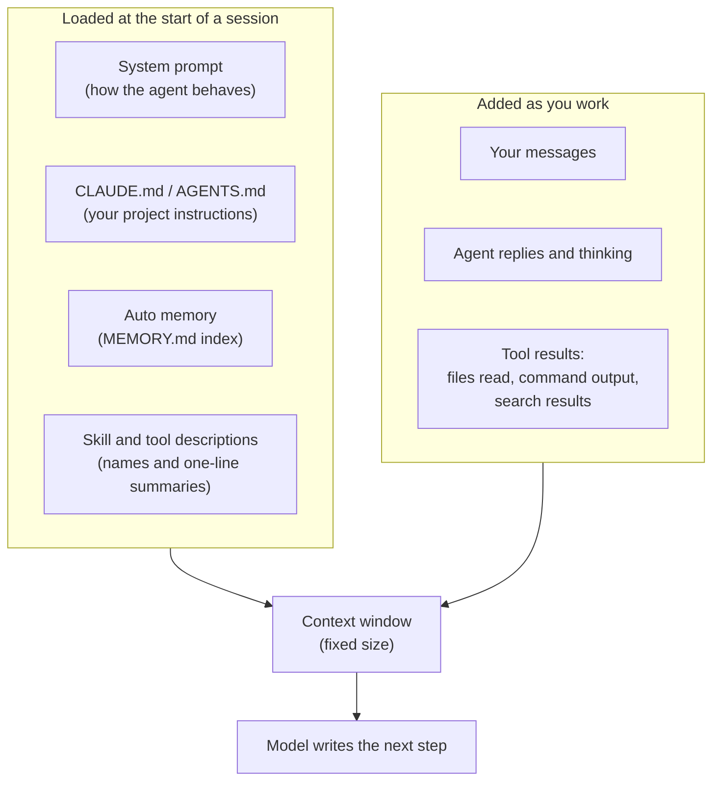
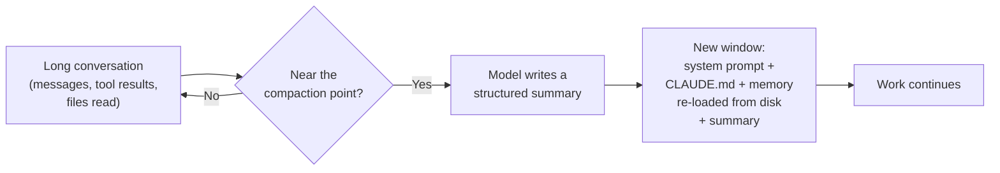

I spend a lot of time working on this site with Claude Code, and in long sessions I kept seeing the same message: the conversation was being "compacted". The work carried on, but sometimes the agent forgot a small instruction I had given an hour earlier. So I went and read Anthropic's documentation to understand what is actually going on. This post is the explanation I wish I had at the start, written for someone who uses these tools but has never looked under the hood.

<!-- Cover image goes here (to be made later) -->

All the numbers below come from Anthropic's docs as I read them on 23 November 2026. These tools change quickly, so check the linked pages if you are reading this much later.

## Tokens: the unit everything is measured in

A language model does not read words or letters. It reads **tokens**, which are small chunks of text. Anthropic's [glossary](https://platform.claude.com/docs/en/about-claude/glossary) describes tokens as the smallest units a model processes, and they can be whole words, parts of words, single characters or bytes. The same page says that on earlier Claude models a token is roughly 3.5 English characters, and that Claude 4.7 and later models use a newer tokenizer that produces about 30 percent more tokens for the same text.

You do not need to count tokens by hand. What matters is that everything is priced and limited in tokens: what you type, what the model writes back, and everything else it is shown along the way. If you do want exact numbers, Anthropic has a free [token counting API](https://platform.claude.com/docs/en/build-with-claude/token-counting).

### Input tokens and output tokens

Tokens come in two kinds, and they are priced differently.

- **Input tokens** are everything sent to the model: the system prompt, your instructions, the chat so far, files it read and tool results.
- **Output tokens** are everything the model writes back, including its thinking.

Output costs more. On Anthropic's [pricing page](https://platform.claude.com/docs/en/about-claude/pricing) (November 2026), output is five times the input price for each current model:

| Model | Input (per million tokens) | Output (per million tokens) |
|---|---|---|
| Claude Opus 5.5 | $4 | $20 |
| Claude Sonnet 5.5 | $2 | $10 |
| Claude Haiku 5.5 (prompts up to 100,000 tokens) | $0.10 | $0.50 |

In agent work, though, most tokens are input. Because the model keeps nothing between requests, every step sends the whole conversation again. A one-line reply from you can trigger a request carrying tens of thousands of input tokens of history. That is why the habits later in this post focus on what goes into the window.

### Thinking levels

Claude Code also lets you choose how hard the model thinks. The [effort docs](https://platform.claude.com/docs/en/build-with-claude/effort) list the levels as `low`, `medium`, `high`, `xhigh` and `max`, and say effort affects "all tokens in the response", not just the thinking. Higher effort usually means better answers on hard problems and more tokens spent.

Thinking is not free. The [costs page](https://code.claude.com/docs/en/costs) says "thinking tokens are billed as output tokens", and you can lower effort with `/effort` or in `/model`. Thinking also takes up room in the window: the [extended thinking docs](https://platform.claude.com/docs/en/build-with-claude/extended-thinking) say Claude Opus 4.5 and models numbered 4.6 and higher "keep prior turns' thinking blocks in context and bill them as input."

So for a simple rename or a typo fix, a low effort level is enough. Save the high levels for debugging and design problems where the extra reasoning pays off.

## The context window: the model's working memory

The **context window** is all the text the model can look at when it writes its next reply. Anthropic's [context windows guide](https://platform.claude.com/docs/en/build-with-claude/context-windows) calls it the model's "working memory", and it is separate from what the model learned during training.

Three things about it surprised me:

1. **The model has no memory between requests.** Every time the agent takes a step, the whole relevant conversation is sent again. The context window is the only "memory" it has in that moment.
2. **Everything counts.** The same guide lists the system prompt, every message, tool results, images, documents, tool definitions and the model's own output (including its thinking) as using up the window.
3. **More is not always better.** Anthropic says that "as token count grows, accuracy and recall degrade", which it calls **context rot** ([context windows guide](https://platform.claude.com/docs/en/build-with-claude/context-windows)). Their engineering post on [context engineering](https://www.anthropic.com/engineering/effective-context-engineering-for-ai-agents) (29 September 2025) describes the model as having an "attention budget" that every extra token draws on.

How big is the window? As of November 2026, the [context windows guide](https://platform.claude.com/docs/en/build-with-claude/context-windows) lists 1 million tokens for most current Claude models, with some older models at 200,000. A single reply can be up to 128,000 tokens long. These numbers have grown over time, so treat them as a snapshot.

### How big is a million tokens?

A million of anything is hard to picture, so here is a rough conversion. OpenAI's [token guide](https://help.openai.com/en/articles/4936856-what-are-tokens-and-how-to-count-them) says 100 tokens is about 75 words, which makes 1 million tokens about 750,000 words. Claude's newer tokenizer produces about 30 percent more tokens for the same text ([glossary](https://platform.claude.com/docs/en/about-claude/glossary)), so on current Claude models it is closer to 575,000 words. These are my own estimates from those two figures, not official numbers.

| Text | Approximate words | Fits in 1 million tokens? |
|---|---|---|
| US Constitution with all 27 amendments | 7,591 ([Ballotpedia](https://ballotpedia.org/US_Constitution)) | Yes, about 75 to 100 copies |
| An average English Wikipedia article | about 730 ([Wikipedia: Size of Wikipedia](https://en.wikipedia.org/wiki/Wikipedia:Size_of_Wikipedia)) | Yes, roughly 750 to 1,000 articles |
| A college textbook | roughly 200,000 to 280,000 (estimates vary) | Two or three |
| *War and Peace* | 587,287 ([WordCounter](https://wordcounter.net/blog/?p=2640)) | About one, depending on the tokenizer |
| King James Bible | 783,137 ([WordCounter](https://wordcounter.net/blog/2015/12/08/10975_how-many-words-bible.html)) | Probably not, on newer models |
| All seven Harry Potter books | about 1,084,000 ([WordCounter](https://wordcounter.net/blog/tag/harry-potter-word-count)) | No |

Numbers and tables are less efficient than prose, because digits and punctuation break into many small tokens. A summary table of a city's population fits easily. A spreadsheet with a row for every resident does not.

### Why not just make the window bigger?

My first thought was that context is like RAM: if you need more, add more. Andrej Karpathy uses a similar picture. In his 2025 talk [Software Is Changing (Again)](https://www.youtube.com/watch?v=LCEmiRjPEtQ) he describes LLMs as a new kind of operating system where the context window is the memory. But unlike RAM, it does not scale cheaply.

- **The work grows faster than the window.** In a transformer, every token is compared with every other token. Anthropic's [context engineering post](https://www.anthropic.com/engineering/effective-context-engineering-for-ai-agents) puts it as "n² pairwise relationships for n tokens". Double the window and that part of the work roughly quadruples ([Vaswani et al., 2017](https://arxiv.org/abs/1706.03762), Table 1).
- **Memory on the GPU grows with every token.** The model keeps a cache of each token it has seen in the window. Sebastian Raschka's [explainer on the KV cache](https://sebastianraschka.com/faq/docs/kv-cache-long-context-bottleneck.html) shows an 8 billion parameter model needing about 4.5 GiB for a single 32,768-token sequence, and the cache grows in step with the length.
- **The model has to learn to use long inputs.** The same Anthropic post notes that in training data "shorter sequences are typically more common than longer ones", so models get less practice with very long contexts.
- **Bigger does not mean better recall.** The [Lost in the Middle](https://arxiv.org/abs/2307.03172) study (2023) found models struggle with information buried in the middle of a long input, and Chroma's [Context Rot](https://www.trychroma.com/research/context-rot) report (July 2025) found performance dropped as inputs grew across 18 models.

So a bigger window costs more compute, more memory and more training, and you still get diminishing returns on accuracy. That is why the rest of this post is about using the window well rather than waiting for a bigger one.

## What actually fills the window in a coding agent

When I type a short question into Claude Code, the model sees much more than my question. The [context window page in the Claude Code docs](https://code.claude.com/docs/en/context-window) says that before your first prompt, "CLAUDE.md, auto memory, MCP tool names, and skill descriptions all load into context." On top of that comes the system prompt that tells the agent how to behave.

In my own sessions, `/context` usually shows about 7 percent of the window already used before I have even sent my first question. Your number will differ depending on how many skills, MCP servers and instruction files you have set up. The docs' own example adds up to roughly 7,850 tokens before the first prompt ([context window page](https://code.claude.com/docs/en/context-window)), and they call those numbers illustrative.

Then, as the agent works, every file it reads, every command output and every search result is added to the conversation. This is the part that grows fastest. One large log file or a long test run can use more tokens than an hour of chatting.

You can see this for yourself. In Claude Code, the `/context` command shows "current context usage as a colored grid" ([commands reference](https://code.claude.com/docs/en/commands)), so you can see which part is taking up the most room.

## The pieces that load before you type anything

### The system prompt

This is the set of instructions the tool's makers write. It tells the model what tools it has, how to use them and how to behave. You do not usually edit it, but it is always there, using part of the window in every session.

### Project instruction files: CLAUDE.md, AGENTS.md and friends

A **CLAUDE.md** file is a plain Markdown file of notes for the agent: how to build and test the project, conventions to follow, gotchas. Claude Code reads it automatically. According to the [memory docs](https://code.claude.com/docs/en/memory), these files can live in several places, and all of them are combined rather than one replacing another:

- your user folder (`~/.claude/CLAUDE.md`), for rules that apply to every project on your computer
- the project root (`./CLAUDE.md`), which you commit so the whole team shares it
- `CLAUDE.local.md`, for your personal notes that you keep out of Git
- subfolders, whose CLAUDE.md files load only when the agent starts working in that folder

The same page explains that a CLAUDE.md can pull in other files with `@path/to/file`, but this does not save space, because imported files load together with the CLAUDE.md that imports them.

Other agents use their own file names for the same idea. **AGENTS.md** is a shared name used by several coding agents, and Google's Gemini CLI uses **GEMINI.md**. The [memory docs](https://code.claude.com/docs/en/memory) say Claude Code "can read AGENTS.md as your project instructions", but by default only when there is no CLAUDE.md.

Claude Code also supports a `.claude/rules/` folder of smaller Markdown files. Rules can be limited to certain paths, so they only load when the agent touches matching files ([memory docs](https://code.claude.com/docs/en/memory)).

The key point for a beginner: **anything in CLAUDE.md is paid for in every single session**, whether the task needs it or not. Anthropic's [best practices page](https://code.claude.com/docs/en/best-practices) puts it this way: every line "takes a little of Claude's attention on every task."

### Memory files

CLAUDE.md is something you write. **Auto memory** is something the agent writes for itself. The [memory docs](https://code.claude.com/docs/en/memory) explain that Claude Code saves short notes about you and your project (preferences, corrections you gave it, project facts) and keeps an index file called `MEMORY.md`. Only the first 200 lines or 25KB of that index load into each session. It deliberately skips things it can work out from the code, such as file paths or how a bug was fixed.

This is how an agent can "remember" across sessions even though the model itself remembers nothing. The memory is just text in a file that gets loaded back in.

### Skills

A **skill** is a folder with a `SKILL.md` file holding instructions for one kind of task, such as "how we write release notes" or "how to deploy". The clever bit is how they load. The [best practices page](https://code.claude.com/docs/en/best-practices) says the agent "sees the name and description in every session, but only reads the full file when the task calls for it." The [skills docs](https://code.claude.com/docs/en/skills) add that a skill's body "loads only when it's used, so long reference material costs almost nothing until you need it."

So a long procedure that would bloat CLAUDE.md can live in a skill instead, and only a one-line description sits in the window until it is needed.

## Subagents: a second context window

A **subagent** is a helper the main agent can start for a side task. The [subagents docs](https://code.claude.com/docs/en/sub-agents) say each one "runs in its own context window with a custom system prompt, specific tool access, and independent permissions."

The point is to keep noise out of your main conversation. If the agent needs to search 50 files to answer one question, a subagent can do the searching in its own window and hand back a short answer. Anthropic's [context engineering post](https://www.anthropic.com/engineering/effective-context-engineering-for-ai-agents) describes subagents that may use "tens of thousands of tokens or more" exploring but return a summary of often 1,000 to 2,000 tokens.

Subagents are not free. The [costs page](https://code.claude.com/docs/en/costs) points out that every subagent "sends its own requests on top of the main conversation's", so they help your context but still use your token allowance.

## Compaction: what happens when the window fills up

Because the window has a fixed size, a long session will eventually run out of room. **Compaction** is how the agent deals with that. Anthropic's [context engineering post](https://www.anthropic.com/engineering/effective-context-engineering-for-ai-agents) describes it as summarising the conversation and starting a new context window with that summary.

### When it happens

In Claude Code it runs automatically. The [model configuration docs](https://code.claude.com/docs/en/model-config#context-window-and-auto-compaction) say the point depends on your model and settings. For models with a native 1 million token window, it compacts "at about 967K tokens by default." Some setups compact at a 200K boundary instead. You can also run it yourself with `/compact`, and you can set an earlier compaction point with `/autocompact` ([commands reference](https://code.claude.com/docs/en/commands)).

### What survives and what is lost

The Claude Code [context window page](https://code.claude.com/docs/en/context-window#what-survives-compaction) has a table of what survives. In short:

- **Kept:** the system prompt, your project-root CLAUDE.md and auto memory (both re-read from disk), and skill descriptions.
- **Partly kept:** skills you already used are re-attached, but capped at 5,000 tokens each and 25,000 tokens in total. Claude Code re-reads up to five of the files it was working on, most recently changed first.
- **Reloaded only when needed:** CLAUDE.md files in subfolders and path-scoped rules.
- **Summarised:** everything else in the conversation becomes "a structured summary."

That last line is what explained my lost instruction. If I told the agent something only in chat, it lives in the conversation, and after compaction it exists only if the summary kept it. Anything written in CLAUDE.md is re-read from disk and comes back word for word. The [memory docs](https://code.claude.com/docs/en/memory) make the same suggestion: put instructions in CLAUDE.md if you want them to persist.

Compaction also costs something. The [costs page](https://code.claude.com/docs/en/costs) notes that "/compact reads the conversation it summarizes, so compacting a large context is itself a large request."

## How to keep work inside the window so compaction is rare

This was my real question. Here is what Anthropic recommends, with the source for each.

**1. Start fresh between unrelated tasks.** The [best practices page](https://code.claude.com/docs/en/best-practices) says to use "/clear between unrelated tasks. It costs nothing, and it means the next task doesn't keep paying for the previous one's history." The [costs page](https://code.claude.com/docs/en/costs) adds a tip: `/rename` the session before clearing so you can `/resume` it later. This is the single biggest habit change for me. One session per task, not one session per day.

**2. When a session goes wrong, restart instead of arguing.** The same [best practices page](https://code.claude.com/docs/en/best-practices) says that after two failed corrections, "/clear plus one new prompt that folds in what you learned works better almost every time." Failed attempts stay in the window and keep distracting the model.

**3. Keep CLAUDE.md short.** The [memory docs](https://code.claude.com/docs/en/memory) recommend you "target under 200 lines per CLAUDE.md file," because "longer files consume more context and reduce adherence." The [best practices page](https://code.claude.com/docs/en/best-practices) gives a test for each line: leave it out if Claude could find the information by reading the code. Personal preferences go in `CLAUDE.local.md`.

**4. Move long procedures into skills.** The [costs page](https://code.claude.com/docs/en/costs) says "skills load on-demand only when invoked, so moving specialized instructions into skills keeps your base context smaller."

**5. Send noisy work to subagents.** The [costs page](https://code.claude.com/docs/en/costs) recommends delegating "verbose operations to subagents so the verbose output stays in the subagent's context while only a summary returns." The [best practices page](https://code.claude.com/docs/en/best-practices) adds: "Ask for short summaries back."

**6. Write plans and progress to files.** Anthropic's [context engineering post](https://www.anthropic.com/engineering/effective-context-engineering-for-ai-agents) calls this structured note-taking: the agent keeps notes, such as a to-do list or a `NOTES.md` file, outside the context window and reads them back later. The [best practices page](https://code.claude.com/docs/en/best-practices) suggests a version of this for bigger features: have Claude interview you, write the result to `SPEC.md`, then "start a fresh session to build from it, so the build begins with a clean context."

**7. If you do compact, tell it what to keep.** You can pass focus instructions, for example `/compact keep the API changes and the test commands` ([best practices](https://code.claude.com/docs/en/best-practices)). The [costs page](https://code.claude.com/docs/en/costs) also shows how to add a "Compact instructions" section to CLAUDE.md so every compaction follows the same rule.

**8. Check what is using space.** Run `/context` to see the breakdown, and turn off MCP servers you are not using with `/mcp` ([costs page](https://code.claude.com/docs/en/costs)).

### A note on prompt caching

Prompt caching does not make your window bigger, but it is related. When the start of a request is identical to a recent one, the API can reuse its earlier work instead of processing those tokens again. The [prompt caching docs](https://platform.claude.com/docs/en/build-with-claude/prompt-caching) say the cache lasts 5 minutes by default, with a 1-hour option, and that cached reads cost a tenth of the normal input price on most models. The [context windows guide](https://platform.claude.com/docs/en/build-with-claude/context-windows) is clear that caching changes what you pay, not how much of the window is used.

For everyday use, this means two things. A stable CLAUDE.md is cheap to resend because it gets cached. And if you leave a session idle for a while, the cache may expire, so the next message costs more. The [best practices page](https://code.claude.com/docs/en/best-practices) says the cache "lasts about an hour on a subscription and five minutes on an API key."

## Anthropic's own view has shifted

One thing I noticed while reading: the [best practices page](https://code.claude.com/docs/en/best-practices) now says that "with a 1M-token window on most current models and compaction near the top of it, you'll rarely run out of context." So for most people, running out of room is less of a problem than it used to be. The bigger reason to keep the window lean is quality. Because of context rot, a focused window full of relevant material tends to give better answers than a huge one full of old logs and abandoned attempts.

## Summary

- Tokens are the unit everything is measured in. Output tokens (including thinking) cost more, but agents send far more input tokens.
- A million tokens is roughly one long novel, and the window cannot simply be enlarged like RAM.
- The context window is the model's only working memory, and everything (instructions, files, tool output, your chat) shares it.
- CLAUDE.md and memory files load every session, skills load on demand, and subagents get a window of their own.
- Compaction summarises a long conversation so work can continue. Files on disk come back in full; things said only in chat may not.
- To rarely need compaction: clear between tasks, keep CLAUDE.md short, use skills and subagents, and write plans and progress to files.

## Sources

- Anthropic, [Effective context engineering for AI agents](https://www.anthropic.com/engineering/effective-context-engineering-for-ai-agents) (29 September 2025)
- Claude Platform docs: [Context windows](https://platform.claude.com/docs/en/build-with-claude/context-windows), [Prompt caching](https://platform.claude.com/docs/en/build-with-claude/prompt-caching), [Glossary](https://platform.claude.com/docs/en/about-claude/glossary), [Pricing](https://platform.claude.com/docs/en/about-claude/pricing), [Effort](https://platform.claude.com/docs/en/build-with-claude/effort), [Extended thinking](https://platform.claude.com/docs/en/build-with-claude/extended-thinking), [Token counting](https://platform.claude.com/docs/en/build-with-claude/token-counting)
- Andrej Karpathy, [Software Is Changing (Again)](https://www.youtube.com/watch?v=LCEmiRjPEtQ), YC AI Startup School (June 2025)
- Vaswani et al., [Attention Is All You Need](https://arxiv.org/abs/1706.03762) (2017); Liu et al., [Lost in the Middle](https://arxiv.org/abs/2307.03172) (2023); Chroma, [Context Rot](https://www.trychroma.com/research/context-rot) (2025); Sebastian Raschka, [KV cache and long context](https://sebastianraschka.com/faq/docs/kv-cache-long-context-bottleneck.html)
- Claude Code docs: [Best practices](https://code.claude.com/docs/en/best-practices), [Context window](https://code.claude.com/docs/en/context-window), [Memory](https://code.claude.com/docs/en/memory), [Costs](https://code.claude.com/docs/en/costs), [Skills](https://code.claude.com/docs/en/skills), [Subagents](https://code.claude.com/docs/en/sub-agents), [Commands](https://code.claude.com/docs/en/commands), [Model configuration](https://code.claude.com/docs/en/model-config)

All pages accessed 23 November 2026.
