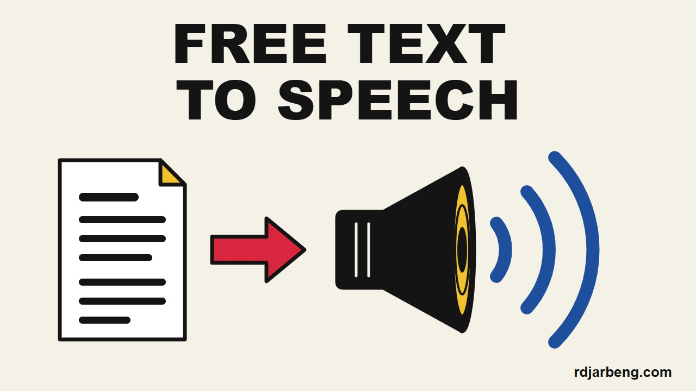

If you want a free tool to read articles and PDFs aloud, use the Read Aloud button in Microsoft Edge. If you need MP3 files for a video, try TTSMaker; for short clips that need to sound expressive, ElevenLabs; and if you want to run it on your own machine, Piper or Kokoro.



The catch: most services put the good voices, downloads or commercial use behind a paywall. Below is what each free option is good for and where its limits are, as of November 2026.

## The short version

| Tool | Best for | Free limit | Download audio |
| :--- | :--- | :--- | :--- |
| **TTSMaker** | MP3s for videos | Weekly character limit (see the site) | Yes |
| **ElevenLabs** | Expressive short clips | 10,000 characters a month, roughly 10 minutes of speech | Yes |
| **Microsoft Edge** | Listening to articles and PDFs | No stated limit | No |
| **NaturalReader** | Studying documents | Free web listening | Limited on free tier |
| **TTSReader** | Long text in the browser | Free web listening | Limited on free tier |
| **Piper / Kokoro** | Offline use, private text | None, it runs on your machine | Yes |

Limits and licence terms change often. Check each site's current terms before you rely on them, especially for paid work.

## How these voices work, briefly

Most modern tools follow the same three steps, which is useful to know when a voice mispronounces something:

1. **Text clean-up.** The tool expands numbers, dates and abbreviations ("Dr." to "Doctor", "45" to "forty-five") and turns words into phonemes. Mistakes with words like "read" (present or past) happen here.
2. **Acoustic model.** A neural network turns the phonemes into a mel-spectrogram, a picture of sound over time. This step sets the pacing, stress and tone.
3. **Vocoder.** A second network, such as HiFi-GAN or BigVGAN, turns the spectrogram into an audio waveform.

## TTSMaker

[TTSMaker](https://ttsmaker.com/) is the one to try if you make videos or courses and want MP3 files without creating an account.

- It has many languages and voices.
- The free tier has a weekly character limit, shown on the site.
- If you plan to use the audio in monetised videos or paid work, read its terms of service first. I have not seen them state this in a way I could link here.
- The newer neural voices sound natural. The older ones still sound robotic on technical terms.

## ElevenLabs

[ElevenLabs](https://elevenlabs.io/) has the most expressive voices of the cloud tools here. Its current flagship model, Eleven v4, follows punctuation and context, so you get pauses and changes in pitch.

- You get a library of ready-made voices and some basic voice design tools.
- The [free plan](https://elevenlabs.io/pricing) gives 10,000 credits a month, and text to speech uses one credit per character. That is roughly 10 minutes of speech, so it suits short clips more than long narration.
- The pricing page lists the commercial licence as a feature of the paid Starter plan, so treat free-plan audio as personal use only.

## Microsoft Edge Read Aloud

Many people already have a good reader installed. [Microsoft Edge](https://www.microsoft.com/edge) has a Read Aloud feature that uses Microsoft's neural voices.

- Open a web page or a local PDF in Edge, then click Read Aloud in the toolbar or press `Ctrl+Shift+U`.
- It needs no account, extra software or API key, and Microsoft doesn't state a usage limit.
- It reads aloud but does not export audio. To get an MP3 you would have to record your desktop audio, for example with a virtual cable like VB-Audio Cable or with Audacity.

## NaturalReader and TTSReader

These two are browser readers for long documents.

- **[NaturalReader](https://www.naturalreaders.com/online/)** lets you paste text or upload PDF and Word files, then highlights each word as it reads. That makes it handy for proofreading and studying.
- **[TTSReader](https://ttsreader.com/)** is a simple in-browser player for long text. You can paste text or drop in a PDF, and it remembers where you stopped.

Listening in the browser is free on both. Downloading audio is limited on the free tiers, so treat them as readers, not as a way to make audio files.

## Running it offline: Piper and Kokoro

If you are working with confidential text, or you need a lot of audio, you can run a model on your own computer. Your text stays on your machine and there is no quota or subscription.

### Piper

[Piper](https://github.com/OHF-Voice/piper1-gpl) is a fast local TTS engine that runs on a Raspberry Pi or an ordinary PC, and [Home Assistant](https://github.com/home-assistant/addons/blob/master/piper/README.md) uses it for its voice features. The original rhasspy/piper repository is archived; the project now lives at OHF-Voice/piper1-gpl.

```sh
pip install piper-tts
python3 -m piper.download_voices en_US-lessac-medium
python3 -m piper -m en_US-lessac-medium -f test.wav -- 'This is a test.'
```

That writes `test.wav`. You can hear the voices first on the [samples page](https://rhasspy.github.io/piper-samples).

The code is GPL-3.0, which matters if you bundle it into a closed-source app. The voices are licensed separately, by the data each was trained on; the project keeps a [list of voices cleared for commercial use](https://github.com/OHF-Voice/piper1-gpl/blob/main/docs/COMMERCIAL_USE.md).

### Kokoro-82M

[Kokoro](https://huggingface.co/hexgrad/Kokoro-82M) is an open-weight model with 82 million parameters, released in December 2024. Its weights are under the Apache 2.0 licence, so you can use it in commercial projects. It covers American and British English plus Spanish, French, Hindi, Italian, Japanese, Brazilian Portuguese and Mandarin, and you can [listen to samples](https://huggingface.co/hexgrad/Kokoro-82M/blob/main/SAMPLES.md) before installing.

```python
# pip install kokoro soundfile   (also needs espeak-ng installed)
from kokoro import KPipeline
import soundfile as sf

pipeline = KPipeline(lang_code="a")  # "a" = American English
for i, (_, _, audio) in enumerate(pipeline("This is a test.", voice="af_heart")):
    sf.write(f"test_{i}.wav", audio, 24000)
```

## Which one to pick

- **Short videos and social posts:** TTSMaker, for MP3 downloads without signing up.
- **A podcast intro or character voices:** ElevenLabs, if the clip is short enough for the free allowance.
- **Reading papers, books and articles:** Microsoft Edge Read Aloud.
- **Scripts, pipelines or private documents:** Piper or Kokoro, run locally in Python or Docker.
