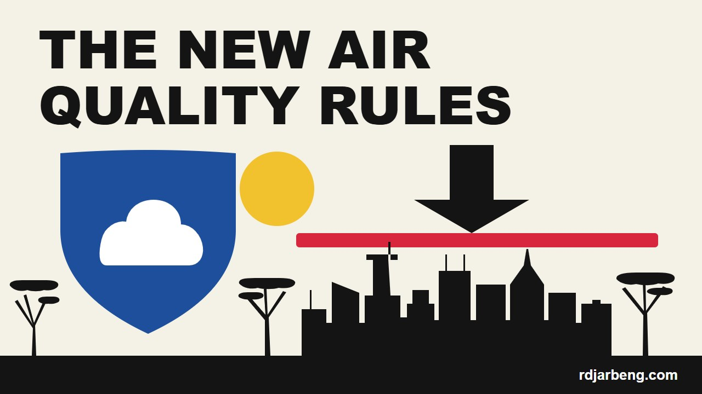

In September 2021 the [World Health Organization](https://www.who.int/publications/i/item/9789240034228) updated its Global Air Quality Guidelines for the first time in sixteen years. The headline change is that the recommended annual average for fine particles (PM2.5) dropped by half, from 10 to 5 micrograms per cubic meter (µg/m³). The reason is simple: the evidence now shows heart and lung damage at concentrations well below what the 2005 guidelines treated as acceptable.

For many African cities that new number is a long way off. In Kampala, a reference monitor measured an [average of 39 µg/m³ over 2018 to 2021](https://pmc.ncbi.nlm.nih.gov/articles/PMC11840866/), nearly eight times the new guideline. In Kinshasa, ground monitors compiled by IQAir averaged [50.2 µg/m³ in 2025](https://www.myjoyonline.com/chad-dr-congo-have-dirtiest-air-in-africa-reunion-canary-islands-cleanest-iqair-2025-report/), ten times the guideline. The WHO expected gaps like these, so the guidelines come with interim targets: intermediate levels a city can aim for now, each of which brings its own health benefit.

## How the guidelines got here

The first WHO guidelines, the [Air Quality Guidelines for Europe](https://www.miteco.gob.es/content/dam/miteco/es/calidad-y-evaluacion-ambiental/temas/atmosfera-y-calidad-del-aire/guidelinesforairquality-2000_tcm30-188065.pdf) of 1987, were built on evidence from Western Europe and North America and said nothing about tropical weather, mineral dust or living conditions in poorer countries. The [2005 update](https://www.who.int/news-room/questions-and-answers/item/who-global-air-quality-guidelines) was the first written for the whole world, and the 2021 guidelines replace it.

## What changed in 2021

The 2021 update rests on systematic reviews of large cohort studies. Better satellite data, combined with chemical transport models and ground measurements, let researchers estimate exposure and health effects down to levels close to background.

| Pollutant | Averaging time | 2005 guideline | 2021 guideline |
| :--- | :--- | :--- | :--- |
| PM2.5 | Annual | 10 µg/m³ | 5 µg/m³ |
| PM2.5 | 24-hour | 25 µg/m³ | 15 µg/m³ |
| PM10 | Annual | 20 µg/m³ | 15 µg/m³ |
| PM10 | 24-hour | 50 µg/m³ | 45 µg/m³ |
| NO2 | Annual | 40 µg/m³ | 10 µg/m³ |
| NO2 | 24-hour | none | 25 µg/m³ |
| Ozone | Peak season | none | 60 µg/m³ |
| Ozone | 8-hour | 100 µg/m³ | 100 µg/m³ |
| SO2 | 24-hour | 20 µg/m³ | 40 µg/m³ |
| CO | 24-hour | none | 4 mg/m³ |

"Peak season" ozone is the average of the daily maximum 8-hour ozone level over the six months of the year when ozone is highest. The 24-hour and 8-hour values are 99th percentiles, which means they can be exceeded on 3 to 4 days a year ([WHO](https://www.who.int/news-room/q-a-detail/who-global-air-quality-guidelines)).

The biggest cut is for nitrogen dioxide: the [annual guideline went from 40 to 10 µg/m³](https://dieselnet.com/news/2021/09who.php), a 75% drop. The reviews found that NO2 harms health directly, on top of its role in forming ozone. The update also adds new guidelines for 24-hour NO2, 24-hour carbon monoxide and peak-season ozone. One value went the other way: the 24-hour SO2 guideline rose from 20 to 40 µg/m³, because WHO based it on a [new systematic review of short-term SO2 exposure and deaths](https://doi.org/10.1016/j.envint.2021.106434) rather than the older evidence behind the 2005 value.

For PM2.5, the curve linking concentration to health damage is steepest at the low end. Going from 10 to 5 µg/m³ prevents more harm per microgram than the same cut at higher levels. So even fairly clean cities gain from cleaning up further.

## Interim targets: steps a city can reach

A 5 µg/m³ annual average is not a near-term goal for a city whose air is several times dirtier. The WHO therefore kept a ladder of [interim targets](https://www.ssph-journal.org/journals/international-journal-of-public-health/articles/10.3389/ijph.2021.1604465/full) in the guidelines:

| Step | Annual mean PM2.5 |
| :--- | :--- |
| Interim Target 1 | 35 µg/m³ |
| Interim Target 2 | 25 µg/m³ |
| Interim Target 3 | 15 µg/m³ |
| Interim Target 4 | 10 µg/m³ |
| Final guideline | 5 µg/m³ |

Interim Target 1 is a realistic first goal for many African cities, and each step down reduces deaths linked to air pollution. At the far end, a WHO analysis estimated that cutting air pollution to the new guideline level could avoid [almost 80% of deaths related to PM2.5 worldwide](https://www.who.int/news/item/22-09-2021-new-who-global-air-quality-guidelines-aim-to-save-millions-of-lives-from-air-pollution).

## Why fine particles do so much harm

The "2.5" in PM2.5 is the particle's diameter in micrometers, many times thinner than a human hair. Particles this small get past the nose and throat and reach the alveoli, the tiny air sacs deep in the lungs where oxygen enters the blood.

The American Heart Association's [scientific statement on particle pollution and heart disease](https://doi.org/10.1161/CIR.0b013e3181dbece1) concludes that PM2.5 causes cardiovascular disease, and that a few hours to weeks of exposure can trigger heart-related deaths and other cardiovascular events. It describes several routes: inflammation in the lungs that spreads through the body, effects on the nerves that control the heart, and the smallest particles possibly passing into the blood. Together these stiffen blood vessels and make clots more likely.

## Ozone harms lungs and harvests

The 2021 guidelines added a peak-season guideline for ground-level ozone of 60 µg/m³. In Africa, ozone deserves more attention than it usually gets.

Nobody emits ozone directly. It forms in the air when nitrogen oxides (NOx) and volatile organic compounds (VOCs) react in sunlight. Ultraviolet light splits NO2, and the freed oxygen atom joins an oxygen molecule to make ozone:

$$\text{NO}_2 + h\nu \longrightarrow \text{NO} + \text{O}(^3\text{P})$$

$$\text{O}(^3\text{P}) + \text{O}_2 + \text{M} \longrightarrow \text{O}_3 + \text{M}$$

In tropical and subtropical Africa this happens fast. Sunlight is strong all year, temperatures are high, and there are large seasonal sources of NOx and VOCs: savannah fires, slash-and-burn farming and charcoal making. During the 2000 dry-season burning in southern Africa, researchers in Lusaka, Zambia, measured ground-level ozone [above 90 parts per billion on most days](https://science.nasa.gov/earth/earth-observatory/savanna-smog/), and they traced a third to half of it to local burning, charcoal making and old cars.

In people, ozone oxidizes the lining of the lungs. In plants, it enters leaves through the stomata, the pores they open during the day to exchange gases, and slows photosynthesis. A [2021 modeling study of sub-Saharan Africa](https://doi.org/10.1007/s11356-021-14967-3) estimated that ozone cuts wheat yields by 2 to 13% and common bean yields by up to 21% in some areas, with the largest losses in big producers such as Ethiopia (wheat) and Tanzania (beans). Where most people grow their own food or earn their living from farming, that makes ozone a food security problem as well as a health one.

## The data gap

You cannot hold a city to a guideline it cannot measure. Africa has [fewer than 1,500 active continuous air quality monitoring locations](https://www.cleanairfund.org/news-item/ai-powered-tools-air-quality-monitoring-africa/) (as of 2026), and many cities have no reference station at all. Monitoring in Africa works in three layers:

- **Reference-grade stations** (beta attenuation monitors, gravimetric samplers): accurate and expensive, and very sparse.
- **Calibrated low-cost optical sensors:** growing city networks in Accra, Nairobi and Kigali.
- **Satellites and models** (MODIS, Sentinel-5P TROPOMI, GEOS-Chem): cover the whole continent, but need ground measurements to check them against.

Three research areas would do the most to close the gap.

### Where the particles come from

A city cannot target its emissions without knowing what its particles are made of. In North American and European cities, traffic and factories dominate. African cities have a different mix:

- dust blown up from unpaved roads and road shoulders
- black carbon from charcoal and firewood stoves
- smoke from burning rubbish where waste collection does not reach
- exhaust from older vehicles running on high-sulfur fuel, often without catalytic converters

Source apportionment methods such as Positive Matrix Factorization (PMF), run on filter samples, estimate how much each source contributes. That tells a city where its money will cut the most pollution.

### Indoor and outdoor air mix

In informal settlements, the line between indoor and outdoor pollution breaks down. Small homes built from porous materials let cookstove smoke out into narrow streets, which raises outdoor levels. Traffic exhaust also gets into homes easily. To measure what people actually breathe, studies need to follow the same people over time with wearable, low-power particle monitors that record their full 24-hour exposure.

### Low-cost sensors need local calibration

Reference monitors are expensive to buy and maintain, which puts a dense network beyond most city budgets. Low-cost optical sensors such as the PurpleAir units used in Kinshasa and Brazzaville cost [about US$250 each, roughly 100 times less than a reference monitor](https://eos.org/articles/cheap-sensors-provide-missing-air-quality-data-in-african-cities) (as of 2021). They make street-level maps possible, but only after local calibration. In humid air, particles absorb water and swell, and uncalibrated optical sensors can then report more particle mass than is really there. The fix is to place low-cost sensors next to a reference monitor for a period and train a correction model, such as gradient boosting or random forest regression, on the paired readings.

## What African cities are doing

### Kigali, Rwanda

Kigali [started car-free days in 2016](https://who-afro.ctb.ku.edu/act/promoting-physical-activity-and-air-quality-through-car-free-sundays-in-kigali-rwanda). They began as a monthly event and later moved to twice a month. Streets close to cars and host group exercise, and the Ministry of Health offers blood pressure and blood sugar checks. Rwanda has also [introduced vehicle emissions testing](https://breathe.climate.uchicago.edu/news/air-pollution-rwanda-announces-vehicle-emissions-testing-policy), and in November 2025 [motorcycle emissions tests started in Kigali](https://www.newtimes.co.rw/article/31276/news/environment/motorcycle-emission-tests-start-in-kigali).

### Nairobi, Kenya

In April 2022 the county assembly [passed the Nairobi City County Air Quality Act](https://www.the-star.co.ke/news/2022-04-10-burning-waste-without-authority-to-attract-sh500000-fine), which bans burning waste without permission and sets fines for polluting industries. In November 2025 the county [launched an Air Quality Action Plan for 2025 to 2029](https://www.the-star.co.ke/counties/nairobi/2025-11-28-nairobi-unveils-new-air-quality-system-to-tackle-pollution), along with a data management system and public portal. Its monitoring network combines [two reference-grade stations and over 50 low-cost sensors](https://www.cleanairfund.org/news-item/ai-powered-tools-air-quality-monitoring-africa/) (as of 2026), which brings air quality data down to the level of a neighborhood.

### Accra, Ghana

Accra deals with seasonal Harmattan dust blown in from the northeast, on top of traffic emissions and open waste burning. In 2018 the Accra Metropolitan Assembly became the first major city government in Africa to formally join the WHO and UN Environment [BreatheLife campaign](https://ama.gov.gh/documents/Breathelife_Campaign_Press_Release.pdf). Its Breathe Accra project now runs a sensor network across the municipal assemblies, and a second phase reported in 2026 is [adding three sensors in each of thirteen assemblies](https://www.myjoyonline.com/municipal-assemblies-gain-real-time-pollution-data-as-breathe-accra-expands-air-quality-monitoring-network/), partly to help them enforce bylaws against open burning. Separately, the city's [2025 to 2035 waste strategy](https://www.myjoyonline.com/ama-launches-waste-optimisation-strategy-to-drive-source-separation-composting-climate-action/) aims to expand composting and reduce illegal dumping and open burning.

### South Africa

South Africa is the counterexample. It is the most industrialized economy on the continent, and its [Highveld Priority Area](https://www.gov.za/documents/notices/national-environmental-management-air-quality-act-second-generation-highveld-0) holds a dense cluster of Eskom coal-fired power stations, petrochemical plants and coal mines. Its [national annual PM2.5 standard](https://www.gov.za/documents/national-environmental-management-air-quality-act-national-ambient-air-quality-standard-0) is 20 µg/m³, due to tighten to 15 µg/m³ in 2030. That is four times the WHO guideline of 5 µg/m³ now, and three times it after 2030, so air that is legal at home can still be far over the 2021 guideline. Good data on its own does not clean the air. It needs enforceable law and the political will to use it.

## What to do next

For policymakers and researchers in Africa, the guidelines point to four practical steps:

1. **Adopt the interim targets in law.** Environment ministries can make Interim Target 1 (35 µg/m³) and Interim Target 2 (25 µg/m³) binding national standards, which gives regulators milestones they can enforce.
2. **Align fuel and vehicle standards.** In January 2015 the East African Community countries [adopted a 50 ppm sulfur limit for diesel](https://www.ccacoalition.org/news/east-african-clean-diesel-now-reality). Similar rules in other regional blocs would stop dirty fuel from being imported where rules are weaker.
3. **Build hybrid monitoring networks.** Combine satellite aerosol optical depth with low-cost ground sensors calibrated against regional reference monitors, so cities without stations still get usable data.
4. **Treat clean cooking as an outdoor air issue.** Direct climate finance and clean energy subsidies toward LPG and electric induction cooking, because household smoke drives neighborhood pollution too.

The WHO cut the annual PM2.5 guideline in half, to 5 µg/m³, and few African cities will get there soon. They do not have to get there in one jump. The ladder of 35, 25, 15 and 10 µg/m³, then 5, lets a city like Kampala aim first for 35 and count lives saved at every step down.
