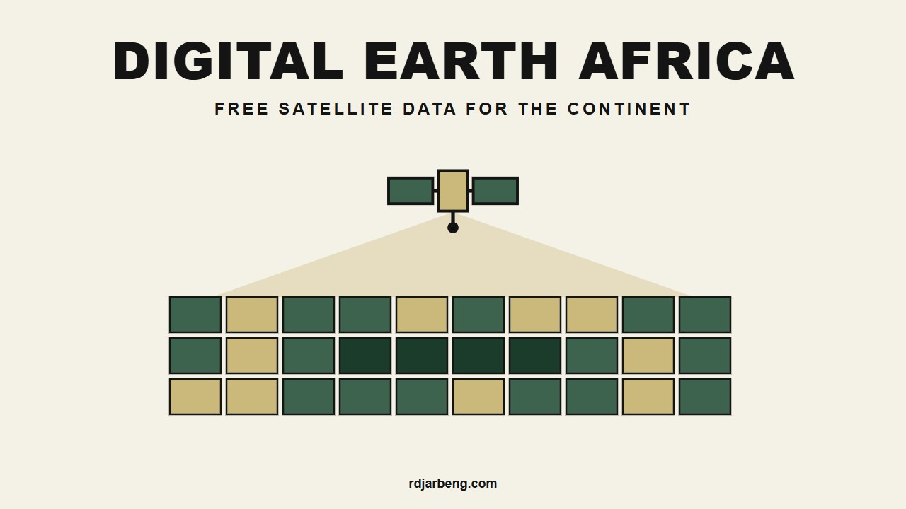

If you plan for floods, droughts or food supplies in Africa, you need reliable information about land and water. [Digital Earth Africa](https://digitalearthafrica.org/en_za/) (DE Africa) provides free and open satellite data for the whole continent. The programme is run by the [International Centre of Insect Physiology and Ecology](https://digitalearthafrica.org/en_za/about-digital-earth-africa/) (icipe).

## What the programme provides

The programme processes openly accessible, freely available data into [decision-ready products](https://digitalearthafrica.org/en_za/data-and-services-roadmap/). These are maps and tools built to answer a practical question, rather than raw satellite images. One of the main offerings is [Analysis Ready Data](https://digitalearthafrica.org/en_za/analysis-ready-data/) (ARD). This is Earth observation data, meaning information about land and water collected by satellites. The data have been processed to a set of requirements, so they can be used directly.

[Water Observations from Space](https://digitalearthafrica.org/en_za/water-observations-from-space/) (WOfS) draws on about forty years of satellite data to show where surface water has been present across Africa. For a planner, that history helps identify floodplains and track water trends over time. The programme also provides a [Water Quality Monitoring Service](https://digitalearthafrica.org/en_za/water-quality-monitoring-service/) for lakes, dams and reservoirs. It reports indicators such as floating algae and algal blooms. It also reports turbidity (how cloudy the water is) and chlorophyll-a (a green pigment that shows how much algae is present).

For farming, the [Cropland Extent Map](https://digitalearthafrica.org/en_za/cropland-extent-map/) shows where cropland is across the continent. The [Fractional Cover](https://digitalearthafrica.org/en_za/fractional-cover/) service has tracked, since 1984, the share of the ground covered by green vegetation, non-green vegetation and bare soil. This helps show where vegetation has been removed or has died back.

[GeoMAD](https://digitalearthafrica.org/en_za/geomad/) combines the surface reflectance of many satellite images over a period into one "geomedian" value for each pixel. Surface reflectance is the light the ground sends back to the satellite, and a pixel is the smallest square in an image. The result can be used to make true-colour images of a year and to study change over time.

## Real-world uses in Africa

In [Zambia](https://digitalearthafrica.org/en_za/putting-earth-observation-to-work-for-zambias-development-priorities/), a four-day capacity-building workshop was held with the National Remote Sensing Centre. Seven Zambian institutions used it to identify ways to use satellite data for national priorities. Capacity-building means training that builds local skills. The proposed projects include monitoring water quality along the Kafue River and tracking land degradation, a decline in the quality of land.

For agriculture, [reliable cropland estimates](https://digitalearthafrica.org/en_za/better-cropland-maps-to-support-africas-agricultural-decisions/), which are figures for how much land is used to grow crops, are essential for planning and food security. In a study across six African countries, [Catherine Nakalembe](https://digitalearthafrica.org/en_za/spotlight-catherine-nakalembe-on-making-cropland-estimates-more-reliable/) and her team assessed seven satellite-based cropland products. Digital Earth Africa's product was among the highest on average for producer's accuracy. This measure shows how often a map correctly picks out cropland that is really there.

In North Africa, [Syrine Souissi](https://digitalearthafrica.org/en_za/spotlight-syrine-souissi-on-using-satellite-data-to-protect-sfaxs-heritage/) studied her hometown of Sfax, Tunisia, over 36 years. She used Landsat time series, which are satellite images taken over many years. She combined them with climate reanalysis data (climate records rebuilt from past observations and models). She also used urban spectral indices, which are formulas that flag built-up land from the colours a satellite records. The work used the Digital Earth Africa Data Cube, a store of organised satellite data. Her study contrasts the expansion of the port and a development area with the relative stability of the historic Medina, the old town.

## How to start using the data

The first page to open is the [Digital Earth Africa Map](https://maps.digitalearth.africa/), an interactive website for viewing the datasets.

For technical users, the [Sandbox](https://digitalearthafrica.org/en_za/dea-platforms/#sandbox) is a cloud-based Jupyter Lab environment, which is a web workspace for writing and running code. It provides limited free computing resources for exploring Digital Earth Africa data and products.

The programme also offers [free online training](https://digitalearthafrica.org/en_za/online-learning/). The courses are self-paced, so you study when it suits you, and they are available in English and French. They include videos, recorded tutorials, manuals with hands-on exercises and access to experts. The [weekly live sessions](https://digitalearthafrica.org/en_za/online-learning/) are held online in French and English, where participants can ask questions.

## Conclusion

For anyone planning around floods, droughts or food supplies, the Digital Earth Africa Map is the place to start. Use the sandbox if you can write code, and the training if you want to learn the data. To understand what satellite tools can and cannot do, read [the Earth observation overview](/earth-observations-promise-and-barriers-a-down-to-earth-view/).
