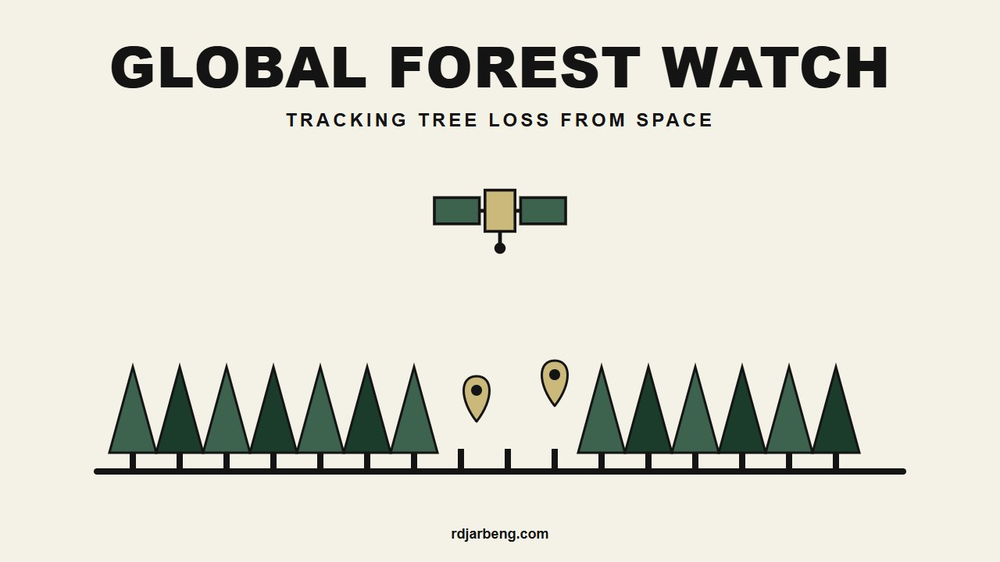

If you want to know whether forest near you is being cleared, you need information that is up to date. [Global Forest Watch](https://www.globalforestwatch.org/) puts satellite images and forest alerts online, so anyone can see where clearing is happening. Alerts are warnings that appear when satellite images show a possible change, such as trees being removed.

The [World Resources Institute](https://www.globalforestwatch.org/about/) established the service in 1997 and launched its interactive online platform in 2014. The service was [renamed Global Nature Watch in 2026](https://www.globalnaturewatch.org/blog/data-and-tools/gfw-now-global-nature-watch/). According to the renaming announcement, nothing changes for users except the name. Saved areas, subscriptions, alerts and saved links keep working.

## How African groups have used it

In Cameroon, the civil society group Action for Sustainable Development used [near real time alerts](https://globalnaturewatch.org/blog/users-in-action/data-protect-cameroon-mengame-gorilla-sanctuary) to watch the Mengamé Gorilla Sanctuary. Near real time means the alerts follow soon after the satellite image is taken. The sanctuary covers 26,780 hectares, a unit for measuring land. Between 1 January 2021 and 20 July 2022, the group recorded more than 937 deforestation alerts. These alerts equalled about eight hectares of forest loss. From 21 July 2022 to 31 December 2023, it recorded more than 1,436 alerts and about 17 hectares of loss. Field checks traced the clearing to new or expanded cocoa and banana plots. The sanctuary's management plan dates from 2007 and needs to be renewed.

In Kenya, the Mara Elephant Project [uses GLAD deforestation alerts and VIIRS fire alerts to watch the forests around the Maasai Mara](https://globalnaturewatch.org/blog/users-in-action/protecting-forest-habitats-mara-elephant-project). GLAD deforestation alerts flag possible forest loss in satellite images. VIIRS fire alerts come from a satellite sensor that detects fires. The Mau, Loita and Nyakweri forests cover about 258,000, 41,000 and 8,000 hectares respectively, and together they support nearly 1,000 elephants. The natural forest cover of Nyakweri, one of the critical forests, has shrunk by 60% since 2001 because of illegal logging and encroachment. Encroachment means people moving into and taking over forest land. The project works with the Kenya Forest Service and Kenya Wildlife Service. It also uses aerial monitoring alongside the alerts.

## How to start using it

The [Global Forest Watch map](https://www.globalforestwatch.org/map/) is the place to start. Both examples above rely on alerts that local groups check against what is happening on the ground.

## Conclusion

If you want to know whether forest near you is being cleared, start with the map, then check the alerts against the ground. In both African examples, the satellite warnings were the first step, and local checks came next. For the wider limits of satellite tools, read [the Earth observation overview](/earth-observations-promise-and-barriers-a-down-to-earth-view/).
