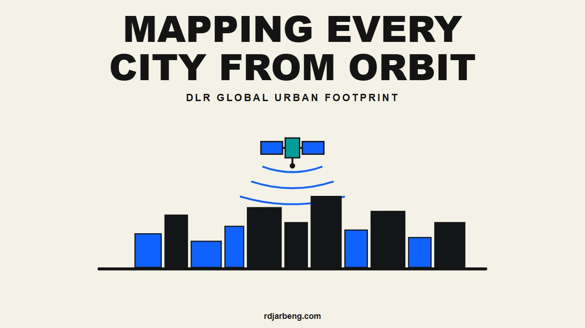

A free worldwide map can show where towns and cities sit and how much land they cover. The Global Urban Footprint (GUF) is one such map. [DLR](https://www.dlr.de/en/eoc), the German Aerospace Center, created it through its Earth Observation Center. The centre includes the [German Remote Sensing Data Center](https://www.dlr.de/en/eoc/about-us/german-remote-sensing-data-center).

## What the Global Urban Footprint provides

[GUF](https://www.dlr.de/en/eoc/research-transfer/projects-missions/global-urban-footprint) is a map of the whole land surface for the reference year 2011, the year the map describes. DLR processed about [180,000 scenes](https://www.dlr.de/en/eoc/research-transfer/projects-missions/global-urban-footprint) from the TerraSAR-X and TanDEM-X radar satellites to build it. A scene is one satellite image. Radar satellites send microwave pulses towards the ground and record the echo that returns. The main product has a resolution of 0.4 arc seconds, a small unit of angle used for map grids. This is about [12 metres near the equator](https://www.dlr.de/en/eoc/research-transfer/projects-missions/global-urban-footprint/guf-data-and-access). Resolution here means the width of one pixel, the smallest square in the image.

The map uses three colours. [Black marks built-up areas, white marks other land, and grey marks places with no coverage, mostly the oceans](https://geoservice.dlr.de/web/maps/eoc:guf:3857). Built-up areas are mainly buildings, the structures of human settlements. [Roads are not mapped](https://geoservice.dlr.de/web/maps/eoc:guf:3857), so wide streets and green spaces inside a city appear as white gaps. Do not read those gaps as empty land.

The detail is fine enough to show [small villages strung along a road or a single farmhouse](https://www.dlr.de/en/eoc/research-transfer/projects-missions/global-urban-footprint). DLR also developed a method to display the networks between settlements, so analysts can compute how central or spread out a place is. The project page lists likely uses, including climate modelling, risk analysis in earthquake and tsunami regions, and monitoring of human impact on ecosystems. The layer can also support studies of how a settlement grew in the past.

The data come as GeoTIFF files. A GeoTIFF is an image file that also stores map coordinates. Each file is a raster, a grid of pixels, and covers a tile of [5 by 5 degrees](https://www.dlr.de/en/eoc/research-transfer/projects-missions/global-urban-footprint/guf-data-and-access). Built-up pixels have the value 255, and all other land has 0. Two versions exist. The 0.4 arc second product, at about 12 metres, is available for scientific research. A 2.8 arc second version is at about 84 metres. Choose the finer version for a city and the coarser one for a whole region.

## Where it has been used

DLR's [project page](https://www.dlr.de/en/eoc/research-transfer/projects-missions/global-urban-footprint) compares GUF with optical satellite imagery, which is ordinary photo-like imagery taken by satellites, for Tokyo, Cairo and Delhi. This shows how the footprint looks at city scale. Checking it against imagery of a city you know is a quick way to judge whether the map fits.

GUF also led to a newer family of maps. DLR explains that GUF was generated from [single-date scenes and commercial imagery](https://www.dlr.de/en/blog/archive/2020/world-settlement-footprint-where-do-humans-live). Commercial imagery is satellite imagery sold by companies, and DLR says its cost prevents regular updates. The team therefore built the World Settlement Footprint (WSF) from free Landsat and Sentinel data, two satellite image series that anyone can download. [WSF 2015 has a 10 metre resolution](https://www.dlr.de/en/blog/archive/2020/world-settlement-footprint-where-do-humans-live). [WSF 2019 also uses Sentinel data at 10 metres](https://www.dlr.de/en/latest/news/2021/04/20211111_the-view-from-space-how-cities-are-growing). [WSF Evolution](https://www.dlr.de/en/latest/news/2021/04/20211111_the-view-from-space-how-cities-are-growing) uses about seven million Landsat images from 1985 to 2015 to show how cities grew each year.

DLR published a WSF 2019 view of [Lubumbashi](https://www.dlr.de/en/latest/news/2021/04/20211111_the-view-from-space-how-cities-are-growing), a city in the Democratic Republic of the Congo. DLR says WSF 2019 and WSF Evolution are used by the World Bank and UN-Habitat, the UN agency for human settlements. It also says they support urban growth analysis in countries that previously had zero or insufficient data.

## How to start using it

The first page to open is the [GUF map on the EOC Geoservice](https://geoservice.dlr.de/web/maps/eoc:guf:3857), which runs in a browser. You can zoom to a city and read the settlement pattern before downloading anything.

The data are [free for scientific and non-commercial use](https://www.dlr.de/en/eoc/research-transfer/projects-missions/global-urban-footprint/guf-data-and-access). To get a copy, read the licence agreement and fill in the order form. Then email guf@dlr.de with the form, your preferred resolution (0.4 or 2.8 arc seconds) and your area of interest. The area can be a country name or the corner coordinates of a bounding box, which is a rectangle drawn around a region. For commercial use, the page directs you to Airbus DS Geo GmbH.

The Geoservice also offers a WMS link. WMS stands for Web Map Service, a standard way to load a map layer into a GIS. A GIS, or geographic information system, is software for stacking and analysing map layers. The [WSF products are free](https://www.dlr.de/en/latest/news/2021/04/20211111_the-view-from-space-how-cities-are-growing) for newer years.

## Conclusion

A free map can show where built-up land was in 2011, and the WSF products carry that record forward to later years. For a city's footprint in one year, start with GUF. For change over time, use WSF. For the wider set of tools and their limits, read [the Earth observation overview](/earth-observations-promise-and-barriers-a-down-to-earth-view/).
