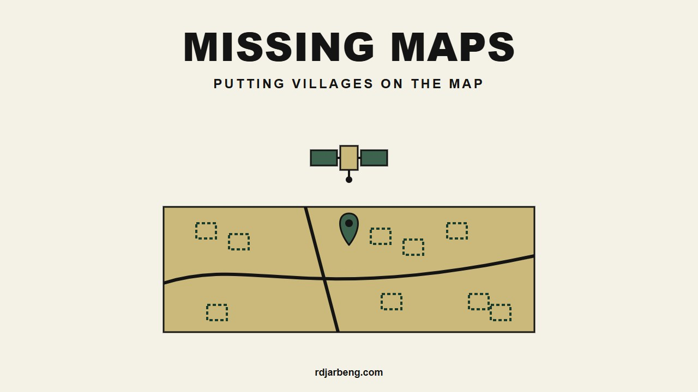

Aid teams need to find villages, roads and buildings on a map before they can reach people in a crisis. [Missing Maps](https://www.missingmaps.org/) is an open, collaborative project in which volunteers map areas where humanitarian organisations work with people at risk of disasters and crises. It is a [collective of organisations](https://www.missingmaps.org/about/), and the Humanitarian OpenStreetMap Team (HOT) is one of its founders. Anyone can take part.

## What Missing Maps provides

All the work feeds into [OpenStreetMap](https://www.openstreetmap.org/), a free map of the world that anyone can edit. Missing Maps adds detail to that shared map rather than running a separate one. Members make their non-sensitive data [free, open and available for use](https://www.missingmaps.org/about/). Contributions to OpenStreetMap are added under the Open Database Licence (ODbL), which sets how the data can be reused.

The [project process](https://www.missingmaps.org/) has three stages. In remote mapping, volunteers trace satellite imagery into OpenStreetMap. In community mapping, local volunteers add detail that cannot be seen from above, such as neighbourhoods, street names and evacuation centres. In use, humanitarian organisations and local communities use the maps to plan risk reduction and disaster response.

Field work has its own [tools](https://www.missingmaps.org/field-mapping/). The Sketch Map Tool lets people print a simple base map, collect local knowledge on paper, scan it and digitise it into OpenStreetMap. This suits low-tech or offline settings. Open Data Kit (ODK) and KoBoToolbox are mobile survey apps designed for humanitarian contexts. The same page advises checking privacy and physical safety before field mapping.

Two tools make remote volunteering easier. [MapSwipe](https://www.missingmaps.org/mapswipe/) is a free, open-source mobile and web app. In a "Find features" project, volunteers swipe through satellite images and select those that contain buildings, roads or waterways. The [HOT Tasking Manager](https://www.missingmaps.org/hot-tasking-manager/) is an open coordination tool that lets many volunteers work on the same area at once. Volunteers lock a task while they edit it, so two people do not edit the same part. Completed tasks are reviewed.

## Where it has been used in Africa

The Democratic Republic of the Congo shows how the work is applied. After an Ebola outbreak was confirmed in Ituri Province on 18 May 2026, the [HOT Eastern and Southern Africa Hub](https://www.missingmaps.org/blog/2026/07/07/17th-ebola-outbreak-in-the-drc-mapping-for-the-response/) worked with local mappers. These included OpenStreetMap RDC and Médecins Sans Frontières (MSF). They launched Tasking Manager projects from 21 May, followed by MapSwipe projects. The main focus was the area around Bunia and Mongbwalu, covering about 22,000 square kilometres. Volunteers updated village locations and mapped residential areas and buildings.

The response used the data for specific tasks. A GIS specialist, someone who works with mapping software, described using OpenStreetMap to optimise the delivery of protective and medical supplies. The map helped identify constraints on road access. Other uses were security planning, such as finding alternative routes, and mapping outbreak hotspots at a small scale. Weekly exports went to the Humanitarian Data Exchange, a shared platform for humanitarian datasets, and the files were downloaded more than 245 times.

Missing Maps also lists a current [project to map buildings in Kano city, Nigeria](https://www.missingmaps.org/projects/). The same model applies wherever the map is thin: split the area into tasks, trace what satellites show, then add local knowledge.

## How to start using it

Nothing here costs money. All the tools are free, and the data is open.

The simplest entry point is [MapSwipe](https://www.missingmaps.org/mapswipe/). Open the app or website and complete the short tutorial.

To draw buildings and roads, go to the [HOT Tasking Manager](https://tasks.hotosm.org/). You need an OpenStreetMap account and a Tasking Manager account. The [first steps guide](https://www.missingmaps.org/hot-tasking-manager/) says the basics take about an afternoon. The guide teaches the iD editor, which runs in the browser. JOSM is a more powerful desktop editor.

A [mapathon](https://www.missingmaps.org/hosting-a-mapathon/) is a session where volunteers get training and map together. The [events calendar](https://www.missingmaps.org/events/) lists upcoming Missing Maps events. The [training materials](https://www.missingmaps.org/training-checklists/) include a step-by-step guide to hosting a mapathon, a JOSM troubleshooting guide and a MapSwipe event toolkit.

## Conclusion

Aid teams cannot easily work with villages, roads or buildings that are missing from the map. Missing Maps fills those gaps with free satellite images and volunteer time, and the result is a shared map that anyone can use. Start with MapSwipe, which needs only a short tutorial. For the wider limits of Earth observation and the role of free imagery, read [the Earth observation overview](/earth-observations-promise-and-barriers-a-down-to-earth-view/).
