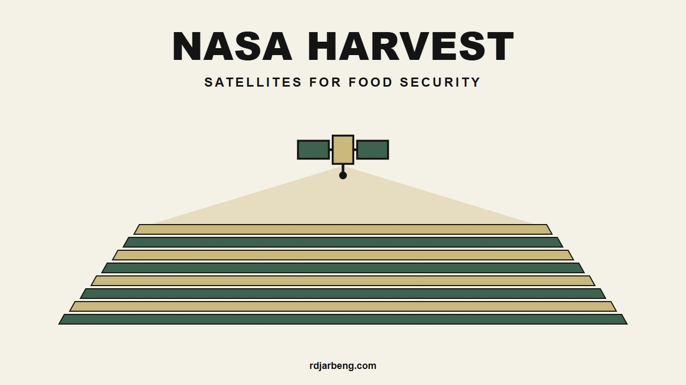

When crops fail, governments and aid groups need to know quickly, while there is still time to act. [NASA Harvest](https://www.nasaharvest.org/) is NASA's global food supply and agriculture consortium, meaning a group of organisations working together. It was [commissioned by NASA in 2017](https://www.nasaharvest.org/about-us). It brings together agriculture experts and remote sensing experts, meaning people who measure the land from satellites. They work with farmers, agribusinesses, economists, humanitarian organisations, governments and technology developers. Its management hub is at the University of Maryland's [Department of Geographical Sciences](https://www.nasaharvest.org/about-us).

Its [stated mission](https://www.nasaharvest.org/about-us) is to advance the adoption of satellite Earth observations by public and private organisations. The aim is to benefit food supply, agricultural production, market stability and human resilience.

## Tools and data for food security

The [Harvest Data Portal](https://data.harvestportal.org/) is the programme's data repository, a store where its datasets can be searched and downloaded. It offers 86 public datasets. Developers can query the datasets through a read-only API, which is a way for software to request data automatically. Users can also connect an AI assistant to search the catalogue.

NASA Harvest uses machine learning, a type of artificial intelligence that learns patterns from examples, to analyse satellite imagery. In its work with partners, the programme applies these methods to produce crop maps and crop yield estimates. A yield estimate is a forecast of how much a crop will produce ([UMD report on Kenya](https://bsos.umd.edu/featured-content/umd-researchers-are-helping-kenya-create-its-own-agricultural-data-infrastructure)).

The programme also runs [Harvest2Market](https://data.harvestportal.org/), which connects crop, trade and food security data.

## Examples of monitoring in Africa

In Kenya, a project called ADAPT-Kenya is building a data system for the national government. The name stands for AI-enabled Data for Agriculture Products and Transformation for Kenya. It is steered by Kenyan government institutions, including the Ministry of Agriculture. The project uses satellite images and AI to produce in-season agricultural data products. These give crop information while the season is still running, for officials, farmers, agribusinesses and insurers. The project is described as a potential model for other countries.

The project is supported by a $4.9 million grant from the Gates Foundation. It also has a $2.5 million in-kind gift from Microsoft's AI for Good Lab, which has a team of AI scientists in Nairobi. An in-kind gift is support given as services or equipment instead of cash ([UMD report on Kenya](https://bsos.umd.edu/featured-content/umd-researchers-are-helping-kenya-create-its-own-agricultural-data-infrastructure)). Kenya's western area is very productive, while much of the rest of the country is more marginal, meaning harder to farm. The project has to work across that variation.

In Ethiopia, NASA Harvest and its partners are [monitoring cropland in Tigray](https://www.nasaharvest.org/news).

## How to start using the resources

The [Harvest Data Portal](https://data.harvestportal.org/) is the place to start. Its public datasets can be searched and downloaded, and the read-only API is available for programmers who want to build new tools.

The programme also offers training. It has [hosted international training in Zambia](https://www.nasaharvest.org/news) for local teams.

## Conclusion

When crops fail, the goal is to give governments, aid groups and farmers information while crops are still growing. That gives them time to act. The portal, the training and the Kenyan project all aim at that goal. For the wider benefits and difficulties of using space tools, read [the Earth observation overview](/earth-observations-promise-and-barriers-a-down-to-earth-view/).
