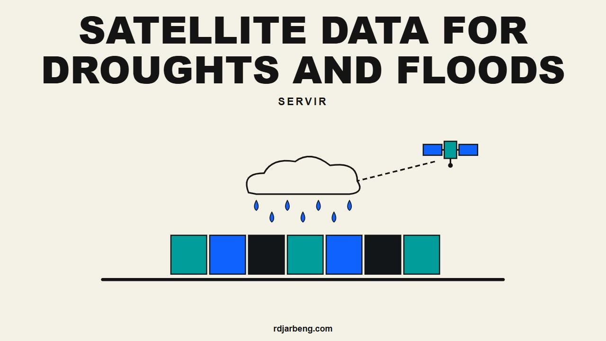

In many regions that SERVIR works in, long-term ground rainfall records are limited. [ClimateSERV's about page](https://climateserv.servirglobal.net/about) says satellite and model rainfall data are then critical for predicting droughts and estimating crop conditions. [SERVIR](https://www.servirglobal.net/about/) turns Earth observation data into services for climate adaptation, disaster resilience, food security and water management. Earth observation data is information collected about the planet, often by satellites.

## History and current status

SERVIR began in 2005 to "connect space to village". It combined NASA's Earth and climate data with the development work of USAID, the US government's aid agency. The [history page](https://www.servirglobal.net/history/) says the NASA and USAID partnership concluded in 2025. The work now continues as the SERVIR Global Collaborative. The history page describes it as an alliance of independent regional hubs, fully owned and led by its regional members.

The [about page](https://www.servirglobal.net/about/) says the Collaborative is led by its independent regional hubs, with SIG-NAL (Spatial Informatics Group, Natural Assets Laboratory) providing technical backbone support. This means the regional hubs now lead the work. The official pages do not state the Collaborative's current funding. The [team page](https://www.servirglobal.net/team/) lists implementing organisations in Africa: CERSGIS in Accra, Ghana; CSE in Dakar, Senegal; ICRISAT in Bamako, Mali; and CIAT in Nairobi, Kenya.

## What SERVIR provides

SERVIR builds decision support with regional institutions. The [what we do page](https://www.servirglobal.net/what/) says the network builds shared digital platforms that bring together Earth observations, scientific models, analytical tools and regional expertise. A scientific model is a computer representation of a system, such as rainfall or crop growth. Its core platforms include Global Risk and Food Security. The Food Security platform monitors agricultural conditions and crop, weather and water information to support production forecasts.

ClimateSERV, for example, delivers map layers, which are one set of data drawn over a map. Users can [view and download](https://climateserv.servirglobal.net/) historical rainfall, vegetation conditions and 180-day rainfall and temperature forecasts. Its [about page](https://climateserv.servirglobal.net/about) says it combines CHIRPS rainfall estimates, NMME seasonal forecasts and NDVI vegetation data. CHIRPS combines satellite rainfall estimates with ground observations. NMME is a seasonal forecast dataset compiled by the National Oceanic and Atmospheric Administration (NOAA). NDVI is an indicator of vegetation health, based on the photosynthetic activity, meaning how much plants use sunlight to grow, that satellites can see.

The [App Center](https://appcenter.servirglobal.net/about/) is an inventory of applications made by regional hubs, partners and SERVIR science teams. Users can filter applications by region or service area, and each detail page gives technical information and credits. The centre says partners make the underlying code available through public repositories, which are online storage locations for code.

SERVIR also uses GeoAI, which its [what we do page](https://www.servirglobal.net/what/) describes as applying artificial intelligence to Earth observation data. Its [about page](https://www.servirglobal.net/about/) lists training and mentorship among its activities.

## Two examples from Africa

ClimateSERV's [about page](https://climateserv.servirglobal.net/about) says Kenya Meteorological Service field offices already use CHIRPS data to guide farmers on climate resilience strategies. Its Kericho office uses CHIRPS to downscale seasonal climate outlooks, which helps farmers choose crop varieties and planting times. Downscaling means making a broad seasonal outlook more local. The example shows a regional forecast reaching the level of individual farms.

The [Charcoal Production Site Monitoring Service](https://appcenter.servirglobal.net/detail/79) is a web platform. It shows where charcoal production sites are in Ghana, to support monitoring of savannah woodland degradation. The page says CERSGIS produces and updates the information with national partner institutions and communities. Degradation here means loss of tree cover or quality. For planners tracking woodland loss, the map shows where the charcoal production sites are.

## How to start

Open the [SERVIR homepage](https://servirglobal.net/) first. It describes regional hubs across Africa, Asia and Latin America, and links to the wider network. For tools, open the [App Center](https://appcenter.servirglobal.net/), which lists applications by region and topic, with a link to each app's details.

For climate and crop questions, open the [ClimateSERV map](https://climateserv.servirglobal.net/map). The [help page](https://climateserv.servirglobal.net/help) explains how to draw an area of interest, which is the place you want to study. You can download it as a GeoJSON file, a common format for map shapes, or upload a JSON area file. ClimateSERV sets a limit of 20 years of data per request. The [ClimateSERV home page](https://climateserv.servirglobal.net/) says users can download charts, summary tables and full datasets.

On access, SERVIR's [about page](https://www.servirglobal.net/about/) lists "sustained partnerships and open access" among what the Collaborative champions. ClimateSERV allows viewing and downloading. The App Center offers a Google sign-in option for its pages.

## Conclusion

Where ground rainfall records are limited, SERVIR's maps, downloads and forecasts give planners something to work with. The network links satellite evidence to local decisions through maps, downloads, tools and training. For the wider background on Earth observation and the barriers that remain, read [the Earth observation overview](/earth-observations-promise-and-barriers-a-down-to-earth-view/).
