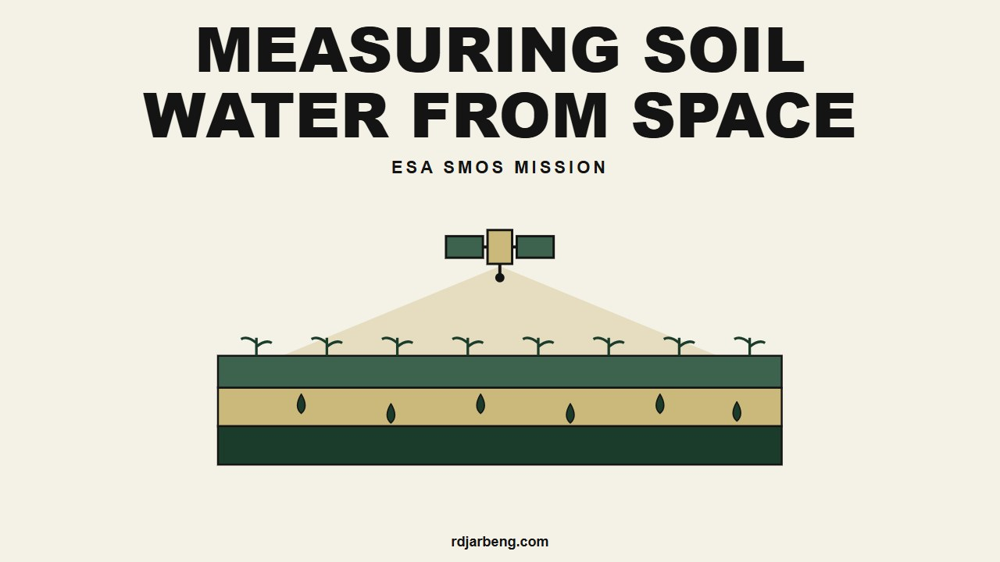

Knowing how wet the soil is can warn of drought before crops suffer. Before SMOS was launched in 2009, there were [relatively few global datasets](https://www.esa.int/articles/about-us/directorates/earth-observation-programmes/futureeo/smos/mapping-moisture) on soil moisture or ocean salinity. Soil moisture is the water held in the top layer of soil. Ocean salinity is the salt content of seawater. [SMOS](https://www.esa.int/missions/about-us/directorates/earth-observation-programmes/futureeo/smos) is the European Space Agency's Soil Moisture and Ocean Salinity mission. It is one of ESA's [Earth Explorer](https://www.esa.int/articles/about-us/directorates/earth-observation-programmes/futureeo/smos/introducing-smos) missions.

## What SMOS provides

SMOS carries one instrument, MIRAS, short for Microwave Imaging Radiometer using Aperture Synthesis. It is a [passive microwave sensor](https://earth.esa.int/eogateway/instruments/miras), so it does not bounce radar off the ground. Instead, it records faint natural microwave emissions, which is energy given off by the surface, at the L-band, a radio frequency of about [1.4 GHz](https://www.esa.int/articles/understanding-ocean-salinity). The instrument has [69 receivers](https://earth.esa.int/eogateway/instruments/miras) and orbits at a [mean altitude of 758 km](https://www.esa.int/missions/about-us/directorates/earth-observation-programmes/futureeo/smos).

The sensor captures "brightness temperature" images. A brightness temperature is not a normal temperature reading. It measures how much microwave energy a patch of ground or sea gives off. That signal changes with the amount of water in soil and salt in seawater.

From these images, SMOS produces [global soil moisture maps every three days](https://www.esa.int/articles/about-us/directorates/earth-observation-programmes/futureeo/smos/introducing-smos). ESA gives the soil moisture accuracy as 4% and the spatial resolution as about 50 km. Spatial resolution is the size of the smallest area the satellite can tell apart. Each SMOS pixel therefore covers a block of land roughly 50 km across.

Over the ocean, SMOS maps [sea surface salinity](https://www.esa.int/articles/about-us/directorates/earth-observation-programmes/futureeo/smos/introducing-smos). ESA states an accuracy of 0.1 practical salinity units (psu) for these readings. The readings are averaged over 10 to 30 days, in areas of about 200 by 200 km. Average seawater is 35 psu, the standard unit for measuring salt in seawater. [ESA describes](https://www.esa.int/articles/understanding-ocean-salinity) this as 35 grams of salt in one litre of water.

ESA says both variables matter for the [water cycle](https://earth.esa.int/eogateway/missions/smos/description), the continuous movement of water between land, air and sea. Soil moisture affects how water and heat move between the land and the atmosphere. Salinity affects the density of seawater, which helps drive ocean circulation.

## Two uses in Africa

In 2011, ESA published [SMOS maps of the Horn of Africa](https://www.esa.int/articles/about-us/directorates/earth-observation-programmes/futureeo/smos/horn-of-africa-drought-seen-from-space) during a severe drought. In Somalia, the satellite showed little or no moisture in surface soil in some key areas between April and July. Crops failed, and millions of people faced food insecurity, meaning they could not reliably get enough food.

A second use addresses gaps in rainfall records. Rain gauges, which are ground instruments that measure rainfall, are sparse across west, central and east Africa. This leaves large gaps in ground-based rainfall data. In a project [reported by ESA in 2022](https://earth.esa.int/eogateway/success-story/smos-data-improve-estimates-of-rainfall-in-africa), scientists used SMOS soil moisture to correct IMERG. IMERG is a NASA rainfall product that estimates rainfall from satellite measurements. The study covered the whole of Africa. The SMOS data almost systematically improved the IMERG estimates, and the corrected product is available in near real time. Better rainfall estimates can support flood forecasting, water resources management and crop yield predictions.

## How to start using SMOS data

SMOS data are [free and open to everyone](https://earth.esa.int/eogateway/missions/smos/data). You still need a free EO Sign In account to download files from ESA's SMOS Online Dissemination Service. The first page to open is the [SMOS data page](https://earth.esa.int/eogateway/missions/smos/data) on ESA's Earth Online portal, which lists the main science products and near-real-time products.

ESA provides tools for reading the files. The [SMOS Toolbox](https://earth.esa.int/eogateway/tools/smos-toolbox) visualises Level-1C and Level-2 products inside the Sentinel Application Platform (SNAP), ESA's software for satellite data. Processing levels describe how far a product has been processed, from raw measurements to finished maps. The [SMOS Data Viewer](https://earth.esa.int/eogateway/tools/smos-data-viewer) gives a quick look at a product and the auxiliary files, meaning supporting files, used to generate it.

At about 50 km per pixel, SMOS shows broad patterns of wet and dry ground, not the condition of one field. For local decisions, it is best used as one layer of evidence alongside rain gauges, farm records and local reports.

## Mission history

SMOS was [launched on 2 November 2009](https://www.esa.int/missions/about-us/directorates/earth-observation-programmes/futureeo/smos). ESA marked its [15-year milestone in orbit](https://www.esa.int/articles/about-us/directorates/earth-observation-programmes/futureeo/smos/from-wildfires-to-ancient-caves-celebrating-15-years-of-smos), far beyond its planned mission duration. ESA also notes that [water shortages can be predicted several weeks before vegetation is likely to suffer](https://www.esa.int/ESA_Multimedia/Images/2016/05/Root-zone_soil_moisture_May_2016).

## Conclusion

SMOS gives a wide view of wet soil and salty seas. It cannot show one field, but ESA notes that water shortages can be predicted several weeks before vegetation suffers. Use it to see broad patterns, and combine it with local measurements. The [Earth observation overview](/earth-observations-promise-and-barriers-a-down-to-earth-view/) looks at that balance in more detail.
